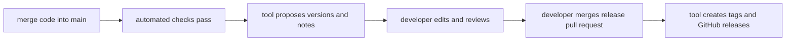
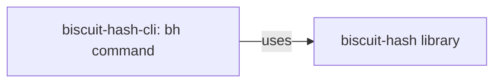

# Releasing a version

This guide explains how to release a package in Rusty Biscuit, edit its release notes, choose
its version number, and handle other packages that depend on it. You need permission to merge
pull requests in this repository. The ordinary release process uses GitHub's website; the
optional command examples assume you are in the repository root.

A **package** is a Rust project with its own `Cargo.toml`, name, and version. A library and its
command-line application are usually separate packages. For example, `biscuit-hash` is the
library and `biscuit-hash-cli` builds the `bh` command. Their versions can differ.

GitHub Actions runs the repository's automated steps, grouped into named **workflows**. This
guide uses the names you will see in GitHub's Actions tab.

Today, releasing creates a Git tag (a name marking a specific source revision) and a GitHub
release page containing release notes and access to the source. It does **not** publish to
crates.io, Homebrew, npm, or PyPI, or build installers for
the general command-line applications. Those distribution steps are planned.

## 1. How do I release a new version?

You release by reviewing and merging a **release pull request**: a proposed change containing
version numbers and changelogs. A tool called release-plz prepares that proposal. You decide
whether its contents are right and when to merge it.

For example, suppose a change to `biscuit-hash` is ready to release:

1. Merge the code change into `main` through an ordinary pull request. Wait for the repository's
   automated checks, shown as **ci** in GitHub Actions, to finish successfully on `main`.
2. Open the repository's **Pull requests** tab and look for a draft pull request with the labels
   **release** and **automated**. It can include several packages. Opening or updating this
   draft is the job named **Create Release PR** in the **Release-plz** Actions workflow.
3. Review its changed files. Check each package version, its changelog, internal dependency
   requirements, and `Cargo.lock`. Edit the proposal if needed; the next sections explain how.
4. When you are satisfied, mark the draft ready for review, let its required checks pass, and
   merge it. Keep the **release** label: that label is what starts publication after the merge.
5. In **Actions → Release-plz**, check that **Publish Release** succeeded. Then open the
   repository's **Releases** page and check the package's tag and release notes.

If the library's approved version is `0.2.0`, its tag is `biscuit-hash-v0.2.0`. If the command-line
package is also released at `0.1.1`, it gets a separate `biscuit-hash-cli-v0.1.1` tag. The command
users run is still named `bh`.

The publishing workflow has no input for selecting just one package. It runs release-plz for
the workspace using the configuration, so review the whole proposal rather than assuming that
editing one package's version limits publication to that package.



Merging ordinary code does not publish a release. Merging a pull request labeled **release**
does start publication; use that label only for an approved release. There is no repository
command such as `just release` that replaces this process.

### What if no release pull request appears?

The process above is configured, but it is not proof that every release calculation succeeds.
Open **Actions → Release-plz**, select the run following the successful checks on `main`, and
inspect **Create Release PR**. A failed calculation leaves no usable proposal. A run can also
stand down when `main` has advanced since the checks it followed; look for the run for the newer
commit. If the tool finds nothing to release, it has no new proposal to open.

To inspect the calculation without publishing anything, open **Actions → Release-plz → Run
workflow**, select the branch, and run it. This starts **Release Dry Run**, which reports the
version and changelog files it would change. It does not create or update a release pull request,
and it does not create tags or publish releases. A successful dry run proves the calculation
worked on that branch; publication is a separate step.

## 2. How are changelogs updated, and why are so many missing?

A `CHANGELOG.md` explains what changed for a package's users. Release-plz is configured to
generate entries as part of the release pull request, using the commits since the package's
previous release. The files become part of `main` when that pull request is merged. They are
not automatically written into every developer's checkout after every commit.

Commit messages provide a starting point. For example:

```text
fix(biscuit-hash): handle empty JSON objects
```

The configured template groups that message under **Bug Fixes**. Messages beginning with `feat`
go under **Features**; `docs`, `perf`, and `refactor` have their own sections too. You should
edit the generated text to explain the user-visible change. The release's GitHub description
comes from the changelog, so edit the file rather than only the pull request's description.

For example, a useful release entry would be:

```markdown
## [0.2.0] - 2026-10-26

### Bug Fixes

- Hashing an empty JSON object now succeeds instead of returning an error.
```

### Where does each changelog belong?

The default is beside the package's `Cargo.toml`. A package can override that location in the
root `release-plz.toml`. That file currently has nine overrides; it is not a list limiting
changelog generation to nine packages.

| Package | Changelog location | Reason |
|---|---|---|
| `biscuit-hash` | `biscuit-hash/lib/CHANGELOG.md` | Default; the file is currently missing |
| `biscuit-hash-cli` | `biscuit-hash/cli/CHANGELOG.md` | Default; the file is currently missing |
| `sniff` | `sniff/lib/CHANGELOG.md` | Explicitly configured; file exists |
| `darkmatter` | `darkmatter/CHANGELOG.md` | Explicitly configured at the area root; file is currently missing |

There is no configured combined changelog for the whole repository. The root `Cargo.lock`
records dependency versions; it is not a substitute for release notes.

### Why are there only ten files today?

The checked-in history shows initial changelog files added with the release setup in January
2026, two Biscuit TUI changelogs added manually in April, and later manual edits to existing
files. That coverage has not expanded to all current packages. Some original paths also moved
or disappeared as the repository changed.

This is incomplete release history, not a deliberate rule that most packages should have no
changelog. Generation must succeed and its changes must be merged before those generated files
appear on `main`. A missing file alone does not identify why a particular package was omitted:
check the release proposal and the calculation's Actions log. Do not assume the automation is
healthy because `changelog_update = true` appears in the configuration.

You can add an entry manually when explaining a change. For a future release, put it under
`## [Unreleased]`; reserve a dated version heading for the release being prepared. Review manual
and generated entries together in the release pull request to avoid duplicate notes.

## 3. Can I choose the version instead of accepting the suggestion?

**Yes. The tool proposes a number; the merged files determine the released version.** You can
edit the release pull request before merging it. The publication step reads those versions;
it does not choose another number during publication.

Semantic versioning uses `major.minor.patch`, such as `1.4.2`. For a stable `1.x` package, a fix
normally changes the patch number, a compatible feature the minor number, and a breaking change
the major number. For the repository's common `0.x` versions, a breaking change normally moves
to the next minor series, for example `0.1.4` to `0.2.0`.

The tool uses commit messages to suggest updates. With the current defaults, a `feat` message
does not necessarily advance a `0.x` package to the next minor series. Automatic API compatibility
checks are disabled here, so the suggested number does not prove that an update is compatible.

### Example: choose `0.2.0` instead of the proposed `0.1.1`

First check out the release pull request's branch, starting from a clean checkout. With the
GitHub CLI, replace `123` with that pull request's number and run this from the repository root:

```sh
gh pr checkout 123
```

Make the following edits on that branch:

1. Set `[package] version = "0.2.0"` in `biscuit-hash/lib/Cargo.toml`.
2. Change the new release heading in `biscuit-hash/lib/CHANGELOG.md` to `0.2.0` and explain any
   breaking changes and how callers should adapt.
3. Review packages that depend on this library. Update their declared version requirements
   where present, adapt callers if necessary, and review the resulting `Cargo.lock` changes.
4. Commit and push the edits to the same pull request, using the normal repository workflow.
   Recheck its files and test results before merging.

If you have release-plz installed, its
[`set-version` command](https://release-plz.dev/docs/usage/set-version) edits the package version
and its configured changelog together. Run this from the repository root on that same branch:

```sh
release-plz set-version biscuit-hash@0.2.0
```

This edits local files; it does not publish anything. Still inspect dependency requirements and
`Cargo.lock`. For several intentional version choices, list each package explicitly:

```sh
release-plz set-version biscuit-hash@0.2.0 biscuit-hash-cli@0.1.1
```

These are examples, not required next versions.
The versions, changelog files, and lockfile changes should all be visible in its **Files changed** tab.

You may leave the draft open while preparing a release. New changes on `main` can cause the tool
to update or replace its proposal, so review the final files again after that happens. There is
currently no repository setting that permanently pins a chosen next version across every future
calculation.

## 4. What happens to packages that depend on the changed package?

There are two different jobs here: building packages together inside this checkout, and making
released packages usable without the checkout. The first works through local paths today; the
second still needs packaging work. Do not assume that a successful local build proves a package
can be released independently.

For example, the `bh` command depends on the `biscuit-hash` library:



Its current dependency is declared in `biscuit-hash/cli/Cargo.toml` as:

```toml
biscuit-hash = { path = "../lib", features = ["xx_hash", "blake3", "argon2id"] }
```

Cargo builds the library from that directory. This declaration contains no version requirement,
so it does not express which separately released library versions the command supports.
If the library's API changes, the command must be adapted and tested with it.

### What release-plz can manage

For packages with versioned internal dependencies, release-plz can update those requirements,
include affected dependent packages in its release proposal, and update the root lockfile. You
review that proposed set together. Packages have independent versions; there is no configured
single version number for the entire repository.

For example, a library could need `0.2.0` for a breaking Rust API change while the command needs
only `0.1.1` if its command-line behavior remains compatible. Releasing the library does not mean
every other package must also become `0.2.0`.

### What is still missing here

Many internal dependencies have only `path`, like the example above. Cargo requires a version
alongside that path when packaging such dependencies for crates.io. Release calculations can
also encounter this obstacle when they use Cargo's packaging step to compare source changes.
Disabling crates.io publication does not make path-only dependencies publishable.

For a library released at `0.2.0`, the versioned declaration would look like this:

```toml
biscuit-hash = { path = "../lib", version = "0.2.0", features = ["xx_hash", "blake3", "argon2id"] }
```

This is an example of the packaging change needed, **not the declaration currently in place**.
The path keeps local development working; the version describes the allowed released dependency.
See [Cargo's explanation of combining paths and versions](https://doc.rust-lang.org/cargo/reference/specifying-dependencies.html#multiple-locations).

For an eventual crates.io release, the library must be available there before its command-line
package can use that published version. Some local package names also belong to unrelated projects
on crates.io, and optional dependencies or files outside a package can prevent publication.
Those problems must be resolved before enabling registry publication. The current workflow does
not perform that migration or publish the chain to a registry.

When reviewing a release now, check the changed library, the packages that use it, their version
requirements where present, their tests, and the lockfile together. Keep an incomplete or failing
proposal in draft rather than treating a proposed version number as proof the chain is ready.

## Where to look next

The files below answer different questions; you do not need to understand all of them to review
a release proposal:

- [`release-plz.toml`](../release-plz.toml) controls package exclusions, changelog locations, and
  whether the tool creates tags or publishes to a registry.
- [`release-plz.yml`](../.github/workflows/release-plz.yml) defines when GitHub runs the preparation,
  publication, and dry-run steps.
- [CI/CD](topics/ci-cd.md) explains how the automated checks run before release preparation.
- [release-plz in CI](cicd/release-plz-ci.md) explains the tool in more detail. Its general examples
  include publishing capabilities that this repository has not enabled.
- The tool's [guide to editing a release pull request](https://release-plz.dev/docs/faq#can-i-edit-the-release-pr-before-merging-it)
  describes manual version and changelog changes.
