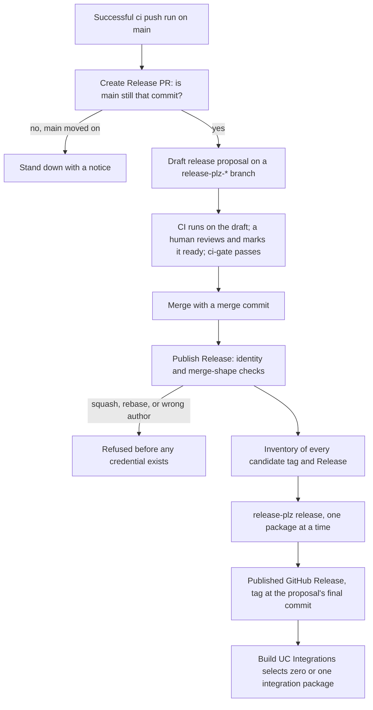
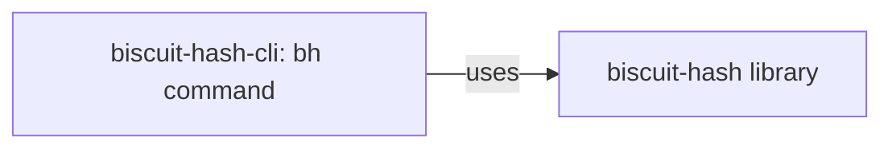

# Releasing a version

This guide explains how to release a package in Rusty Biscuit: the one-time setup the release
automation needs, how to cut a release, how to recover when publication fails, and how to test the
release calculation from a branch. It also covers editing release notes, choosing version numbers,
and handling packages that depend on each other. You need permission to merge pull requests in this
repository; the one-time setup needs the repository owner. The ordinary release process uses
GitHub's website; the optional command examples assume you are in the repository root.

A **package** is a Rust project with its own `Cargo.toml`, name, and version. A library and its
command-line application are usually separate packages. For example, `biscuit-hash` is the
library and `biscuit-hash-cli` builds the `bh` command. Their versions can differ.

GitHub Actions runs the repository's automated steps, grouped into named **workflows**, each made
of **jobs**. This guide uses the names you will see in GitHub's Actions tab: the **Release-plz**
workflow holds the three release jobs **Create Release PR**, **Publish Release**, and **Release Dry
Run**.

Today, releasing creates a Git tag (a name marking a specific source revision) and a GitHub
Release page containing release notes and access to the source. It does **not** publish to
crates.io, npm, or PyPI. A separate workflow attaches prebuilt binaries, installers, and Homebrew
formulas for approved command-line packages (see [Binary distribution](#binary-distribution)), but
no package is approved yet, so those remain **planned** for users. The only binaries built today are
the archives for three home-automation integrations (see
[Integration archives](#7-integration-archives)).

> **Current state.** Only `sniff-detection-cli` and `git-wt-cli` are eligible for release
> ([why](#the-temporary-two-package-restriction)).

## 1. How a release flows

A release is a reviewed pull request. A tool called [release-plz](https://release-plz.dev) reads
the commits since each package's last release, proposes new version numbers and changelog entries,
and opens a **release proposal**: a draft pull request containing only those edits. You review and
merge it; merging it is what publishes.



A few GitHub terms used throughout:

- **`workflow_run` trigger.** One workflow can start when another finishes. **Create Release PR**
  starts each time the **Continuous integration** workflow (`ci.yml`, called `ci` below) completes.
  It acts only when that `ci` run was a successful
  run for a push to `main`; for anything else it records a notice and does nothing. GitHub runs a
  `workflow_run` job from the copy of the workflow file on `main`, not from the commit being
  judged, so edits to that job take effect only once merged.
- **Draft pull request.** A pull request marked as not ready to merge. CI still runs on it; a
  person must click **Ready for review** before it can be merged. Release proposals always open
  as drafts, labeled **release** and **automated**.
- **GitHub App installation token.** A GitHub App is an identity a repository owner creates and
  installs on chosen repositories with chosen permissions. A workflow holding the App's private key
  can exchange it for an installation token: a credential that lasts at most an hour, works only
  on the repositories the App is installed on, and carries only the permissions requested. The
  release jobs mint one immediately before the step that writes and GitHub revokes it when the
  job ends. Every other step uses the workflow's own token, which can only read.

Merging ordinary code does not publish a release, and there is no repository command such as
`just release` that replaces this process.

## 2. Set up the release App

This is a one-time task for the repository owner. Until it is done, both writing release jobs stop
with a configuration error.

### Why an App instead of the workflow's own token

Two reasons. GitHub does not start new workflow runs for pull requests or Releases created with a
workflow's built-in token, so a proposal opened that way would get no CI run (and so no
`ci-gate`), and a Release published that way would never start the integration build. Changes made
with an App's token do start workflows. Second, publication proves a merged proposal came from the
release automation by checking that the pull request's author is the App's bot account, which a
person cannot impersonate.

### Create and install the App

1. Create a GitHub App owned by the repository owner (**Settings → Developer settings → GitHub
   Apps → New GitHub App**). It needs no webhook; untick **Active** under **Webhook**. Choose
   **Only on this account** for where it can be installed.
2. Grant exactly these **repository permissions** and nothing else:

   | Permission | Access | Why |
   |---|---|---|
   | Contents | Read and write | push the proposal branch, create tags and Releases |
   | Pull requests | Read and write | open and update the release proposal |
   | Metadata | Read-only | required by GitHub for every App |

3. After creating it, note the **App ID** on its **General** page (a number, not the Client ID) and
   generate a **private key**, which downloads a `.pem` file.
4. Install the App (**Install App** in the App's settings) and choose **Only select repositories →
   rusty-biscuit**. The jobs request a token for this one repository only, but installing it more
   widely would still let the key reach other repositories.
5. Find the App's bot login. It is the App's slug (the name in its URL,
   `github.com/apps/<slug>`) followed by `[bot]`, for example `my-app[bot]`.

### Store the configuration in the repository

In **Settings → Secrets and variables → Actions**, add:

| Name | Kind | Value |
|---|---|---|
| `RELEASE_APP_ID` | variable | the App ID |
| `RELEASE_APP_PRIVATE_KEY` | secret | the whole contents of the `.pem` file |
| `RELEASE_APP_BOT_LOGIN` | variable | the exact bot login, including `[bot]` |

With the GitHub CLI, the same setup looks like this (example values):

```sh
gh variable set RELEASE_APP_ID --body 123456
gh variable set RELEASE_APP_BOT_LOGIN --body 'my-app[bot]'
gh secret set RELEASE_APP_PRIVATE_KEY < ~/Downloads/my-app.private-key.pem
# The jobs look the bot up by this login; it must answer with a numeric id.
gh api '/users/my-app%5Bbot%5D' --jq .id
```

Delete the downloaded `.pem` file once the secret is stored.

Leave the repository's existing pull-request settings and branch protections as they are. The App
needs no bypass of the `main` ruleset and no change to **Allow GitHub Actions to create and approve
pull requests**; its proposals go through the same required `ci-gate` check and human merge as any
other pull request.

### Configuration errors and what they mean

The release jobs check the configuration before any credential is minted. There is never a
fallback to the workflow's own token. The job's annotation (titled `release path`) prints one of:

| Message | Fix |
|---|---|
| `release App: not configured: repository variable RELEASE_APP_ID, repository secret RELEASE_APP_PRIVATE_KEY, repository variable RELEASE_APP_BOT_LOGIN (see docs/releases.md)` | Add every item the message lists; it names only the missing ones. |
| `RELEASE_APP_BOT_LOGIN: repository variable is not set; set it to the release App's bot login, including the [bot] suffix (see docs/releases.md)` | Shown by **Publish Release**, which needs the login to check the proposal's author, and by **Create Release PR**, which commits the proposal as the bot. Add the variable. |
| `RELEASE_APP_BOT_LOGIN: must be the App's bot login ending in [bot], found 'my-app'` | Set the full login, `my-app[bot]`. |
| `pull_request.user.login: must be the release App 'my-app[bot]', found '…'` | The merged pull request was not opened by the configured App. Either the variable names the wrong App or the proposal did not come from the automation; it is not published. |
| `GET users/my-app[bot]: unexpected HTTP 404` | The login does not exist; check the slug. |

Only events that would actually prepare or publish a release reach these checks. An unrelated pull
request or a failed `ci` run is a successful no-op whatever the configuration.

## 3. Cut a release

For example, suppose changes to `git-wt-cli` (the `wt` command) and `sniff-detection-cli` are ready
to release:

1. Merge the code changes into `main` through ordinary pull requests. Wait for the **ci** workflow
   to finish successfully on `main`.
2. **Create Release PR** then checks that `main` is still the commit `ci` validated, and opens or
   updates the release proposal. Open the **Pull requests** tab and find the draft with the labels
   **release** and **automated**, on a branch named `release-plz-…`. It can include several
   packages.
3. CI runs on the draft automatically. Review its changed files: each package version, its
   changelog, internal dependency requirements, and `Cargo.lock`. Edit the proposal if needed; the
   sections below on [changelogs](#4-edit-the-changelog) and [versions](#5-choose-the-version)
   explain how.
4. When you are satisfied, click **Ready for review**. Marking it ready does not start a new CI
   run; the result already reported for the draft's latest commit counts. `ci-gate` is the
   required check and must pass.
5. Merge with **Create a merge commit**. Keep the **release** label: it is part of what identifies
   the merge as a release. A squash or rebase merge is refused before any credential is minted,
   because only a merge commit's second parent proves which reviewed commit the tags must point at.
6. In **Actions → Release-plz**, check that **Publish Release** succeeded. Its job summary shows
   the release inventory: each package, its tag, its state, and the Release link. Then open the
   repository's **Releases** page and check the tags and release notes.

If `git-wt-cli`'s approved version is `0.2.0`, its tag is `git-wt-cli-v0.2.0`. The command users run
is still named `wt`.

### What publication checks, and why

Before minting a credential, **Publish Release** checks that the closed pull request was merged
into `main` from a `release-plz-` branch, carries the **release** label, was opened by the App's
bot account, and lives in this repository rather than a fork. It then checks the merge's shape:
exactly two parents, the second being the proposal's final commit.

Each tag points at that **final reviewed commit of the proposal**, not at the merge commit and
never at a later `main`. The job checks out the merge commit named by the event, never the current
`main`, so a push that lands while publication runs cannot change what is released. The packages
it releases are the ones whose version the proposal itself changed, measured from where the
proposal branched off `main` to its final commit; changes made on `main` meanwhile do not add or
hide a package.

The publishing workflow has no input for selecting just one package. It releases every eligible
package whose version the proposal changed, so review the whole proposal.

### The temporary two-package restriction

Only `sniff-detection-cli` and `git-wt-cli` are eligible right now. `release-plz.toml` sets
`release = false` for the workspace and `release = true` for those two packages. This limits how
many permanent tags the first release through this path can create, while the path has never yet
succeeded end to end.

While the restriction holds:

- the proposal is expected to bump **exactly** those two packages. **Publish Release** refuses a
  proposal that bumps only one of them, or any other package, before writing anything:
  `proposal: must bump exactly ['git-wt-cli', 'sniff-detection-cli']; unexpected […], missing […]`;
- **Create Release PR** fails if release-plz's proposal names any other package. By then the
  proposal is already open; close it rather than merge it.

Restoring workspace-wide eligibility is a separate, later change, made only after the first
release's tags and GitHub Releases have been verified.

### What if no release proposal appears?

Open **Actions → Release-plz**, select the run that followed the successful **Continuous integration** run on `main`, and
inspect **Create Release PR**:

- **A notice `main advanced from … to …`.** `main` moved on after `ci` validated that commit. The
  run stands down on purpose; the newer commit's own `ci` run prepares the proposal.
- **A notice that the event does not prepare releases.** The `ci` run failed, was for a pull
  request or the nightly schedule, or ran on another branch. Only successful push runs on `main`
  prepare releases.
- **A configuration error.** See [the table above](#configuration-errors-and-what-they-mean).
- **A failed `release-plz release-pr` step.** The calculation failed and no usable proposal exists.
  Run the [dry run](#8-prove-the-calculation-from-a-branch) to get its full diagnostics.
- **Success with `packages: none (nothing to release)` in the summary.** Nothing has changed since
  the last release.

### Binary distribution

Publishing a Release also starts the **Distribute binaries** workflow. For a package that
[`docs/deployment.yaml`](deployment.yaml) approves, it builds the tagged commit for macOS and Linux
and attaches the archives, a shell installer, and checksums to the Release this guide created; for
any other package it does nothing. The Release therefore briefly has notes but no binaries. Approval
must already be in the tagged commit, so it is merged before the release, usually inside the
release proposal itself.

[Distributing prebuilt binaries](distribution.md) explains approval, the rollout ledger, what to do
when a distribution run fails, and how users install the results.

## 4. Edit the changelog

A `CHANGELOG.md` explains what changed for a package's users. Release-plz is configured to
generate entries as part of the release proposal, using the commits since the package's previous
release. The files become part of `main` when that proposal is merged. They are not automatically
written into every developer's checkout after every commit.

Commit messages provide a starting point. For example:

```text
fix(biscuit-hash): handle empty JSON objects
```

The configured template groups that message under **Bug Fixes**. Messages beginning with `feat`
go under **Features**; `docs`, `perf`, and `refactor` have their own sections too. You should
edit the generated text to explain the user-visible change. The Release's GitHub description
comes from the changelog, so edit the file rather than only the pull request's description.

For example, a useful release entry would be:

```markdown
## [0.2.0] - 2026-10-26

### Bug Fixes

- Hashing an empty JSON object now succeeds instead of returning an error.
```

### Where does each changelog belong?

The default is beside the package's `Cargo.toml`. A package can override that location in the
root `release-plz.toml`. That file currently has ten overrides; it is not a list limiting
changelog generation to ten packages.

| Package | Changelog location | Reason |
|---|---|---|
| `biscuit-hash` | `biscuit-hash/lib/CHANGELOG.md` | Default; the file is currently missing |
| `biscuit-hash-cli` | `biscuit-hash/cli/CHANGELOG.md` | Default; the file is currently missing |
| `sniff` | `sniff/lib/CHANGELOG.md` | Explicitly configured; file exists |
| `git-wt-cli` | `worktree/cli/CHANGELOG.md` | Explicitly configured; file is created by its first release proposal |
| `darkmatter` | `darkmatter/CHANGELOG.md` | Explicitly configured at the area root; file is currently missing |

There is no configured combined changelog for the whole repository. The root `Cargo.lock`
records dependency versions; it is not a substitute for release notes.

### Why are there only ten files today?

The checked-in history shows initial changelog files added with the release setup in January
2026, two Biscuit TUI changelogs added manually in April, and later manual edits to existing
files. That coverage has not expanded to all current packages. Some original paths also moved
or disappeared as the repository changed.

This is incomplete release history, not a deliberate rule that most packages should have no
changelog. Generation must succeed and its changes must be merged before those generated files
appear on `main`. A missing file alone does not identify why a particular package was omitted:
check the release proposal and the calculation's Actions log. Do not assume the automation is
healthy because `changelog_update = true` appears in the configuration.

You can add an entry manually when explaining a change. For a future release, put it under
`## [Unreleased]`; reserve a dated version heading for the release being prepared. Review manual
and generated entries together in the release proposal to avoid duplicate notes.

## 5. Choose the version

**The tool proposes a number; the merged files determine the released version.** You can
edit the release proposal before merging it. Publication reads the versions at the proposal's
final commit; it does not choose another number.

Semantic versioning uses `major.minor.patch`, such as `1.4.2`. For a stable `1.x` package, a fix
normally changes the patch number, a compatible feature the minor number, and a breaking change
the major number. For the repository's common `0.x` versions, a breaking change normally moves
to the next minor series, for example `0.1.4` to `0.2.0`.

The tool uses commit messages to suggest updates. With the current defaults, a `feat` message
does not necessarily advance a `0.x` package to the next minor series. Automatic API compatibility
checks are disabled here, so the suggested number does not prove that an update is compatible.

### Example: choose `0.2.0` instead of the proposed `0.1.1`

This example uses the `biscuit-hash` library because it has dependents; while the
[two-package restriction](#the-temporary-two-package-restriction) holds, apply the same steps to
`git-wt-cli` (`worktree/cli/Cargo.toml` and `worktree/cli/CHANGELOG.md`).

First check out the release proposal's branch, starting from a clean checkout. With the GitHub
CLI, replace `123` with that pull request's number and run this from the repository root:

```sh
gh pr checkout 123
```

Make the following edits on that branch:

1. Set `[package] version = "0.2.0"` in `biscuit-hash/lib/Cargo.toml`.
2. Change the new release heading in `biscuit-hash/lib/CHANGELOG.md` to `0.2.0` and explain any
   breaking changes and how callers should adapt.
3. Review packages that depend on this library. Update their declared version requirements
   where present, adapt callers if necessary, and review the resulting `Cargo.lock` changes.
4. Commit and push the edits to the same pull request, using the normal repository workflow.
   Recheck its files and test results before merging. Your commits become part of the proposal's
   final commit, which is what gets tagged.

If you have release-plz installed, its
[`set-version` command](https://release-plz.dev/docs/usage/set-version) edits the package version
and its configured changelog together. Run this from the repository root on that same branch:

```sh
release-plz set-version biscuit-hash@0.2.0
```

This edits local files; it does not publish anything. Still inspect dependency requirements and
`Cargo.lock`. For several intentional version choices, list each package explicitly:

```sh
release-plz set-version biscuit-hash@0.2.0 biscuit-hash-cli@0.1.1
```

These are examples, not required next versions.
The versions, changelog files, and lockfile changes should all be visible in its **Files changed** tab.

You may leave the draft open while preparing a release. New changes on `main` can cause the tool
to update or replace its proposal, so review the final files again after that happens. There is
currently no repository setting that permanently pins a chosen next version across every future
calculation.

## 6. Handle packages that depend on the changed package

There are two different jobs here: building packages together inside this checkout, and making
released packages usable without the checkout. The first works through local paths today; the
second still needs packaging work. Do not assume that a successful local build proves a package
can be released independently.

For example, the `bh` command depends on the `biscuit-hash` library:



Its current dependency is declared in `biscuit-hash/cli/Cargo.toml` as:

```toml
biscuit-hash = { path = "../lib", features = ["xx_hash", "blake3", "argon2id"] }
```

Cargo builds the library from that directory. This declaration contains no version requirement,
so it does not express which separately released library versions the command supports.
If the library's API changes, the command must be adapted and tested with it.

### What release-plz can manage

For packages with versioned internal dependencies, release-plz can update those requirements,
include affected dependent packages in its release proposal, and update the root lockfile. You
review that proposed set together. Packages have independent versions; there is no configured
single version number for the entire repository.

For example, a library could need `0.2.0` for a breaking Rust API change while the command needs
only `0.1.1` if its command-line behavior remains compatible. Releasing the library does not mean
every other package must also become `0.2.0`.

### What is still missing here

Many internal dependencies have only `path`, like the example above. Cargo requires a version
alongside that path when packaging such dependencies for a registry. The pinned release-plz no
longer packages the workspace to calculate versions, so the release calculation does not need
those versions; enabling crates.io publication later would.

For a library released at `0.2.0`, the versioned declaration would look like this:

```toml
biscuit-hash = { path = "../lib", version = "0.2.0", features = ["xx_hash", "blake3", "argon2id"] }
```

This is an example of the packaging change needed, **not the declaration currently in place**.
The path keeps local development working; the version describes the allowed released dependency.
See [Cargo's explanation of combining paths and versions](https://doc.rust-lang.org/cargo/reference/specifying-dependencies.html#multiple-locations).

For an eventual crates.io release, the library must be available there before its command-line
package can use that published version. Some local package names also belong to unrelated projects
on crates.io, and optional dependencies or files outside a package can prevent publication.
Those problems must be resolved before enabling registry publication. The current workflow does
not perform that migration or publish the chain to a registry.

When reviewing a release now, check the changed library, the packages that use it, their version
requirements where present, their tests, and the lockfile together. Keep an incomplete or failing
proposal in draft rather than treating a proposed version number as proof the chain is ready.

## 7. Integration archives

The **Build UC Integrations** workflow starts whenever a GitHub Release is published. It builds
something only when the Release's tag is exactly `{package}-v{version}` for one of
`arcam-amp-integration`, `eversolo-integration`, or `sony-receiver-integration`, with a valid
semantic version (prerelease and build suffixes are allowed). Any other Release, including every
release of the two currently eligible packages, selects nothing and no build starts.

For a matching tag, for example `eversolo-integration-v0.3.0`, it checks out the commit that tag
names, cross-compiles that one package for `aarch64-unknown-linux-musl`, and uploads
`eversolo-integration-aarch64.tar.gz` (the binary, plus the package's `driver.json` when it has
one) to that same Release.

## 8. Prove the calculation from a branch

The **Release Dry Run** job runs the same release-plz version as the publishing jobs, computes the
next versions, and reports what it would change. It never publishes: it has no App credentials, its
token can only read, and it creates no branch, pull request, tag, or Release. Use it to check a
branch's release configuration before merging, or to diagnose a failed **Create Release PR**.

Unlike the other two jobs, the dry run uses the workflow file from the branch you choose, so it
also tests edits to the dry-run job itself.

1. Push your branch.
2. Open **Actions → Release-plz → Run workflow**, choose the branch, and click **Run workflow**.
3. Open the run's **Release Dry Run** job. Its summary shows the diagnostics before and after the
   calculation and a **Release calculation result** listing each version change
   (`` `git-wt-cli`: 0.1.0 → 0.1.1 ``) and the files it edited or created.
4. Download the artifact `release-dry-run-{run id}-{attempt}` from the run's page for the details.

| File in the artifact | Contents |
|---|---|
| `before.json`, `after.json` | diagnostics: source commit, branch and upstream, tool and Git versions, effective Git settings, tracked and untracked changes |
| `git-trace.log` | every Git command release-plz ran |
| `update.stdout.log`, `update.stderr.log` | release-plz's own output; read the end of `update.stderr.log` first when the calculation fails |
| `update.diff` | the edits the calculation made to tracked files |
| `untracked.txt` | new files it created, such as a first changelog |
| `calculation.json` | version changes by package, unexpected packages, and edited files; written only when the calculation itself succeeded |

### Why the calculation adds a Git attributes file

To compare versions, release-plz checks out older commits in its own temporary copy of the
repository. `scripts/init.ps1` is older than `.gitattributes`, so a checkout made under the
`*.ps1 text eol=crlf` rule leaves a CRLF copy that, at a commit before the rule existed, no
longer matches the stored file. Git then refuses the next checkout ("Your local changes … would
be overwritten by checkout: scripts/init.ps1").

Both the dry run and **Create Release PR** therefore run release-plz through
`scripts/ci/release_path.py`, which gives that one process a temporary attributes file
(`core.attributesFile`, set through `GIT_CONFIG_COUNT`) holding the same `*.ps1` rule. At commits
that have `.gitattributes`, that file wins, so current trees are checked out exactly as before.
Your checkout, `.gitattributes`, and your Git configuration never change, and PowerShell users
see no difference. The file is written outside the checkout and removed afterwards, so the
clean-tree checks still see everything release-plz writes. Publication does not use it: it only
checks out the proposal's final commit, which has `.gitattributes`.

A failed calculation keeps the job red; the diagnostics and the artifact are still produced. The
job also fails when the calculation bumps a package outside the
[eligible set](#the-temporary-two-package-restriction). A summary saying `no package version
changed` means the run succeeded but proves nothing about a release.

### Why the release tool is a patched build

Every release job runs release-plz 0.4.3 built from its upstream source with one small patch that
lives in this repository. The patch lets release-plz find a package that was **renamed** after its
last release.

To work out what changed since a package's last release, release-plz finds the package's newest
`{package}-v{version}` tag, rebuilds the workspace as it was at that tag's commit, and looks the
package up there. Unpatched, it looks only for the package's **current** name. It does this for
every workspace package, including packages that are not eligible for release.

Three packages were renamed on 2026-10-03 (`sniff-cli` to `sniff-detection-cli`, `worktree-cli` to
`git-wt-cli`, and `dmls` to `darkmatter-lsp`), and their `…-v0.1.0` tags point at an earlier commit
where only the old names exist:

```sh
git rev-list -n 1 git-wt-cli-v0.1.0                       # 907cd6e4…
git show 907cd6e4:worktree/cli/Cargo.toml | grep '^name'  # name = "worktree-cli"
```

An unpatched 0.4.3 therefore stops with `cannot find package "git-wt-cli" in workspace …`. A
published tag is never moved, so the tool is patched instead. When the current name is not in the
rebuilt workspace, the patched tool picks the package whose `Cargo.toml` is at the same path
relative to the workspace root (`worktree/cli/Cargo.toml` is `worktree-cli` at the tag and
`git-wt-cli` today). A match on the current name still comes first. If neither the name nor the
path matches, the calculation still fails; the package is never treated as released for the first
time. The `Cargo.lock` comparison finds the package the same way.

`.github/actions/setup-release-plz`, the one setup step all three jobs use, makes the build
reproducible:

1. It downloads the source archive of the upstream tag `release-plz-v0.4.3` and refuses it unless
   its SHA-256 matches the one pinned in the action.
2. It applies `release-plz-0.4.3-historical-manifest-path.patch`, stored next to the action, with
   `git apply`, which fails rather than guess if any part of the patch does not fit.
3. It runs the patch's own unit tests, builds with `cargo build --locked` (the exact dependency
   versions upstream committed) on the toolchain in `rust-toolchain.toml`, and checks that the
   binary reports `release-plz 0.4.3`.
4. It saves the binary in the GitHub Actions cache. The cache key contains the version, the archive's
   SHA-256, a hash of the patch file, the toolchain, and the runner's operating system and
   architecture, so any change to an input builds again. Later runs restore the binary instead of
   building it; a binary is saved only after its tests and version check pass.

There is no fallback to a prebuilt or unpatched release-plz. When an upstream release finds renamed
packages on its own, delete the patch file, replace the build steps with a pinned install of that
release, and update the version in the action and its contract tests
(`tools/test-toolkit/tests/ci_workflow_contracts.rs`). Re-read the two behaviors described in
[Why `recovery` depends on the release-plz version](#why-recovery-depends-on-the-release-plz-version)
in the new version first. The patch changes only how a package's last release is found; it does
not touch publication.

## 9. Recover a failed publication

Tags are permanent: once published, a tag is never moved or deleted by the automation. Recovery is
therefore built around one rule. **Re-run the original Publish Release workflow run** (open it,
then **Re-run jobs**). That run is tied to its merge commit, so a re-run releases exactly what the
merge approved, even if `main` has moved on. Do not make a new merge, push a new tag, or create the
Release by hand with `gh release create`.

### Read the inventory

**Publish Release** records the state of every candidate package before it writes anything, and
again after. The job summary shows it as a table, and the artifact
`release-publication-{run id}-{attempt}` holds the JSON (`inventory-before.json` and
`publication.json`, which adds the failures and the exit status). Each report names the workflow
run, the merge commit, and the proposal's final commit that every tag must point at.

| State | Meaning | What a re-run does |
|---|---|---|
| `new` | neither the tag nor the Release exists | creates both with release-plz |
| `recovery` | the tag exists at the right commit, its Release does not | creates only the Release with release-plz; the tag is not touched |
| `complete` | the tag is at the right commit and its Release is published | nothing |
| `ERROR: …` | a state the automation refuses to repair | stops; see below |

Packages are released one at a time. If the second package fails, the first stays released and the
inventory shows it `complete`; the re-run skips it and continues. A re-run of a fully complete
publication writes nothing. The job's exit status is the first failing release-plz exit status, so
a failure is never reported as some other error.

### States the automation refuses

Before any write, publication stops if any candidate is in one of these states:

- `tag … points at …, not the proposal's final commit …; a published tag is never moved`. A tag of
  that name already exists elsewhere. That version cannot be released from this proposal; release
  a new version through a new proposal.
- `a Release exists for … but its tag does not`, or `an unexpected draft Release exists for …`.
  Something outside the automation created the Release. Find out how before changing it; once the
  stray Release is resolved, re-run the original run.
- Any GitHub API answer other than success or "not found" (for example a `403` or a timeout). It is
  never read as "absent". Re-run once GitHub is reachable.

The first inventory runs with the workflow's read-only token, which cannot see draft Releases. The
check that gates writing is repeated with the App's token, which can, so a draft Release is caught
there.

### Why `recovery` depends on the release-plz version

Release-plz has no "create only the missing Release" command, so `recovery` relies on two
behaviors of the pinned version, 0.4.3, read from its source (the repository's patch does not
change either):

- It skips a package as already released when the package's tag exists **locally** (it runs
  `git tag -l`), before it looks at Releases. Publication therefore deletes that tag inside its
  own throwaway clone, never on GitHub.
- It turns tag creation and Release creation on and off separately. The generated configuration
  sets `git_tag_enable = false`, so release-plz creates the Release against the existing tag.

A contract test fails if the pin changes. Changing the version means rereading those two
behaviors in the new version's source before updating the test.

## Where to look next

The files below answer different questions; you do not need to understand all of them to review
a release proposal:

- [`release-plz.toml`](../release-plz.toml) controls package eligibility, changelog locations, and
  whether the tool creates tags or publishes to a registry.
- [`release-plz.yml`](../.github/workflows/release-plz.yml) defines when GitHub runs the preparation,
  publication, and dry-run jobs; [`release_path.py`](../scripts/ci/release_path.py) makes every
  decision those jobs act on.
- [`build-integrations.yml`](../.github/workflows/build-integrations.yml) builds the integration
  archives.
- [Distributing prebuilt binaries](distribution.md) covers the **Distribute binaries** workflow that
  attaches CLI binaries to a published Release.
- [CI/CD](topics/ci-cd.md) explains how the automated checks run before release preparation.
- [release-plz in CI](cicd/release-plz-ci.md) explains the tool in more detail. Its general examples
  include publishing capabilities that this repository has not enabled.
- The tool's [guide to editing a release pull request](https://release-plz.dev/docs/faq#can-i-edit-the-release-pr-before-merging-it)
  describes manual version and changelog changes.
