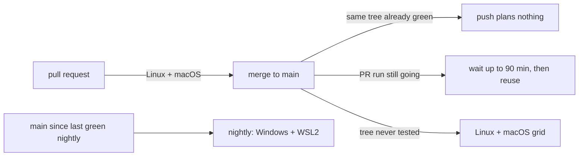
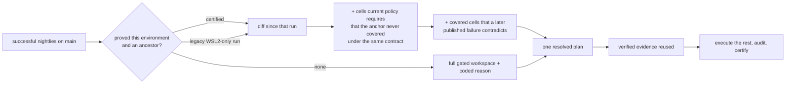
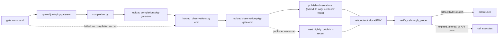
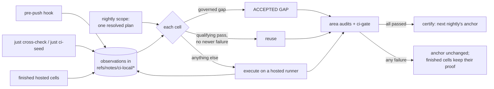
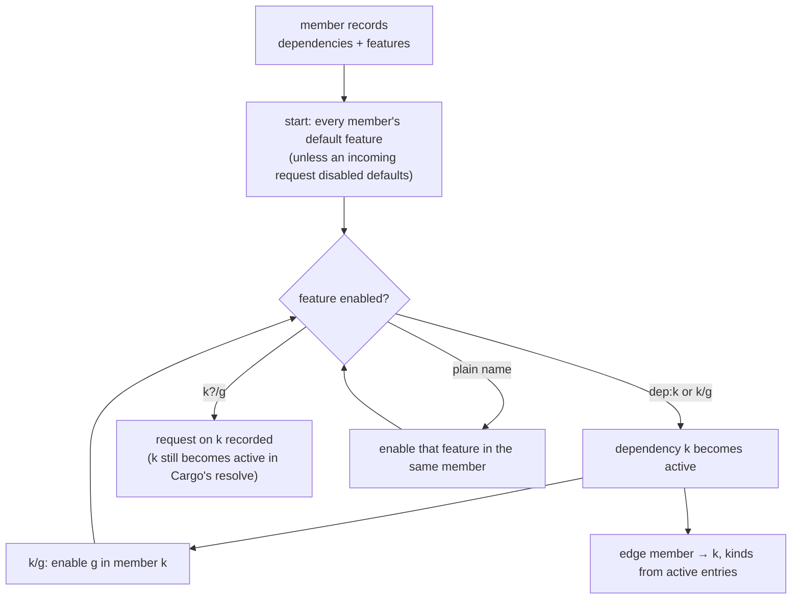
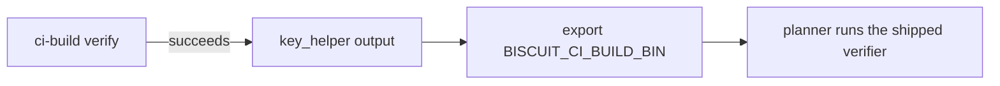

# CI/CD in Rusty Biscuit

## Overview

Rusty Biscuit's CI/CD runs on **GitHub Actions** and is layered to match the [testing tier
taxonomy](../testing-strategy.md): fast feedback first, then full coverage, then
nightly/advisory work. Releases are automated through [release-plz](https://release-plz.dev) but
**no crate is published to crates.io** — GitHub releases and version tags are the only
distribution channel today.

Package-area gates use the same `just` recipes developers run locally. Scope selection is handled
by `scripts/ci/affected_scope.py`, which emits **one canonical resolved plan**: the selected
package areas with a reason each, the packages contributing to each area, and one
`{package, environment, gate}` **cell** per unit of work carrying its execution, origin, state,
evidence, and governance. A changed source file selects its owning package; an unchanged reverse
dependency is reported by name and selected nowhere.

**Area groups; package identifies.** Every stored name — artifact, JUnit manifest record, baseline
entry, receipt cell — is keyed on `{package, environment, tier}`. Area is *derived* from each
member's manifest directory with the same rule as `sniff repo package-area` (no committed mapping
file; a drift contract compares the two wherever sniff is installed), and the only stored name
carrying it is the per-area result slice `ci-results-<slug>`. Nested areas such as
`claudine/rendezvous` are their own areas, never folded into a parent.

## Pipeline Layers

The pipeline has four conceptual layers. Each layer answers a different question.

| Layer                     | Question it answers                                               | Blocking?                      |
|---------------------------|-------------------------------------------------------------------|--------------------------------|
| **Local pre-push hook**   | Do source-changed packages pass L1/L2 on this host?                | Strict by default              |
| **Dependency-scoped CI**  | Do changed packages compile and test on the remaining runners?    | Yes                            |
| **Affected coverage**     | Did the changed package closure lose exercised behavior?          | Report-only                    |
| **Nightly / advisory**    | Did anything drift since yesterday?                               | No                             |

### Layer 1 — Local pre-push hook

`.githooks/pre-push` runs `just pre-push` before `git push` completes. That is
`just ci-local --l2`: lint and L1 plus every hostable non-focusing L2 suite for source-changed
packages. On a clean checkout the gates run FROM the reviewed plan described next (`just ci-local
--plan-in`, handed over as `BISCUIT_CI_PLAN_IN`): the planner never selects twice, an L1/L2 cell
that qualifying prior passing evidence already covers is skipped, a cell whose newest prior
evidence is a failure is rerun, and lint runs as always; a dirty checkout or an
`RUSTY_BISCUIT_PRE_PUSH_AREAS` override replans from the working tree for wider feedback and
publishes nothing. A docs-only push gates nothing unless a test reads a changed document, in which
case it runs that test alone ([test inputs](../cicd/test-inputs.md)). Before any gate, the hook reviews every branch update
the push carries, in order — each revision's COMMITTED tree (its own planner, manifests, and
policy, in a temporary worktree unless it is the clean checkout), never the working tree — applies
published evidence to it, prints it, and refuses on a recorded execution constraint scoped to that
update's remote branch (either name when the refspec renames) and remote only when a cell in the
prohibited environment would still execute; reused or absent cells satisfy it.
`just ci-local --plan` is the working-tree preview of that review; the two differ exactly when
the checkout is dirty.

Before any gate, and in every mode, the hook publishes a **scope receipt** under
`refs/notes/ci-local/scope`: the resolved plan and `scope.json` projection for the COMMITTED
`base..head` (never unstaged or untracked files), bound to the exact base, head, and tree. CI's
scope job takes a matching receipt as its plan without running the planner or setting up a Rust
toolchain, falls back to its own calculation on any miss (materializing the toolchain only then)
and says which (`scope-missing`, `scope-base-mismatch`, ...), and ignores it on
`workflow_dispatch`. Its summary also lists the validation environments consulted and matched, the
cells reused from passing evidence and the refusals by code. A failing receipt is retained for diagnosis but never suppresses execution. The base is the one the CI event will compare with: the remote's
current `main` for a push to `main` (`github.event.before`); otherwise — `ci.yml` fires
`pull_request` for every target branch — the current remote tip of each open pull request's target
branch (listed with `gh pr list` on a GitHub remote; a missing, unauthenticated, or failing `gh`
blocks the push and names the command), each planned and checked in turn, or a provisional plan
against the remote's `main` when no pull request is open. A target branch the same push also
updates is reviewed in both states its run can see — the current tip and the incoming revision —
and a target the push deletes leaves the pull request no base, so that update is blocked. A pull
request opened from the web UI is
a trigger no hook reviews, which is why the provisional plan is constrained too. The receipt binds
the first context's base; a target that advanced past the branch point is reviewed but records no
receipt, and CI calculates scope itself.

The hook uses `sniff` to identify macOS, Linux, native Windows, or WSL2 and publishes a
**validation receipt** — schema version 2, carrying the
reviewed base (the scope receipt's: a pull request's target tip, never a merge base with
`origin/main`), head, tree, and the scope receipt's plan identity plus one record per
`{package, gate}` cell that this run executed with its
outcome, exit code, completion, test counts, duration, gate-input identity, backend proof, and
bounded failure detail. Those records come from the JUnit report each canonical tier recipe
already stages, so a receipt reports what the run *measured* rather than what it claimed. The
reports themselves are retained on the producing host under
`$BISCUIT_CI_EVIDENCE_DIR/<head sha>/<environment>/` (root default `~/.rusty-biscuit/ci-evidence`)
before the receipt is written; `host.report_dir` names that directory, and a copy that fails
publishes no receipt.

The receipt is not stored as-is. `scripts/ci/observation_notes.py` turns each of its cells into an
immutable **observation** (cited by report digest) and unions them into the **observation
collection** (schema version 3) on `refs/notes/ci-local/<environment>`, so the next package, a
retry, or another host at the same head adds to the note instead of replacing it. The union is
written locally first, then the remote ref is fetched, merged, and pushed without force, retrying a
lost race up to five times; a failure leaves the proof on the local ref and the covered cells
scheduled for CI. A retry of a cell links to the observation it replaces (`retry_of`), and the
verifier orders results only by that link and by commit ancestry, never by time: a later failure
beats an earlier pass, a later pass beats an earlier failure, and results nothing orders that
disagree make the cell execute.

The link is set by whoever ran the retry, from what it knew when the retry started, never from the
order observations reach the note:

- a `cross-check.sh` rig leg asks `observation_notes.py retry-predecessor` before it runs and names
  the cell's one unsuperseded observation, if there is exactly one;
- a hosted re-run attempt names the earlier attempt of the same workflow run and cell;
- a hook receipt names nothing.

So a pass that ran first but was published after a newer failure is stored unlinked, the two
disagree, and the cell executes. The field contract is in
[`.github/ci/schemas/README.md`](../../.github/ci/schemas/README.md#observation-collection).

A **complete** run is evidence whether it passed or failed; `strict` and `warn` both publish one.
A gate that staged no report is recorded `partial` and refused for reuse, so a compile failure
cannot pass for a tested cell. An L2 cell is `partial` unless a backend it required actually drove
a test — an absent backend makes the suite *skip*, and nextest prints PASS in about 0.02 s.
`lint` and `check` stage no report and are therefore always CI-origin.

CI reads **every** note on every environment's notes ref from the merge base (included) to the
outgoing head, so a macOS receipt from this push and a prior `cross-check` WSL receipt combine in
one answer, and results on one environment covering different packages combine across commits and
across observations of one commit; each cell is resolved among the observations that qualify for it,
newest by retry link and commit ancestry. A receipt from an
**older head** is accepted per cell when that cell's *gate-input identity* is unchanged — the
`git ls-tree` entries of the tested package's build closure (dev-dependencies and the lockfile
included) plus that gate's global inputs, plus the Just recipes the gate's CI entry recipes
reach, compared by recipe rather than by file — and the comparison is recomputed over both
trees rather than read out of the receipt. `schema_version: 1` notes are exact-tree, pass-only,
whole-environment, never upgraded in place, and render their measurements as
`not recorded (v1 receipt)`.

An accepted cell has its *execution* omitted and stays a *cell* with local origin, so the rollup
expects a local-origin result for it instead of reporting `MISSING`. Suppressing the matrix entry
while leaving the policy expecting a CI result was the PR #76 seven-cell regression.

The hook is controlled by `RUSTY_BISCUIT_PRE_PUSH`:

- `scope-only` — resolve and print the plan, publish the scope receipt, run no gate, publish no outcomes, exclude no CI cells
- `off` — deprecated alias of `scope-only`
- `warn` — run and report, but never block the push
- `strict` — run and block the push on failure (the default)

`just ci-local --plan` prints the plan's change inventory before the cell list, from the same field
`ci-reporting` renders, so the terminal and the GitHub report cannot disagree about what changed.
When the plan schedules no cell it names the changed documents and states that no package test is
required. That is an **affirmative scheduling decision**, not a warning, a failure, an accepted
gap, or a fabricated passing result.

`scripts/cross-check.sh` records a `rig` observation for a leg's cell, the moment that leg finishes,
under the leg's own environment: `wsl2-ubuntu` for the WSL2 guest and `windows-latest` for native
Windows. It does so only when the leg ran the outgoing head's exact tree on a clean remote worktree
with no test filter, in archive mode; every other run prints why it published nothing. It ships the
developer's local tree, uncommitted work included, so most of its runs test a tree no head names.
Each recorded cell cites its JUnit report, the expected-test listing, and the completion record,
all kept in one per-run directory; a completed failure is recorded too (without a completion
record, which `completion.py` refuses for a failing test), and an interrupted or incomplete leg
records nothing, so an earlier leg's proof survives it.

### Execution constraints

Reuse qualifying passing evidence per required cell on every OS. If no
qualifying passing evidence exists, execute the required tests. A request to
avoid rerunning passed tests is not an environment ban. Only a separately
explicit instruction (such as an environment unavailable during maintenance)
creates an execution constraint; never infer a blanket WSL prohibition.

A separately explicit execution ban is **recorded, not remembered**. Each record in the
constraint store — `<home>/.rusty-biscuit/ci-constraints/<repository>/` beside the evidence
directory, unless `BISCUIT_CI_CONSTRAINTS_DIR` overrides it — carries an environment, an optional
gate, a reason, an owner, an expiry, and optionally a repository and branch. The hook derives
`<repository>` from the remote being pushed to and `just ci-local` from `origin`; an unknown
repository reads the store root, recursively, so every record binds. `just ci-local --plan` and
the pre-push hook enforce them; **CI never reads them**, so a constraint can only stop a push and
can never make CI silently skip required coverage. An expired record is announced and ignored; a
malformed one blocks, because an instruction that cannot be read is not one that can be ignored.

`just ci-local --plan` is the pre-trigger review surface: it resolves the plan, prints every cell
with its execution, origin, state, evidence, and governance, and exits non-zero when a prohibited
cell has no qualifying evidence. It runs no gate and starts no build. `--plan-out <path>` writes
the same cells as canonical JSON.

Parallel test workers default to `max(1, logical_cores - 2)` locally. CI uses
all logical cores when there are four or fewer, and `logical_cores - 2` on
larger runners. This preserves capacity on developer and larger shared hosts
without crippling small CI runners. It is a concurrency setting, not CPU
affinity or a guarantee that cores stay reserved. Shared-resource L2 suites
remain at one worker; `l2-parallel-self-spawn` opts isolated suites into the
parallel policy, and an explicit `BISCUIT_L2_THREADS` takes precedence.

`_test_threads` in `just/devops.just` calculates the shared worker default.
It recognizes CI through `CI=true`, `GITHUB_ACTIONS=true`, or a nonempty
`BISCUIT_CI_ENVIRONMENT`; selecting the `ci` Nextest profile alone does not
change a local host's budget. L1, sanity, and real-resource recipes export
`NEXTEST_TEST_THREADS` while preserving an explicit value. Direct local Nextest
runs inherit `test-threads = -2` from `.config/nextest.toml`. Cargo build-job
limits are unchanged.

Resource-specific CI-profile test groups remain narrower limits: Claudine L1
allows four concurrent tests and Sniff L1 on Windows allows one. Claudine CLI
L1 inherits the OS-aware worker budget; a fixed package-wide cap would silently
defeat the public runners' available concurrency.

`RUSTY_BISCUIT_PRE_PUSH_AREAS` (package names or area directories) replaces the computed scope with
a fixed selection. Install the hook dispatcher with:

```bash
just init
```

Linked worktrees share one Git hooks directory, so the installed file is a
stable dispatcher rather than a symlink to one checkout. At invocation it
resolves `git rev-parse --show-toplevel` and executes that worktree's
`.githooks/pre-push`; this prevents an older checkout's receipt schema from
silently replacing the branch's current evidence protocol.

Run the hook's local regression suite with
`bash .githooks/tests/test-pre-push.sh` when changing its contract.

### Layer 2 — Dependency-scoped CI

`ci.yml` runs on pull requests, pushes to `main`, and a nightly schedule. Its first job validates
the canonical recipe surface, obtains the changed file set from the event's exact base and head
SHAs, verifies every published local receipt per cell, and resolves the plan.

**Environments are scheduled by event.** Each record in `.github/ci/environments.json` names the
GitHub events that schedule it, and the planner plans nothing for an environment the event does
not schedule (recorded as `deferred_environments`). As decided on 2026-09-18
(`fixes/2026-09-18-ci-cadence`): a pull request proves `ubuntu-latest` and `macos-latest`, the
latter normally from the pre-push hook's local evidence; a push to `main` schedules the same two;
the nightly run (08:00 UTC) plans `windows-latest` and `wsl2-ubuntu`, each over the packages that
changed since the last successful nightly that proved that environment, with `ubuntu-latest` joining cell-less as the producer
of WSL2's archives; `workflow_dispatch` plans every environment over the full workspace. A push to
`main` whose pull request validation is reused therefore plans nothing, and every downstream job
skips. The `ci:all-os` label plans every environment for a pull request from its next push.



Nightly scope is per environment, not per run. Each scheduled environment is anchored to the
newest successful nightly on `main` that this head descends from **and** that proved that
environment, and the planner unions the per-anchor selections once per `{package, environment,
gate}`. A run proves an environment when it published a **coverage certification** for it — written
by the `certify-nightly` job only after the final gate passed and every normal audit ran — or, for a
run from before certifications existed, when its own workflow scheduled the environment and every
`coverage-audit` job succeeded. So the old WSL2-only history anchors WSL2 and leaves Windows on the
full gated workspace; once a dual-environment nightly is certified, both share the newer anchor.



The plan records each environment's anchor and reason in `coverage_anchors` (reasons:
`bootstrap-no-run`, `api-failure`, `search-exhausted`, `policy-uncertified`,
`no-qualifying-ancestor`, `certified-ancestor`, `legacy-wsl2-ancestor`), so a first nightly, an API
outage, or an exhausted search is visible rather than inferred from silence.

A certification records, for every cell it covers, a **coverage contract**: a digest of what that
cell must prove beyond its name, such as its Level-2 backends, its test features, its target kinds,
and its companion suites. The next nightly computes the same digest for every cell current policy
requires (the plan's `required_cells`) and compares the two:

| The anchor's certification... | The cell is... |
|---|---|
| covered it with the same contract | inherited (`inherited_cells`) unless the diff reselects it, or later evidence reopens it (below) |
| covered it with a different contract (a new backend or test feature) | selected (`policy_delta`) |
| did not cover it (an expired accepted gap, a newly declared gate) | selected (`policy_delta`) |
| is a legacy run, which recorded no contracts | selected (`policy_delta`) |

For example, a package that adds `wezterm` beside `tmux` to its Level-2 backends changes only its
manifest, which selects no package by itself; the changed contract is what puts its `L2` cell back
in the nightly. A selected cell still goes through evidence verification, so a cell already proved
on a rig (`just ci-seed`) does not execute. `inherited_cells` keep coverage transitive across
nightlies that execute nothing.

**A later failure reopens an inherited cell.** A certification proves the anchor, not every commit
since, so before the planner lends a covered cell to the new nightly it asks the evidence verifier
about it, with the same rules a selected cell gets: a result counts when it describes this head's
tree or one with the same gate inputs, and a passing retry that names the failure in `retry_of`, or a
pass on a descendant commit, supersedes it. When the newest qualifying result is a failure, or a pass
and a failure that nothing orders, the cell is selected and listed in `reopened_cells`, its
selection reason names the evidence, and it builds, dispatches, and executes like any selected
cell. The anchor and every other inherited cell stand.

```sh
just cross-check alpha --os windows   # after a green nightly; the rig run fails and is published
# next nightly, with nothing changed in alpha (or only docs changed):
#   windows-latest  reopened_cells: [alpha/L1]   inherited_cells: [beta/L1, ...]
#   wsl2-ubuntu     reopened_cells: []           inherited_cells: [alpha/L1, beta/L1, ...]
```

If the reopened cell fails, the gate is red and no certification is written, so the failure stays
visible to the following nightly too; if it passes, the certification covers it as this run's own
result. A later passing rig retry (`cross-check.sh` names its predecessor before it runs) restores
inheritance without a hosted run. The nightly records earlier runs' unpublished hosted observations
before it plans, so a failure only an artifact holds is seen as well. A legacy anchor therefore selects the whole WSL2 workspace once, and
seeded evidence decides what actually runs; the first certified nightly ends that. A failed,
canceled, incomplete, foreign, or non-ancestor run never becomes or moves an anchor. The nightly now
runs the same evidence verifier as pushes, so notes published from a rig satisfy Windows and WSL2
cells there. Windows and WSL2 failures are found after merge and fixed forward; they never block a
merge.

A pull request merged before its own CI finished would otherwise get the whole grid again. The push
instead waits, up to 90 minutes, for the pull request's run of the same head. A green finish on the
same tree is reused; a failure, cancellation, or timeout falls back to the normal grid.

**A package that is not built yet runs no tests.** Zero tests fail the completeness check, because
an empty test list looks exactly like a broken filter, so such a package declares why it has none:

```toml
[package.metadata.ci.tests]
unimplemented = "not implemented yet, so there are no tests to run"
```

While the package's own source holds no test, the planner gives it no test cell and records
`unimplemented: {reason, tests_found: false}` on it; lint still compiles every target on Linux.
The first `#[test]` (or `#[tokio::test]`, `rstest`, `proptest!`, a file under `tests/`) schedules
its tests normally, and the plan reports `tests_found: true` so the marker can be deleted. Only
declaring packages are scanned. The field reference is in `.github/ci/README.md`.

**Seeding the nightly from the rigs.** The nightly reuses any verified observation for a cell, so
the test rigs can prove the Windows and WSL2 cells ahead of it instead of the nightly running them on
hosted runners. `just ci-seed` does that for the whole workspace at one pinned `main` revision:

```sh
git switch --detach origin/main      # the checkout must be the pinned revision, clean
just ci-seed --plan                  # preview: every cell, reused or still owed, and its rig
just ci-seed                         # prove what is owed on BUILD_WIN and BUILD_WSL
just ci-seed --os wsl --package ui   # narrow a pass to one environment or package
```

It resolves the full-workspace nightly plan, asks the nightly's own verifier which cells are already
proved (by an earlier seed, the pre-push hook, or another host), and runs `just cross-check <package>
--os windows|wsl` for each package still owing a cell. Every finished leg publishes its observation
at once, so stopping a pass loses only the leg in flight; running the command again continues where
it stopped, because what is owed is always re-derived from published proof, never from the progress
file (`<evidence dir>/seed/<seed id>/state.json`), which only records attempts and their logs.

A busy rig (another run holds its clone), an unreachable one, an unset `BUILD_WIN`/`BUILD_WSL`, a
failed run, and a run that published nothing are reported apart, and each leaves its cells owed; the
command exits nonzero until every requested cell is proved or a governed gap. A pass pinned to an
older revision keeps its value: the nightly reuses its proof wherever the cell's inputs are unchanged.

The seed proves **Level 1 cells only**, because `just cross-check` runs a package's Level 1 suite and
nothing else. A pending cell of any other gate (Level 2, browser, and so on) is listed as
`unsupported`, no leg runs for it (a Level 1 run would not prove it), and the command exits nonzero
while it remains; the nightly runs that cell on its hosted runner. Today every higher tier on these
two environments is a governed gap, so a full-workspace pass has no such cell until a higher tier is
enabled there:

```text
  reused      alpha/windows-latest/L1   build-win  already proved; not run again
  unsupported alpha/windows-latest/L2   build-win  the seed runs Level 1 only; this L2 cell stays for the nightly
```

An optional Windows-risk workflow, running selected Windows cells before a push, is **planned**.

### Hosted cell observations

A nightly that fails in one place no longer discards the cells it proved elsewhere. Every scheduled
hosted producer (a native test job in `_package-ci.yml`, or the WSL2 guest job in `_wsl-ci.yml`)
records its finished cell as an observation and uploads it before its area or the workflow knows how
it ended. A trusted job then publishes the run's observations to the notes refs, where the normal
verifier reads them like any other producer's.



What each stage records, and what it refuses:

- **A passing cell** needs the gate to have succeeded and a completion record bound to this cell,
  head, run, and attempt. The observation cites the report by SHA-256 and byte count, and its proof
  carries the digests of `expected-<gate>.json` and `completion.json`.
- **An honest failure** (a real report that names a failing test) is recorded too, with whatever
  proof the expected listing allows. A failure needs no completion record, and it still blocks an
  older pass of the same inputs.
- **Interrupted or unproven work records nothing.** A cancelled or skipped gate, a missing or
  unreadable report, a report the failure cannot be attributed to, or a passing gate with no valid
  completion record makes `emit` exit nonzero with the reason and write no file. The step is
  `continue-on-error` so it can never change the cell's verdict.
- **Cancellation.** A job cancelled before its `emit` step publishes nothing. One cancelled after
  its observation upload keeps the artifact, and `publish-observations` still runs (`always()`), so a
  cell that finished is not lost to an unrelated failure or a cancelled sibling.
- **A run whose publisher never ran** (force-cancelled, a lost runner, the publisher's own time
  limit) is recovered by the next nightly. Before it verifies evidence, the nightly's `scope` job
  runs `hosted_observations.py publish --recent --no-push`: it lists the newest five completed
  scheduled `ci.yml` runs on `main` (whatever their conclusion), collects their `observation-*`
  artifacts, validates them exactly as the publisher does, and records them in its own checkout's
  notes, so the verifier discovers them in the same pass. That needs only the `actions: read` the
  job already holds. `publish-observations` then runs the same command with a push, so the recovery
  outlives the run. A run of another event, workflow, branch, or repository, or one still in
  progress, is never collected; republishing an observation a note already holds changes nothing.
  A run older than the window, or an observation whose artifact expired, is not recovered and its
  cell executes; `publish --run-id N` still republishes one run by hand.
- **Names are conventions, not stored.** The report lives in `junit-<package>-<gate>-<environment>`
  of the producer run; the observation's `producer.host.label` is the environment, which is how the
  probe recomputes that name. The observation itself records `workflow`, `run_id`, and `attempt` and
  is never rewritten: a retry at a new head is verified, not copied, and a re-run attempt is a new
  observation linked with `retry_of` to the earlier attempt of the same run and cell. An attempt
  published before its predecessor stays unlinked, because a stored observation is never
  re-identified, and the cell executes.

Discovery fetches the artifact. `local_evidence.py verify --artifact-repo OWNER/REPO` (what `ci.yml` passes) builds
`hosted_observations.gh_probe` and hands it to `verify_cells` as its `report_probe`; the probe
lists the producer run's artifacts through `gh api`, requires the conventional artifact to exist and
be unexpired, downloads it, and compares the cited member's bytes and the proof's digests. Anything
else (expired, altered, deleted, API failure) answers "unavailable" and the cell executes, with the
`observation-report-unavailable` reason in the plan. A failure is kept regardless.

The report artifacts keep the repository's default artifact retention, so hosted proof is reusable
for that long and no longer; an expired artifact makes the cell run again rather than fail.

`publish-observations` runs only on `schedule`, holds `contents: write` and `actions: read`, and
runs default-branch code from the tested checkout (full history, so an earlier run's head can carry
its note). It writes notes refs only. A push the remote
refuses leaves the proof local and prints "hosted observations are local to this runner; remote reuse
unavailable"; the step then fails red, but the job is not part of `ci-gate`.

**Unverified:** whether the repository ruleset permits `GITHUB_TOKEN` to push `refs/notes/*`; whether
a cancelled run still schedules the publisher on a real cancellation; and how the Actions artifact
service behaves for a re-run attempt that repeats an artifact name. None has been exercised on a
hosted run.

**Partial-run recovery:** failed or canceled nightlies leave the last
successful baseline unchanged. Hosted cells that finished keep their proof
(previous section), and so do rig legs (`just cross-check`, `just ci-seed`). Retries verify and reuse
qualifying evidence, executing only unproven cells. A newer qualifying failure will
prevent an older pass from hiding that cell's failure.

Every nightly cell resolves the same way, whoever produced its proof:



A pass from the pre-push hook, a rig, or a hosted cell counts only for its own environment, on the
same tree or one with the same gate inputs; WSL2 proof never stands in for native Windows.

**Planned release evidence policy:** native Windows and WSL2 passes are not
required for ordinary merges to `main`. A release will require qualifying
passing evidence for its release scope on macOS, Linux, native Windows, and
WSL2. Defining that scope, aggregating its evidence, enforcing the release
gate, and handling capability gaps are deferred release-process work; this
policy is not yet implemented by the cadence correction.

`ci.yml` defines **exactly eight top-level jobs**, and a contract test pins the set: `validation`
(does successful PR validation cover this tree?), `scope` (source the plan), `preflight`
(bootstrap prerequisites per selected OS — no test suite), `build` (the native build owners),
`area-ci` (one caller identity per selected area), `area-drift` (the planner's areas match
`sniff`), `ci-gate` (the required check, a policy-free fold of the other six blocking jobs), and
advisory `ci-reporting`. No job owns a test suite on CI's behalf: every suite belongs to a package and runs
in that package's own cell, so the plan places it once and one owner answers for it.

`preflight` and `area-ci` are both matrix jobs guarded by a **scalar** plan output read before
matrix expansion — `preflight_os != '[]'` and `has_packages == 'true'`. A documentation-only
change classifies to an empty `preflight_os` and schedules no area, so both resolve to `skipped`
immediately after `scope` as a decision rather than as a property of GitHub's empty-matrix
handling.

The tested half of a run is **one top-level entry per selected package area**. `ci.yml`'s
`area-ci` job fans out over the planner's `scheduled_areas`, hands each area its dispatch rows
(`area_rows`), and calls `_area-ci.yml`, which calls `_package-ci.yml` **once for the whole
area**, which delegates each `wsl2-ubuntu` row to `_wsl-ci.yml`. That is four levels including the
caller; GitHub documents ten, and the repository's contracts hold the chain at four.

**The unit of dispatch is a plan cell.** The planner emits one row `{package, gate, environment,
runner}` per *executing* cell — never for a reused, accepted-gap, prohibited, or event-deferred
one — grouped per area into four disjoint sets (`test` for native L1/L2/browser, `check`, `lint`,
`wsl`) with scalar `has_*_rows` flags. An area with no rows skips the execution call entirely yet
keeps its audit; otherwise each set expands as a `fail-fast: false` matrix. No workflow accepts a
list of environments. Each job resolves everything else from the plan through
`scripts/ci/cell_contract.py`, which refuses a row the plan does not schedule before anything
runs. Plan schema version 5 stamps every area `execution_path: "rows"`, the only admitted value;
rollback is a revert, not a per-area switch. Version 6 gives every executing L2 cell `backends`, the
hostable subset of the package's `l2_backends`: the producer requires exactly that list, `backend-proof
verify` writes `backend-proofs.json` beside its evidence, and `completion.py` reads both from the same
staging tree. The planner refuses, whole and before dispatch, a
row set over 256 jobs, an area's rows over 16 KB, or all rows together over 512 KiB.

A called workflow's jobs render as `<caller job name> / <called job name>`, and a matrix job's
label carries every row value in key order, so a producer reads
`area-ci (playa) / package-ci / test (playa-cli, L1, macos-latest, macos-latest)`: area first,
then the whole cell. No display name is parsed for *identity* — that comes from each artifact's
`manifest.jsonl` and `status.json` — but the composite label **is** parsed by
`scripts/ci/runner_loss.py` to attribute a dead runner's cell, so renaming a producer job or
reordering a row is a contract change.

A source-changed package receives lint, L1 across its environments, and its declared higher tiers.
Compile-check is no longer blanket: the planner reads each package's declared Cargo targets from
`cargo metadata --no-deps`, credits the L1 build with the `lib`, `bin`, and `test` kinds, and schedules a
`check` cell on `ubuntu-latest` alone where `example` or `bench` targets exist, with
explicit `--examples`/`--benches` selectors in place of `--all-targets`. A package with unchanged
direct reverse dependents also owns a `check` cell on `ubuntu-latest`, which compiles them against
its public API as a second step (Open Question 1, Option B): the dependents get no area, job, or
cell of their own, and the cell reports "also compiled N dependent(s)". Every cell states which gate its
compile coverage came from, and an archive-only environment names the runner that built its
archive rather than claiming to have compiled anything. This alone took the full-scope job
estimate from 486 to 432.

Per-package policy — L2/browser tier ownership, native libraries, Cargo features, runner tools,
and companion suites — lives in each package's `[package.metadata.ci]`; environment capabilities
live in `.github/ci/environments.json`. Documentation, manifests, lockfiles, Just recipes, and
workflow configuration select no package jobs, and `workflow_dispatch` remains the explicit
full-workspace path. The exception is a file compiled code reads: embedded into shipped code it
is that package's source, and read by a test it schedules one Linux L1 cell narrowed to exactly
those tests; see [test inputs](../cicd/test-inputs.md). See [testing-strategy.md](../testing-strategy.md).

**CI's own suites have owners.** Two ordinary workspace members hold them: `repo-deps`
(`scripts/`) owns the merge-gate and plan binaries' Nextest suites plus the `scripts/ci/test_*.py`
contracts, and `test-toolkit` (`tools/test-toolkit/`) owns `ci_workflow_contracts` and the
`tools/test-audit` typecheck/Vitest pair. Both gate, so a change to CI's own tooling reaches CI as
an ordinary package job rather than as a job that exists to run suites for everyone.

`SUITE_REGISTRY` in `affected_scope.py` is the one declaration site — suite name → owner, canonical
recipe, environment, kind (`cargo` or `companion`), and how that suite reports counts — and
`validate_suite_registry` rejects an unknown, unowned, doubly-owned, recipe-less, or undeclared
suite. Selection follows ownership: `scripts/**` and `tools/test-toolkit/**` are their owners'
package directories and need no entry, while `SUITE_OWNER_PREFIXES` / `SUITE_OWNER_PATHS` carry
only what lies outside a member directory.

| changed input | selects |
|---|---|
| `.github/ci/**`, `scripts/Cargo.toml` | `repo-deps` |
| `.github/workflows/**`, `tools/test-audit/**`, `pnpm-lock.yaml`, `pnpm-workspace.yaml`, `tools/test-toolkit/Cargo.toml` | `test-toolkit` |

A trigger selection is narrower than a source change: the changed path says nothing about the
owner's public API, so it contributes no reverse dependencies and no dependent seam. No path here
selects the full workspace.

Only cells not already satisfied by verified evidence get a hosted runner: the rows an area
receives are the plan's *executing* set. A reused cell is published straight
into its area's summary, where the grid's "Reused results" table names the receipt's evidence ref,
counts, duration, and host — no setup, build, archive, or test step runs for it.

Skippable jobs carry **no `name:`**. GitHub never evaluates the matrix context for a job it skips,
so a declared `name:` containing `${{ matrix.… }}` reaches the Checks tab as raw expression text
(63 such labels in run 34638047631). Omitting `name:` makes the label the job id when skipped and
`job-id (matrix values)` when it runs — which is also how `lint`'s environment stays visible.

### How the planner reads the workspace

The scope job runs `cargo metadata --no-deps --offline --format-version 1`. That lists the
workspace members, their declared dependencies, and their `[features]` tables, and it downloads
nothing: no registry index, no crate sources, no git checkouts, and no `Cargo.lock` rewrite. The
`resolve` section is `null`, and no planning code reads it. The planner needs only edges between
members (who must be rebuilt, which native libraries a package inherits, which directories feed a
build), so `member_dependency_graph` derives those edges from the member records using Cargo's
own feature-activation rules.



Each rule, with the smallest example:

- **Defaults on, all platforms.** A member's `default` feature is enabled and `target = ...` on a
  dependency is ignored, so `[target.'cfg(windows)'.dependencies] b = { path = "../b" }` is an
  edge on every host. The graph is one platform-independent view, as the full resolve was.
- **Optional dependencies need an activator.** `b = { path = "../b", optional = true }` is an edge
  only when an enabled feature names it: `dep:b`, `b/x`, `b?/x`, or the implicit feature `b` (which
  `dep:b` anywhere in the same `[features]` table suppresses).
- **`k/g` turns `k` on and requests `g` in it.** `x = ["b/extra"]` activates `b` and enables
  `extra` in member `b`, which can activate `b`'s own optional dependencies in turn.
- **`k?/g` requests `g` only if `k` is otherwise active, but Cargo's resolve still reports the
  edge.** With `default = ["b?/extra"]`, `a → b` appears in `cargo metadata`, so it appears here;
  the difference from `k/g` is only that the requester's same-named feature `b` stays off.
- **Kinds are a union over active entries.** A dev entry beside an inactive optional normal entry
  yields a `dev` edge only; two active entries yield both kinds.
- **A member without `default` is valid; `default-features = false` is honored per entry,** but a
  member's own `default` still applies when another member depends on it with defaults.
- **Matching is by manifest directory, never by name.** Paths go through one host-native
  `normcase(realpath(...))`, so Windows spelling and macOS `/var` symlinks compare correctly. A
  registry dependency that shares a member's name is not an edge.

Anything the planner cannot interpret stops with an error naming the package and entry: an
unknown feature, `dep:k` or `k/g` naming no dependency, a missing or wrongly typed field, two
members sharing a directory, or a path dependency that matches no member. It never defaults a
field.

**Local packages outside the workspace.** A path dependency that is not a member (for example an
excluded package) is read from its own `Cargo.toml`, because its feature requests can switch on
optional member dependencies. It never appears in results: no node, no native union, no input
directory, and no bridged `a → outside → b` edge. Its dev dependencies are ignored, and
`workspace = true` entries inherit from the nearest workspace root. This loader needs `tomllib`
(Python 3.11+) and refuses by name when it is missing and a manifest is needed; the scope job
runs Python 3.12.

**Unsupported: replacements.** `[patch]` or `[replace]` in the root manifest, or in a
`.cargo/config(.toml)` from the root upward or under `CARGO_HOME`, that names a member or points
at a member directory makes the planner stop with an error; the derived graph would no longer
match Cargo's resolve.

**The toolchain is still required.** `cargo metadata` runs through the pinned toolchain
(`rustup show`) and the prebuilt helper, exactly as before. Only the registry is no longer needed.

**Checking the graph against Cargo.** Small all-local workspaces in
`scripts/ci/test_affected_scope.py` run in the Ubuntu `Companion suites` step: each is compared
with Cargo's full resolve using `--offline`, an empty temporary `CARGO_HOME`, and no compile.
The real workspace is not compared on every push; that is a local check, run when member
manifests, features, or the toolchain change:

```sh
cargo metadata --format-version 1 --locked > /tmp/full.json
cargo metadata --no-deps --offline --format-version 1 > /tmp/nodeps.json
cd scripts/ci && python3 -c "import json, test_affected_scope as t; \
nd=json.load(open('/tmp/nodeps.json')); full=json.load(open('/tmp/full.json')); \
print(t.derived_edges(nd) == t.resolved_edges(full))"
```

It must print `True`. A recurring check on the real workspace is deliberately not scheduled, so
a manifest change that makes the two diverge is found by this command, not by CI.

### One native owner compiles, every tier consumes

Every executing L1, L2, and browser cell names exactly one **build record** in the resolved plan,
and one job compiles it. `ci.yml`'s `build` job is a `fail-fast: false` matrix over the plan's own
owner projection — one leg per producer environment — that installs the union of build prerequisites, produces
each package’s Nextest archive in a shared target tree with its manifest and declared sidecars, includes the verifier, and
uploads `build-<package>-<producer>-<key>` with run-scoped retention.

A consumer downloads that artifact, runs `ci-build verify` — plan key, realized digest, source
identity, producer/execution compatibility, archive and sidecar checksums, expected binaries, and
the host's own runtime ABI and observed external library identities — before tests run. Inventory and
runtime inspection extract the verified archive; the consumer then runs the canonical tier recipe
in archive mode. A rejection is a stable infrastructure verdict that stops the cell; nothing
compiles a replacement, and a consumer that finds no build record for its cell refuses rather than
compiling in place. Linux and WSL2 share one Linux archive and publish two separate result cells;
native Windows and WSL2 are structurally incompatible and can never pair. Clippy and the
check-only example/bench targets stay their own compile configurations, in their own jobs, with
their own caches.

The verifier a consumer just ran is also the planner's **key helper**. Tests that compute build
keys go through `scripts/ci/build_key.py`, which otherwise falls back to `cargo run --bin ci-build`
— a cold compile in a checkout with no `ci-build`. So once verification succeeds,
`_ci_build_verify` reports `key_helper=<build>/tools/ci-build[.exe]`, and the `gate` step exports it
as `BISCUIT_CI_BUILD_BIN` before the recipe runs; an empty value stops the cell. The `expected`
step gets no binding, and the helper runs with compiler-wrapper mode removed (`BISCUIT_CI_BUILD_WRAP`
unset, `RUSTC_WRAPPER` empty). A `requires-toolchain` suite that runs the planner avoids the helper
build but keeps its intentional Cargo calls. `just cross-check` binds the same variable for Unix and
Windows archive hosts.

```sh
: "${ARCHIVE_KEY_HELPER:?verification did not report the ci-build key helper}"
export BISCUIT_CI_BUILD_BIN="$ARCHIVE_KEY_HELPER"   # then: just _test ...
```



A build record is **plumbing, never a result cell**: no `{package, environment, tier}` identity, no
JUnit, no baseline entry. A failed, cancelled, or unuploadable owner makes each dependent cell
`MISSING — blocked by build <key>`, which blocks; unaffected areas and environments proceed.

Seven stages are reported separately — producer queue, compile+archive, and upload; consumer
download, verify, extract, and execute — so no transfer or setup cost hides inside test time. Each
executing cell displays the planned key, realized digest, and producer it ran, under **Build
provenance** in its area's summary. See
[.github/ci/README.md](../../.github/ci/README.md#what-each-stage-cost).

### Each area audits its planned coverage

**Each producer proves its own cell first.** A test job lists its expected tests on its own
target before the gate (`just _expected_manifest`, after provisioning, because listing runs the
binaries); after the gate, `scripts/ci/completion.py` compares that listing with the job's reports
as identities, not counts, and writes a completion record only when they agree. The job uploads it
as `completion-<package>-<gate>-<environment>`, and a failed upload fails the job. Check and lint
jobs write one too. A missing or malformed report, an absent expected test, an unexpected or
duplicate identity, an unapproved skip, a failed companion suite, or an unproven required backend
leaves no record.

`_area-ci.yml`'s `coverage-audit` job runs `if: always()` behind that area's producers and always
renders `ci-rollup rollup --area`. It runs `ci-rollup verdict --area --producers <result>` when
the area's producer call succeeded **or was skipped**. Producer failures already reach `ci-gate`;
the audit therefore creates no second red check for the same failure. A skipped call is how an
all-reused or gap-only area is still judged, and over executing cells it blocks as
`producers-skipped`. When it enforces, it fails closed on missing or unscheduled evidence, an
executing cell without a valid completion record (`completion-unproven`), a record for a cell the
plan did not execute (`completion-unplanned`), invalid governed gaps, and exact-skip violations on
legacy cells (reused, or rolled up without a plan), scoped to that area alone. It recomputes no expected test and no skip for
an executing cell: that cell's producer already did. It also narrows runner-loss attribution to its
own packages, because a job name carries no area. `ci-rollup summarize --results <slice>…` folds
the slices into one view and applies no policy at all.

An area whose every cell is reused **still fans out**, so its local-origin results are still
reported somewhere. `scheduled_areas` is derived from each package's declared gates rather than
its executing cells, and the audit reads its package membership from the plan rather than from
the rows, which is what gets this right.

### Governed policy gaps

A tier a package owns tests for that an environment cannot host is governed once, in
`environments.json`, as a capability object carrying `available: false` plus `reason`, `owner`,
`expiry`, and optionally `closes` — the tracked work that ends the gap. Such a cell is an
**`ACCEPTED GAP`**: a distinct machine-readable state, decided by the planner before the run and
never inferred from a GitHub cancellation conclusion. It is neither a pass nor a test failure and
does not block; the rollup renders its owner, expiry, policy entry, `closes` link, and revocation
instructions where a reader sees the cell. An absent, incomplete, or expired acceptance is a
blocking `POLICY GAP` instead, and a real failure outranks an accepted gap.

The gap is also visible **immediately**, before any producer runs: `_area-ci.yml`'s `accepted-gaps`
job waits on nothing, reads the plan the scope job uploaded, and runs `scripts/ci/publish_gaps.py`,
which creates one `neutral` check run per accepted-gap cell on the pull request head (Open
Question 4, ruled 2026-09-12). The check's name identifies the cell; its title and summary carry
the `ACCEPTED GAP` marker, owner, expiry, and reason; its text carries the revoke instructions and
the `closes` work; `details_url` links the policy entry. `neutral` leaves the PR clean and never
alters the run's conclusion — `cancelled` keeps its one meaning, interruption — and the tool
refuses an ungoverned or expired cell rather than publish it as harmless. That job is the only
one holding `checks: write`; `ci.yml`'s `area-ci` carries the grant as a cap and `package-ci` and
`coverage-audit` declares a read-only set of its own.

### The merge gate

`ci.yml`'s `ci-gate` job is the single required check: a **policy-free fold**. It `needs` every
blocking top-level job, runs `if: always()`, and passes only when each `needs.*.result` is
`success` or `skipped` — an unselected area's job is skipped and must not block, while `failure`
and `cancelled` do. It reads no plan, policy, baseline, or artifact; a `MISSING` cell is caught by
its area's own coverage audit. `continue-on-error` hides a failure from the fold, so
exactly one job (`ci.yml`'s advisory `ci-reporting`) carries it. The semantics were
proven in a scratch repository (`fixes/2026-09-11-cicd-cleanup/fixtures/scratch-2026-09-12.md`).

Test, lint, and compile steps fail their producer jobs visibly. Their
`always()` status steps still publish package/environment/tier evidence for the
coverage audit, and every matrix uses `fail-fast: false`, so one failure does not
cancel the remaining cells that lack qualifying local evidence. `ci-baseline.toml`
is a skip budget only; failures cannot be pardoned downstream after the
producer has truthfully reached the gate. An approval excuses only an *observed* `<skipped/>`:
an expected test that reported nothing fails its cell as `completion-test-missing` whatever the
baseline says. The earlier reading, under which an expected-but-unreported test counted as a
skip, was removed deliberately (`2026-09-19-direct-cell-execution`) — an observed skip is a
decision, silence is a lost test.
The `protect-your-bacon` ruleset (id 19747338) has required `ci-gate` since 2026-09-13. It named
`ci-verdict` until then, and because that job no longer existed in `ci.yml`, every pull request sat
on a `ci-verdict — Expected` check that could never arrive. The admin `pull_request` bypass actor
on that ruleset was left untouched by the swap.

`ci-results.json` and the skip-only baseline are independently versioned: the result document is
at `schema_version: 5` and the baseline at 3. Identity is
still `{package, environment, tier}`; each cell also carries its derived `area`, its `origin`
(`ci`, `local`, `prior-local`, or `none`), the `evidence` behind a reused result, its measured
`duration_s`, and the `target_kinds` and `compile_coverage_from` the plan assigned it. Version 4
made `counts` optional alongside `duration_s`, so a cell nobody measured omits the field rather
than reporting a zero that reads as a suite which found nothing. Version 5 adds `completion` to
every cell the plan executed and `unplanned_completions` to the document. The
document carries `accepted_evidence`, one entry per reused cell — the same set accepted for
*scheduling*, so the scheduler and the report cannot disagree. A document from an earlier
generation is refused by its version, before any cell is interpreted, with the migration that
applies named; the fix is to re-run the rollup that produced it.

### The run report

`ci-reporting` is advisory: `if: always()`, `continue-on-error: true`, and it `needs` the whole run
including `ci-gate`, so it is written after the decision it declines to make. It never claims
mergeability and applies no baseline, accepted-gap, missing-cell, or merge policy. It has three
modes — a reused PR validation (link the prior run, state that no package cell executed), a
successful scope (read the plan and this run's `ci-results-<slug>` area slices through
`ci-rollup summarize`, the same typed model the areas wrote, never a second model parsed from raw
JUnit), and a failed or cancelled bootstrap (name the first actionable infrastructure failure).

The successful-scope mode renders the plan's change inventory, the direct and reverse dependency
sets, per-environment test counts and durations including machine-recorded companion counts, the
Linux-only `ci` lint **command** duration labeled as such, and each cell's literal `ci` /
`local` / `prior-local` origin. A measurement it does not have renders as `not recorded` with the
reason, never as `0`. There is no `cicd` origin.

The **change inventory** arrived with plan schema version 3: the changed paths normalized to one
repository-relative spelling, sorted, de-duplicated, and bucketed exhaustively into
`configuration`, `documentation`, `source`, and `other` with per-bucket and total counts. A rename
contributes one logical path; `--all` records no diff inventory rather than an empty list that
would read as "nothing changed". It is a sibling of `change_class`, not a replacement, and both
readers — `ci-plan` in the terminal, `ci-reporting` in GitHub Markdown — consume the one field.
A scope receipt written against version 2 is refused once with the existing `scope-schema` reason
and one fresh calculation follows.

### Layer 3 — Affected coverage and specialized workflows

On pull requests, `ci.yml` passes the affected package closure to one `cargo llvm-cov` invocation
and uploads one LCOV artifact (`lcov-affected`). It does not perform a package-by-package pass and
then repeat the workspace.

Specialized runtime contracts are **reusable workflows called by `ci.yml`**, not independently
path-triggered ones, so a commit produces one CI run rather than a wall of overlapping ones. Each
would be selected from affected scope and gated on preflight. **The inventory is currently empty:**
the last entry retired when Biscuit TUI's attached-console captured-stdout test became ordinary
`windows-latest` L1 evidence inside `biscuit-tui-cli`'s own cell.

Messenger and all three Rendezvous crates are owned by their ordinary
package-keyed L1 cells on Ubuntu, Windows, macOS, and WSL2. Messenger declares
all-feature coverage and the six desktop-notifier helpers as a
`messenger-desktop-stubs` build **sidecar**: its producer compiles them, the
manifest records each one's size and digest, and every consumer takes them
verified from `<artifact>-sidecars/` with `MESSENGER_STUB_BIN_DIR` exported from
that directory. The old `runner-tools` prebuild that compiled them on the test
runner is gone. The same path carries them to the toolchain-free WSL2 guest, and
on native Windows they arrive under their `.exe` names. JUnit and producer-status
artifacts retain the package/environment/tier identity consumed by their area's
coverage audit.
`sniff-performance.yml`
stays independent because its PR leg is artifact-only and its scheduled leg measures work counts,
not correctness. `build-integrations.yml` stays release-triggered.

### Layer 4 — Nightly and advisory

Each scheduled workflow owns its own name, schedule slot, artifacts, and summary so none can be
mistaken for required validation: fuzz 02:00, sniff-performance 04:00 UTC, maintenance audit
Mondays 07:00.

Coverage and workspace benchmarking left CI on 2026-08-12: coverage is a local tool (`just
coverage` per package), and `bench-nightly`'s Bencher.dev upload had been failing silently for
weeks — performance testing returns as the opt-in, package-owned design in
`features/2026-08-12-perf-opt-in/spec.md`.

The 90-minute budget is provisional: warm scheduled runs measured 14–18 minutes, but every
cold-cache run was truncated by the previous 30-minute ceiling, so the cold duration has never
actually been observed. Tighten the budget — or split the 16 bench targets across parallel jobs —
once a cold run has been recorded.

#### `fuzz-nightly.yml` — 02:00 UTC daily

Two matrix jobs (`biscuit-file`, `darkmatter`) on the **nightly** toolchain, capped at 10,000 runs
and 300 s per target. The interesting policy bits:

- **Replay-first.** Committed crash corpora (`fuzz/artifacts/<target>/`) are replayed with
    `-runs=0` before any new fuzzing. A regression in a previously-fixed crash fails the run
    immediately and loudly.

- **Auto-issue on new crash.** When a *new* crash is found, the workflow opens a GitHub issue
    de-duplicated by target marker + crash signature. Reproduction instructions are embedded in the
    issue body.

- **Advisory.** Fuzz nightly never gates merges; it produces actionable issues instead.

#### `maintenance-audit.yml` — Mondays 07:00 UTC and manual

Reports what has moved upstream for every value the repository pins on purpose — the required Rust
version, the kache version floor, `cargo-nextest`, third-party GitHub Action versions, and the runner image —
and changes nothing. The job always succeeds; a finding is information. Pins advance only through a
reviewed change (see [Advancing a pinned value](#advancing-a-pinned-value)).

#### `build-integrations.yml` — on `release: published`

Cross-compiles the three Unfolded Circle integrations (`arcam-amp-integration`,
`eversolo-integration`, `sony-receiver-integration`) to `aarch64-unknown-linux-musl` using `cross`,
then uploads tarballs to the GitHub release via `gh release upload`. `fail-fast: false` so one
target's failure doesn't strand the others.

## Release Strategy

Releases are automated end-to-end by `release-plz.yml` in the public repository.

### Two-job flow

1. After the `ci` workflow **succeeds** on `main` (a `workflow_run` trigger, not a bare push — release
   automation follows the validation it depends on rather than racing it), **`release-pr`** runs
   `release-plz release-pr`. It opens (or updates) a single **draft**
   release PR labeled `release`, `automated`. The PR contains version bumps and changelog updates
   for every package with relevant commits since the last tag. Concurrency is configured to be
   **non-cancelling** so two concurrent runs cannot race the PR head.

2. When a merged PR labeled `release` closes, **`release-plz-release`** runs `release-plz
   release`. It creates git tags shaped `{{ package }}-v{{ version }}` and publishes GitHub
   releases with the rendered changelog. Ordinary pushes do not start the publishing job.

### What we do *not* do

- **No crates.io publishing.** `publish = false` is set workspace-wide in `release-plz.toml`. If a
    crate ever needs to ship to crates.io, that's an explicit, per-package decision.

- **No version bumping on PRs that don't touch a published package.** `release-plz` is
    conventional-commit aware (`feat`, `fix`, `perf`, `refactor`, `docs`, `test`, `chore(deps)`,
    `chore`) and skips `chore(release)`.

- **No release for excluded packages.** `biscuit-tui`, `biscuit-tui-cli`, `tabby`, and the `ui`
    package opt out.

### Versioning policy

- **SemVer checks are disabled.** `semver_check = false` avoids release-plz regenerating
    intentionally untracked nested-workspace lockfiles; with `publish = false`, there is no
    crates.io consumer requiring that publication gate.

- **Per-package changelogs** at `<area>/CHANGELOG.md` for nine packages (the rest aggregate into the
    workspace root changelog).

- **Conventional commit prefixes** drive both the bump level and the changelog section. See the
    `commit_parsers` array in `release-plz.toml` for the canonical mapping.

## Caching and Performance

Every Rust workflow uses `Swatinem/rust-cache@v2` with `workspaces: ". -> target"` and a workflow-
or matrix-scoped `shared-key`. The package gates key **per package and per job kind**, and only
where something still compiles: `package-ci-<package>-check-<os>`,
`package-ci-<package>-lint-ubuntu-latest`, and `build-<package>-<producer>` for the native
build owner. **No test tier has a cache key at all.** L1, L2, browser, and the WSL2 guest
consume that owner's archive: they restore no cache, install no toolchain, and compile nothing —
and a restored cache is the one thing that can make a silent rebuild look fast. Other examples: `coverage-affected`,
`coverage`, `bench-nightly-darkmatter`, and `sniff-bench`. Cache keys are intentionally scoped
rather than global — this trades hit rate for protection against a poisoned target directory
taking down the entire pipeline.

The package-scoped key has **not** been measured against a real run yet. The known pressure is
GitHub's 10 GB repository cache quota: roughly 5 keys × 63 packages means one full run saves more
caches than the quota holds and evicts its own predecessors, so only intra-run reuse is reliable
today. Do not diagnose a cold build as a cache-key bug.

Concurrency is configured per-workflow:

- Dependency-scoped CI: `cancel-in-progress: true` per ref, so force-pushing a fix cancels
    the prior run.

- `release-plz` and the fuzz/bench nightlies: **never cancel** — partial state from these is
    always more useful than nothing.

## Required Toolchain on Runners

`rust-toolchain.toml` pins one **exact** Rust version for the whole repository, and required CI
honors that file with `rustup show` rather than overriding it with a floating channel. Local and CI
therefore resolve the same compiler — which also stabilizes rustfmt and Clippy, curing the
`main`↔branch formatting drift documented in `CLAUDE.md`.

Two deliberate overrides exist, both outside required CI:

- **`rust-latest-stable.yml`** sets `RUSTUP_TOOLCHAIN=stable` to test the newest compiler in
  advance. Advisory; it cannot change required-CI behavior.
- **`fuzz-nightly.yml`** uses nightly because `cargo-fuzz` requires it.

Coverage adds `llvm-tools-preview` on top of the pinned toolchain.

### Advancing a pinned value

The maintenance audit reports drift; advancing a pin is a reviewed change:

1. Check the most recent `rust-latest-stable` run (for a toolchain bump) or the upstream release
   notes (for an action, kache, or nextest bump).
2. Update the single authority — `rust-toolchain.toml`, `.github/kache-min-version`, or the `uses:`
   pin — never a second copy.
3. Run `cargo fmt --all --check` (read-only; never write-mode), plus the affected areas' `just
   build`, `just test`, and `just lint`.
4. Review newly enabled compiler and Clippy diagnostics rather than silencing them.
5. Keep action-version upgrades in their own commit, separate from behavior changes.

Roll back by reverting that one authority value; nothing else encodes it.

Shared CLI tools used in CI:

- `python3`, `jq`, and `gh` — scope calculation and GitHub orchestration.
- Node.js, npm, and pnpm — frontend legs declared with the `node` capability.
- `cargo-nextest` — the canonical test runner for L1 tiers.
- `just` — orchestration entry point for every job.
- `cargo-llvm-cov` — coverage.
- `cargo-fuzz` — fuzz targets.
- `cross` — integration cross-compilation.
- `bencher` — nightly benchmark upload.
- `release-plz` — release planning and publication.

The root `just init` recipe has a CI/CD stage that ensures the applicable
local equivalents. Binaries encapsulated entirely inside a third-party action
remain owned by that action.

## Policy Summary

What a reviewer can rely on when approving a PR:

1. **Every affected gating package passed the environments its event schedules** against the
   exact pinned Rust version in `rust-toolchain.toml`. A pull request proves Linux and macOS;
   the nightly run adds native Windows and `wsl2-ubuntu`, a distinct archive-based L1 cell.
   Windows and WSL2 failures are therefore found after merge and fixed forward, by decision.
2. **`just check-canonical` confirms the area structure is well-formed** — no `justfile`
   recipe drift snuck in.

3. **An unchanged downstream consumer is reported, not scheduled.** It appears by name in the
   plan's `reverse_dependencies` and receives no area, job, or result cell, so an untested area
   can never present as a green top-level result. The specialized runtime contracts are still
   selected from affected scope by `ci.yml`.

4. **Coverage is reported but not gated.** Treat coverage as a delta to inspect, not a number to
   defend.

5. **Bench and fuzz drift is captured nightly,** not on the PR itself. A regressed fuzz target
   files an auto-issue rather than blocking your merge.

6. **Releases never happen from a PR branch.** They happen from `main` via release-plz's draft
   PR, which is itself reviewed before merge.

What CI explicitly does **not** guarantee:

- **Compile coverage inside the WSL2 guest.** L1 compiles and runs the `lib`, `bin`, and `test`
    kinds on each scheduled native environment; the guest only runs the `ubuntu-latest` archive.
    A `check` cell on `ubuntu-latest` alone compiles `example` and `bench` through explicit
    `--examples`/`--benches` selectors, and it is scheduled for packages that declare those
    kinds; a package with neither gets a check job only to compile its unchanged direct reverse
    dependents. Example and bench kinds are never compiled on Windows or macOS.

- **Performance regressions blocking merge.** Bench results are tracked in Bencher but not gated.
- **External-resource (L4 `test-real`) tests passing.** Those tiers are explicitly excluded from
    CI; they live on developer machines and the homelab.

## Adding a New Workflow

Before adding a new workflow, check:

1. **Does an existing canonical recipe cover this?** If yes, register the area in the root
   `justfile` and declare the package's CI policy in its `[package.metadata.ci]`
   instead of inventing a new workflow.

2. **Is this a canonical area contract or a specialized contract?** Canonical work belongs in
   `_package-ci.yml` and the package policy; specialized hardware, IPC, or console behavior may justify
   its own file. If it does, make it a **reusable** workflow (`workflow_call` +
   `workflow_dispatch`, no `push`/`pull_request` triggers, no own `concurrency` group) and add a
   scope-gated job to `ci.yml` that calls it. A self-triggering workflow reintroduces the wall of
   parallel runs per commit that the orchestrator exists to prevent.

3. **Should this gate merges or just report?** Mirror the existing pattern — coverage,
   bench, fuzz, sniff-performance, and the maintenance audit are non-gating; everything else is.
   A non-gating workflow needs its own name, schedule slot, artifact names, and summary.

4. **Pick a unique `shared-key`** for the cache so you don't share state with an unrelated job.
5. **Honor `rust-toolchain.toml`** with `rustup show`; never override it with a floating
   `dtolnay/rust-toolchain@stable`, and never rely on the runner's default. Nightly and
   latest-stable overrides are deliberate exceptions, documented where they occur.
6. **Install native prerequisites before building** with `just _ensure-native-libs <area>`, so a
   `-sys` crate cannot fail to compile for a missing system library.

## Pointers

- Workflow definitions: `.github/workflows/`
- Release config: `release-plz.toml`
- Test tier taxonomy: [`testing-strategy.md`](../testing-strategy.md) and
    `.claude/skills/rust-testing/SKILL.md`

- Pre-push hook: `.githooks/pre-push`, tested by `.githooks/tests/`
- Canonical recipe definitions: root `justfile` and `just/*.just`
