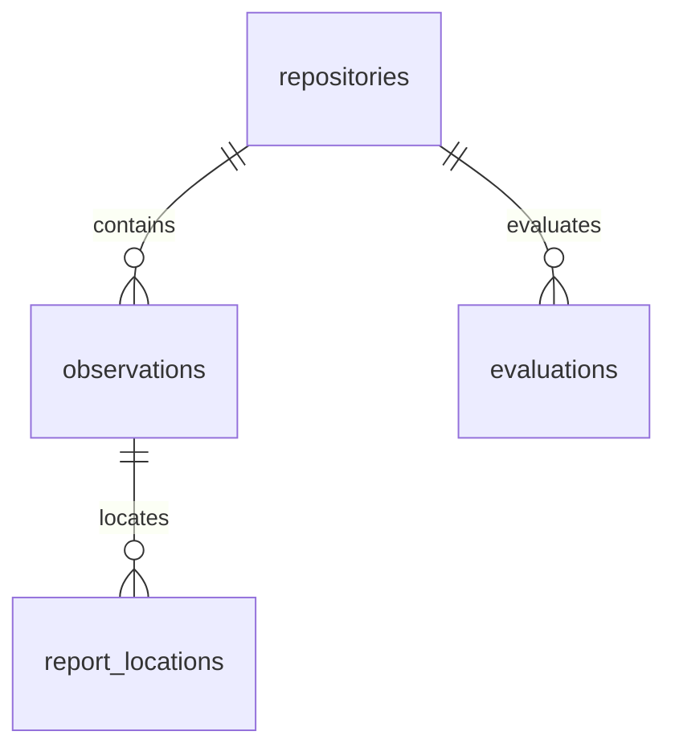

# Proposed D1 evidence data model

This proposal makes Cloudflare D1 the shared system of record for evidence
produced by local validation, remote test rigs, and GitHub Actions. It replaces
Git-note synchronization with authenticated API requests. It does not change
which tests are required or what makes an observation qualify for reuse.

The proposal preserves the [current evidence shapes](../../schemas/ci-evidence.yaml)
and the [existing verification rules](../../docs/cicd/evidence.md). It is a
design for discussion, not an implemented database or migration.

## Assumptions and boundaries

- A small TypeScript Worker owns the D1 binding. Clients call its API; they do
  not receive database credentials or submit arbitrary SQL. Local clients and
  trusted GitHub workflows authenticate separately. The API derives repository
  and producer permissions from the caller, not from submitted JSON.
- An observation records one attempt, including failures and incomplete runs.
  Recording a new attempt never overwrites a previous one. Time of arrival is
  useful for pagination and snapshots, never for deciding which result wins.
- Cell identity remains `{package, environment, gate}`. Package area is derived
  for display outside the store. A narrowed test selection is an additional
  compatibility condition; it does not redefine the cell key.
- D1 holds evidence metadata and references. Report bytes live in durable
  object storage, retained GitHub artifacts, or a producer's retained directory.
  This proposal does not choose an object-storage vendor. A local path is not
  a globally downloadable report.
- The existing planner supplies required cells. The verifier supplies Git
  ancestry, recomputed gate-input equivalence, feature/backend compatibility,
  report checks, retry resolution, and conflict decisions. SQL is not a second
  planner or verifier.
- Use the primary D1 database for ingestion, evidence snapshots, and readiness
  decisions. Initially do not opt into read replicas. If replication is later
  enabled, preserve the primary-read requirement at these boundaries; a
  bookmark alone does not prove that another producer's newest write is visible.
  D1 documents its [primary and replica behavior](https://developers.cloudflare.com/d1/best-practices/read-replication/).

## Data model

Four tables are sufficient initially. The original observation stays intact as
JSON; generated columns provide the indexes needed by the verifier. Derived
evaluations retain both the requested coverage and the decision for every cell.

| Table | Purpose | Mutation policy |
|---|---|---|
| `repositories` | Stable repository identity and evidence revision counter | Slug may change; revision advances automatically |
| `observations` | Immutable original observations plus their collection context | Insert only; duplicate delivery is idempotent |
| `report_locations` | Report availability and verification history | Append only; a new event can withdraw an old location |
| `evaluations` | Auditable CI-reuse or release-readiness decisions at an evidence snapshot | Insert only; recompute instead of updating |



### Repository identity and snapshot counters

`repository_id` is GitHub's stable numeric repository ID, represented as text.
It survives a repository rename; `slug` is its current `owner/name`. Using the
ID in every key also prevents collisions between repositories with identical
package names or commit IDs.

`evidence_revision` advances whenever an observation or report-location event
is inserted. It conservatively invalidates cached evaluations for the whole
repository. Start with that simple rule; do not add per-package invalidation
until measurements justify it.

```sql
CREATE TABLE repositories (
    repository_id TEXT PRIMARY KEY NOT NULL,
    slug TEXT NOT NULL UNIQUE,
    evidence_revision INTEGER NOT NULL DEFAULT 0
        CHECK (evidence_revision >= 0)
);
```

### Immutable observations

`payload_json` is the canonical serialization of the original observation,
including its `observation_id`. `head`, `tree`, and `environment` come from its
version-3 collection. Together these fields allow reconstructing a collection
without changing observation IDs. `source_version = 2` denotes observations
adapted from a version-2 receipt; the API performs the existing adapter before
insertion. Version-1 receipts are not silently promoted: importing those would
require a separate legacy contract and is outside this initial model.

`accepted_principal` identifies the authenticated publisher. It is audit
provenance, not permission to reuse the result. `received_at_ms` is a server
timestamp. `seq` is an insertion cursor, not test ordering.

```sql
CREATE TABLE observations (
    seq INTEGER PRIMARY KEY AUTOINCREMENT,
    repository_id TEXT NOT NULL REFERENCES repositories(repository_id),
    observation_id TEXT NOT NULL,
    environment TEXT NOT NULL CHECK (environment IN (
        'ubuntu-latest', 'macos-latest', 'windows-latest', 'wsl2-ubuntu'
    )),
    head TEXT NOT NULL,
    tree TEXT NOT NULL,
    source_version INTEGER NOT NULL CHECK (source_version IN (2, 3)),
    payload_json TEXT NOT NULL CHECK (json_valid(payload_json)
        AND json_type(payload_json) = 'object'),
    accepted_principal TEXT NOT NULL,
    received_at_ms INTEGER NOT NULL,
    package TEXT GENERATED ALWAYS AS
        (json_extract(payload_json, '$.cell.package')) STORED NOT NULL,
    gate TEXT GENERATED ALWAYS AS
        (json_extract(payload_json, '$.cell.gate')) STORED NOT NULL
        CHECK (gate IN ('lint', 'check', 'L1', 'L2', 'browser')),
    outcome TEXT GENERATED ALWAYS AS
        (json_extract(payload_json, '$.cell.outcome')) STORED NOT NULL
        CHECK (outcome IN ('pass', 'fail')),
    gate_input_identity TEXT GENERATED ALWAYS AS
        (json_extract(payload_json, '$.cell.gate_input_identity')) STORED NOT NULL,
    retry_of TEXT GENERATED ALWAYS AS
        (json_extract(payload_json, '$.retry_of')) STORED,
    UNIQUE (repository_id, observation_id),
    CHECK (observation_id = json_extract(payload_json, '$.observation_id')),
    CHECK (json_type(payload_json, '$.observation_id') = 'text')
);

CREATE INDEX observations_cell
    ON observations(repository_id, package, gate, environment, seq);
CREATE INDEX observations_head
    ON observations(repository_id, head, environment, observation_id);
CREATE INDEX observations_retry
    ON observations(repository_id, retry_of);

CREATE TRIGGER observations_revision AFTER INSERT ON observations
BEGIN
    UPDATE repositories SET evidence_revision = evidence_revision + 1
    WHERE repository_id = NEW.repository_id;
END;

CREATE TRIGGER observations_no_update BEFORE UPDATE ON observations
BEGIN
    SELECT RAISE(ABORT, 'observations are immutable');
END;

CREATE TRIGGER observations_no_delete BEFORE DELETE ON observations
BEGIN
    SELECT RAISE(ABORT, 'observations are immutable');
END;
```

The API strictly validates the submitted JSON before this DDL sees it, verifies
content identity using the existing identity contract, and canonicalizes it.
Do not change the identity algorithm as part of changing storage. New Rust
hashing implementation uses `biscuit-hash`; compatibility with existing IDs is
a migration prerequisite, not an excuse to re-identify historical evidence.

Retry links have no SQL foreign key: a collection can arrive as a batch whose
members are not in retry order. The API validates the complete retry graph
before inserting anything: links stay within the same repository, head, tree,
environment, package, and gate, and cannot dangle or cycle. The insert batch is
atomic. This preserves the current same-collection rule.

### Append-only report-location events

The observation already contains each report's expected path, digest, size,
and original store. A location event adds retrieval information without
changing that observation. Moving bytes from a GitHub artifact to durable
storage therefore does not change the observation ID.

`location_key` names one retrieval location, such as an artifact/file pair or
an object-store key. `locator_json` contains its typed retrieval metadata; it
is not an executable URL supplied to an unrestricted HTTP client. A host-dir
locator includes the host identity and directory; an artifact locator includes
repository, run, artifact, and member identifiers. Credentials are never stored
in locators.

Each event contains `verified`, `unavailable`, or `withdrawn`. Only an
authorized verifier writes `verified` after checking the referenced bytes or
applying the existing foreign-host provenance rule. `verification_method`
distinguishes those two cases. The newest event for a location wins; if it
expires, do not fall back to an older verified event for that same location.
Other independently verified locations may still qualify.

```sql
CREATE TABLE report_locations (
    seq INTEGER PRIMARY KEY AUTOINCREMENT,
    repository_id TEXT NOT NULL,
    observation_id TEXT NOT NULL,
    report_path TEXT NOT NULL,
    location_key TEXT NOT NULL,
    location_kind TEXT NOT NULL CHECK (location_kind IN (
        'host-dir', 'artifact', 'object'
    )),
    locator_json TEXT NOT NULL CHECK (json_valid(locator_json)
        AND json_type(locator_json) = 'object'),
    state TEXT NOT NULL CHECK (state IN (
        'verified', 'unavailable', 'withdrawn'
    )),
    verification_method TEXT CHECK (verification_method IN (
        'bytes', 'foreign-host-provenance'
    )),
    checked_at_ms INTEGER NOT NULL,
    valid_until_ms INTEGER,
    checked_by TEXT NOT NULL,
    FOREIGN KEY (repository_id, observation_id)
        REFERENCES observations(repository_id, observation_id),
    CHECK (state != 'verified' OR
        (verification_method IS NOT NULL AND valid_until_ms IS NOT NULL
         AND valid_until_ms > checked_at_ms))
);

CREATE INDEX report_locations_history ON report_locations(
    repository_id, observation_id, report_path, location_key, seq
);

CREATE TRIGGER report_locations_revision AFTER INSERT ON report_locations
BEGIN
    UPDATE repositories SET evidence_revision = evidence_revision + 1
    WHERE repository_id = NEW.repository_id;
END;

CREATE TRIGGER report_locations_no_update BEFORE UPDATE ON report_locations
BEGIN
    SELECT RAISE(ABORT, 'report location history is immutable');
END;

CREATE TRIGGER report_locations_no_delete BEFORE DELETE ON report_locations
BEGIN
    SELECT RAISE(ABORT, 'report location history is immutable');
END;
```

The API rejects a report path absent from the observation and verifies digest
and size against that original reference. It also validates proof documents
such as expected-test listings and completion records; a report-location event
alone does not certify the producer's proof.

### Derived evaluations

An evaluation answers a specific question about a pinned revision and a
canonical plan. It is not a mutable `latest-pass` record. `purpose` separates
CI reuse from release readiness because their coverage and gap policies differ.

`plan_identity` names the complete supplied plan, including selected packages,
required cells, filters, features, backend requirements, and gap policy.
`verifier_identity` names the verifier implementation and acceptance policy.
Both must change whenever their meaning changes.

`required_cells_json` is an array with one unique `{package, environment,
gate}` row per required cell, plus its applicable execution requirements.
`decisions_json` has exactly one row for each required cell:

```json
[
  {
    "package": "biscuit-hash",
    "environment": "macos-latest",
    "gate": "L1",
    "state": "pass",
    "observation_ids": ["0123456789abcdef"],
    "reason": "exact-tree"
  }
]
```

States are `pass`, `fail`, `missing`, `conflict`, `accepted-gap`, and
`prohibited`. A rejected passing candidate does not produce `pass`: if no
qualifying candidate remains, the cell is `missing` with rejection reasons.
An accepted gap is explicitly distinct from a passing test.

The verifier validates the exact cell-set equality, state vocabulary, and
referenced observations before insertion. For CI reuse, accepted gaps may
satisfy policy. The proposed release policy requires actual passes across all
four environments for the requested coverage, so gaps block release. That
policy is a proposal to agree on, not a change to the current merge gate.

```sql
CREATE TABLE evaluations (
    seq INTEGER PRIMARY KEY AUTOINCREMENT,
    evaluation_id TEXT NOT NULL UNIQUE,
    repository_id TEXT NOT NULL REFERENCES repositories(repository_id),
    purpose TEXT NOT NULL CHECK (purpose IN ('ci-reuse', 'release-readiness')),
    head TEXT NOT NULL,
    tree TEXT NOT NULL,
    plan_identity TEXT NOT NULL,
    verifier_identity TEXT NOT NULL,
    evidence_revision INTEGER NOT NULL,
    observation_watermark INTEGER NOT NULL,
    location_watermark INTEGER NOT NULL,
    required_cells_json TEXT NOT NULL CHECK (json_valid(required_cells_json)
        AND json_type(required_cells_json) = 'array'),
    decisions_json TEXT NOT NULL CHECK (json_valid(decisions_json)
        AND json_type(decisions_json) = 'array'),
    satisfied INTEGER NOT NULL CHECK (satisfied IN (0, 1)),
    evaluated_at_ms INTEGER NOT NULL,
    valid_until_ms INTEGER NOT NULL CHECK (valid_until_ms > evaluated_at_ms)
);

CREATE INDEX evaluations_lookup ON evaluations(
    repository_id, purpose, head, tree, plan_identity, verifier_identity,
    evidence_revision, seq
);

CREATE TRIGGER evaluations_no_update BEFORE UPDATE ON evaluations
BEGIN
    SELECT RAISE(ABORT, 'evaluations are immutable');
END;

CREATE TRIGGER evaluations_no_delete BEFORE DELETE ON evaluations
BEGIN
    SELECT RAISE(ABORT, 'evaluations are immutable');
END;
```

`valid_until_ms` cannot exceed the earliest report-attestation expiry,
applicable gap expiry, or verifier-policy freshness deadline used in the
evaluation. An empty plan is not automatically a release approval: the planner
must explicitly establish the release scope, and the evaluator must refuse an
unexpectedly empty scope.

### D1 execution and consistency

The DDL uses SQLite-compatible SQL, JSON functions, and generated columns
supported by [D1's SQL surface](https://developers.cloudflare.com/d1/sql-api/sql-statements/).
Use prepared statements with bound parameters. The examples below use named
parameters for readability; the Worker translates them to numbered or anonymous
bindings accepted by its D1 prepared statements. Never interpolate caller data
into SQL text.

D1's [`batch()`](https://developers.cloudflare.com/d1/worker-api/d1-database/#batch)
executes its statements transactionally. Use it for multi-observation ingestion.
Do not assume that arbitrary `BEGIN`/`COMMIT` statements or an interactive
transaction around network requests are available. Snapshot watermarks and a
revision-guarded insert allow expensive Git and report checks outside a database
transaction without publishing a result over evidence that changed meanwhile.

## Expected queries

The following catalog covers the intended API's initial operations. Migration
DDL is above. There is deliberately no update/delete operation for observations
and no query that declares an observation passing solely from its stored
`outcome`. Administrative disaster recovery is a separate operational procedure.

### 1. Register a repository or record a rename

An administrator registers the stable GitHub ID. A rename updates the display
slug without changing evidence ownership. The API verifies the ID/slug pairing
through GitHub before running this statement.

```sql
INSERT INTO repositories(repository_id, slug)
VALUES (:repository_id, :slug)
ON CONFLICT(repository_id) DO UPDATE SET slug = excluded.slug;
```

### 2. Ingest observations and detect conflicting duplicate delivery

After authentication, schema/identity validation, and retry-graph validation,
insert one observation. Repeat the insert in a single batch for a collection.
An existing ID is not overwritten.

```sql
INSERT INTO observations(
    repository_id, observation_id, environment, head, tree, source_version,
    payload_json, accepted_principal, received_at_ms
)
VALUES (
    :repository_id, :observation_id, :environment, :head, :tree, :source_version,
    :payload_json, :accepted_principal, :now_ms
)
ON CONFLICT(repository_id, observation_id) DO NOTHING;

SELECT environment, head, tree, payload_json
FROM observations
WHERE repository_id = :repository_id AND observation_id = :observation_id;
```

Before acknowledging delivery, compare the selected context and canonical
payload with the submitted values. Equal means idempotent success; any mismatch
means corruption and returns a conflict. The authenticated first publisher and
original arrival timestamp remain unchanged. For a collection, validate known
IDs before batching; if concurrent insertion creates a conflict, reject the
request and acknowledge no conflicting record. Nonconflicting immutable records
already inserted can remain and are safe to retry.

### 3. Capture the evidence snapshot

Read the repository revision and both insertion watermarks in one statement
against the primary. Subsequent queries are bounded by these watermarks. A
missing repository is an error, not an empty passing evidence set.

```sql
SELECT r.evidence_revision,
       COALESCE((SELECT MAX(o.seq) FROM observations o
                 WHERE o.repository_id = r.repository_id), 0)
           AS observation_watermark,
       COALESCE((SELECT MAX(l.seq) FROM report_locations l
                 WHERE l.repository_id = r.repository_id), 0)
           AS location_watermark
FROM repositories r
WHERE r.repository_id = :repository_id;
```

### 4. Fetch a cell's candidate history

Retrieve observations for a package and gate on reachable commits. The trusted
verifier obtains `reachable_heads_json` from the Git graph, including the
candidate head itself. Bound large ancestor sets in chunks and merge results;
never treat a truncated history as complete. No outcome, completion,
environment, or stored-input-identity filter may hide a qualifying failure.

```sql
SELECT o.*
FROM observations o
WHERE o.repository_id = :repository_id
  AND o.package = :package AND o.gate = :gate
  AND o.seq <= :observation_watermark
  AND o.head IN (SELECT value FROM json_each(:reachable_heads_json))
ORDER BY o.seq;
```

Include all environments because exact-tree narrowed L1 evidence can qualify
across hosts. The verifier applies that exception only to matching filters;
ordinary cells require their own environment. It recomputes input equivalence
for older heads, verifies feature/backend/proof/report requirements, then
resolves supersession by ancestry and explicit retries. Input digests stored
by producers are provenance, not a SQL shortcut to acceptance.

### 5. Inspect one observation and its retry links

Fetch the original observation, its declared predecessor, and its direct
successors for diagnostics or a retry-start decision. Traversing this query
does not itself decide which attempt qualifies for a target revision.

```sql
SELECT * FROM observations
WHERE repository_id = :repository_id AND observation_id = :observation_id;

SELECT prior.*
FROM observations current
JOIN observations prior
  ON prior.repository_id = current.repository_id
 AND prior.observation_id = current.retry_of
WHERE current.repository_id = :repository_id
  AND current.observation_id = :observation_id;

SELECT * FROM observations
WHERE repository_id = :repository_id AND retry_of = :observation_id
  AND seq <= :observation_watermark
ORDER BY seq;
```

When starting a retry, the verifier examines the full same-collection cell
history from query 4. It names a predecessor only when the current retry rules
find one unambiguous predecessor. Never use `ORDER BY received_at_ms DESC LIMIT 1`
to invent a retry link.

### 6. Append a report-location verification or withdrawal

The API first loads the observation with query 5 and checks that `report_path`
is one of its references. An authorized verifier then appends a verification,
unavailability result, or withdrawal. There is no in-place status update.

```sql
INSERT INTO report_locations(
    repository_id, observation_id, report_path, location_key, location_kind,
    locator_json, state, verification_method, checked_at_ms, valid_until_ms,
    checked_by
)
VALUES (
    :repository_id, :observation_id, :report_path, :location_key, :location_kind,
    :locator_json, :state, :verification_method, :now_ms, :valid_until_ms,
    :checked_by
);
```

A location event advances the evidence revision. Perform such writes before
capturing the final evaluation snapshot; if a probe changes availability while
evaluating, recapture and re-evaluate. Repeated availability probes need not
append identical events while a valid attestation remains sufficient.

### 7. Find currently usable report locations

First choose the newest event for each location at the snapshot, then test its
state and expiry. This ordering prevents an older successful check from hiding
a later withdrawal. Return all usable locations so the verifier can choose a
retrieval method compatible with the reader's host and policy.

```sql
WITH latest AS (
    SELECT *, ROW_NUMBER() OVER (
        PARTITION BY repository_id, observation_id, report_path, location_key
        ORDER BY seq DESC
    ) AS position
    FROM report_locations
    WHERE repository_id = :repository_id
      AND observation_id = :observation_id
      AND seq <= :location_watermark
)
SELECT * FROM latest
WHERE position = 1 AND state = 'verified' AND valid_until_ms > :now_ms
ORDER BY report_path, location_key;
```

No rows means no currently attested location, not necessarily no observation.
A qualifying failure still blocks reuse even if its reports are unavailable.

### 8. Find report references needing probing, renewal, or durable copying

List reports for a supplied set of relevant observations that have no usable
location. The verifier can probe them or report the exact missing proof. An
operator can additionally use the returned references to copy expiring artifact
bytes to durable storage and append a new location with query 6.

```sql
WITH latest AS (
    SELECT *, ROW_NUMBER() OVER (
        PARTITION BY repository_id, observation_id, report_path, location_key
        ORDER BY seq DESC
    ) AS position
    FROM report_locations
    WHERE repository_id = :repository_id AND seq <= :location_watermark
), usable AS (
    SELECT observation_id, report_path FROM latest
    WHERE position = 1 AND state = 'verified' AND valid_until_ms > :renew_before_ms
)
SELECT o.observation_id, json_extract(j.value, '$.path') AS report_path,
       j.value AS original_reference_json
FROM observations o, json_each(o.payload_json, '$.reports') j
WHERE o.repository_id = :repository_id AND o.seq <= :observation_watermark
  AND o.observation_id IN (SELECT value FROM json_each(:observation_ids_json))
  AND NOT EXISTS (
      SELECT 1 FROM usable u
      WHERE u.observation_id = o.observation_id
        AND u.report_path = json_extract(j.value, '$.path')
  );
```

Set `renew_before_ms` to now to find unavailable reports, or a future renewal
threshold to find reports whose attestations will expire soon. A failing report
probe adds an unavailable event; it must not erase the original observation.

### 9. Save a completed evaluation only if its snapshot is still current

The verifier validates cell-set equality and computes `satisfied` from the
purpose's policy. Insert its result only if no new evidence or location event
arrived while verification was running.

```sql
INSERT INTO evaluations(
    evaluation_id, repository_id, purpose, head, tree, plan_identity,
    verifier_identity, evidence_revision, observation_watermark,
    location_watermark, required_cells_json, decisions_json, satisfied,
    evaluated_at_ms, valid_until_ms
)
SELECT :evaluation_id, repository_id, :purpose, :head, :tree, :plan_identity,
       :verifier_identity, evidence_revision, :observation_watermark,
       :location_watermark, :required_cells_json, :decisions_json, :satisfied,
       :now_ms, :valid_until_ms
FROM repositories
WHERE repository_id = :repository_id
  AND evidence_revision = :snapshot_revision;
```

Exactly one inserted row means success. Zero means snapshot contention or an
unknown repository: recapture query 3 and retry verification, with a bounded
retry count and an explicit unavailable result if contention persists. Never
convert that condition into `satisfied = 1`. Reusing an evaluation ID after a
lost response requires fetching and comparing that immutable evaluation first.

### 10. Answer a quick CI-reuse or release-readiness request

Look up a matching, unexpired evaluation whose evidence revision is still
current. All identity inputs come from the pinned target and canonical plan,
not from a caller's assertion that it wants a passing result.

```sql
SELECT e.*
FROM evaluations e
JOIN repositories r ON r.repository_id = e.repository_id
WHERE e.repository_id = :repository_id AND e.purpose = :purpose
  AND e.head = :head AND e.tree = :tree
  AND e.plan_identity = :plan_identity
  AND e.verifier_identity = :verifier_identity
  AND e.evidence_revision = r.evidence_revision
  AND e.valid_until_ms > :now_ms
ORDER BY e.seq DESC
LIMIT 1;
```

A cache miss triggers evaluation from existing evidence, not tests. A returned
`satisfied = 0` is an explained negative decision. A missing observation may
schedule tests in CI; a readiness command simply reports the missing cells.
For release readiness the supplied plan covers all four supported environments,
regardless of which environments an ordinary PR event schedules.

### 11. Explain every blocking cell and summarize by environment

Use the immutable evaluation returned by query 10, or one explicitly requested
for historical inspection. Bind `purpose` from that record. The first query
lists actionable gaps; the second provides a compact four-environment summary.

```sql
SELECT json_extract(d.value, '$.package') AS package,
       json_extract(d.value, '$.environment') AS environment,
       json_extract(d.value, '$.gate') AS gate,
       json_extract(d.value, '$.state') AS state,
       json_extract(d.value, '$.reason') AS reason,
       json_extract(d.value, '$.observation_ids') AS observation_ids
FROM evaluations e, json_each(e.decisions_json) d
WHERE e.repository_id = :repository_id AND e.evaluation_id = :evaluation_id
  AND json_extract(d.value, '$.state') != 'pass'
  AND NOT (e.purpose = 'ci-reuse'
           AND json_extract(d.value, '$.state') = 'accepted-gap')
ORDER BY environment, package, gate;

SELECT json_extract(d.value, '$.environment') AS environment,
       COUNT(*) AS required_cells,
       SUM(json_extract(d.value, '$.state') = 'pass') AS passing_cells,
       SUM(json_extract(d.value, '$.state') = 'accepted-gap') AS accepted_gaps,
       SUM(json_extract(d.value, '$.state') NOT IN ('pass', 'accepted-gap'))
           AS other_blocking_cells
FROM evaluations e, json_each(e.decisions_json) d
WHERE e.repository_id = :repository_id AND e.evaluation_id = :evaluation_id
GROUP BY environment
ORDER BY environment;
```

An environment absent from this summary has no required rows in that plan; it
does not implicitly pass. For a release evaluation the service rejects a plan
that unexpectedly omits a required environment before saving it.

### 12. Recheck a release decision immediately before recording the release

Require the exact approved evaluation to remain current, satisfied, and
unexpired. The caller separately confirms that the pinned Git revision and
approved metadata have not changed. Zero rows blocks the operation pending
reevaluation.

```sql
SELECT e.evaluation_id, e.head, e.tree, e.plan_identity, e.evidence_revision
FROM evaluations e
JOIN repositories r ON r.repository_id = e.repository_id
WHERE e.repository_id = :repository_id AND e.evaluation_id = :evaluation_id
  AND e.purpose = 'release-readiness' AND e.satisfied = 1
  AND e.head = :head AND e.tree = :tree
  AND e.plan_identity = :plan_identity
  AND e.verifier_identity = :verifier_identity
  AND e.evidence_revision = r.evidence_revision
  AND e.valid_until_ms > :now_ms;
```

This proves readiness as of that read. D1 and GitHub tag creation cannot share
a transaction; this proposal does not claim otherwise. Store the evaluation
ID and evidence revision in the release audit trail. If policy demands that no
new result can arrive between approval and tagging, a separate release
coordination protocol is required. Ordinary publication to another channel
does not create a new release or mutate its evidence snapshot.

### 13. Reconstruct a collection for export, migration comparison, or debugging

Return observations for the exact collection context in observation-ID order.
The API wraps them in `{schema_version: 3, environment, head, tree,
observations}`. An empty result produces an empty collection, not evidence of
successful coverage.

```sql
SELECT payload_json
FROM observations
WHERE repository_id = :repository_id
  AND head = :head AND tree = :tree AND environment = :environment
  AND seq <= :observation_watermark
ORDER BY observation_id;
```

Importing Git notes uses query 2. Compare exports against the canonical source
collections before switching the reader. The database may retain more total
history than a Git note's 256 KiB publication limit; exporting back into notes
must still enforce that transport's limit rather than silently truncate.

### 14. Incrementally export the audit log

Page through each append-only stream using insertion cursors. Save each cursor
only after its page has been persisted. Bound the scan by query 3's watermarks
for a finite, reproducible export. Evaluation exports are historical decisions,
not candidates for automatic acceptance under a different verifier policy.

```sql
SELECT * FROM observations
WHERE repository_id = :repository_id
  AND seq > :after_seq AND seq <= :observation_watermark
ORDER BY seq LIMIT :page_size;

SELECT * FROM report_locations
WHERE repository_id = :repository_id
  AND seq > :after_seq AND seq <= :location_watermark
ORDER BY seq LIMIT :page_size;

SELECT * FROM evaluations
WHERE repository_id = :repository_id AND seq > :after_seq
ORDER BY seq LIMIT :page_size;
```

Use independent cursors for each table. This API export supports inspection
and migration; operational backups must also preserve the repository table
and schema and follow a tested D1 backup/restore procedure.

### 15. Inspect storage growth and producer activity

Count stored observations and payload bytes by environment and producer kind.
This is operational reporting only. It never changes scope or evidence
acceptance and can run less frequently than readiness queries.

```sql
SELECT environment,
       json_extract(payload_json, '$.producer.kind') AS producer_kind,
       COUNT(*) AS observations,
       SUM(length(CAST(payload_json AS BLOB))) AS payload_bytes,
       MAX(received_at_ms) AS last_received_at_ms
FROM observations
WHERE repository_id = :repository_id
GROUP BY environment, producer_kind
ORDER BY environment, producer_kind;

SELECT COUNT(*) AS location_events FROM report_locations
WHERE repository_id = :repository_id;

SELECT COUNT(*) AS evaluations FROM evaluations
WHERE repository_id = :repository_id;
```

## Implementation and migration decisions

Before implementation, agree on authentication for local producers, the report
retention policy, attestation lifetimes, release handling of accepted gaps, and
how to retain release audit references. The data model deliberately does not
introduce publication state, package-area stores, or another test scheduler.

Migration should import existing observations, compare the old and new readers'
cell decisions on representative pinned plans, then switch to one authoritative
reader. Do not keep two independently writable systems of record indefinitely.
Importing metadata does not make missing reports available, and hosting the
records centrally does not make an untrusted producer's pass trustworthy.

The expected implementation language is Rust or TypeScript. Just recipes remain
glue. The current Python implementation is a behavioral reference during
migration; this proposal requires no new Python code.

## Draft validation

All four DDL blocks and all 23 query statements were executed against an
in-memory SQLite database using Node's `node:sqlite`. Scenario checks covered
idempotent delivery without revision advancement, rejection of a stale
evaluation snapshot, expiry of release approval, withdrawal invalidating an
evaluation without reviving an older report attestation, immutable records,
visibility of both failing and passing observations, and watermark isolation.
This is local SQL validation, not a deployed D1 test; implementation must also
exercise D1 bindings, transactional batches, authentication, and concurrent
requests against the actual service.
