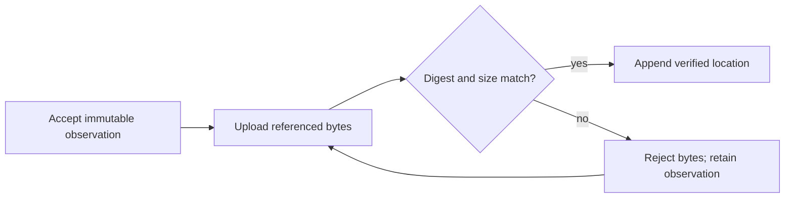
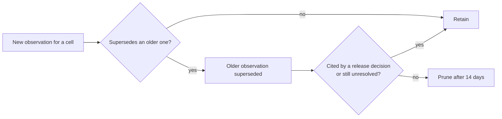

# The evidence store

Build a shared service that records test attempts and preserves their supporting
reports. Recording a result does not establish that it satisfies a testing
requirement: the later verifier makes that decision.

This directory's [`d1-model.md`](./d1-model.md) supplies the proposed tables and
query catalog. This spec defines the delivery boundary and resolves ambiguities
in that proposal; the clarifications below take precedence. The existing
[evidence contract](../../docs/cicd/evidence.md) remains authoritative for record
validation and reuse. This work takes over the "Better Evidence" intent first
drafted in `2026-10-26-change-detection`.

## Why

Evidence lives in Git notes and is queried awkwardly. Reports live in Actions
artifacts or on the host that produced them. Artifact expiry can prevent reuse
of a hosted pass even though its observation still exists. Much of the current
Python reconciles those separate locations.

## Outcome and delivery boundary

At completion, an authenticated TypeScript Worker owns a Cloudflare D1 database
for metadata and a private R2 bucket for report bytes. Hosts and GitHub Actions
can submit existing observation collections through a versioned HTTP API. They
never hold database credentials or submit SQL.

The service is live and has accepted representative host and hosted collections
through an explicit ingestion command. That command is deployment and migration
tooling, not a replacement test runner or verifier. Automatic producer wiring,
historical import, comparison of reuse decisions, and switching the authoritative
reader belong to `2026-11-06-rust-evidence-client`. Existing notes remain the sole
authority until that switch. Do not add a permanent second publication path or
make CI success depend on this service during this stage.

## Preserved contracts

- Store identity remains `{package, environment, gate}` within a repository.
  Areas are derived display groups, never database keys. A narrowed test filter
  adds a compatibility condition without creating a different cell identity.
- Preserve observation IDs, collection context, retry links, failures, incomplete
  attempts, and proof references. Accept version-3 collections and the existing
  version-2 receipt adapter; legacy version-1 import is outside this scope.
  Validate using the executable contracts documented in
  [CI evidence](../../docs/cicd/evidence.md), including canonical identity checks.
  Do not invent a stricter digest format or normalize paths in a way that changes
  an existing ID. New Rust hashing uses `biscuit-hash`.
- Storage does not change scheduling, environment requirements, accepted gaps,
  or the `ci-gate` merge gate. The canonical resolved plan remains the only source
  of required work. A stored pass, verified report location, or new arrival time
  does not by itself authorize reuse. Failures remain visible when reports expire.
- The model's release-readiness queries describe a future consumer, not a release
  policy approved by this spec. Create the evaluation table, but leave public
  evaluation publication disabled until a trusted verifier and its policy exist.
  A producer may not submit an evaluation claiming its own result satisfies coverage.

## Service contract

Publish a machine-readable API contract and checked-in request/response examples
with the Worker. Version the HTTP API independently from the existing evidence
formats and database migrations. Unsupported versions fail explicitly.

| Operation | Required behavior |
|---|---|
| Ingest a collection | Strictly validate shape, identity, collection context, and retry graph before acknowledging it; return accepted and already-present IDs. |
| Read observations | Fetch by ID, export an exact collection, or page candidate history by package, gate, and supplied reachable heads. Include failures and incomplete attempts. |
| Read a snapshot | Return repository revision and observation/location watermarks from one primary-database read; page all reads against those bounds. |
| Upload or fetch proof | Transfer only authorized report and proof bytes referenced by an observation, using bounded requests. |
| Append location history | Record byte verification, unavailability, or withdrawal; only the verifier role can attest a location. |
| Read changes | Page committed observation and location events using separate cursors, bounded by a captured snapshot. |
| Administrative operations | Register repositories, manage credentials, migrate, back up, and restore using a separate operator role. |

Unknown repositories are errors, not empty successful queries. Every list response
states whether another page exists. Cursors bind repository, query, and snapshot;
invalid cursors fail rather than silently restarting. Set and document request,
page, upload, and batch bounds before deployment. Reject oversized collections
before writes; never truncate history or split a retry graph into independently
accepted pieces. The Git-note transport's 256 KiB ceiling does not automatically
become the database's collection limit.

Use stable error codes for invalid input, denied access, conflicting identity,
oversized input, rate limiting, and service unavailability. Distinguish an empty
successful response from a failed lookup. Include retry guidance and a request ID;
never include credentials or report contents in errors or operational logs.

### Atomic ingestion and retries

An identical delivery is an idempotent success: it changes neither the original
publisher nor its timestamp, and does not advance the evidence revision. Reusing
an ID with different canonical bytes or collection context is a conflict.

**Reader's note:** the model's ingestion example allows nonconflicting records to
remain after a concurrent identity conflict, despite its earlier promise of atomic
collection ingestion. This service chooses atomic ingestion so a rejected retry
graph cannot leave half a collection behind. Duplicate/context comparison and any
resulting abort must occur inside the same D1 batch as insertion; checking before
or after the batch is insufficient. Implement a database-enforced conflict guard
and prove rollback under concurrent requests. If the deployed D1 experiment cannot
support this, return the design to Open Questions before implementation proceeds.
[D1 documents transactional batch rollback](https://developers.cloudflare.com/d1/worker-api/d1-database/#batch).

A lost response is safe to retry with the original collection and IDs. Location
events also need a request identity: repeating one identical event returns the
original result without advancing the revision; a different payload under that
identity is a conflict. This requires a small addition to the model's location
event schema. Evaluations and events must never use arrival order to supersede
an observation's test outcome.

### Report and proof storage

Choose R2 for the initial implementation rather than supporting several object
stores. Keep report bytes private and immutable under repository-scoped keys.
The Worker verifies size and digest against the original reference before adding
a usable location. Apply the same integrity checks to expected-test listings and
completion records; preserving JUnit alone is insufficient proof.

D1 metadata and object bytes cannot commit as one transaction. Treat them as
separate recoverable steps:

An observation can arrive before its bytes, including a failing attempt with no
proof. Do not mark it complete or reusable on that basis. If object upload
succeeds but location insertion fails, retry finalization without changing the
observation. Track and clean unreferenced staging objects under a documented
cleanup policy. Existing artifact and host-directory locators remain representable;
a local path is not remotely downloadable. Resolve only typed, allowed locations,
never arbitrary caller-supplied URLs or paths.

Expiry or deletion appends an unavailable or withdrawn location event. A failed
probe is scoped to its location; an expired newest event never revives an older
verification of that location. Independent locations may still be usable. Retention
does not delete observations or turn an unavailable report into a passing result.

### Authentication and authorization

GitHub Actions uses OpenID Connect (OIDC), a short-lived signed workflow identity,
with exact issuer, audience, stable repository ID, and an allowlist of trusted
workflow/ref contexts checked by the service. Untrusted fork pull requests cannot
publish using the base repository's permissions. Never exchange an arbitrary
GitHub identity for unrestricted store access.

Hosts receive individually revocable credentials; the mechanism remains an Open
Question below. Derive repository and role permissions from authenticated identity,
not submitted producer fields. Record the actual publisher separately from claimed
historical provenance. Separate producer, verifier, reader, and operator permissions;
importing old evidence does not make the importer its original test producer.
Revocation stops future access without rewriting past evidence. Record a separate
audit trail for credential and operator changes, without recording secrets.

### Change notifications

The initial event hook is a durable, pull-based change feed backed by committed
observation and location cursors. Consumers persist a cursor only after processing
its page, and must tolerate replay after a crash. It announces evidence changes,
including new failures and withdrawals; it does not schedule tests or authorize a
release. No consumer is required in this spec. Push webhooks, delivery queues, and
exactly-once delivery are outside scope; this avoids losing an event between a
database commit and an external notification.

### Outages and recovery

During this stage, store outages leave existing notes-based behavior unchanged.
After the later reader switch, an unavailable store prevents evidence reuse; it
never proves coverage. The caller may run the canonical plan only where execution
constraints permit. A readiness query reports unavailable rather than success;
it does not itself launch tests. Existing local execution bans remain binding.

The ingestion tool retains the original collection and proof files until durable
acknowledgment. Retry temporary failures with bounded backoff; report persistent
failure with a nonzero exit and a concrete retry command. Do not rerun tests merely
to recover an upload. Do not retry invalid credentials or conflicting IDs forever.

Use primary reads initially, with no read replicas. Migrations are numbered and
reviewed; restore must preserve repository identities, immutable records, and
object references. Back up metadata and object bytes separately and document their
recovery boundary. On restore, reject pre-restore cursors and evaluations using a
store-generation identifier so a reused revision number cannot validate stale
state. Verify referenced objects and recover acknowledged writes after the backup
where possible; report any loss explicitly. Document deployment rollback, operator
ownership, and how credentials are restored without publishing secrets.

## Validation and acceptance

This is a service change, not a reason to add workspace-wide test runs. Add focused
service contract checks and a deployed development-instance correctness check for:

- canonical identity compatibility; duplicate delivery; conflicting duplicates
  during concurrent ingestion; atomic rollback; retry-graph rejection;
- cross-repository denial, untrusted workflow denial, role separation, host
  credential revocation, and expired authentication;
- interrupted uploads, mismatched bytes, missing proof, idempotent finalization,
  location withdrawal, and replayable change pages;
- finite snapshot pagination while writes continue, without hiding failures;
- backup/restore into an isolated instance, object retrieval, and rejection of
  old cursors after restore.

The DDL and query catalog have already passed local SQLite checks. Exercise D1
bindings, generated columns, triggers, and batches against a development instance;
this checks service correctness rather than test execution on multiple operating
systems. Check configured bounds against [D1's documented limits](https://developers.cloudflare.com/d1/platform/limits/).
Do not add a performance campaign: if a timing question remains, use one host and
a quick sample, and state what decision its result changes.

Completion requires the versioned API examples, reproducible Worker deployment and
migrations, a successful host and hosted ingestion demonstration, and an isolated
restore demonstration. Add current operating instructions under `docs/cicd/` for
deployment, credentials, uploads, failures, retention, and restore. Those pages
must explain the actual service without linking back to this dated specification.
Update relevant workflow skills when implementation changes the workflow. Keep
`status: draft-spec` until the decisions below are settled; do not claim the store
is authoritative or the later verifier is implemented.

## Open Questions

### How should hosts receive and rotate credentials?

The service needs unattended access from laptops and test rigs without giving
them operator privileges. Choose one mechanism before production deployment.

- **Per-host random bearer tokens, stored as server-side digests. Recommended.**
  Pros: simple unattended requests, repository/role scope, independent expiry and
  immediate revocation on each authenticated request. Cons: a copied token is usable
  until expiry or revocation; operators must distribute and rotate secrets through
  an existing secure channel. Never place them in the repository or command history.
- **Cloudflare Access service credentials.** Pros: central credential management
  outside the application. Cons: another access-policy layer to operate, and the
  Worker still needs repository/role authorization and verified caller identity.
- **Per-host signing keys.** Pros: requests can prove possession without sending
  the private key. Cons: request signing, replay protection, clock handling, and
  key rotation add client complexity.

Recommend bearer tokens for the small initial host set because they meet revocation
and unattended-use needs with the least protocol complexity. Agree on expiry,
rotation, secure distribution, and operator ownership before enabling host writes.
GitHub Actions continues to use short-lived OIDC identity rather than these tokens.

### How long should report and proof bytes remain available?

**Ruled 2026-11-08: retain what reuse and audit read; prune the rest after a
14-day grace period; operate within the free tier.**

"Durable" means independent of Actions artifact expiry, not unlimited history.
Reuse consults only a cell's latest qualifying pass; a pass superseded by a
newer pass on a descendant commit is never read again, and a failure matters
only until it is superseded. Live storage is therefore bounded by the number of
cells (on the order of a thousand), not by run count.

**Retained indefinitely**, per `{package, environment, gate}` cell:

- the latest qualifying passing observation and its report and proof bytes;
  for an unchanged package this is its last evidence and nothing more
- every unresolved failure or pass/fail conflict, which must keep blocking reuse
- every observation and report a release-readiness decision cites, so a
  release remains auditable

**Pruned** 14 days after supersession: every other observation, its report
locations, and its R2 bytes. The grace period keeps recent superseded failure
reports available for debugging flaky tests.

**Design consequence.** `d1-model.md` makes observation and report-location
history append-only, with triggers that forbid deletion. Replace that with one
sanctioned pruning path: a verifier-driven pruning operation that determines
supersession with the same ordering rules as reuse (strict descendants and
valid retry links, never timestamps or upload order), withdraws report
locations, then deletes bytes and rows. It must refuse to prune a cell's
current pass, an unresolved failure or conflict, or release-cited evidence, and
it must not advance supersession using unavailable store data. Ad hoc deletion
outside that path remains forbidden. Pruning is idempotent and safe to rerun
after partial failure; bytes deleted before their rows are not left referenced
as available.

**Budget.** Operate within Cloudflare's free tier for Workers, D1, and R2,
with a target cost of $0/month; confirm the current free-tier allowances during
planning. The first phase still produces the volume estimate from existing
observations and reports; a projection that exceeds the free tier within 12
months is a blocking finding, not a reason to change retention silently.
Never upgrade to a paid plan automatically; reaching a limit raises an alert
for an explicit operator decision. When a free-tier limit is reached, failed
ingestion or reads degrade to "unproved", so CI executes the work; retained
evidence is never evicted to make room. Report-attestation lifetimes are
separate from byte retention and remain a verifier-policy decision in
`2026-11-06-rust-evidence-client`.

Rejected alternatives: keeping all bytes under a paid-plan budget (pays to
store history nothing reads) and a fixed time-based retention (expires a
still-current pass for an unchanged package, forcing needless retests).

## Not in scope

- Qualification rules, the verifier, automatic producer wiring, historical import,
  and the authoritative reader switch: `2026-11-06-rust-evidence-client`.
- Changing which results count: `2026-11-06-any-host-evidence`.
- New test triggers, merge requirements, release approval policy, or a second planner.

## Correction to the earlier draft

The first draft said Git notes last 90 days. Notes are refs and do not expire.
Artifacts expire, and with them the reports that back a hosted observation.
`Today's Pipeline` is an informal historical sketch, not the scheduling contract:
the current event and scope rules live in the repository's CI documentation and
canonical planner. In particular, do not implement its all-branches nightly scan
or its suggestion that downstream jobs recalculate the canonical plan.
