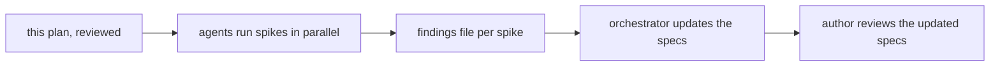
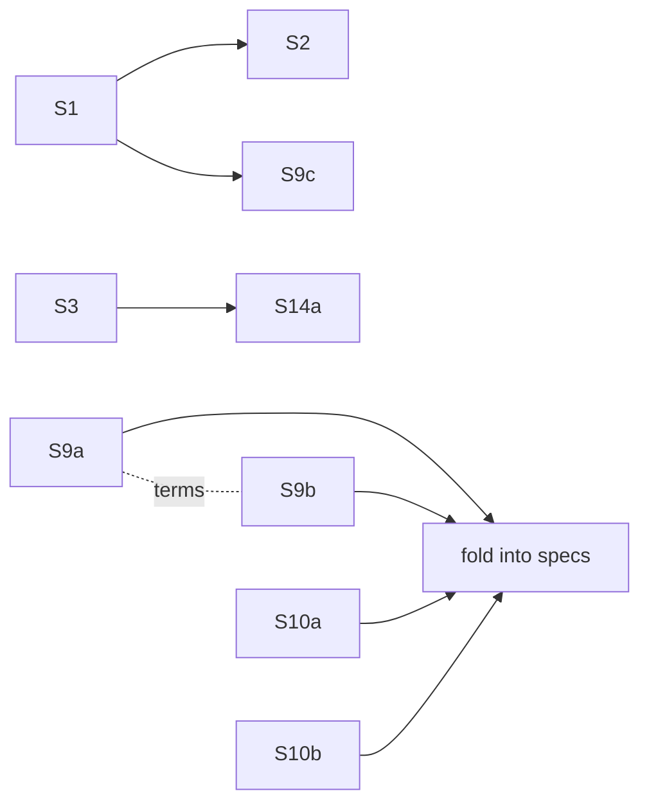

# Spike plan for the evidence and release pipeline

This plan runs the spikes that the pipeline's draft specs depend on, so that each
spec can be finalized from findings rather than guesses. It covers the specs from
`2026-11-06-proven-push-planner-cell` through `2026-10-26-change-detection`.

Each spike answers one question, and each answer changes a named section of a
spec. A spike that cannot name the decision it unblocks does not run.

## How a spike runs



### Rules for every spike agent

- **Read only, as far as shared state goes.** No commits, pushes, tags,
  releases, or pull requests. No CI runs unless the spike below says so and
  the author has approved it. Nothing published outside this machine and the
  `BUILD_*` rigs.
- **Leave the worktree alone.** Never modify a spec, and never touch the
  author's uncommitted files. Experiments run in a throwaway clone under the
  session scratchpad or on a rig's own scratch clone. Never `git stash`.
- **Follow repository skills.** Load `os` and `storage-strategy` before using a
  rig, `rust-devops` for CI and release questions, and `rust-testing` for test
  questions. Run a rig preflight before a large build.
- **Stop at the question.** Do not fix what you find. Record it.
- **Report uncertainty plainly.** "Not determined" is a valid answer. A guess
  presented as a finding is worse than no finding.

### What each spike delivers

One file at `<spec directory>/spikes/<spike-id>-<slug>.md`, which the
repository already uses for spike output:

```markdown
---
spike: S9a
spec: 2026-11-06-rust-evidence-client
question: <the question below, verbatim>
answer: <one line: yes / no / a number / not determined>
confidence: high | medium | low
date: <date run>
---

## Answer
## Evidence          <!-- commands, outputs, file:line references -->
## What this changes in the spec   <!-- section by section -->
## Surprises         <!-- anything that moves a seam or the pipeline order -->
```

## Spikes to run now

Status values: **ready** means the spike can start once this plan is approved;
**needs Ken** means something is waiting on the author.

| ID | Spec | Question | Unblocks | Method | Cost | Status |
|---|---|---|---|---|---|---|
| S1 | `2026-10-28-publish` | Does `dist` 0.34, with `precise-builds`, plan and build one CLI from a `{package}-v{version}` tag in this workspace? | "Scope" (whether `dist` stays the tool) | `dist init` and `dist plan`/`dist build` for `biscuit-hash-cli` in a scratch clone, host target only, without a tag push | Local, under 1 h | ready |
| S2 | `2026-10-28-publish` | Which asset URLs does binstall try for a `{package}-v{version}` tag, and do they match `dist`'s asset names? | Whether each crate needs `pkg-url` | Use `cargo binstall --dry-run` with debug logging against a scratch manifest, compared with S1's asset names; read binstall's default URL templates | Local, under 1 h | ready (after S1) |
| S3 | `2026-10-28-publish` | What are the stripped, LTO sizes and dynamic-library dependencies of the 8 first-set CLIs, and what must a build host install? | The release profile, the cmake/ALSA prerequisites, the PyPI size risk | Release builds on macOS (here) and `$BUILD_LINUX`; check linked libraries with `otool -L` and `ldd` | Rig, 1–3 h of builds | ready |
| S4 | `2026-11-06-ubuntu-archive-disk` | How much disk does each Ubuntu archive build key use, against a hosted runner's free space? | The fix choice (reclaim space, split the job, or shrink archives) | Reproduce the archive build on `$BUILD_LINUX` with disk measured per key; read hosted-runner disk figures from documentation and existing logs. Ask the author for one instrumented CI run only if the local figures cannot answer | Rig, 2–3 h; possibly 1 CI run | ready |
| S5 | `2026-11-06-windows-wsl-test-failures` | Do the unexplained `darkmatter-cli` and `messenger` failures reproduce on `$BUILD_WIN`, and does an 8.3 short-name temp directory reproduce the `RUNNER~1` group? | The verdict column; whether one shared path helper is the fix | `just cross-check` for both packages; rerun with `TEMP`/`TMP` set to an 8.3 short path if the volume supports short names | Rig, 2–4 h | ready |
| S5b | `2026-11-06-windows-wsl-test-failures` | Is `ucrt64` now the default Git for Windows layout, and does `wt` behave correctly but slowly without recognizing it? | Whether this is a product fix and how urgent it is | Git for Windows release notes; check the rig's layout; time `wt list` on the rig | Research and rig, under 1 h | ready |
| S6 | `2026-11-06-legible-ci-names` | How short can a reusable-workflow job's displayed name get, and do readable names require flattening the workflows? | "Scope" and the naming convention | GitHub documentation on job naming for reusable and matrix jobs, plus the names of recent runs from the API. No experimental runs | Research, under 1 h | ready |
| S8a | `2026-10-26-next-gen-pipeline` | Do `d1-model.md`'s schema and queries behave correctly on real D1, including batches, generated columns, triggers, concurrent writes, and size limits? | The data model, or a decision to change stores | Run the DDL, the query catalog, and a concurrency test against a dev D1 database via `wrangler` | Small Cloudflare usage | **needs Ken**: account and API token |
| S8b | `2026-10-26-next-gen-pipeline` | How do laptops and rigs get, rotate, and revoke store credentials, and how does GitHub Actions authenticate? | "Authentication" | Paper design comparing at least three options (for example Cloudflare Access service tokens, GitHub OIDC with a token-exchange Worker, per-host keys), against revocation, setup effort, and leak impact | Research, 1–2 h | ready |
| S8c | `2026-10-26-next-gen-pipeline` | What observation volume and report storage should be expected, and what will it cost? | "Retention and cost" | Measure the current `refs/notes/ci-local/*` notes and recent JUnit artifacts; project forward under merge-triggered runs; apply current D1/R2 pricing | Local and API, 1 h | ready |
| S9a | `2026-11-06-rust-evidence-client` | Which rules in the evidence scripts become unnecessary with one store, and which are real policy that must be ported? | The size of this port, and whether 10 and 15 shrink | A rule catalog for `local_evidence.py`, `observation_notes.py`, `hosted_observations.py`, `reuse_validation.py`, `evidence_index.py`, and `runner_loss.py`: each rule's location, purpose, the failure it prevents, and its classification | Reading only, 3–5 h | ready |
| S9b | `2026-11-06-rust-evidence-client` | Where is gate-input identity computed, and can it be extracted into a library the verifier calls before the planner is ported? | "Verifier and planner seam" | Trace its computation and inputs in `affected_scope.py` and its consumers; propose the narrowest seam | Reading only, 1–2 h | ready |
| S9c | `2026-11-06-rust-evidence-client` | How does CI get a pinned prebuilt evidence tool, and how does it recover from a bad release of it? | "Tool bootstrap" | Paper design informed by S1 | Research, 1 h | ready (after S1) |
| S10a | `2026-11-06-any-host-evidence` | What does archive mode guarantee that a native build on the same OS does not? | Whether the simplified rule can drop archive mode | Read the `os` skill's `wsl.md`, `docs/cicd/evidence.md`, and the history of the archive guard; list each guarantee and the failure it prevented | Reading only, 1–2 h | ready |
| S10b | `2026-11-06-any-host-evidence` | How often have retry links and conflicting results occurred, and would "a later pass for the same inputs wins" have hidden a real failure? | Whether retry links can go | Mine the existing observation notes for retries, conflicts, and fail-then-pass sequences; classify each as flaky or a real fix | Local, 2 h | ready |
| S11 | `2026-11-06-merge-triggered-os-runs` | With one run per OS at a time, how would queues and coverage have behaved over the last 60 days? | Concurrency policy; the nightly's fate | Merge timestamps and per-OS run durations from `gh`; simulate one at a time with replacement | API and local, 1–2 h | ready |
| S13a | `2026-10-27-release-process` | Does anything meaningful depend on a package's version value: tests, snapshots, or embedded strings? | The release-only-diff rule | Search for `CARGO_PKG_VERSION`, `env!("CARGO_PKG_VERSION")`, version strings in snapshots and fixtures, and `--version` assertions | Reading only, under 1 h | ready |
| S14a | `2026-11-06-publish-more-channels` | Does a binary linking `libasound` pass manylinux auditing as a maturin `bin` wheel? | Whether `uv` can ship `claudine` | Build `claudine` on `$BUILD_LINUX`, wrap it in a `bin` wheel, and run `auditwheel show`/`repair` | Rig, 1–2 h, after S3 | ready |
| S14b | `2026-11-06-publish-more-channels` | Are the planned names still free on crates.io, PyPI, and npm under `@yankeeinlondon`? | Naming | Public registry lookups only, with no reservations | Under 30 min | ready |

## Agent assignments

Eight agents. Spikes that share a host or depend on each other share an agent, so
no two agents compete for the same rig.

| Agent | Spikes | Type | Notes |
|---|---|---|---|
| A1 Publishing | S1, S2, S9c, S13a, S14b | `rust-devops`-aware general agent | S2 and S9c follow S1 |
| A2 Linux rig | S3, S14a, S4 | `rust-developer` | In order, on `$BUILD_LINUX`; S4 last because it is the longest |
| A3 Windows rig | S5, S5b | `rust-developer` with the `os` skill | `$BUILD_WIN` |
| A4 GitHub history | S6, S11 | general-purpose | API and documentation only |
| A5 Store design | S8b, S8c | general-purpose | S8a joins here once credentials exist |
| A6 Evidence rules | S9a | general-purpose, high effort | The largest reading task; S9a decides the most |
| A7 Identity seam | S9b | general-purpose | Coordinates its terms with A6's catalog |
| A8 Any-host rules | S10a, S10b | general-purpose | |



## Deferred spikes

These would be measured against code or a design that earlier specs will change.
Each runs when its spec is next in line.

| Spec | Spike | Why wait |
|---|---|---|
| `2026-11-06-rust-ci-planner` | Rule inventory, golden-plan corpus, startup cost | The evidence port changes the planner first |
| `2026-11-06-python-retirement` | Inventory of what remains | The spec sizes itself after the ports |
| `2026-10-26-change-detection` | Safety replay, value measurement, `tree-hugger` readiness | Its target is the Rust planner, which does not exist yet |
| `2026-10-27-release-process` | AI release notes on real commits | The prompt depends on the final flow |

Specs with no spikes: `2026-11-06-proven-push-planner-cell` and
`2026-11-06-release-path-repair` (already reviewed),
`2026-11-01-rust-pre-push` (its open questions are decisions, not unknowns), and
`2026-11-06-os-failure-reports`.

## After the spikes

1. The orchestrator reads each findings file and updates its spec: it settles
   what the answers settle, marks remaining questions, and moves any spike work
   the spec named into its decisions.
2. Any finding that moves a seam or changes the order is reported on its own,
   not buried in a spec edit, and the pipeline check is rerun.
3. The author reviews the updated specs.

## Needs from Ken

- Approve this plan, including the cost column.
- For S8a: a Cloudflare account and an API token scoped to D1 and Workers. Until
  then S8a waits, and the other store spikes run.
- For S4: approval in advance for one instrumented CI run, used only if local
  measurement cannot answer.
- Confirmation that the `$BUILD_LINUX` and `$BUILD_WIN` rigs are free for several
  hours of builds.
