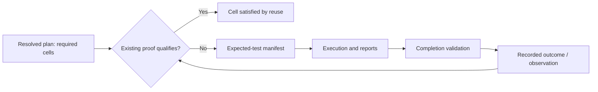

# Calculating Testing Requirements Today

When a commit is pushed to Github we always must run an "assurance pipeline" that validates that this commit is ready for the "core OS's" (macOS and linux). 

Windows and WSL2 are not secondary in importance but instead of being checked on the `commit` event they are instead checked every night where they go through the same assurance pipeline.

## The Pipeline

### Commit Push

- Local Host
    - user runs `git push ...`
    - Pre-Push Hook called
    - Planner asked to determine testing scope as "evidence"
    - the local host is tested across the scope of the evidence which applies to the host's OS
- Github Actions
    - the `ci` job is executed
    - it is passed the "evidence" (including the results from the local run on the host) as a "note" as part of the commit
    - ci _re-calculates_ the plan (NO IDEA WHY) 
    - any evidence from the local host is accounted for and tests are not rerun

### Nightly 

Every night, the `nightly` job is run on Github:

- it checks to see if there are any new commits since the last successful `nightly` run 
    - this is done across all remote branches
- if there are no new commits then the job reports and exits successfully
- if there are new commits
    - if the commit is from `Ken Snyder <ken@ken.net>` with a signed commit then nightly is automatically run
    - if the commit is not signed or not from `Ken Snyder <ken@ken.net>` then the job is left in a "paused" state so that Ken or someone with admin permissions can manually approve the job
- A job with new commits which has been approved, follows these steps:
    - validates what evidence has been proven (mainly what OS's have already been tested) for the commit
    - if there is evidence that has not yet been proven then that evidence will be scheduled and run as part of this job
    - typically that means Windows and WSL tests but it COULD mean macOS or Linux tests if the commit was "forced" to go through even though some tests on these OS's were failing

## Today's Planner

> the `affected_scope.py` script acts as the planner and executor and is used both locally on the host and on cicd.

The planner creates cells grouped by:

- Cargo Package
- Github Environment (`macos-latest`, `ubuntu-latest`, `windows-latest`, `wsl2-ubuntu`)
- Gate (`L1`, `L2`, `Browser`)

Package metadata declares tiers, features, backends, and companion suites. Github Environment determines where those requires apply:

- Pull requests and ordinary pushes to main: Linux and macOS.
- Nightly: native Windows and WSL2.
- Manual dispatch or a PR with ci:all-os: all four.
- Lint and separate compile checks: Linux only.

L1 covers library, binary, and test compilation. A separate check cell covers examples, benches, or unchanged direct dependents.

Each required cell then resolves to:

- execution, 
- verified evidence reuse, 
- or a capability-gap state. 

Reusing evidence preserves the requirement in the plan; it removes only the execution. Lint cells are explicitly non-reusable through local evidence. These rules live in package_cells (scripts/ci/affected_scope.py:3217).

### Theoretical Lifecycle

> Question: does "evidence" start as a requirement?

Conceptually there is a lifecycle, but it spans separate documents—not one evidence object that starts empty and becomes complete.

This Mermaid diagram doesn't fit the current terminal width.

The distinction matters:

- Resolved plan: what must be proved.
- Scope receipt: publishes that plan before testing; proves no tests passed.
- Expected-test manifest: enumerates actual test identities on the execution target before running them.
- Reports and completion record: establish what happened and whether the producer fulfilled its contract.
- Receipt/observation: records the measured outcome for verification and possible later reuse.

Evidence can record failure. Only qualifying passing evidence satisfies a requirement. A newer qualifying failure—or conflicting results—can prevent reuse of an older pass. See the evidence documentation (docs/cicd/evidence.md).
