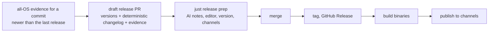

# The Release Process

We are using the [Release-Plz](https://release-plz.dev/) solution today and we can continue to if it makes sense but in this spec we are going to define what is required and then agree on the right solution for it.

## Decision needed first

Two descriptions of this process now exist, and they differ:

| | Authored process (below) | Discussed on 2026-11-06 |
|---|---|---|
| Starts when | A person runs `just release` | Evidence for all four OSes exists |
| Happens through | A local interactive flow | A release pull request |
| Reaches `main` by | A push, as the sole exception to PR-only | A normal merge |
| Testing | None; existing evidence is posted | None; existing evidence is shown |

**Recommended combination:**

This keeps everything in the authored process, including the human review and AI
notes, and removes the need for any exception to PR-only `main`. That exception was
the part flagged as a security concern.

## The Process (as authored)

- Prelude
    - code in `main` -- which can only come in via PR's -- has evidence of tests passing on 1 or more OS's
    - evidence from Linux and macOS is always available because that is done immediately when pushing the PR
    - the PR should not allow the "merge to main" force override option unless at least one OS has provided fully successful evidence but it shouldn't pass unless all tested OS's provide full passing evidence
    - the Windows and WSL2 tests are run every evening and they can consolidate evidence on the PR or on a merge to main
        - this is done because testing can be VERY long and Windows and WSL most of all
        - putting this into an asynchronous cycle allows better cycle time and in the relatively rare cases where Windows or WSL have errors the nightly job identifies it and a targeted fix can be built
    - when a commit in `main` has passing evidence across all 4 supported OS's it is now eligible for being released
- Readiness Check
    - we should have a quick and easy check that indicates whether `main` is "release ready" or not
      - if we are not in a "release ready" state it should immediately fail and describe what is failing
      - if we are in a "release ready" state then move to **Release Prep**
- Release Prep
    - list all commits since last release (with single line of description ... aka, each commit is one line); up to a max of 50 where we would then just communicate: `- plus <b>{#}</b> more commits`
    - then report `- producing draft release notes`
    - then we will run a local AI agent to evaluate the key changes in this commit:
        - the local AI agent will simply compose a Markdown prompt we've written to `prompts/release.md`
            - this prompt should provide all the base context it needs to do it's job
        - It needs to report on:
            - new functionality introduced
            - refactored functionality (including details around public interfaces and what changes if any were introduced)
            - fixes made to existing functionality
    - the AI agent's job is to:
        - succinctly but clearly detail out the changes that this release produced
        - suggest whether this release is a "major","minor", or "patch" release
    - We send the release notes to the user's favorite editor using the `claudine edit` functionality
        - this allows them to read/review and make any adjustments they would like to
    - interactive prompt to agree on the release version number (with the recommended release version based on the AI's response)
    - we then use the mapping data in @docs/deployment.yaml to determine what platforms the given package will be deployed/published to. This will be reported to the user to confirm these platforms are their intention (simple yes/no confirm)
- Changelog
    - the CHANGELOG.md in each package being released is updated with the release information agreed to
- Release on Github
    - the changelog(s) are committed and then pushed, tag the release version
    - no testing should be required but we can post all the OS evidence to verify that we are in the appropriate state to release
    - Note: it is important to NOT do testing again as it is fully redundant at this point!
    - Github should then:
        - publish this commit as a release along with the release notes (this must be allowed as the sole exception to updating `main` without a PR)
            - this exception should be well thought through so as not to introduce a security vulnerability
        - a build of the package for each OS should be posted to Github
- Publish
    - Once Github's release has culminated we should concurrently publish to the agreed upon platforms

### Ideas

- if Release-Plz is able to deterministically build a "changelog" then we might want it to do that and then after the AI has created it's rendition have it review what was produced by Release-Plz and do one final iteration on the changelog
- the release process should be wrapped by `just`: `just release <package>` at repo root or `just release <package?>` in a package area where if no discrete package is specified then it is assumed that all packages in that package area are being released.

## Rules this spec must settle

- **The trigger.** Use "a `main` commit with complete evidence, newer than the last
  release" rather than "the latest commit", which may never be proven if a merge
  lands before each run finishes.
- **The release's own diff.** Bumping versions and changelogs creates a new tree,
  which would invalidate the evidence. A diff limited to versions, changelogs, and
  the lockfile must inherit the evidence, with a check that the diff is limited to
  exactly those files. That check is what lets `ci-gate` pass with no tests.
- **Accepted gaps.** `d1-model.md` proposes that capability gaps block a release.
  The Windows and WSL2 Level 2 cells are gaps today, so that needs a ruling.
- **Packages.** Is a release whole-repo, or per-package as `just release <package>`
  implies? Does a package need all-OS evidence for its own closure, or for the whole
  commit?
- **Keep or replace release-plz.** It may stay for versions and changelogs, or be
  replaced by the tool that owns the rest of this flow.

## Spikes needed

- **Release-only diff.** Does anything meaningful depend on the version value, such
  as tests reading `CARGO_PKG_VERSION`?
- **AI notes.** Try `prompts/release.md` on a real span of commits before committing
  to its shape.

## Guidelines

- no code can be written in Python!
- if there is a need to write faster turn-around code then it must be in Typescript (but Rust is always considered acceptable too)
- any just recipes should provide "glue" but not business logic
