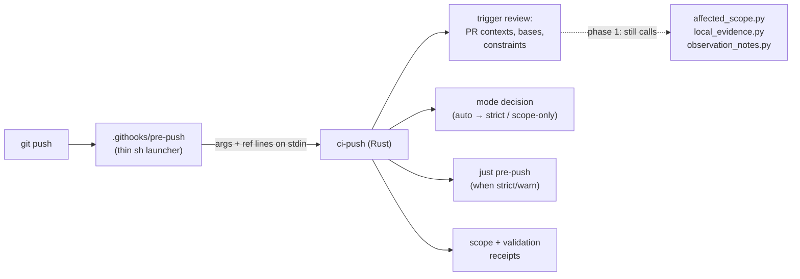

# Move the Pre-push Hook's Logic into Rust

> **Pipeline note (2026-11-06):** Phase 1 is this spec's scope. Phase 2 ports
> evidence code that the planned shared evidence store replaces, so that work moves to
> `2026-11-06-rust-evidence-client` rather than being ported twice, and its
> `affected_scope.py --apply-to` piece moves to `2026-11-06-rust-ci-planner`.

## Why

`.githooks/pre-push` is a ~770-line POSIX `sh` script that orchestrates five
Python programs (`affected_scope.py`, `diff_scope.py`, `local_evidence.py`,
`constraints.py`, `observation_notes.py`). Two facts from 2026-11-01 show the
cost:

- **It does not work on native Windows.** From Git Bash, `python3` resolved to
  a Cygwin shim that `exec`s a `/cygdrive/...` path Git Bash cannot open, so
  the trigger review failed and *every* push was blocked, including one meant
  only to move a branch to another host. The only way through was
  `--no-verify`. The `os` skill records the same class of failure on the build
  rigs ("`python3` is a broken shim; use `py`") and a list of other
  shell-to-native traps (CRLF from `jq.exe`, `/cygdrive` arguments, Cygwin
  taking over `PATH`).
- **Its tests run on Linux only.** `.githooks/tests/test-pre-push.sh` (71 cases,
  ~2,600 lines of Bash) hard-codes `PATH=<tmp>:/usr/bin:/bin` and symlinks
  native executables, so it cannot run on native Windows and runs in CI only on
  `ubuntu-latest`. The hook's Windows behavior is therefore unproven by any
  test.

Every package in this monorepo must work on macOS, Linux, native Windows, and
WSL2. Hardening the shell and the Python interpreter lookup around this would
deepen the dependency that causes the problem. The repository's direction is
that real logic lives in Rust (or TypeScript) and `just` recipes and hooks stay
thin.

## What changes

The hook becomes a thin launcher. A new Rust binary, `ci-push`, in the
`repo-deps` crate (`scripts/`), owns the hook's decisions and is tested with
nextest on every OS.

### Phase 1 — `ci-push` owns the orchestration

`ci-push` takes over, with behavior identical to the current hook unless stated:

1. **Ref-update parsing** — the `<local ref> <local sha> <remote ref> <remote sha>`
   lines Git supplies; deletions, tags, and non-branch destination refs skipped by name. Read
   the complete update list before reviewing any update, since another update
   in that list can change a pull request’s base. Reject malformed nonempty
   lines rather than silently reviewing only part of a push. An empty list or
   a list containing only skipped updates runs no gate and publishes nothing.
2. **Trigger contexts** — for a push to `main`, the remote's previous tip (all
   zeros means full scope); for any other branch, one context per open pull
   request whose head it is (listed by spawning `gh pr list`), against the
   current remote tip of its base, and both states when the same push also
   updates that base; with no open pull request, the provisional plan against
   the remote's `main`.
3. **Mode resolution** — `RUSTY_BISCUIT_PRE_PUSH` = `auto` (default), `strict`,
   `warn`, `scope-only`, `off` (alias of `scope-only`). `auto` resolves to
   `strict` when any reviewed update starts a CI run (an update of `main`, or of
   a branch with an open pull request) and to `scope-only` otherwise.
   *(The `auto` mode already exists in the `sh` hook as of 2026-11-01; this
   phase moves it, it does not invent it.)*
4. **Committed-tree planning** — materializing a temporary detached worktree
   when the reviewed revision is not the clean checkout, and removing it on
   every exit path (including Ctrl-C).
5. **Path set** — the committed `base..head` `--name-status` path set handed to
   the planner, replacing `diff_scope.py`.
6. **Execution constraints** — reading the constraint store and refusing an
   executing prohibited cell, replacing `constraints.py check` (the store
   format is unchanged).
7. **Gates and publication** — running `just pre-push` with the reviewed plan,
   and every rule that withholds a validation receipt (dirty tree, selection
   override, interrupted run, push that does not carry `HEAD`, ...), with the
   same actionable information. Presentation may use `biscuit-terminal`
   components; message wording and ANSI bytes are not a compatibility API.
8. **Python, where still needed, is found by Rust**: a working interpreter of at
   least 3.10, tried as `python3`, then `py -3` (Windows), then `python`, each
   *executed* with a non-interactive version probe to prove it runs rather
   than only found on `PATH`. Retain the selected executable and its argument
   prefix for every direct Python call. Probes have a bounded timeout and
   reject failed launches and unsupported versions. A missing interpreter is
   one clear error that names what was tried. Audit Python calls in invoked
   helpers too: a helper that starts `python3` again can recreate the Windows
   failure even after Rust selected `py -3`. Thread the selected interpreter
   through those helpers without changing their planning rules. Keep
   `PYTHONDONTWRITEBYTECODE=1` for committed-tree helpers.

### Launcher and process boundaries

Keep the installed worktree-aware dispatcher. It must continue selecting the
invoking checkout’s `.githooks/pre-push`, never another worktree’s binary.
The versioned hook only enters the checkout and invokes Cargo with explicit
package, feature, and binary selectors, forwarding Git’s two arguments, stdin,
and the final exit status. Use `--` before binary arguments. Cargo performs
freshness checking on every invocation; do not choose a release binary by
source timestamps, which miss feature, toolchain, dependency, and branch changes.
A build failure blocks the push with a useful diagnostic. No automatic download
or global installation fallback is introduced.

The proposed command is `cargo run -p repo-deps --no-default-features
--features build-tools --bin ci-push -- <remote-name> <remote-url>`; its feature
selection depends on the dependency decision in Open questions. Avoid recursive
Cargo lock waits: the launched binary must run only after Cargo has finished
building it, and helper builds must not inherit a held build lock.

Rust reads and owns Git’s complete stdin before starting children; children
that do not require input receive null stdin. Pass arguments as separate values,
without constructing shell command strings. Preserve paths with spaces and
Unicode, accept CRLF ref lines, and keep native Windows paths native when
invoking Python. Git Bash’s argument conversion must not reinterpret file paths.
Clear the repository-pinning `GIT_*` variables currently cleared by the hook
before fixture-independent helpers or gates run; preserve unrelated Git
configuration and credentials. Local repository and host discovery use `sniff`,
and programmatic Git operations follow the repository’s in-process `gix`
policy. Remote fetches and evidence pushes remain explicit Git CLI boundaries
that honor the user’s transport configuration.

Temporary detached worktrees are runtime review artifacts, not development
worktrees. Remove only artifacts this invocation created. On normal exit,
review failure, and catchable interruption, terminate and reap children before
removing their working directories. Never promise cleanup after a forced kill
or power loss; on cleanup failure print the retained path and recovery action.
An interrupted gate cannot publish validation evidence or become a successful
`warn` result. Durable reports survive temporary-directory cleanup.

### Decision and evidence contracts

The following are preserved behavior, not new policy:

- Review every branch/context before publication or local gates. A review,
  evidence-verification, or constraint failure blocks **every mode**, including
  `warn` and `scope-only`. `warn` permits ordinary gate failures only. An invalid
  mode blocks before doing work; `off` retains its deprecation message.
- Check constraints against the evidence-applied committed plan, using the
  pushed remote URL and both local and destination branch names when renamed.
  Only cells still scheduled to execute can violate a constraint. A package
  selection override narrows local gates only; it never narrows this review.
  Keep existing repository identity, branch matching, home-directory resolution,
  and `BISCUIT_CI_CONSTRAINTS_DIR` behavior. CI does not read this local store.
- On GitHub, a failed or unavailable pull request lookup is a review failure,
  not proof that no pull request exists. Retain the non-GitHub provisional-plan
  behavior and the rejection of a push deleting an open pull request’s base.
- Keep the planner as the only scope authority. Preserve its package,
  environment, and gate identities and event selection. Feed the first reviewed
  HEAD context’s plan to clean, unmodified local gates; do not calculate scope
  a second time. A dirty checkout or selection override still replans only for
  local feedback and cannot publish validation evidence.
- A scope receipt and a validation receipt prove different things. Scope
  describes the committed tree even when the checkout is dirty. It binds only
  HEAD’s first eligible context; an all-zero or non-ancestor base cannot produce
  that receipt. Other contexts fall back to planning in CI.
- Recheck HEAD identity and cleanliness after gates, as well as before them.
  Complete failing cell results remain diagnostic evidence; interrupted or
  incomplete runs do not. Retain reports before writing a receipt, preserve
  compatible prior cells on retry, and never let a failed publication erase
  durable reports. Scope-recording/publication failures remain advisory after
  successful review; CI calculates its own plan. Validation publication failures
  likewise leave CI responsible for execution and do not change the gate result.

No plan, receipt, or constraint schema changes are intended. Compare the Rust
constraint reader against the existing Python reader on shared fixtures. If a
schema change proves necessary, document it in `docs/cicd/schema-versions.md`
and update every listed reader rather than silently accepting a new format.

### Later work — outside this implementation

**Reader’s note:** the original Phase 2 promised a Python-free push while also
allowing the Python planner to remain. Those outcomes cannot both hold. This
spec completes the Rust orchestration and interpreter-selection fix only.
`2026-11-06-rust-evidence-client` owns the remaining evidence operations;
`2026-11-06-rust-ci-planner` owns planning and `--apply-to`. A Python-free push
is an acceptance condition of that later chain, not this spec. Do not build a
second evidence store client or port the planner here.

## Tests

- Every behavior `test-pre-push.sh` covers today becomes an L1 nextest test of
  `ci-push`, driven through fixture repositories with a bare local remote and
  stub `gh`/`just` executables built as test binaries (no shell scripts, no
  `/usr/bin` assumptions), so the suite runs on macOS, Linux, native Windows,
  and WSL2.
- `test-pre-push.sh` and `pre-push-hook-tests.yml` are deleted once parity is
  shown case by case (a table in the implementation log mapping every
  Bash case present at implementation time to its Rust test; 71 is the draft’s
  historical count).
- The thin hook and existing dispatcher are exercised through Git’s actual
  hook invocation, checking argument/stdin forwarding, success and failure
  status, and worktree selection. Native Windows covers Git started from both
  Git Bash and PowerShell; these are process tests, requiring no focused window.
- Add focused cases for malformed/CRLF input, multi-update base changes, dirty
  and non-HEAD outgoing trees, interruption and child cleanup, retained reports,
  publication failure, and Python fallback (including a broken first candidate
  and a helper that would otherwise launch `python3` again). No test uses the
  user’s remotes, credentials, evidence directory, or constraint store.
- Register the Rust suite under `repo-deps`’ existing L1 coverage. Ensure changes
  to the hook and dispatcher select their owning tests through the established
  test-input/source-input declarations. Replace or remove obsolete root test
  recipes and workflow references in the same change; retain dispatcher coverage.
  Use runtime test-toolkit/harness paths so nextest archives work on WSL2.
  Reuse the canonical environment schedule rather than adding a dedicated
  four-environment hook workflow. Local acceptance evidence can cover all four
  environments without changing which environments a pull request schedules.

## Acceptance criteria

1. On native Windows (Git Bash and PowerShell-launched Git), a push of a branch
   with no open pull request succeeds without `--no-verify`, runs no gate, and
   publishes an eligible scope receipt using a supported fallback interpreter
   when `python3` is absent or broken. Its invoked helpers also use that
   interpreter. Missing all supported interpreters produces one clear error.
2. The same push with `RUSTY_BISCUIT_PRE_PUSH=strict` runs the gates.
3. `.githooks/pre-push` contains no decision logic: no mode resolution, no
   pull request listing, no constraint check.
4. The `ci-push` L1 suite passes on all four environments.
5. Docs (`docs/topics/ci-cd.md`, `docs/testing-strategy.md`, `README.md`, the
   `rust-devops` and `os` skills) describe the binary and drop references to
   the retired Bash suite.

## Non-goals

- Changing what the hook decides (modes, contexts, constraints, receipts).
- Porting Python that the push path does not call.
- Changing CI's own use of the Python planner.

## Open questions

1. **Which dependency tier should own the binary?** The draft promises the
   `build-tools` tier avoids `gix` and `sniff`, but repository policy requires
   in-process Git reads and `sniff` discovery. Currently `sniff` belongs to
   `local-tools`; cancellation support (`ctrlc`) does too. This must be settled
   before implementation chooses the launcher’s feature flags.

   - **Use `local-tools` (recommended).** Reuse the existing discovery and Git
     implementation and cancellation support. Pros: follows repository policy,
     avoids duplicated discovery, and reduces repeated Git subprocesses,
     especially on Windows. Cons: a fresh clone compiles the larger dependency
     closure. Prefer this correctness-first choice unless the author explicitly
     approves a narrower dependency design; no additional performance spike is
     required to decide the port’s behavior.
   - **Keep `build-tools` with a narrower discovery feature.** Pros: could keep
     startup builds smaller while retaining shared discovery behavior. Cons:
     requires a separate review of `sniff` feature boundaries and adds work
     outside this orchestration port. Do not promise that reduction until its
     dependency closure is established.
   - **Keep `build-tools` and approve a Git CLI/discovery exception.** Pros:
     limits the initial compile closure and resembles the old hook. Cons:
     departs from repository standards and retains process overhead and parsing
     risks. Requires explicit author agreement and documented boundaries.

## Resolved review decisions

- Keep the current shell `auto` behavior until Rust replaces it. Backing it out
  would change when gates run without helping verify the port.
- Let Cargo check binary freshness. Do not add timestamp-based binary selection
  or a bootstrap benchmark: this port introduces no measured build-cost target
  that needs a performance experiment.
- Preserve decision behavior and evidence formats, while improving diagnostics
  and replacing shell-specific presentation with terminal components where used.
