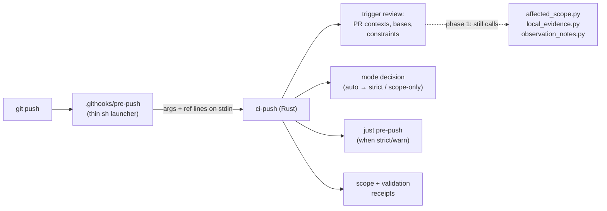

# Move the Pre-push Hook's Logic into Rust

> **Pipeline note (2026-11-06):** Phase 1 is this spec's scope. Phase 2 ports
> evidence code that the D1 store replaces, so that work moves to
> `2026-11-06-rust-evidence-client` rather than being ported twice, and its
> `affected_scope.py --apply-to` piece moves to `2026-11-06-rust-ci-planner`.

## Why

`.githooks/pre-push` is a ~770-line POSIX `sh` script that orchestrates five
Python programs (`affected_scope.py`, `diff_scope.py`, `local_evidence.py`,
`constraints.py`, `observation_notes.py`). Two facts from 2026-11-01 show the
cost:

- **It does not work on native Windows.** From Git Bash, `python3` resolved to
  a Cygwin shim that `exec`s a `/cygdrive/...` path Git Bash cannot open, so
  the trigger review failed and *every* push was blocked, including one meant
  only to move a branch to another host. The only way through was
  `--no-verify`. The `os` skill records the same class of failure on the build
  rigs ("`python3` is a broken shim; use `py`") and a list of other
  shell-to-native traps (CRLF from `jq.exe`, `/cygdrive` arguments, Cygwin
  taking over `PATH`).
- **Its tests run on Linux only.** `.githooks/tests/test-pre-push.sh` (71 cases,
  ~2,600 lines of Bash) hard-codes `PATH=<tmp>:/usr/bin:/bin` and symlinks
  native executables, so it cannot run on native Windows and runs in CI only on
  `ubuntu-latest`. The hook's Windows behavior is therefore unproven by any
  test.

Every package in this monorepo must work on macOS, Linux, native Windows, and
WSL2. Hardening the shell and the Python interpreter lookup around this would
deepen the dependency that causes the problem. The repository's direction is
that real logic lives in Rust (or TypeScript) and `just` recipes and hooks stay
thin.

## What changes

The hook becomes a thin launcher. A new Rust binary, `ci-push`, in the
`repo-deps` crate (`scripts/`), owns the hook's decisions and is tested with
nextest on every OS.

### Phase 1 — `ci-push` owns the orchestration

`ci-push` takes over, with behavior identical to the current hook unless stated:

1. **Ref-update parsing** — the `<local ref> <local sha> <remote ref> <remote sha>`
   lines Git supplies; deletions, tags, and non-branch refs skipped by name.
2. **Trigger contexts** — for a push to `main`, the remote's previous tip (all
   zeros means full scope); for any other branch, one context per open pull
   request whose head it is (listed by spawning `gh pr list`), against the
   current remote tip of its base, and both states when the same push also
   updates that base; with no open pull request, the provisional plan against
   the remote's `main`.
3. **Mode resolution** — `RUSTY_BISCUIT_PRE_PUSH` = `auto` (default), `strict`,
   `warn`, `scope-only`, `off` (alias of `scope-only`). `auto` resolves to
   `strict` when any reviewed update starts a CI run (an update of `main`, or of
   a branch with an open pull request) and to `scope-only` otherwise.
   *(The `auto` mode already exists in the `sh` hook as of 2026-11-01; this
   phase moves it, it does not invent it.)*
4. **Committed-tree planning** — materializing a temporary detached worktree
   when the reviewed revision is not the clean checkout, and removing it on
   every exit path (including Ctrl-C).
5. **Path set** — the committed `base..head` `--name-status` path set handed to
   the planner, replacing `diff_scope.py`.
6. **Execution constraints** — reading the constraint store and refusing an
   executing prohibited cell, replacing `constraints.py check` (the store
   format is unchanged).
7. **Gates and publication** — running `just pre-push` with the reviewed plan,
   and every rule that withholds a validation receipt (dirty tree, selection
   override, interrupted run, push that does not carry `HEAD`, ...), with the
   same messages.
8. **Python, where still needed, is found by Rust**: a working interpreter of at
   least 3.10, tried as `python3`, then `py -3` (Windows), then `python`, each
   *executed* to prove it runs rather than only found on `PATH`. A missing
   interpreter is one clear error that names what was tried.

The hook script reduces to locating or building `ci-push` and `exec`ing it with
its arguments and stdin. Building follows the `ci-build` precedent: `cargo run
-p repo-deps --no-default-features --features build-tools --bin ci-push`
(the `build-tools` tier, so a push never compiles sniff's DuckDB or `gix`
closure).

### Phase 2 — the remaining Python on the push path

Port what `ci-push` still calls: `local_evidence.py` (`scope-record`,
`verify --cells`, `record-cells`), `observation_notes.py publish-receipt`,
and `affected_scope.py --apply-to`. After this phase a push needs no Python.
`affected_scope.py`'s planning (~6,000 lines, shared with CI) is large enough
to warrant its own spec; Phase 2 may stop at a Rust-callable seam around it.

## Tests

- Every behavior `test-pre-push.sh` covers today becomes an L1 nextest test of
  `ci-push`, driven through fixture repositories with a bare local remote and
  stub `gh`/`just` executables built as test binaries (no shell scripts, no
  `/usr/bin` assumptions), so the suite runs on macOS, Linux, native Windows,
  and WSL2.
- `test-pre-push.sh` and `pre-push-hook-tests.yml` are deleted once parity is
  shown case by case (a table in the implementation log mapping each of the 71
  Bash cases to its Rust test).
- The thin hook gets one test per OS: it launches `ci-push` and forwards the
  exit code.

## Acceptance criteria

1. On native Windows (Git Bash and PowerShell-launched Git), a push of a branch
   with no open pull request succeeds without `--no-verify`, runs no gate, and
   publishes the scope receipt, with no `python3` shim on `PATH`.
2. The same push with `RUSTY_BISCUIT_PRE_PUSH=strict` runs the gates.
3. `.githooks/pre-push` contains no decision logic: no mode resolution, no
   pull request listing, no constraint check.
4. The `ci-push` L1 suite passes on all four environments.
5. Docs (`docs/topics/ci-cd.md`, `docs/testing-strategy.md`, `README.md`, the
   `rust-devops` and `os` skills) describe the binary and drop references to
   the retired Bash suite.

## Non-goals

- Changing what the hook decides (modes, contexts, constraints, receipts).
- Porting Python that the push path does not call.
- Changing CI's own use of the Python planner.

## Open questions

1. **Bootstrapping cost.** The first push on a fresh clone compiles `ci-push`.
   `ci-build` already sets this precedent, but should the hook prefer a
   prebuilt `target/release/ci-push` when one is fresher than its sources?
2. **The interim `sh` `auto` mode.** Keep it in the hook until Phase 1 lands
   (current behavior), or back it out so the logic is written only once?
