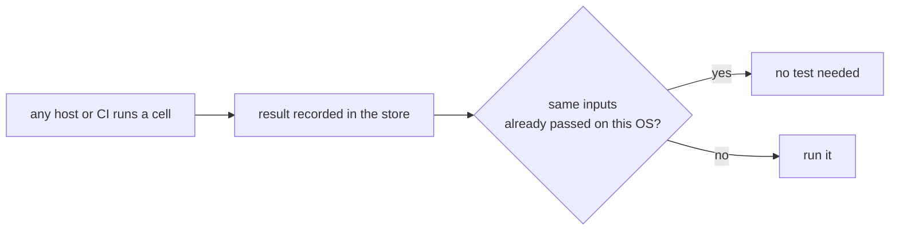

# Evidence counts wherever it was produced

## Why

Evidence is required for each OS, but where it came from should not matter.
Windows and WSL2 hosts can run tests today, yet a result only counts from a clean
remote worktree, unfiltered, in archive mode, so it is easy to spend hours on
tests that contribute nothing. Nothing reads that evidence at pull request time
either, because those environments are not scheduled then.

## Outcome

One rule on every OS: a complete, passing run of a cell, from a clean committed
tree, counts for that OS, for as long as that cell's inputs are unchanged.

- Evidence is keyed on inputs: the package's build closure plus the gate's global
  inputs. The commit is recorded as a label, so a merge commit and a docs-only
  commit retest nothing.
- A local run reports why it will not count **before** it starts.
- Pull requests read any OS's evidence that exists, and report the rest as not
  yet proven rather than failing.

## Scope

- The simplified rule, replacing the `rig` and archive-mode conditions.
- Failures stay in the record. A later pass for the same inputs outranks an
  earlier failure, without needing today's retry links, if the spike allows.
- Decide what `just ci-seed` and `just cross-check` become.
- Update `docs/cicd/evidence.md`, the `os` skill's `ci-evidence.md`, and
  `CLAUDE.md`.

## Spikes needed

- **Is archive mode essential?** Learn what it guarantees before dropping it. The
  WSL2 archive model exists because of compile-time paths, so a native build may
  prove something different.
- **Retry links and conflicts.** Can they really be removed without allowing a
  flaky pass to hide a real failure?

## Open questions

Today `lint`, `check`, browser, and companion-suite work always run in CI, whatever
evidence exists, which conflicts with never repeating a test that has passed. Decide
per gate whether it can qualify from any host, or must stay in CI and why. A release
pull request needs this answer to pass with no testing.

`2026-10-27-release-process` asks that a merge need at least one OS's full
evidence and no failing OS. Today's merge gate differs. Decide the rule here,
since this spec owns what evidence means at pull request time.
