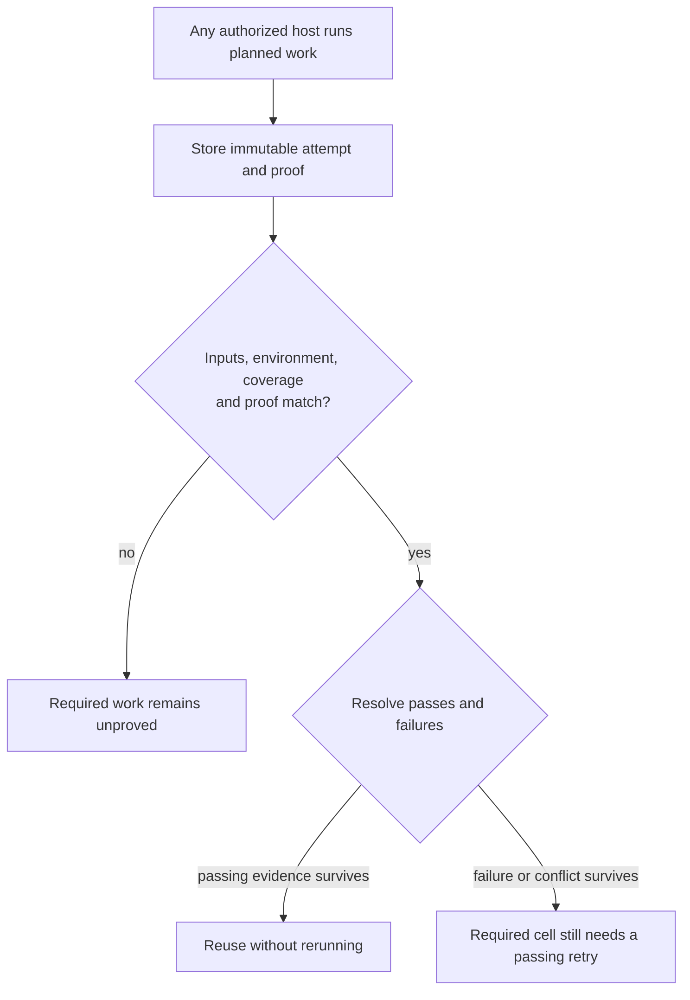
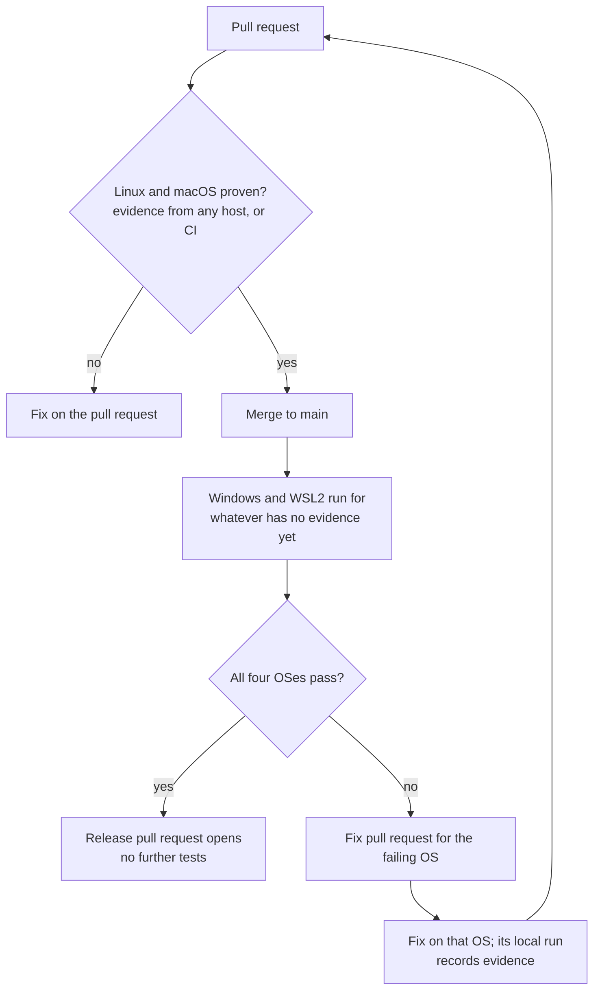

# Evidence counts wherever it was produced

## Why

Tests run on developer machines, remote build hosts, and hosted CI. A result
should count when it proves the required work, regardless of which of those
places produced it. Today remote Windows and WSL2 recording is restricted to
clean, unfiltered archive runs through the cross-check recorder. Other local
paths already produce reusable evidence; this change makes qualification
consistent rather than assuming all host evidence is currently rejected.

## Outcome

A complete, passing run from a clean committed tree can satisfy a matching
**cell**: one Cargo package, environment, and gate. A gate is a required activity
such as lint, compilation checking, or a test tier. Reuse lasts while the cell's
inputs and coverage requirements match and no unresolved qualifying failure
blocks it. The host's name and the command used to start the run are provenance,
not eligibility rules.

A commit identifies where an attempt ran; it is not the sole reuse key. Git
history still matters for reachability, coverage boundaries, and ordering
failures. A merge or documentation change avoids reruns only when verified
inputs remain equivalent. Version, manifest, or lockfile changes are not
blanket exemptions: the verifier must account for any build effects.

## Scope and prerequisite boundary

Build on the shared Rust verifier and authoritative store delivered by
`2026-11-06-rust-evidence-client`. That prerequisite preserves current rules;
this specification intentionally broadens producer eligibility. Use its
snapshot, authentication, durable report, retry, and outage contracts rather
than adding another acceptance path.

- Keep stored identity keyed by `{package, environment, gate}`. Package areas
  group the display only.
- Remove special eligibility based solely on the `rig` producer kind, a remote
  worktree location, or invocation through `cross-check`.
- Retain clean committed inputs, complete execution, verifiable reports,
  required backends, feature selection, and environment compatibility.
- Keep event scheduling in the canonical resolved plan. Reading Windows or
  WSL2 evidence on a pull request does not schedule either environment there.
  New merge-triggered runs belong to `2026-11-06-merge-triggered-os-runs`.
- Merge policy is unchanged (ruled below). Release readiness remains
  owned by `2026-10-27-release-process`; this feature supplies evidence, not
  release authorization.

## Qualification contract

The verifier recomputes input equivalence from repository objects and the
canonical plan. Identity includes the package's declared build closure,
gate-specific global inputs and recipe closure, plus the coverage contract:
features, target kinds, toolchain/build compatibility, selected tests, required
companions, and backends. A stored digest alone proves none of these. Unknown
inputs or missing Git objects mean no reuse, with a reason.

An eligible producer must establish:

1. The tested checkout matches the recorded committed tree before execution
   and remains unchanged through completion. Reject relevant untracked or
   ignored input contamination; generated build outputs are not source changes.
   Keep before/after checks and report validation, not just a caller's `clean`
   flag. A changing checkout yields a retained diagnostic attempt, not reuse.
2. The actual execution environment matches the plan's environment contract.
   Use `sniff` for discovery. Native Windows, WSL2, Linux, and macOS remain
   distinct. Cross-compilation is compile proof only; an x86_64 requirement is
   not automatically satisfied by an arm64 run on the same OS.
3. The expected-test listing and reports prove the entire selected activity,
   with existing ignored-test and approved-skip rules. Missing tests, interrupted
   runs, and capability gaps never become passes. Terminal and browser tests
   must keep windows from gaining focus.
4. Reports and completion proof are digest-checked and durably retrievable by
   other readers. A path present only on the producing machine cannot qualify
   elsewhere. Producer authorization comes from authenticated store access,
   never from an environment label in submitted JSON.

Before starting, the shared runner prints the planned cells, execution mode,
and any known reason the run cannot earn reuse. It revalidates after running;
preflight is not a promise that a later upload or completion check will succeed.
Dirty-tree smoke runs remain useful and may run with a clear warning. A failed
publication retains the attempt and proof for explicit upload retry; it does
not report successful publication.

A manually filtered run cannot satisfy a whole-tier cell. Preserve the existing
exception for a plan's narrowed test-input cell: matching filter, exact tree,
and the current cross-host allowance. Do not broaden that exception into
cross-OS credit for ordinary tests.

## Execution mode is part of what was proved

**Reader's note:** removing an arbitrary archive requirement and removing
archive portability coverage are different changes. An archive run executes
prebuilt binaries away from the builder's paths. A native build can pass while
hiding a broken compile-time fixture path, so the modes are not interchangeable.

Native builds qualify for cells whose execution contract permits native work,
including native Windows cells. For an archive-only contract, such as today's
WSL2 environment, retain verified archive execution, relocation safeguards,
and builder/runtime compatibility. A native WSL2 result can be retained for
inspection but cannot replace that cell's archive proof. Archive execution
proves behavior on the consumer, not compilation there.

The verifier compares the execution requirement carried by the plan rather
than hardcoding a list of special producer names. Changing WSL2 to permit native
execution would require a separate explicit coverage decision and mitigation
for lost archive-path coverage. No exploratory or performance spike is needed
to establish this already documented distinction.

## Failures, retries, and concurrent runs

Keep immutable passing and failing attempts. Preserve the prerequisite's
ordering: strict descendant commits and valid explicit retry links establish
supersession; timestamps, upload order, and a query for the latest pass do not.
Same-commit attempts without retry links and attempts on divergent histories
remain unordered. A surviving failure or mixed pass/fail conflict prevents
reuse; a later upload of an old pass cannot clear it.

A deliberate retry names the failure it retries and must prove the same cell
under matching inputs and coverage. Existing retry validation and cycle checks
remain in force. If a conflict has several independent surviving failures, do
not silently discard any when one retry link clears only one predecessor.
Reevaluate against a fresh store snapshot before publishing a reuse decision,
as required by the prerequisite. Preserve diagnostics for failures even when a
valid retry supersedes them.

**Reader's note:** the earlier suggestion to drop retry links is removed.
Concurrent hosts have no trustworthy universal run order. Keeping explicit
retry relationships prevents an unrelated flaky pass from hiding a failure,
without a new spike or a new failure-resolution algorithm.

## Which activities can reuse host evidence?

Eligibility depends on equivalent work, not the gate's name. Extend producer
proof where needed before marking a currently non-reusable activity reusable.

| Activity | Decision and required proof |
|---|---|
| L1 and L2 tests | Reuse complete matching test coverage, including required terminal backends and existing skip rules. |
| Browser tests | Reuse only with the planned browser/runtime and complete reports; a host without the required browser cannot claim coverage. |
| Lint | Allow reuse on the planned environment after recording the exact command, tools, relevant configuration, exit status, and completion proof. No synthetic test counts. |
| Compile checking | Allow reuse only for the target kinds and build settings actually checked. Preserve the restricted existing L1-to-check substitution; never assume every L1 compiles examples or benches. |
| Checks that compile unchanged reverse dependencies | Keep non-reusable in this change. Their full consumer input closure is not yet the package cell's reuse identity; crediting package-only proof would miss consumer changes. |
| Companion suites | They are required work attached to a cell, not a separate passing badge. Reuse only when all planned companions have completion proof and matching inputs, tools, and environment. |

A cell with any required activity that lacks adequate proof still executes.
Inspect work outside cells, including Schematic's generated-output build guard:
reuse must not silently remove a required guard. Either bind its verified proof
and input closure to the reused work or retain its existing execution path.
Do not add a second scheduler or an unconditional full-workspace run to cover it.

These decisions intentionally broaden lint/check recording; they do not promise
that every release pull request can skip all execution. The release workflow
must distinguish reusable test work from validation and publication steps that
still need to run.

## Pull-request reporting and merge policy

Report available evidence for all four environments without expanding the
event's execution plan. Evaluate deferred environments against canonical
coverage requirements produced by the planner, not a reporter's independent
package selection. Show passed, failed, conflicting, unproved, and accepted
capability gap separately. Unavailable store data is unavailable, never a pass
or proof that no failure exists. Report the evaluated head, evidence revision,
and covered scope so a partial package result cannot read as a fully proven OS.

Merge policy is unchanged (see the ruling under Open Questions): `ci-gate`
remains the policy-free fold of blocking job results, required Linux/macOS
cells still execute when unproved, and Windows/WSL2 evidence on a pull request
is advisory whether it is passing, failing, conflicting, or absent. Display a
known deferred failure prominently; it does not block the merge. This feature
adds no blocking readiness check.

## Existing commands and rollout

Keep `just cross-check` as the convenience command for executing a package on
a configured remote OS. It submits through the same verifier as a local run;
its name earns no special trust. Continue accepting useful smoke runs while
explaining why they cannot earn reuse.

Keep `just ci-seed` as a resumable way to prepare nightly evidence from a clean,
pinned `origin/main` checkout. It queries the shared store and runs only missing
supported cells. Preserve its current L1 execution limit and report other
required gates as unsupported with a nonzero exit; do not label them covered.
It remains useful until the scheduling successor explicitly changes it.

Inventory all producers and consumers, then change qualification in one shared
library. Older observations gain credit only if their existing fields and
retained proof establish every new requirement; never synthesize missing proof
or silently reinterpret legacy receipts. Add versioned execution/proof fields
where required and document compatibility and all reader updates in
`docs/cicd/schema-versions.md`. Do not bump unrelated formats. Mixed-version
readers must refuse unsupported proof rather than guess.

Update `docs/cicd/evidence.md`, relevant CI topic pages, command help, the
rust-devops and os skills, and applicable repository instruction files
(`AGENTS.md` and `CLAUDE.md`) when implementation changes their stated rules.
Record departures from this snapshot in the implementation log. This review
changes only the specification; current policy documentation changes with code.

## Verification and acceptance

Use the repository's rust-testing skill and test toolkit, nextest, and canonical
Just recipes. Favor frozen plan/attempt fixtures and a fake store over live
credentials or extra CI environments.

Acceptance requires:

- The same complete proof qualifies from local, remote, and hosted producers
  when environment and execution requirements match. Wrong architecture,
  native Windows versus WSL2, incompatible builds, dirty/changing inputs,
  filtered subsets, and missing proof are rejected with specific reasons.
- Native Windows execution qualifies without an arbitrary archive restriction;
  a native WSL2 run does not satisfy an archive-only cell. Archive consumers
  retain relocation checks and do not claim native compilation.
- Input changes, features, required companions/backends, target kinds, narrowed
  exact-tree filters, legacy data, and unavailable reports are covered by
  decision tests. A docs-only or merge commit reuses only equivalent inputs.
- Newer failures, valid retries, same-commit unordered attempts, divergent
  histories, concurrent publication, and delayed uploads preserve failure
  visibility and deterministic decisions independent of clock order.
- Lint/check reuse requires real completion proof. Dependent compilation and
  work outside cells cannot disappear because another activity was reused.
- Pull requests show deferred evidence without scheduling deferred work.
  Reporting has focused tests for missing, failing, conflicting, and
  unavailable deferred evidence, none of which changes the merge outcome.
  Accepted gaps are never labeled as passes.
- Shared producer/verifier behavior works on macOS, Linux, native Windows,
  and WSL2, reusing qualifying evidence. This is portability verification,
  not a new all-OS CI workflow or benchmark program.

## Open Questions

### What evidence should block a merge?

**Ruled 2026-11-08: Linux and macOS decide merges; Windows and WSL2 are proven
after merge and fixed forward.** This is the current policy, and this feature
does not change it.

- Any host may record evidence for its own OS. A Windows or WSL2 host that
  validated its OS locally supplies evidence that the post-merge run reuses
  instead of testing again.
- Windows and WSL2 evidence visible on a pull request, including a known
  failure, is reported and does not block the merge.
- **Accepted capability gaps** are reported as gaps, never as passes. Whether a
  gap satisfies all-OS release readiness belongs to `2026-10-27-release-process`.
- **Store outage:** no blocking readiness check is added, so an outage cannot
  block a merge. Unavailable evidence is reported as unavailable, and the
  required Linux and macOS work executes.

The post-merge runs belong to `2026-11-06-merge-triggered-os-runs`, the
per-OS fix pull request to `2026-11-06-os-failure-reports`, and the
evidence-triggered release pull request to `2026-10-27-release-process`.

Rejected alternatives: blocking a merge on a known Windows/WSL2 failure (a
Windows-only flake would hold up unrelated merges that the post-merge cycle
already handles) and requiring one fully proven OS (weakens the Linux/macOS
requirement).
