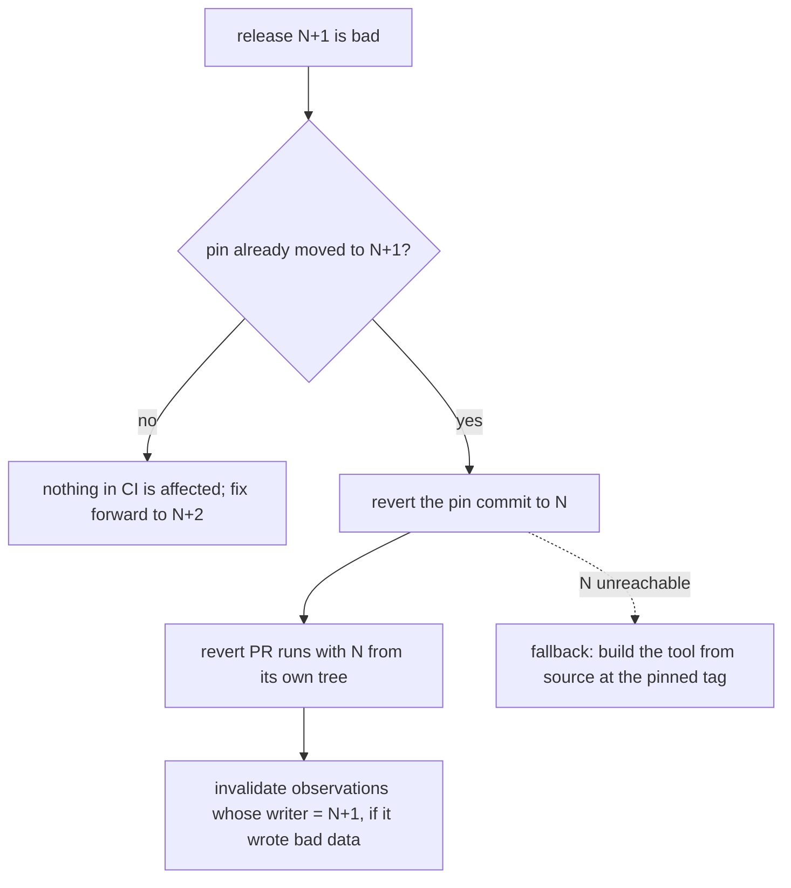

## Answer

Treat the evidence tool like any third-party binary that CI pins, except that
this repository publishes it. A checked-in pin names the exact release tag and
a SHA-256 per target. CI downloads the archive from that tag's fixed URL,
checks it against the pinned hash, and runs it. A bad release never reaches CI
until a pull request moves the pin, and recovery is reverting that pin. A
build-from-source fallback covers the case where no good release is reachable.

Two findings change the spec's seams (see Surprises): moving the pin is a
non-source change that today schedules no CI, and the publish spec ships
Windows binaries later than the Windows CI cells need this tool.

## Evidence

Facts this design rests on, from S1 and S2 (run 2026-11-07):

- dist publishes per-package, per-tag assets at a fixed, predictable URL:
  `https://github.com/yankeeinlondon/rusty-biscuit/releases/download/<pkg>-v<ver>/<pkg>-<target>.tar.xz`
  (`.zip` on Windows), each with a `.sha256` and a combined `sha256.sum`.
  Archive layout: `<pkg>-<target>/<bin>` plus README and LICENSE.
- release-plz tags every package; GitHub's "Latest" release is whichever
  package released last (today `claudine-gen-v0.1.0`). "Latest" has no meaning
  for one tool, so a pin must be an exact tag.
- dist's generated runners: `ubuntu-22.04` (glibc 2.35 baseline),
  `ubuntu-22.04-arm`, `macos-15`, `macos-15-intel`, `windows-2022`.
- CI environments (`.github/ci/environments.json`): `ubuntu-latest`
  (`x86_64-unknown-linux-gnu`), `macos-latest` (`aarch64-apple-darwin`),
  `windows-latest` (`x86_64-pc-windows-msvc`), and `wsl2-ubuntu` (a Linux guest
  on `windows-latest`, so `x86_64-unknown-linux-gnu`).
- `GITHUB_TOKEN` can download public release assets and start
  `workflow_dispatch`; it cannot trigger workflows by pushing tags
  (`docs/cicd/release-plz-ci.md`).
- S13a: anything that embeds `CARGO_PKG_VERSION` changes behavior on a
  version-only diff.

## Design

### Pin

One checked-in file (for example `.github/ci/tools.json`) holds, per tool:
the package, the exact tag, and one SHA-256 per target that CI uses
(`x86_64-unknown-linux-gnu`, `aarch64-apple-darwin`,
`x86_64-pc-windows-msvc`). Hosts read the same file. The hash is taken
from the release when the pin is bumped and then stored in the repository.
It is never re-read from the release, so a replaced asset fails verification
instead of being trusted.

### Fetch in CI

A small composite action, or one shell step per OS, that:

1. computes the asset URL from the pin and the runner's target;
2. downloads it (`curl -fsSL`, or `gh release download <tag> -p <asset>`);
3. verifies the pinned SHA-256, and fails the job on mismatch;
4. extracts it into the tool cache and adds it to `PATH`;
5. caches by `{tag, target}` (`actions/cache`), so a rerun does not download.

Do not use dist's `installer.sh`/`.ps1`. They fetch over the network again,
edit shell profiles, and verify against the release's own checksum. Do not use
`cargo binstall` in CI either. It adds a tool to install, probes many URLs (S2),
and falls back to compiling.

If dist's `github-attestations` is enabled later, `gh attestation verify` can
replace or add to the pinned hash. Not tested.

### Hosts

`just` installs the pinned tag on a host by the same rule: an exact tag and a
verified hash, through `cargo binstall --git … <pkg>@<ver>` (needs S2's
`pkg-url`) or a direct download. A developer may also run a source build. In
every case the observation records the tool's version as metadata.

### Identity rule

The tool's own version must **not** enter gate-input identity or observation
IDs (S13a shows how a version string leaks into keys). Store it beside the
observation as `writer` metadata. Two hosts on different tool versions then
still agree on what a cell is, and a bad writer can be found by that field.

### Changing the tool's code

- A pull request that edits the tool's source is tested by that package's
  normal cells, which build it from source. CI's gating and evidence steps keep
  using the **pinned** binary, so a broken change cannot certify itself.
- A change to the store contract ships in two releases: N+1 reads and writes
  both forms, then the pin moves, then N+2 drops the old form.

### Release order

The release workflow, and any evidence check that gates a release, uses the
pinned version N to release N+1. The pin moves only by a later pull request.
That pull request is the canary: it runs CI with N+1 before main depends on it.

## Recovery from a bad release

1. **Pin not yet moved**: nothing breaks. Fix forward with N+2. Never delete,
   re-tag, or replace N+1's assets: the pinned-hash check would catch a
   replacement, and other hosts may already have it.
2. **Pin moved, CI broken**: revert the pin. CI reads the pin from the checked-out
   tree, so the revert pull request already runs with N and can pass.
3. **Bad observations written**: because each observation records its writer
   version, invalidate everything written by N+1 in one operation. This is the
   case for keeping writer metadata mandatory.
4. **No good release reachable** (GitHub outage, N's asset unreadable): a
   break-glass input or variable makes the fetch step run
   `cargo build --locked --release -p <tool>` at the pinned tag's commit. It is
   slow, but the gate is not left without a tool. It must be explicit, never an
   automatic fallback on hash mismatch.
5. Old releases stay. Releases are append-only, and at least the previous pin's
   assets must remain for step 2 to work.

## What this changes in the spec

- **Spikes needed → "Tool bootstrap"**: settled as the design above. Add to
  Scope: pin file, fetch step with pinned-hash check, writer metadata on every
  observation, source-build break-glass.
- **Outcome**: "the same cells qualify as before" now also needs "the tool's
  own version is not part of any identity".
- **depends-on `2026-10-28-publish`**: the evidence tool must be an opted-in
  dist package. It also needs whatever S1 found for any package: `repository`
  set, no test-helper binaries, and a release-plz dispatch per tag.

## Surprises

- **A pin bump schedules nothing.** Under the repository's rule ("a changed file
  schedules the code that reads it"), editing `.github/ci/tools.json` is a
  non-source change, so the canary pull request would run no cells and prove
  nothing. The planner needs a rule that a tool-pin change schedules at least
  one evidence-writing cell per pinned target. This moves a seam into the
  planner or `2026-11-06-rust-ci-planner`.
- **Windows ordering conflict.** `2026-10-28-publish` decides that Windows
  binaries ship only once Windows is green. The `windows-latest` and
  `wsl2-ubuntu` cells need this tool once evidence moves to the store. The
  evidence tool needs an exception (publish its Windows build early, as a CI
  tool), or the Windows cells use the source-build path until then.
- The release that gates on evidence and the tool that writes evidence share a
  pipeline. Keeping N pinned while releasing N+1 avoids a cycle. But that only
  holds if the release gate never builds the tool from the release commit.
  Write this down as a rule.
