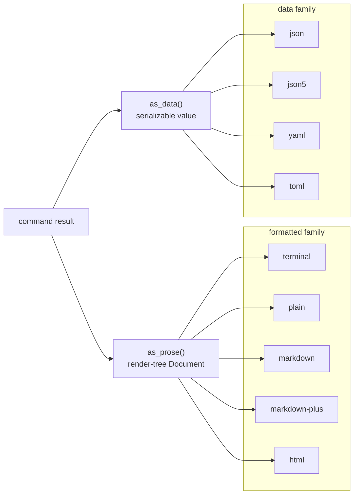

# Command Output

Implement one trait on a command's result and that result can print as styled
terminal text, plain text, Markdown, HTML, JSON, JSON5, YAML, or TOML, with a
single function call choosing between them. This page covers the contract in
`renderable::output`: what a result provides, the options every output receives,
and how width and link metadata reach the Markdown and browser folds.

`renderable` only defines the contract. The function that performs the output,
`write_output`, lives in `biscuit-terminal` because the terminal fold lives
there and that crate depends on this one, not the reverse. See
[Command output dispatch](../../biscuit-terminal/docs/output.md) for the target
enum, width resolution, and the terminal behavior.

A **fold** is a function that walks a render tree and produces text for one
target; this page uses the word throughout.

## Two sources, two families

A result exposes two sources, and every output is produced from one of them:

- **`as_prose()`** returns a render-tree `Document`, the human-readable form.
- **`as_data()`** returns a serializable value that holds all of the data in a
  sensible structure.

The outputs therefore form two families. A command accepts whole families, never
part of one.



## Implementing `CommandOutput`

Only `as_prose`, `as_data`, and the `Data` type are required. Do anything that
can fail (loading, composing, resolving a theme) before you build the value:
every method here is infallible, so an override never has an error to swallow.

```rust
use renderable::CommandOutput;
use renderable::tree::{Document, RenderNode};
use serde::Serialize;

#[derive(Clone, Serialize)]
struct Report {
    checked: u32,
    broken: u32,
}

impl CommandOutput for Report {
    type Data = Report;

    fn as_prose(&self) -> Document {
        let line = format!("{} checked, {} broken", self.checked, self.broken);
        Document::new(RenderNode::root(vec![RenderNode::paragraph(vec![
            RenderNode::text(line),
        ])]))
    }

    fn as_data(&self) -> Report {
        self.clone()
    }
}
```

`as_data` takes no options. When the data carries text a formatted output would
also print, such as a rendered document, build the value at the resolved width so
that property reads as the formatted output would. Numbers, paths, and codes are
never wrapped.

### Per-target overrides

A generic fold is not always the right answer. A document's `markdown` output may
be its source text rather than a fold of its tree, and a page builder may need
options a generic fold has never heard of. Four optional methods cover this:

| Method | Overrides | When it returns `None` (the default) |
|---|---|---|
| `render_terminal` | `terminal` and `plain` | the terminal fold of `as_prose()` |
| `render_markdown` | `markdown` | the Markdown fold of `as_prose()` |
| `render_markdown_plus` | `markdown-plus` | the Markdown fold, MarkdownPlus dialect |
| `render_html` | `html` | the browser fold of `as_prose()` |

Each returns `Option<String>` rather than calling the fold itself, because the
terminal fold is out of reach from this crate. `None` tells the dispatch to run
the fold.

```rust
# use renderable::{CommandOutput, OutputOptions};
# use renderable::tree::{Document, RenderNode};
struct SourceDocument {
    source: String,
}

impl CommandOutput for SourceDocument {
    type Data = String;

    fn as_prose(&self) -> Document {
        Document::new(RenderNode::root(vec![RenderNode::paragraph(vec![
            RenderNode::text(self.source.clone()),
        ])]))
    }

    fn as_data(&self) -> String {
        self.source.clone()
    }

    // `markdown` prints the source as written. Every other target still folds.
    fn render_markdown(&self, _options: &OutputOptions) -> Option<String> {
        Some(self.source.clone())
    }
}
```

There is no `plain` override: `plain` is the `terminal` path given the plain
profile. An override of `render_terminal` must honor
`options.terminal_profile`, so it produces a correct `plain` for free. A
`terminal` override that paints unconditionally would leak escape bytes into
`plain`.

## `OutputOptions`

Every output path receives the same small struct:

| Field | Meaning |
|---|---|
| `verbosity` | The global `-v` count. Above zero, a link or image that cannot be clickable also prints its destination. |
| `width` | The resolved [output width](#output-width). |
| `terminal_profile` | The [capabilities](#terminalprofile) the formatted output may use. |

```rust
use renderable::{OutputOptions, TerminalProfile, Width};

let options = OutputOptions::new(Width::Columns(80), TerminalProfile::plain())
    .with_verbosity(1);
```

`into_plain()` returns the same options with the plain profile substituted, and
it is applied after every other choice was made. No option can therefore restore
a capability the plain profile removes.

## `TerminalProfile`

A profile states what a formatted output may use. Every output path reads
capabilities from here and never from the environment, which is what makes a
render reproducible and testable. The color types are the target-neutral ones
from `renderable::color`.

| Field | Meaning |
|---|---|
| `color_depth` | The color depth styling may use; `ColorDepth::None` emits no color |
| `color_mode` | The background's light or dark mode |
| `text_color`, `background_color` | The detected foreground and background, when known |
| `is_tty` | Whether the output stream is a terminal |
| `hyperlinks` | Whether OSC 8 hyperlinks (clickable terminal links) may be written |
| `italics`, `underline` | Whether those styles may be written |
| `graphics` | Whether inline images may be written |
| `unicode` | Whether Unicode glyphs, box drawing among them, may be written |

**`TerminalProfile::plain()` is the one built-in plain profile.** Never assemble a
plain profile by hand. It turns every styling capability off and leaves `unicode`
on, because plain tables keep their box-drawing borders: plain output is free of
escape bytes, not ASCII-only. `Default` returns the same profile, so a profile
nobody detected cannot style.

```rust
use renderable::TerminalProfile;

let plain = TerminalProfile::plain();
assert!(plain.is_plain());
assert!(plain.degrades_to_plain());
assert!(plain.unicode);
```

| Method | Answers |
|---|---|
| `is_plain()` | Does this profile write no escape sequence at all? |
| `degrades_to_plain()` | Does a `terminal` request on this profile become `plain`? True when the stream is not a terminal, or the terminal has no color. |
| `without_hyperlinks()` | This profile with OSC 8 turned off |

`biscuit-terminal` fills a profile from a detected terminal with
`Terminal::output_profile`.

## Output width

`renderable::output::Width` (also `renderable::Width`) is the width a command was
asked to print at. It is an enum and never a large number, so anything that fills
to the width has to say what it does when there is no width.

| Variant | Prose | Fills (rules, bands, right margins) |
|---|---|---|
| `Columns(n)` | soft breaks joined, wrapped at `n` | filled to `n` |
| `Unlimited` | soft breaks joined, never wrapped | natural width |
| `Source` | soft breaks kept as authored | natural width |

A **soft break** is a single newline inside a paragraph; Markdown treats it as a
space.

`Columns(0)` is never constructed: `Width::columns(n)` returns `None` for zero.
The other helpers do the arithmetic a nested renderer needs:

```rust
use renderable::Width;

assert_eq!(Width::Columns(72).as_columns(), Some(72));
assert!(!Width::Unlimited.is_bounded());

// What is left after a gutter or indent; a bounded width never drops below 1.
assert_eq!(Width::Columns(10).saturating_sub(4), Width::Columns(6));
assert_eq!(Width::Unlimited.saturating_sub(4), Width::Unlimited);

// A cap still applies when nothing else bounds the output.
assert_eq!(Width::Unlimited.capped_at(60), Width::Columns(60));
```

### Output width and layout width are different things

`renderable::layout::Width` (`Auto`, `FitContent`, `Fixed`) is a component's sizing
policy. `renderable::output::Width` is how wide the whole output may be. They share
a name and nothing else. A file that uses both imports the layout one as
`LayoutWidth`:

```rust
use renderable::layout::Width as LayoutWidth;
use renderable::output::Width;

let policy = LayoutWidth::FitContent;
let output = Width::Unlimited;
```

### Width in the Markdown fold

`MarkdownRenderOptions::width` reflows paragraphs. It defaults to `Source`, so a
caller that sets nothing gets its soft breaks back unchanged.

```rust
use renderable::Width;
use renderable::tree::render::{MarkdownRenderOptions, render_markdown_document};
# use renderable::tree::{Document, RenderNode};
# let document = Document::new(RenderNode::root(vec![]));

let rendered = render_markdown_document(
    &document,
    &MarkdownRenderOptions {
        width: Width::Columns(72),
        ..MarkdownRenderOptions::default()
    },
)?;
println!("{}", rendered.output);
# Ok::<(), renderable::tree::RenderError>(())
```

| `width` | Paragraph text |
|---|---|
| `Source` | soft breaks written as authored |
| `Unlimited` | each soft break written as a space, so a paragraph is one line; hard breaks kept |
| `Columns(n)` | joined, then wrapped at `n` display columns |

Reflow works over the paragraph's inline structure rather than over its text, so
a line never breaks inside a code span, a link or image destination or title, an
autolink, or raw HTML. Code fences, tables, headings, and HTML blocks keep their
lines under every width. The result reads back as the same paragraph. The full
list of refused breaks is in
[Tree Rendering: Output width](./tree-rendering.md#output-width).

### Width in the browser fold

`BrowserRenderOptions::width` takes the same enum. `Columns(n)` constrains prose
elements to `n` `ch` through one zero-specificity page rule, so code blocks and
tables are not narrowed and any page or component style can override it.
`Unlimited` and `Source` add no rule.

```rust
use renderable::Width;
use renderable::tree::render::{BrowserRenderOptions, render_browser_document_html};
# use renderable::tree::{Document, RenderNode};
# let document = Document::new(RenderNode::root(vec![]));

let page = render_browser_document_html(
    &document,
    &BrowserRenderOptions {
        width: Width::Columns(64),
        ..BrowserRenderOptions::default()
    },
)?;
assert!(page.output.contains("max-width: 64ch"));
# Ok::<(), renderable::tree::RenderError>(())
```

## Link metadata

A link can carry where in the target it points, such as a line and column, in a
typed form instead of a string each target has to parse. Put `LinkMetadata` on a
`Link` node and each fold writes it in that target's own way:

```rust
use renderable::output::link_metadata::{LinkMetadata, QueryParams};
use renderable::tree::RenderNode;

let mut link = RenderNode::link(
    "/repo/types.md#setup".to_string(),
    None,
    vec![RenderNode::text("types.md:14:83")],
);
link.attrs.set_link_metadata(LinkMetadata {
    query: QueryParams::from_iter([("line", 14_u64), ("column", 83)]),
});
```

| Target | The link is written as |
|---|---|
| Markdown | a single-quoted JSON5 title: `[types.md:14:83](/repo/types.md#setup '{ qp: { line: 14, column: 83 } }')` |
| Browser | query parameters: `/repo/types.md?heading=setup&line=14&column=83` |
| Terminal | [OSC 8 parameters](../../biscuit-terminal/docs/output.md#osc-8-parameters) beside a bare URI |

`QueryParams` keeps authored order and holds each key once; inserting a key again
replaces its value in place. `QueryValue` is a string, a finite number, or a
boolean, so a Markdown round trip writes `14` rather than `"14"`, and
`to_transport()` gives the string form for query strings and OSC 8. The escaping
and ordering rules are in
[Tree Rendering: Link query metadata](./tree-rendering.md#link-query-metadata).

### Reading a title with `parse_link_title`

`link_metadata::parse_link_title` is the one interpretation of a Markdown link
title. Anything that reads a title calls it, so a title never means two things. A
title that is a JSON5 object is structured data; any other title is a plain
tooltip, as in CommonMark.

```rust
use renderable::output::link_metadata::parse_link_title;

let parsed = parse_link_title("{ class: 'docs-link', qp: { line: 14 } }");
let structured = parsed.structured().expect("a JSON5 object");
assert_eq!(structured.class.as_deref(), Some("docs-link"));
assert_eq!(structured.link_metadata().query.get("line").unwrap().to_transport(), "14");

assert_eq!(parse_link_title("Shown as a tooltip").tooltip(), Some("Shown as a tooltip"));
```

It never prints. It returns a `LinkTitleNotice` for the caller to report.
`notice.token()` names the notice's kind (`malformed` or `legacy`); the
application maps that to its own diagnostic code, because this crate knows no
application's codes:

| Title | `title` | `notice` |
|---|---|---|
| a JSON5 object | `LinkTitle::Structured` | `Malformed` only when a value was ignored |
| starts with `{` but is not a JSON5 object | `LinkTitle::Plain` | `Malformed` |
| a leftover `key=value` title, such as `class='docs'` | `LinkTitle::Plain` | `Legacy` |
| anything else | `LinkTitle::Plain` | none |

The `key=value` check is broad: any unquoted `=` directly after a word counts, so
a prose title such as `a = b` raises `Legacy` too. Nothing interprets such a title
as attributes, and it remains a tooltip either way.

## See also

- [Command output dispatch](../../biscuit-terminal/docs/output.md): `OutputTarget`,
  `write_output`, width resolution, and the terminal fold's behavior.
- [Tree Rendering](./tree-rendering.md): the render tree these folds walk.
