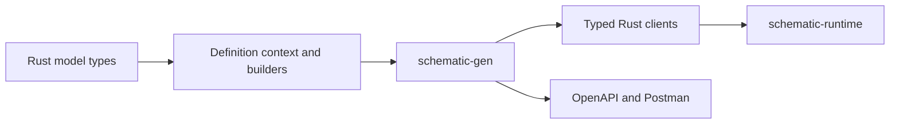

# Schematic

Schematic defines REST and WebSocket APIs and generates typed Rust clients,
OpenAPI documents, and Postman collections. REST definitions use builders and a
typed registration context; generated clients send through `schematic-runtime`.

| Package | Purpose |
| --- | --- |
| [schematic-define](define/) | Definition builders, typed registration, authentication and parameters |
| [schematic-definitions](definitions/) | Shipped provider definitions and ordered module groups |
| [schematic-gen](gen/) | Generator library and CLI |
| [schematic-runtime](runtime/) | Requests, credentials, responses, redirects and paging |
| [schematic-schema](schema/) | Generated REST and WebSocket clients |
| [schematic-oauth](oauth/) | OAuth2 token acquisition and refresh |



Build or install the generator from this checkout:

```sh
just -f schematic/justfile build
cargo install --path schematic/gen
```

## Quick Start

```rust
use schematic_schema::prelude::*;

#[tokio::main]
async fn main() -> Result<(), Box<dyn std::error::Error>> {
    let client = OpenAI::new().api_key(std::env::var("OPENAI_API_KEY")?);

    // One method per endpoint; nothing is sent until `.await`
    let models = client.list_models().await?; // Err(CallError) for no reply or a failed one
    println!("Found {} models", models.data.len());

    // Required values are arguments; `.full()` keeps the response metadata
    let response = client.retrieve_model("gpt-4").full().await?;
    println!("{} (request id {:?})", response.meta.status, response.meta.request_id);
    if let Some(model) = response.data() {
        println!("Model: {}", model.id);
    }

    println!("API docs: {:?}", OpenAI::DOCS_URL);
    Ok(())
}
```

Awaiting an endpoint call returns the decoded value, or a `CallError`:
`CallError::Transport` when no response arrived, `CallError::Api` (with the
status, headers, request id, and raw body) when the server answered with a
failure. Adding `.full()` instead returns `Ok` with a `Response` envelope
whenever the server answered, whatever the status, and `Err(TransportError)`
only when no response arrived. See
[Calling an API](./docs/runtime/calling-an-api.md) and
[the runtime docs](./docs/runtime/README.md).

## WebSocket Quick Start

```rust
use std::time::Duration;

use schematic_schema::elevenlabs_ws::{
    ElevenLabsTTSWs, TextToSpeechConnectionParams,
};
use schematic_schema::ws_shared::WsClientOptions;

#[tokio::main]
async fn main() -> Result<(), Box<dyn std::error::Error>> {
    let mut api = ElevenLabsTTSWs::new();
    api.headers = api.headers.clone().use_api_key("my-key", "xi-api-key");

    let params = TextToSpeechConnectionParams {
        model_id: Some("eleven_turbo_v2_5".to_string()),
        ..Default::default()
    };

    let options = WsClientOptions::builder()
        .request_timeout(Duration::from_secs(10))
        .disable_nagle(true)
        .build();

    let ws = api
        .connect_text_to_speech("voice_id_here", params, options)
        .await?;

    ws.send(serde_json::json!({"text": "Hello from Schematic"})).await?;
    ws.close().await?;
    Ok(())
}
```

## Documentation

- [Author a definition](docs/definition-builders.md) and [register model types](docs/typed-registration.md).
- [Generate artifacts and verify changes](docs/generation/workflow.md), including the current provider catalog and shared-module settings.
- [Call an API](docs/runtime/calling-an-api.md), [read responses](docs/runtime/README.md), and [page through lists](docs/pagination.md).
- [Import OpenAPI](docs/io/import-openapi.md), [export OpenAPI](docs/io/export-openapi.md), or [export Postman](docs/io/export-postman.md).
- [Save a definition as a self-contained bundle](docs/io/definition-bundles.md) and export from the file alone.
- [Understand generated requests](docs/generation/request-side.md), [validation](docs/generation/validation.md), and [partial generation](docs/generation/partial-generation.md).
- [Use WebSocket headers](docs/headers/README.md).

## License

AGPL-3.0-only

See [the compiling authoring example](docs/authoring-examples.md) for nominal models, public
aliases, containers, and complete context-based API assembly.
