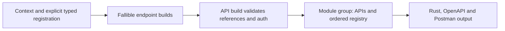

# A complete REST definition

Declare nominal models beside their registration implementations, then build
endpoints and their API against one context. This example runs as part of
`schematic-define`'s doctests; no network request is made.

```rust
use schematic_define::prelude::*;
use schematic_define::{definition_type, rust_path, ParamDef, QueryParamType};
use schemars::JsonSchema;
use serde::{Deserialize, Serialize};
use std::collections::HashMap;

definition_type! {
    #[derive(Debug, Clone, Serialize, Deserialize, JsonSchema)]
    pub struct Item { pub id: String }
}
pub type PublicItem = Item;

let mut context = DefinitionContext::types_in("::my_models");
// Register the public alias before any endpoint registers Item implicitly.
let item = context.register_as::<Item>(rust_path!(PublicItem).schema_name("Item"))?;
let wrapped = context.register::<Option<Vec<Item>>>()?;
let map = context.register::<HashMap<String, Item>>()?;
let json = context.register::<serde_json::Value>()?;
assert_eq!(context.registrations().len(), 1);
assert_eq!(context.registrations()[0].schema_name(), "Item");
assert_eq!(item.rust_path(), "PublicItem");
assert!(map.rust_path().contains("PublicItem"));
assert_eq!(json.wire_schema(), serde_json::json!({}));

let endpoint = Endpoint::get("ListItems", "/items")
    .describes("List items, optionally filtered by tag")
    .query(ParamDef::new("tag", QueryParamType::String))
    .returns_json::<Vec<Item>>(&mut context)
    .build()?;
let api = RestApi::builder(&context, "Items", "https://example.com")
    .describes("Item service")
    .bearer_env(["ITEMS_TOKEN"])
    .endpoints([endpoint])
    .build()?;
context.finish()?;
assert_eq!(api.endpoints[0].path, "/items");
assert_eq!(api.endpoints[0].params.as_ref().unwrap().query[0].name, "tag");
assert_eq!(context.registrations().len(), 1);
// The API carries each component once; endpoint references name it.
assert_eq!(api.schemas[0].name, "Item");
assert_eq!(api.rust_type(wrapped.type_ref()).as_deref(), Some("::std::option::Option<::std::vec::Vec<PublicItem>>"));
# Ok::<(), schematic_define::DefinitionError>(())
```

The example's alias is locally resolvable. In a provider, qualify it through a
public module reachable from the generated crate, for example
`rust_path!(::my_models::PublicItem)`. Successful authoring checks type identity;
compiling the generated crate checks public visibility. Without an alias,
`context.register::<Item>()?` uses the module supplied to `types_in` and the
identifier supplied by `definition_type!`.

A provider returns both API and registry through
`schematic_definitions::registry::assemble_module_group(module_path, assembly)`;
the assembly closure receives the context and returns `Result<Vec<RestApi>,
DefinitionError>`. The adapter preserves registration order and extracts nested
schemas. Register explicit components before endpoint discovery when their
order matters. Do not fill a second registry by hand.



Missing descriptions, success shapes, or API auth choices prevent compilation.
Invalid values, repeated success/auth declarations, conflicting environment
names, collisions, and destination mismatches return `DefinitionError`.
A path containing `?` and every GET body fail validation. Use `.query(...)`,
`.header_param(...)`, `.cookie(...)`, path placeholders, and request body methods
to state input location. Two declarations with the same method and normalized
path are duplicates regardless of their inputs.

For pagination, keep the strategy helper in the provider, set
`.default_pagination(strategy)` on the API, and attach `.pagination(Collection)`
to endpoints that need a collection, override, or opt-out. See
[definition builders](definition-builders.md),
[typed registration](typed-registration.md), and [pagination](pagination.md)
for defaults, adoption controls, and error contracts.
