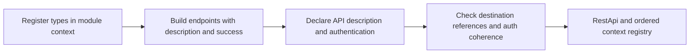

# Building REST definitions

Use `Endpoint` and `RestApi` builders to state the facts needed to generate a client. Create endpoints before the API builder borrows the module group's `DefinitionContext`:

```rust
use schematic_define::prelude::*;

let mut ctx = DefinitionContext::types_in("::my_models");
let endpoint = Endpoint::get("Read", "/items")
    .describes("Read items")
    .returns_json::<Vec<String>>(&mut ctx)
    .build()?;
let api = RestApi::builder(&ctx, "Items", "https://example.com")
    .describes("Item service")
    .bearer_env(["ITEMS_TOKEN"])
    .endpoints([endpoint])
    .build()?;
```

Description and success are required for endpoint `build()`. Description and an explicit authentication choice are required for API `build()`. Missing facts cause a compile error. Neither value nor builder has `Default`; `EndpointParams::new()` creates a valid empty parameter set.



`Endpoint::new(id, method, path)` covers every `RestMethod`. Named constructors cover `get`, `post`, `put`, `patch`, `delete`, `head`, and `options`. Empty ids/descriptions and paths without a leading `/` fail at build. API names/descriptions must be nonempty and the base URL must have an HTTP(S) scheme and host. Existing query-bearing paths remain accepted during migration.

Choose one success with `returns(Success::json(desc))`, `Success::text()`, `Success::binary()`, or `Success::empty()`. Shorthands are `returns_json::<T>(&mut ctx)`, `returns_text()`, `returns_binary()`, and `returns_empty()`. A second success declaration fails with “several success shapes arrive with response model v2.” `errors(ErrorSet::none())` and API `default_errors(ErrorSet::none())` reserve the response vocabulary; no other error-set constructor exists yet.

Requests use `request_json::<T>(&mut ctx)`, `request_form(fields)`, `request_urlencoded(fields)`, `request_text()`, or `request_binary()`. `FormField::json_desc("metadata", desc)` authors typed JSON metadata without naming the stored Schema type. Forms retain field names, required flags, descriptions, file MIME patterns, and file-count limits. Text and binary defaults are `text/plain` and `application/octet-stream`; their content type can be stated explicitly with the corresponding `_with_content_type` method. These declarations preserve the existing output-specific transport validation; they do not add text/binary body payload support. GET-body rejection is **planned** for the definition-form update.

Typed `Schema` values retain optional descriptor evidence alongside their Rust path. API build validates this evidence, including component names, wrappers, reserved structure, and agreement with the lowered path. Missing destination registrations, missing descriptor evidence on JSON schemas, forged descriptors, and collected collisions fail. Typed OpenAPI export uses the descriptor's wire schema, so Rust qualification does not erase component references or wrappers. A root typed `Vec<T>` retains automatic GET list recognition; `Option<Vec<T>>` and nominal collection wrappers still require authored collection information. Legacy schemas omit this evidence and keep their existing direct construction/export behavior until migrated; passing an untyped JSON schema into the API builder fails. See [typed registration](typed-registration.md).

For authentication, `no_auth()`, `bearer_env(names)`, and `basic_env(username, password_names)` make coherent declarations. `authentication(strategy, names)` supports API keys, parameter keys, OAuth2, and custom bearer headers. The stored auth types are unchanged. A second authentication declaration fails even if it repeats the same strategy. An explicit `env_mapping(mapping)` must agree with each environment value supplied by the auth declaration, in either setter order. For example, declaring `bearer_env(["TOKEN"])` and mapping bearer credentials to `OTHER_TOKEN` fails. Extra mappings support an intentional multi-method `auth_policy(policy)`; that policy remains authoritative through `effective_auth_policy()`.

Headers, query parameters, complete parameter sets, documentation URL, version, module path, request suffix, and API cross-origin policy retain the current stored representation and generator precedence. Endpoint headers override matching API headers through the generator's existing merge. Builders preserve declaration order. Endpoint-level cross-origin, request-id normalization, secret markers, pager-managed declarations, and the later response vocabulary are **planned**.

## Default allow-list

The public defaults below remain meaningful; the audit test checks the shipped source inventory so new defaults require an explicit decision.

| Type | Why its default is valid |
| --- | --- |
| `EndpointParams` | Empty parameters describe a valid endpoint. |
| `AuthStrategy`, `AuthPolicy` | Anonymous auth / no accepted auth or fallback is a valid policy. |
| `CrossOrigin` | Same-origin is the safe complete policy. |
| `EnvMapping`, `Headers` | No environment credentials or extra headers is valid. |
| `SensitiveString` | An empty secret is valid data; it makes no authentication claim. |
| `PkceRequirement`, `OAuth2ClientAuthMethod` | Required PKCE / client-secret Basic are explicit complete protocol defaults. |
| `ConnectionLifecycle` | Empty optional lifecycle messages are valid. |
| `WebSocketEndpoint` | Retained for existing incremental WebSocket construction, which is outside this REST migration. Its empty id still needs authoring before generation. |
| `FrameFormat`, `RequestIdType` | JSON text frames / u64 request ids are complete established defaults. |
| `WebSocketRuntimeHints`, `WebSocketEndpointHints` | No optional hints is valid. |
| `SchematicDocExtension`, `SchematicSchemaExtension` | All optional extension metadata may be absent. |
| `ExportOptions`, `ExportFormat`, `OpenApiImportOptions` | Complete tooling options with established defaults. |

Provider and importer migration is **planned**. External REST literals remain legal until all consumers migrate; compiler-enforced construction will then use `#[non_exhaustive]`. Generated request types retain their existing defaults.
