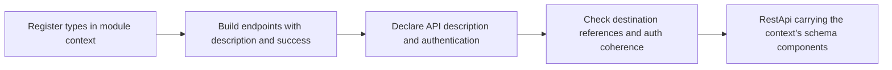
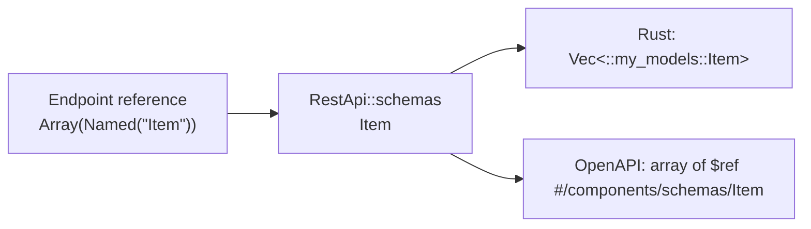

# Building REST definitions

Use `Endpoint` and `RestApi` builders to state the facts needed to generate a client. Create endpoints before the API builder borrows the module group's `DefinitionContext`:

```rust
use schematic_define::prelude::*;

let mut ctx = DefinitionContext::types_in("::my_models");
let endpoint = Endpoint::get("Read", "/items")
    .describes("Read items")
    .returns_json::<Vec<String>>(&mut ctx)
    .build()?;
let api = RestApi::builder(&ctx, "Items", "https://example.com")
    .describes("Item service")
    .bearer_env(["ITEMS_TOKEN"])
    .endpoints([endpoint])
    .build()?;
```

Description and success are required for endpoint `build()`. Description and an explicit authentication choice are required for API `build()`. Missing facts cause a compile error. Neither value nor builder has `Default`; `EndpointParams::new()` creates a valid empty parameter set.



`Endpoint::new(id, method, path)` covers every `RestMethod`. Named constructors cover `get`, `post`, `put`, `patch`, `delete`, `head`, and `options`. Empty ids/descriptions and paths without a leading `/` fail at build. API names/descriptions must be nonempty and the base URL must have an HTTP(S) scheme and host. Paths containing `?` fail shared validation and endpoint/API build; declare query inputs with `.query(ParamDef::new(...))`. Endpoint identity is `(method, path)`, with placeholder names normalized for duplicate checks. Query values and response shapes do not create separate routes.

Choose one success with `returns(Success::json(desc))`, `Success::text()`, `Success::binary()`, or `Success::empty()`. Shorthands are `returns_json::<T>(&mut ctx)`, `returns_text()`, `returns_binary()`, and `returns_empty()`. A second success declaration fails with “several success shapes arrive with response model v2.” `errors(ErrorSet::none())` and API `default_errors(ErrorSet::none())` reserve the response vocabulary; no other error-set constructor exists yet.

Requests use `request_json::<T>(&mut ctx)`, `request_form(fields)`, `request_urlencoded(fields)`, `request_text()`, or `request_binary()`. `FormField::json_desc("metadata", desc)` authors a typed JSON form part from a registration. Forms retain field names, required flags, descriptions, file MIME patterns, and file-count limits. Text and binary defaults are `text/plain` and `application/octet-stream`; their content type can be stated explicitly with the corresponding `_with_content_type` method. These declarations preserve output-specific transport validation; generated text and binary request fields are sent as raw bodies. A GET endpoint rejects every request-body form at endpoint build. API build also rejects a transferred GET body with destination API, endpoint and method context. HEAD keeps its existing behavior.

A JSON request, response, or form part stores a `TypeRef`: the names of schema components plus their wrapper shape, with no Rust path and no copy of the schema. API build copies the context's components into `RestApi::schemas`, where each component's Rust path and wire schema is stored once. A reference therefore cannot disagree with its component; it can only fail to resolve.

```rust
let mut ctx = DefinitionContext::types_in("::my_models");
let endpoint = Endpoint::get("ListItems", "/items")
    .describes("List items")
    .returns_json::<Vec<Item>>(&mut ctx) // registers Item
    .build()?;
assert_eq!(endpoint.response, ApiResponse::json_vec_type("Item")); // Array(Named("Item"))

let api = RestApi::builder(&ctx, "Items", "https://example.com")
    .describes("Item service").no_auth().endpoints([endpoint]).build()?;
// api.schemas: [SchemaComponent { name: "Item", rust_path: Some("::my_models::Item"), schema: {..} }]
let reference = api.endpoints[0].json_references()[0];
assert_eq!(api.rust_type(reference).as_deref(), Some("::std::vec::Vec<::my_models::Item>"));
```



API build runs `RestApi::validate_references`: every name must resolve to a registered component, or the build fails with `DefinitionError::UnresolvedReference { api, endpoint, name }`. It also rejects empty, duplicate, or malformed components. Call the same method on a definition read from JSON before using it. A name that exists only nested inside another component has no Rust path of its own and cannot be referenced directly. OpenAPI export writes `Named` as a `$ref`, so Rust qualification never erases component references or wrappers. A root typed `Vec<T>` retains automatic GET list recognition; `Option<Vec<T>>` and nominal collection wrappers still require authored collection information. `Schema { type_name, module_path }` is used only by WebSocket messages. See [typed registration](typed-registration.md).

For authentication, `no_auth()`, `bearer_env(names)`, and `basic_env(username, password_names)` make coherent declarations. `authentication(strategy, names)` supports API keys, parameter keys, OAuth2, and custom bearer headers. Basic stores its environment inside the strategy: `basic_env("USER", ["PASS", "SECRET"])` stores `AuthStrategy::Basic { username_env: ["USER"], password_env: ["PASS", "SECRET"] }` with an empty `env_auth`, and `authentication(AuthStrategy::Basic { .. }, names)` fails at build when `names` is not empty, so a password never comes from `env_auth`. `env_username(name)` fills an empty Basic `username_env` or must equal it; on any other strategy it is accepted only when the explicit mapping's `basic_user` is exactly `[name]`, and fails otherwise. A second authentication declaration fails even if it repeats the same strategy. An explicit `env_mapping(mapping)` must agree with each environment value supplied by the auth declaration, in either setter order. For example, declaring `bearer_env(["TOKEN"])` and mapping bearer credentials to `OTHER_TOKEN` fails. Extra mappings support an intentional multi-method `auth_policy(policy)`; that policy remains authoritative through `effective_auth_policy()`.

Headers, query parameters, complete parameter sets, documentation URL, version, module path, request suffix, and API cross-origin policy retain the current stored representation and generator precedence. Endpoint headers override matching API headers through the generator's existing merge. Builders preserve declaration order. Endpoint `cross_origin(policy)` replaces the API policy for that endpoint, including redirects and followed pagination links. `allow_origins` accepts only bare HTTP(S) origins, with an optional port and trailing slash; paths, user information, queries and fragments fail API build. Caller policy settings may only tighten each applicable definition policy. Runtime-only origin and redaction settings are not represented as OpenAPI/Postman transport behavior.

Declare a parameter location with `query(param)`, `header_param(param)`, or `cookie(param)`. Path parameters remain explicit placeholders in the path template, and request methods declare the body location. Constant headers still use `header(name, value)`. Location never changes route identity.

```rust
use schematic_define::{CrossOrigin, Endpoint, ParamDef, QueryParamType};

let param = ParamDef::new("ref", QueryParamType::String)
    .rust_name("git_ref").secret();
let endpoint = Endpoint::get("ReadFile", "/files/{file}")
    .describes("Read a file").returns_empty().query(param)
    .cross_origin(CrossOrigin::allow_origins(["https://downloads.example.com"]))
    .build()?;
```

`ParamDef::new` creates an optional parameter; `required()` and `describes(text)` set existing metadata. `rust_name` changes only the Rust field and setter; encoding and export retain the wire name. For example, `ref` is sent on the wire while callers use `git_ref`. Optional `beta` and `recursive` parameters are ordinary Boolean inputs: omission sends no value, and a supplied false remains false.

API `request_id_header("X-Request-ID")` and `secret_header("X-Pin")` normalize names to lowercase and reject invalid HTTP header names. Parameter `secret()` adds its wire name to the predecessor runtime's redaction metadata. The existing auth strategy markers, redaction behavior and explicit `auth_policy` semantics remain authoritative.

`pager_managed()` records an adoption requirement, preserved in serialized definitions. API build resolves the strategy and requires a matching location and wire name with an exposed caller control. A marker alone cannot hide an input. Required managed inputs additionally need a pagination-authored sent default that is valid for the declared type (an `Integer` parses as `i64`, a `Number` as a finite `f64`, a `Boolean` is `true` or `false`, an `Enum` value is one of its values, anything else is nonempty); `pager-managed-required-without-default` reports a missing default and `pager-managed-default-invalid` an invalid one, each naming the strategy kind and parameter. `default_pagination(strategy)` authors an API strategy; `.pagination(Collection)` assigns an endpoint collection, opt-out, or strategy override. Pagination exception tables and legacy parameter pagination fields are removed.

New optional fields are omitted when unused, preserving historical definition JSON. Absent/null origin overrides and Rust aliases mean no override/alias; absent marker flags mean false, while null/wrong-type flags are Serde errors. These are definition transfer fields rather than a new configuration format. The later response vocabulary remains **planned**.

## Paths, deprecation, rate limits, and endpoint authentication

These builder calls are optional; a definition that uses none of them builds
and serializes exactly as before.

```rust
let endpoint = Endpoint::get("GetIssue", "/repos/{owner}/{repo}/issues/{number}")
    .describes("Get an issue")
    .returns_json::<Issue>(&mut ctx)
    .path_param(ParamDef::path("owner", QueryParamType::String))
    .path_param(ParamDef::path("repo", QueryParamType::String))
    .path_param(ParamDef::path("number", QueryParamType::Integer).describes("Issue number"))
    .deprecated()
    .rate_limit(RateLimit::new("x-ratelimit-limit", "x-ratelimit-remaining", "x-ratelimit-reset", ResetUnit::EpochSeconds)?)
    .public()
    .build()?;
```

**Typed path parameters.** `path_param` stores the parameter in
`EndpointParams::path`, forced required, `Simple` style and not exploded. An
endpoint with no declarations keeps every placeholder an untyped string. Once
any is declared, the declared names must equal the placeholders exactly:
`{+name}` counts as `name`, and a placeholder repeated in the template needs
one declaration. Build rejects, naming the parameter: a missing or extra
declaration, a duplicate, `required: false` (never silently corrected), a
style other than `Simple`, an `Array` or `Json` type, an enum with no values
or a repeated value, an invalid explicit `rust_name`, and a Rust field shared
with a query, header, cookie or other path parameter. That field comparison
uses the explicit `rust_name`, else the wire name with characters outside
`[A-Za-z0-9_]` replaced by `_`; the generator's `generated-name-collision`
check, which also snake-cases, stays the complete one.
`Endpoint::path_placeholders()` lists the placeholder names once each, in
order of first occurrence.

**Deprecation.** `.deprecated()` on an endpoint or a `ParamDef` sets a flag
that is omitted from JSON while false. Generated Rust documentation and the
OpenAPI `deprecated` field are **planned**; no Rust `#[deprecated]` attribute
will be generated.

**Rate-limit and retry metadata.** `.rate_limit(RateLimit)` and
`.retry_guidance(RetryGuidance)` exist on the API and endpoint builders. An
endpoint value replaces the API value whole, never field by field;
`RestApi::effective_rate_limit(&endpoint)` and `effective_retry_guidance`
return the value that applies. The values are descriptive: nothing retries,
sleeps, or enforces them. Build re-validates them, since their fields are
public. Their export to OpenAPI and generated documentation is **planned**.

**Endpoint authentication.** With no declaration an endpoint inherits the API
policy. `.public()` makes it unauthenticated; `.auth(policy)` replaces the API
policy and reads credentials through the API's effective environment
mapping; `.auth_with_env_mapping(policy, mapping)` replaces that mapping too.
`RestApi::endpoint_auth(&endpoint)` returns `Inherited`, `Public`, or
`Replaced` with the policy and mapping that apply. Build rejects:

| Declaration | Error |
| --- | --- |
| two of `public`, `auth`, `auth_with_env_mapping` | declared more than once |
| a policy with no explicit method and no fallback | use `public()` instead |
| an OAuth2 grant with an invalid URL (endpoint policy, API `auth`, or API `auth_policy`) | the grant's URL error |
| a bearer fallback without `bearer_token` variables in the mapping | no `bearer_token` variables |
| an API-key fallback without `api_key` variables for the same header (case-insensitive) | names both headers |
| a Basic fallback without both `basic_user` and `basic_pass` | names the missing half |
| a query or cookie API-key fallback, unless it is identical to the API's own and no endpoint mapping is declared | an `EnvMapping` cannot name it |

A policy without an environment fallback needs no mapping. JSON spells the
field `"auth": "Public"` or
`"auth": {"Policy": {"policy": {..}, "env_mapping": {..}}}`. Applying the
resolved policy in generated clients is **planned**.

Each new field is omitted when unset. Absent means inherit, false or empty;
an explicit `null`, a wrong type, or `{}` for a metadata value is an error.

## Default allow-list

The public defaults below remain meaningful; the audit test checks the shipped source inventory so new defaults require an explicit decision.

| Type | Why its default is valid |
| --- | --- |
| `EndpointParams` | Empty parameters describe a valid endpoint. |
| `AuthStrategy`, `AuthPolicy` | Anonymous auth / no accepted auth or fallback is a valid policy. |
| `CrossOrigin` | Same-origin is the safe complete policy. |
| `EnvMapping`, `Headers` | No environment credentials or extra headers is valid. |
| `SensitiveString` | An empty secret is valid data; it makes no authentication claim. |
| `PkceRequirement`, `OAuth2ClientAuthMethod` | Required PKCE / client-secret Basic are explicit complete protocol defaults. |
| `ConnectionLifecycle` | Empty optional lifecycle messages are valid. |
| `WebSocketEndpoint` | Retained for existing incremental WebSocket construction, which is outside this REST migration. Its empty id still needs authoring before generation. |
| `FrameFormat`, `RequestIdType` | JSON text frames / u64 request ids are complete established defaults. |
| `WebSocketRuntimeHints`, `WebSocketEndpointHints` | No optional hints is valid. |
| `SchematicDocExtension`, `SchematicSchemaExtension` | All optional extension metadata may be absent. |
| `ExportOptions`, `ExportFormat`, `OpenApiImportOptions` | Complete tooling options with established defaults. |

All shipped REST providers and the importer use typed builders. `Endpoint` and `RestApi` are `#[non_exhaustive]`, preventing external struct literals. Generated request types retain their existing defaults. The unused endpoint `oauth_scopes` field is removed; explicit API `auth_policy` remains authoritative.

## Definition transfer input shapes

The JSON transfer matrix below describes the new authoring fields. Invalid input
fails deserialization or public API assembly; it never hides a parameter. The
positive control uses a required, adopted `limit` with a sent default of 25.
YAML is not a separate definition-loading interface.

| JSON shape | Endpoint `cross_origin` | Parameter `rust_name` | Parameter `secret` | Parameter `pager_managed` |
| --- | --- | --- | --- | --- |
| absent | inherit API | derive identifier from wire name | false | false; normal automatic adoption still applies |
| null | inherit API | derive identifier from wire name | error | error |
| wrong whole type | error | error | error | error |
| one wrong element | invalid allow-list member: error | array instead of string: error | array instead of Boolean: error | array instead of Boolean: error |
| every wrong element | error | error | error | error |
| empty | empty allow-list remains an explicit policy | empty identifier: error | empty array: error | empty array: error |
| duplicate key | error | error | error | error |
| trailing garbage | error | error | error | error |

A present `pager_managed: true` without matching strategy input and caller control
is an error, including when no strategy resolves. A matching required input with
no sent default reports `pager-managed-required-without-default`.

Imported definition modules use these builders too. Their public
`module_group()` returns `Result<Vec<RestApi>, DefinitionError>` built from one
ordered context; the catalog factory unwraps it.
The importer emits nominal Registration implementations beside generated
models. Aliases reuse their underlying registration; containers and inline
primitive/JSON types do not become extra components. See
[OpenAPI imports](io/import-openapi.md) for normalization and overlay behavior.

Use `.pagination(Collection)` on an endpoint to declare its collection or
pagination override. An explicit collection is resolved before root-array inference
and the API default. OpenAI's overlay assigns this same endpoint field.

An explicit environment mapping may leave credential fields unset. An empty mapping names no environment credentials; it remains distinct from omitting the mapping and deriving one from the authentication fields. When both declarations name the same credential kind, their names must agree, regardless of setter order.

## Success and error authoring contract

| Method | Accepted now |
| --- | --- |
| `returns(Success)` | Exactly one `Success::json(desc)`, `text()`, `binary()`, or `empty()`. |
| `returns_json::<T>(&mut context)` | Typed JSON shorthand; registers T in the supplied context. |
| `returns_text()`, `returns_binary()`, `returns_empty()` | Shorthands with String, bytes, or unit success. |
| `errors(ErrorSet)` | Only `ErrorSet::none()`. |
| API `default_errors(ErrorSet)` | Only `ErrorSet::none()`. |

`Success` and `ErrorSet` are non-exhaustive. Lowering retains the existing
single stored response; `ErrorSet::none()` does not disable runtime errors.
Several successes, status/range error declarations, streaming success constructors,
content-type setters on success declarations, and GraphQL are **planned**.
The names `path_param`, `public`, `auth`, `deprecated`, and `rate_limit` are
reserved for **planned** vocabulary. Request content-type setters already work;
they do not add success content negotiation. There is no route selector API.

Start with [the compiling authoring example](authoring-examples.md).
