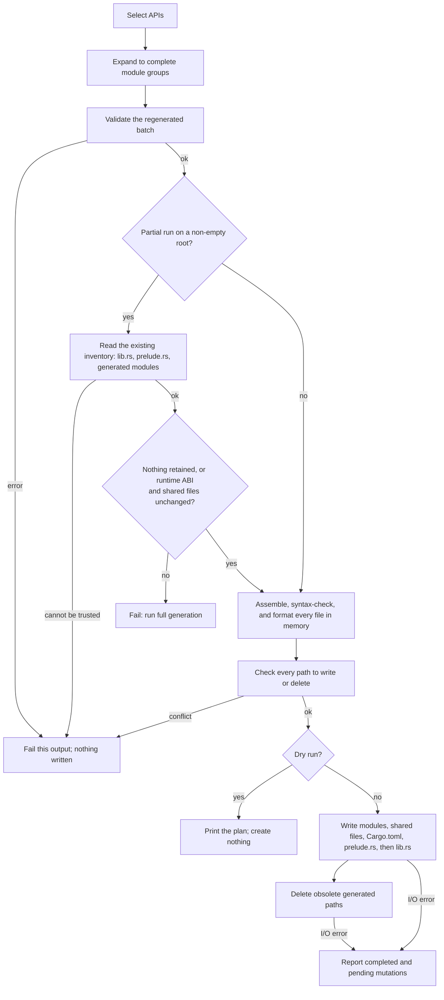

# Partial Generation and Safe Publication

`schematic-gen generate --api <name>` regenerates one API without touching
the rest of the generated crate, the OpenAPI documents, or the Postman
collections. `generate --api all` regenerates everything. Both prepare every
file in memory and check every path they would change before they write
anything, and they never overwrite or delete a file the generator did not
write.

You can:

- regenerate one API after editing its definition:
  `just -f schematic/justfile generate-one ollama-native`
- rely on every other module, artifact, and hand-written file staying
  byte-for-byte as it was
- trust a refusal: when the generator cannot account for what is already in
  an output directory, it changes nothing and says how to proceed
- read, after an I/O failure, exactly which files were written or deleted and
  which were not

## What a partial run regenerates

APIs that share a `module_path` share one generated module (a *module
group*). A partial run always regenerates complete groups, because one file
holds every member:

| You select | Regenerated | Kept as they are |
| --- | --- | --- |
| `ollama-native` | `OllamaNative` and `OllamaOpenAI` (module `ollama`) | the other 14 module groups |
| `emqx-basic` | `EmqxBasic` and `EmqxBearer` (module `emqx`) | the other 14 module groups |
| `gitea` | `Gitea` (module `gitea`) | the other 14 module groups |
| `all` | every module group | nothing; obsolete generated modules are deleted |

`lib.rs` and `prelude.rs` are rebuilt from the kept and the regenerated
groups, in registry order, so after a partial run they are identical to what
full generation would write. `lib.rs` also records the `schematic-runtime`
ABI the crate was generated for (see
[shared runtime compatibility](#shared-runtime-compatibility)). `shared.rs`,
`ws_shared.rs`, the WebSocket definition modules, and `schema/Cargo.toml` are
rewritten on every run. The manifest's module features come from the whole
registry, never from the selection, so a partial run writes the same
`Cargo.toml` as full generation.

OpenAPI and Postman follow the same rule with their own module names: a
partial run rewrites only the selected groups' `<module>.json` and
`<module>.postman_collection.json` (plus `<module>.postman_environment.json`
with `--postman-environment`) and deletes nothing. AsyncAPI documents are not
written by `generate`; `export-asyncapi` writes them, with the same rule for
one API and for all (see [AsyncAPI](../io/asyncapi.md#file-names)).

```bash
# Regenerate the Ollama group in all three outputs
cargo run -p schematic-gen -- generate --api ollama-native --output schema/src \
    --openapi-out openapi --postman-out postman
# [OK] Generated ollama under schema/src (14 written, 0 deleted; kept anthropic, ...)
# [OK] Published openapi (1 written, 0 deleted)
# [OK] Published postman (1 written, 0 deleted)
```

## How a run proceeds

Each output root (the Rust crate, the OpenAPI directory, the Postman
directory) goes through these steps on its own. A refusal or failure in one
root never stops the others; the command exits 1 if any root failed.



## Ownership: what the generator may change

The generator writes to a path only if nothing is there or the file there
proves the generator wrote it. It deletes only proven paths.

| Path | Proof of ownership |
| --- | --- |
| `*.rs` in the crate | first line is the `// This code was automatically generated by schematic-gen. ...` header |
| `schema/Cargo.toml` | contains the line `# This file was automatically generated by schematic-gen.` |
| a module directory | every file inside, at any depth, carries the `.rs` header |
| `openapi/*.json`, `openapi/*.yaml`, `postman/*.postman_collection.json`, and `postman/*.postman_environment.json` when the run requests environments | a regular file with the artifact name (JSON and YAML have no header) |

Symbolic links are never followed and never count as proof, and a file that
cannot be read is never proven owned. Anything without proof is preserved:

```text
schema/src/
├── lib.rs              generated: rewritten
├── gitea.rs            generated: rewritten when selected, else kept
├── handwritten.rs      no header: never touched
└── bin/main.rs         no header: never touched
```

When an unproven file sits at a path the run must write, the run refuses
before writing anything:

```text
$ schematic-gen generate --api gitea ...
[ERROR] refusing to update schema/src; nothing was changed:
  - schema/src/gitea.rs was not written by schematic-gen
Move or remove the listed paths, or generate into an isolated output directory.
```

A module whose size crosses the split threshold (2000 formatted lines)
changes layout between `<module>.rs` and a `<module>/` directory holding
`mod.rs` (module docs, submodule declarations, re-exports, and each API's
client struct and tag type), `requests.rs`, and
`responses.rs`. The new layout is written first;
the old one is deleted only if it is provably generated. If the old layout
holds hand-written content, the run refuses and leaves it intact.

Within a regenerated directory module, generated files the new output no
longer needs are deleted; other files in that directory stay. Full
generation (`--api all`) also deletes generated top-level modules that no
current API produces. A partial run never deletes anything outside the
regenerated groups.

## The inventory a partial run requires

A partial run keeps modules it does not regenerate, so it must know what the
existing crate holds. An absent or empty output directory holds nothing: the
run writes only the selected groups and a `lib.rs` declaring them. Any other
directory must be fully explained, or the run refuses with
`refusing to update ...; nothing was changed` and the remedy *run full
generation (`generate --api all`) or generate into an isolated output
directory*:

| Refused when | Example message |
| --- | --- |
| `lib.rs` or `prelude.rs` is missing, hand-written, or does not parse | `lib.rs does not parse as Rust (...)` |
| `lib.rs` declares a kept module whose file is missing | ``lib.rs declares module `beta`, but neither beta.rs nor beta/mod.rs is a generated file`` |
| a generated module is not declared in `lib.rs` | ``generated module `delta` is not declared in lib.rs`` |
| `lib.rs` declares a module no current definition produces | ``lib.rs declares module `delta`, which no current definition generates`` |
| a kept module exists as both `x.rs` and `x/` | ``module `beta` exists both as beta.rs and as beta/`` |
| the prelude exports for a kept module differ from what the current definitions export (an API was added, removed, or renamed); each API exports its client struct `{Api}` | ``prelude.rs exports ["Gamma", "GammaExtra"] from `gamma`, but the current definitions export ["Gamma"]`` |

The inventory is checked against the module and type *names*; a kept module
whose endpoints changed in the definitions is still kept as it is. Regenerate
it, or run full generation, to bring it up to date.

### Shared runtime compatibility

Kept modules call code they were not generated with, from two places: the
hand-written `schematic-runtime` crate, and the generated helper files
`shared.rs` (cookie encoding and `FormFile`) and
`ws_shared.rs` (the WebSocket error, options, reconnect, and codec types),
which every run rewrites. A partial run therefore answers two separate
questions before it keeps anything:

| Question | Answered by | Why the other check cannot answer it |
| --- | --- | --- |
| Do the kept modules match the hand-written runtime? | the `schematic-runtime` ABI marker in `lib.rs` | the shared files are generated, not part of the runtime, so they say nothing about it |
| Do the kept modules match the generated shared helpers? | a byte comparison of the new `shared.rs` and `ws_shared.rs` with the files on disk | the ABI number changes only with the runtime; a shared helper can change while it stays the same |

Both must pass. Passing one never excuses the other, so a harmless edit to
a shared helper still requires full generation.

Generated `lib.rs` records the runtime's ABI version and checks it at
compile time:

```rust
pub const SCHEMATIC_RUNTIME_ABI: u32 = 2;
const _: () = assert!(
    schematic_runtime::ABI == SCHEMATIC_RUNTIME_ABI,
    "schematic-schema was generated for schematic-runtime ABI 2, but the schematic-runtime it is built against has another ABI; ..."
);
```

Building the crate against a runtime with another ABI therefore fails to
compile with that message, instead of failing somewhere inside a module. The
generator emits `schematic_gen::RUNTIME_ABI`, which a unit test keeps equal to
`schematic_runtime::ABI`.

A partial run that keeps any module reads that marker from the existing
`lib.rs` (by parsing it, not by searching its text) and refuses before
writing anything unless both hold:

- `lib.rs` has exactly one top-level `const SCHEMATIC_RUNTIME_ABI: u32` whose
  value is an integer literal equal to the generator's `RUNTIME_ABI`. A
  different value, a missing marker (output generated before
  `schematic-runtime` existed), or a malformed one (not an integer literal,
  not `u32`, declared more than once) all count as a change.
- `shared.rs` and `ws_shared.rs` would be written byte-for-byte unchanged.

```text
refusing a partial update of schema/src; nothing was changed: the shared runtime
would change (lib.rs records schematic-runtime ABI 1, this generator emits ABI 2)
while module(s) anthropic, ... are retained without being regenerated. Run full
generation (`generate --api all`) instead
```

A missing marker is reported as
`lib.rs records no schematic-runtime ABI, this generator emits ABI 2`, a
malformed one as, for example,
`lib.rs's SCHEMATIC_RUNTIME_ABI is not an integer literal`, and a changed
shared file by its name (`shared.rs`). A matching marker never bypasses the
inventory checks above. With nothing retained (every group selected, or an
empty output directory) the marker and the shared files do not matter.

**Planned: one mechanism.** Shared helpers are to move from the generated
shared files into `schematic-runtime`, where the ABI marker covers them,
typically as part of other work that touches the same code. The byte
comparison is removed once no generated shared helper file remains; until
then both checks stay.

## Failures during publication

Every check above runs before the first write, so a failure while publishing
is an I/O failure (a full disk, a file locked by another program, a path
changed by another process). Writes are atomic per file, but a run is not a
transaction. The error lists what happened and what did not:

```text
publishing schema/src stopped at `write schema/src/prelude.rs`: Failed to write output file ...
  completed (12):
    write schema/src/ollama/mod.rs
    ...
  not done (2):
    write schema/src/prelude.rs
    write schema/src/lib.rs
The output is only partly updated. Fix the cause and run the command again; if a
partial run then refuses the output, run full generation (`generate --api all`)
```

`lib.rs` is written last among the files, so until it is written the crate
still declares its previous module set. Rerunning the same command after
fixing the cause either completes or refuses without changing anything; full
generation always repairs the crate. No `[OK] Generated` line is printed for
an output that failed.

## Dry runs

`--dry-run` prepares exactly the same plan, with the same validation and
ownership checks, and prints it instead of applying it. It creates no files
and no directories, including the output roots and `Cargo.toml`.

## Library use

`output::prepare_rust_output` returns a `RustOutputPlan` (the `MutationPlan`,
the regenerated groups, and the retained groups) without writing anything;
`MutationPlan::publish` applies it and returns a `PublicationReport`.
`output::Selection::All` is full generation and `Selection::Apis(&[...])` a
partial run; `registry` lists every REST API in registry order, and
`registrations` is the inventory whose WebSocket entries the crate packages:

```rust,ignore
use schematic_definitions::registry::registrations;
use schematic_gen::output::{RustOutputRequest, Selection, prepare_rust_output};

let prepared = prepare_rust_output(&RustOutputRequest {
    registry: &registry,                   // every API, registry order
    registrations: registrations(),        // the inventory: WebSocket modules to package
    selection: Selection::Apis(&[&ollama_native]),
    output_dir: Path::new("schema/src"),
    manifest_dir: Some(Path::new("schema")),
})?;
println!("regenerating {:?}, keeping {:?}", prepared.regenerated, prepared.retained);
prepared.plan.publish()?;
```

`output::generate_and_write_all(&apis, dir, dry_run)` is full generation of
`apis`. `pipeline::generate_batch(&registry, &BatchScope::Selection(names), ...)`
runs all three outputs the way the CLI does. Validation of each output is
described in [validation.md](validation.md).
