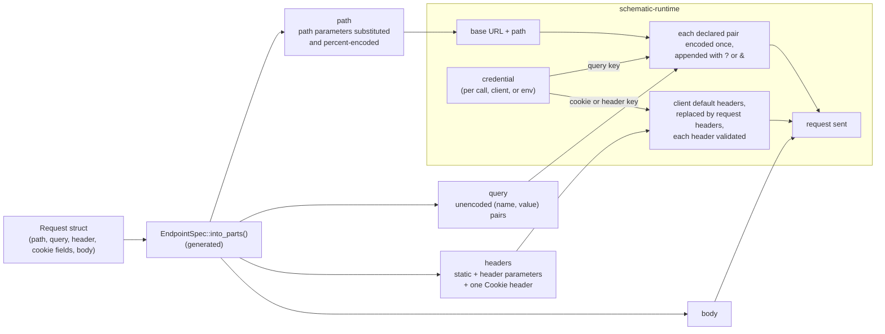
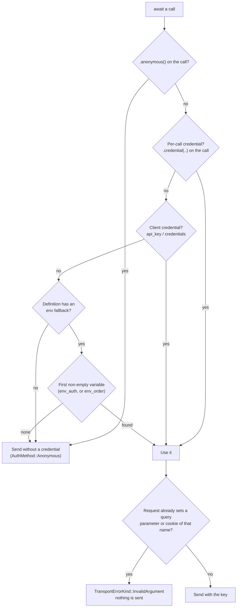

# Request-Side Inputs

Every endpoint in an API definition becomes a request struct in the
generated `schematic-schema` crate. This page explains how a request struct's
fields become an HTTP request: what goes into the path, the query string,
the headers, and the body, where the encoding happens, and where the
client's credential is added.

Generated code only describes a request. Sending it is the job of the
hand-written [`schematic-runtime`](../../runtime/README.md) crate; the
[runtime docs](../runtime/README.md) cover the response envelope, transport
errors, credentials, redirects, deadlines, and hooks.

You can:

- set query parameters with the generated `with_*` builders and rely on the
  same bytes reaching the server as before the query was kept separate
- read a request's query parameters as plain, unencoded `(name, value)`
  pairs by calling `into_parts()`, without parsing a URL
- send a text or binary body exactly as given, under the endpoint's declared
  content type
- set header and cookie parameters with `with_*` builders; every request
  carries at most one `Cookie` header
- authenticate an API whose key travels in a query parameter or a cookie,
  per call, per client, or from an environment variable, without the key
  ever appearing in `Debug` output or stored request metadata

## From request struct to URL



Request structs implement the runtime's `EndpointSpec` trait. Its
`into_parts()` returns a `RequestParts` struct, or an `InvalidArgument` when
the request cannot be described (a JSON body that fails to serialize, or a
static `Cookie` header that cannot be merged):

| Field | Contents |
| --- | --- |
| `method` | HTTP method (`schematic_runtime::Method`), such as `Method::GET` |
| `path` | Path with path parameters substituted and percent-encoded; keeps any query written in the path template |
| `query` | Declared query parameters as unencoded `(name, value)` pairs, in declaration order, duplicates kept |
| `headers` | Endpoint headers as `(name, value)` pairs: static endpoint headers, set header parameters, and at most one `Cookie` header |
| `body` | Request body (`schematic_runtime::RequestBody`) |

`Client::send` turns every `InvalidArgument`, whether from `into_parts()` or
from the runtime's own checks below, into a `TransportError` whose kind is
`TransportErrorKind::InvalidArgument`. Nothing is sent in that case.

## Query parameters

A definition declares query parameters in `EndpointParams.query`. Each one
becomes an optional field with a `with_*` builder. Only parameters you set
are sent, in declaration order:

```rust
use schematic_schema::gitea::ListPullRequestsRequest;
use schematic_schema::schematic_runtime::{EndpointSpec, Method};

let parts = ListPullRequestsRequest::new("own er", "repo")
    .with_sort("newest".to_string())
    .with_state("open closed".to_string())
    .into_parts()?;
assert_eq!(parts.method, Method::GET);
assert_eq!(parts.path, "/repos/own%20er/repo/pulls");
// Declared order (state comes before sort), values not encoded.
assert_eq!(
    parts.query,
    vec![
        ("state".to_string(), "open closed".to_string()),
        ("sort".to_string(), "newest".to_string()),
    ]
);
```

A Gitea client sends that request as
`GET /api/v1/repos/own%20er/repo/pulls?state=open%20closed&sort=newest`.

A parameter that the endpoint's pagination strategy adopts, such as this
endpoint's `page` and `limit`, is not a field: the pager writes it after the
request's own query. See [Pagination](../pagination.md#adopted-parameters).

### Encoding rules

The runtime is the only place query pairs are encoded. It encodes every
name and value once, byte by byte: every byte except the RFC 3986 unreserved
characters (`A-Z a-z 0-9 - _ . ~`) becomes `%XX` with uppercase hex.

| Value | On the wire |
| --- | --- |
| `open closed` | `open%20closed` (a space is `%20`, never `+`) |
| `a+b` | `a%2Bb` |
| `x%y` | `x%25y` (a `%` is always encoded; values are never decoded) |
| `ünï` | `%C3%BCn%C3%AF` (UTF-8 bytes) |
| empty string | `state=` |

Array parameters repeat the key, one pair per element:
`include=a&include=b`. An array of `serde_json::Value` sends each element's
JSON text, so a string element arrives quoted (`include=%22a%22`).
Generation rejects a query parameter whose type is an array of arrays
(`query-parameter`), since an element that is itself an array has no
single text value.

A test compares the request lines the generated clients put on the wire,
covering every case on this page, with a recorded baseline.

### Path templates that already contain a query

Some definitions write a query directly into the path template, for example
Gitea's `/repos/{owner}/{repo}/git/trees/{sha}?recursive=true`. That query is
not declared query data: it stays in `path` exactly as written, and
generation reports a `query-in-path` warning for it (see
[validation](./validation.md#embedded-queries)). Declared pairs are appended
after it with `&`:

```text
/repos/o/r/git/trees/abc?recursive=true&page=1
```

### Base URLs that contain a query

The path is appended to the base URL's text, so it follows the base URL's
query rather than merging with it, and declared pairs are then appended
with `&`. A client built with
`Gitea::new().base_url("https://host/api/v1?tenant=a b")` sends

```text
GET /api/v1?tenant=a%20b/repos/o/r/pulls&page=1
```

The server sees the path as part of the `tenant` value. Do not put a query
in a base URL.

### Request metadata

The runtime records each request in `RequestMeta`, which hooks and the
response envelope expose. `RequestMeta.url` is the full URL that was
requested, query included, and `RequestMeta.query` holds the decoded query
pairs in URL order. Both redact secret values, including the API key query
parameter described below.

## Text and binary bodies

An endpoint declaring `ApiRequest::Text { content_type }` gets a
`body: String` field; `ApiRequest::Binary { content_type }` gets a
`body: Vec<u8>` field. Both are required by `new(...)`, and so are
arguments of the endpoint method, and become
`RequestBody::Raw` in `into_parts()`: the bytes are sent unchanged, with the
declared content type as the `Content-Type` header.

```rust
use schematic_schema::example::Example;

let client = Example::new();

// Text: `ApiRequest::Text { content_type: "text/plain; charset=utf-8" }`
client.send_note("line one\nline two".to_string()).await?;

// Binary: any bytes, including ones that are not UTF-8.
client.upload_blob("name", vec![0x00, 0x9F, 0xFF]).await?;
```

An empty `String` or `Vec<u8>` sends an empty body under the same content
type. Generation rejects a declared content type that is empty or contains a
character other than visible ASCII, space, or tab (`text-request-body` or
`binary-request-body`).

## Header parameters

Each `EndpointParams.header` entry becomes an optional field and a `with_*`
builder, using the same type mapping as query parameters. The field name is
sanitized (`X-Trace-Id` becomes `x_trace_id`), but the header is sent under
its exact declared name. `required` is not enforced yet.

| You set | The server receives |
| --- | --- |
| `.with_x_trace_id("abc 123".to_string())` | `X-Trace-Id: abc 123` |
| `.with_x_ids(vec![1, 22, 333])` | `X-Ids: 1,22,333` (array elements joined with `,`) |
| nothing | no `X-Trace-Id` header at all |

Headers merge in this order, with names compared case-insensitively:

1. the API's static headers (`RestApi.headers`) other than `Cookie`, which
   the generated `new()` sets as client default headers, plus any
   `default_header` you add to the client
2. the endpoint's static headers (`Endpoint.headers`), which replace default
   headers of the same name
3. set header parameters, which replace endpoint headers of the same name;
   an unset parameter leaves a static header alone
4. the credential header, if the credential travels in one (see
   [credentials](#where-the-credential-comes-from))

So an endpoint with the static header `X-Mode: static` and a header
parameter `x-mode` sends `x-mode: param` when the parameter is set, and
`X-Mode: static` when it is not.

Before anything is sent, the runtime parses every header name and value
with the HTTP types. A value with a control character, such as
`"bad\r\nX-Injected: 1"`, makes the send fail with
`TransportErrorKind::InvalidArgument` (reason ``header `X-Trace-Id` is not
valid``) and no request leaves the client. The error names the header,
never the value. Non-ASCII characters are valid header bytes (`obs-text`)
and are sent as raw UTF-8. Generation rejects a header parameter whose name
is not an HTTP token, and an array-of-arrays type (`header-parameter`).

## Cookie parameters

Each `EndpointParams.cookie` entry also becomes an optional field and a
`with_*` builder. Set cookie parameters are encoded and folded into a single
`Cookie` header together with any static cookies:

```text
Cookie: api=1; theme=dark; session=a%20b%3Bc; prefs=x%2Cy,%C3%A9
```

**Encoding.** A cookie value keeps every byte RFC 6265 allows in a cookie
value, including `%`; every other UTF-8 byte becomes `%XX` with uppercase
hex. A space is `%20`, `;` is `%3B`, `,` is `%2C`, CR and LF are `%0D` and
`%0A`, and `é` is `%C3%A9`. No server is assumed to decode the value: it
receives exactly this text. Array elements are encoded one by one and joined
with a literal `,`, so a `,` inside an element stays distinguishable
(`["x,y", "é"]` becomes `x%2Cy,%C3%A9`). Because CR, LF, and `;` are always
encoded, no value can start another header or another cookie. The generated
`shared::encode_cookie_value` applies this encoding.

**Merging.** The generated `into_parts()` collects cookies in this order
(`shared::combine_cookie_headers`), and a later cookie with the same name
(compared case-sensitively) replaces the earlier value in its original
position; a new name is appended:

1. the API's static `Cookie` header, which generation folds into every
   endpoint's static headers ahead of the endpoint's own
2. the endpoint's static `Cookie` header
3. set cookie parameters

With an API cookie `api=1; theme=api`, an endpoint cookie
`theme=dark; session=static`, and `session` set to `a b`, the server
receives `Cookie: api=1; theme=dark; session=a%20b`. A static `Cookie`
header that must be merged and is not a list of `name=value` pairs makes
`into_parts()` return an `InvalidArgument` (``header `Cookie` is not a list
of name=value pairs``) rather than being dropped, so the send fails before
any network work. Generation rejects a cookie parameter whose name is not a
cookie name (`cookie-parameter`).

An API-level `Cookie` is not a client default header because the runtime
refuses a default header that can carry a credential, and `Cookie` is one.

## API keys in a query parameter or cookie

An API whose effective auth policy (`RestApi::effective_auth_policy`, which
honors an explicit `auth_policy` over the legacy `auth` field) includes
`ApiKeyParam { name, location }` sends its key as the query parameter or
cookie `name`. The generated `definition()` tells the runtime so, as a
`CredentialPlacement::ApiKeyQuery { name }` or `ApiKeyCookie { name }`.

### Where the credential comes from

The runtime resolves one credential per send, the same way for every
placement (header, query, or cookie):



```rust
use schematic_schema::example::Example;
use schematic_schema::prelude::*;

let client = Example::new();

// Per call: wins over the client credential and the environment.
client.list_things().credential(Credential::api_key("my key")).await?;

// Per client: used whenever a call supplies none.
let client = Example::new().api_key("my key");

// From the environment: the variables `env_auth` names are read in order
// and the first non-empty one wins. `env_order` replaces that list, e.g.
// EXAMPLE_KEY="" then EXAMPLE_KEY_2="k" sends `k`.
let client = Example::new().env_order(["EXAMPLE_KEY", "EXAMPLE_KEY_2"]);

// Explicitly anonymous: no per-call, client, or environment credential.
client.list_things().anonymous().await?;
```

- **Query.** The key is appended after the declared pairs and encoded once,
  like any other pair: with `q=x y` and the key `k&=`, the server receives
  `?q=x%20y&api_key=k%26%3D`.
- **Cookie.** The key is encoded like a cookie value and appended to the one
  `Cookie` header: `lang=en; theme=t` plus the key `s;v` becomes
  `lang=en; theme=t; sid=s%3Bv`.
- **A request value of the same name.** A credential is never injected over
  a value the request sets itself. If the request already sets the
  `api_key` query parameter or the `sid` cookie (through a declared
  parameter or a static cookie), the send fails with
  `TransportErrorKind::InvalidArgument` before any network work, and the
  error does not contain the key.
- **No key.** When no source supplies a key, the request is sent without
  one; there is no missing-credential error. The response metadata records
  `AuthMethod::Anonymous`, and the server's reply (typically a 401) arrives
  in the response envelope. A definition without an env fallback reads no
  variable, even if one is set, and a fallback with no variable to read is
  dropped from the generated definition.
- **Wrong kind.** A per-call credential of a kind the API does not accept
  (for example `Credential::basic` for a key-in-query API) fails with
  `TransportErrorKind::InvalidArgument`; a client credential of such a kind
  is refused with `BuildError::IncompatibleCredential` at `build()`, or else
  on the first call as `TransportErrorKind::InvalidClient`.

## Debug output never shows a credential

A generated client wraps a `schematic_runtime::Client`, whose `Debug`
output prints only the API name, the base URL (with any user information
redacted), the timeout, and the kind of the client credential:

```text
Example(Client { api: "Example", base_url: "https://api.example.com", timeout: 30s, credential: Some(Key(Credential(ApiKey, [redacted]))), .. })
```

Explicit bearer tokens, header API keys, basic-auth passwords, and
parameter keys are never part of it, whichever way they were supplied, and
an environment key is read at send time rather than stored in the client.
Request structs hold only the parameters you set, never the client's key.
The request URL on the wire still carries a query key; the URL kept in
`RequestMeta` and shown in errors redacts it.
