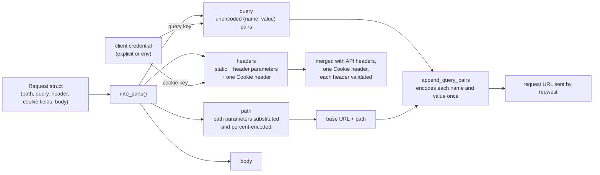
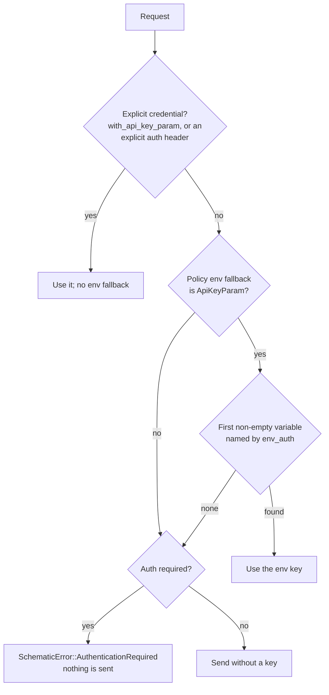

# Request-Side Inputs

Every endpoint in an API definition becomes a request struct in the
generated `schematic-schema` crate. This page explains how a request struct's
fields become an HTTP request: what goes into the path, the query string,
the headers, and the body, where the encoding happens, and where the
client's credential is added.

You can:

- set query parameters with the generated `with_*` builders and rely on the
  same bytes reaching the server as before the query was kept separate
- read a request's query parameters as plain, unencoded `(name, value)`
  pairs by calling `into_parts()`, without parsing a URL
- build a URL from those parts yourself with `shared::append_query_pairs`,
  which encodes each pair exactly once
- send a text or binary body exactly as given, under the endpoint's declared
  content type
- set header and cookie parameters with `with_*` builders; every request
  carries at most one `Cookie` header
- authenticate an API whose key travels in a query parameter or a cookie,
  explicitly or from an environment variable, without the key ever appearing
  in the client's `Debug` output

## From request struct to URL



`into_parts()` returns a `RequestParts` tuple with five elements:

| Index | Contents |
| --- | --- |
| `0` | HTTP method, such as `"GET"` |
| `1` | Path with path parameters substituted and percent-encoded |
| `2` | Request body (`RequestBody`) |
| `3` | Endpoint headers as `(name, value)` pairs: static endpoint headers, set header parameters, and at most one `Cookie` header |
| `4` | Declared query parameters as unencoded `(name, value)` pairs |

## Query parameters

A definition declares query parameters in `EndpointParams.query`. Each one
becomes an optional field with a `with_*` builder. Only parameters you set
are sent, in declaration order:

```rust
use schematic_schema::gitea::ListPullRequestsRequest;

let request = ListPullRequestsRequest::new("own er", "repo")
    .with_state("open closed".to_string())
    .with_page(2);

let (method, path, _body, _headers, query) = request.into_parts()?;
assert_eq!(method, "GET");
assert_eq!(path, "/repos/own%20er/repo/pulls");
// Declared order (page comes before state), values not encoded.
assert_eq!(
    query,
    vec![
        ("page".to_string(), "2".to_string()),
        ("state".to_string(), "open closed".to_string()),
    ]
);
```

The generated client sends that request as
`GET /api/v1/repos/own%20er/repo/pulls?page=2&state=open%20closed`.

### Encoding rules

`append_query_pairs` is the only place query pairs are encoded. It uses
`urlencoding::encode` on every name and value:

| Value | On the wire |
| --- | --- |
| `open closed` | `open%20closed` (a space is `%20`, never `+`) |
| `a+b` | `a%2Bb` |
| `x%y` | `x%25y` (a `%` is always encoded; values are never decoded) |
| `ünï` | `%C3%BCn%C3%AF` (UTF-8 bytes) |
| empty string | `state=` |

Array parameters repeat the key, one pair per element:
`include=a&include=b`. An array of `serde_json::Value` sends each element's
JSON text, so a string element arrives quoted (`include=%22a%22`).

### Path templates that already contain a query

Some definitions write a query directly into the path template, for example
Gitea's `/repos/{owner}/{repo}/git/trees/{sha}?recursive=true`. That query is
not declared query data: it stays in the path element exactly as written, and
generation reports a `query-in-path` warning for it (see
[validation](./validation.md#embedded-queries)). Declared pairs are appended
after it with `&`:

```text
/repos/o/r/git/trees/abc?recursive=true&page=1
```

### Base URLs that contain a query

The separator is chosen from the path, not from the full URL. A client
created with `with_base_url("https://host/api/v1?tenant=a")` therefore sends
`/api/v1?tenant=a/repos/o/r/pulls?page=1`: the path and its query follow the
base URL's query rather than merging with it. This matches how generated
clients have always built URLs; do not put a query in a base URL.

### Response hooks

`ResponseContext.path` is the path element: it does not contain declared
query parameters. `ResponseContext.url` is the full URL that was requested,
query included.

## Text and binary bodies

An endpoint declaring `ApiRequest::Text { content_type }` gets a
`body: String` field; `ApiRequest::Binary { content_type }` gets a
`body: Vec<u8>` field. Both are required by `new(...)` and become
`RequestBody::Raw` in `into_parts()`: the bytes are sent unchanged, with the
declared content type as the `Content-Type` header.

```rust
use schematic_schema::example::{SendNoteRequest, UploadBlobRequest};

// Text: `ApiRequest::Text { content_type: "text/plain; charset=utf-8" }`
client.send_note(SendNoteRequest::new("line one\nline two".to_string())).await?;

// Binary: any bytes, including ones that are not UTF-8.
client.upload_blob(UploadBlobRequest::new("name", vec![0x00, 0x9F, 0xFF])).await?;
```

An empty `String` or `Vec<u8>` sends an empty body under the same content
type. Generation rejects a declared content type that is empty or contains a
character other than visible ASCII, space, or tab (`text-request-body` or
`binary-request-body`).

## Header parameters

Each `EndpointParams.header` entry becomes an optional field and a `with_*`
builder, using the same type mapping as query parameters. The field name is
sanitized (`X-Trace-Id` becomes `x_trace_id`), but the header is sent under
its exact declared name. `required` is not enforced yet.

| You set | The server receives |
| --- | --- |
| `.with_x_trace_id("abc 123".to_string())` | `X-Trace-Id: abc 123` |
| `.with_x_ids(vec![1, 22, 333])` | `X-Ids: 1,22,333` (array elements joined with `,`) |
| nothing | no `X-Trace-Id` header at all |

Headers merge in this order, with names compared case-insensitively:

1. the API's static headers (`RestApi.headers`) and its credential header
2. the endpoint's static headers (`Endpoint.headers`), which replace API
   headers of the same name
3. set header parameters, which replace endpoint headers of the same name;
   an unset parameter leaves a static header alone

So an endpoint with the static header `X-Mode: static` and a header
parameter `x-mode` sends `x-mode: param` when the parameter is set, and
`X-Mode: static` when it is not.

Before anything is sent, every header name and value is parsed with the
HTTP types (`reqwest::header::HeaderName`, `HeaderValue`). A value with a
control character, such as `"bad\r\nX-Injected: 1"`, makes the request fail
with `SchematicError::Header(HeaderError::InvalidHeaderValue("X-Trace-Id"))`
and no request leaves the client. The error names the header, never the
value. Non-ASCII characters are valid header bytes (`obs-text`) and are sent
as raw UTF-8. Generation rejects a header parameter whose name is not an
HTTP token, and an array-of-arrays type (`header-parameter`).

## Cookie parameters

Each `EndpointParams.cookie` entry also becomes an optional field and a
`with_*` builder. Set cookie parameters are encoded and folded into a single
`Cookie` header together with any static cookies:

```text
Cookie: api=1; theme=dark; session=a%20b%3Bc; prefs=x%2Cy,%C3%A9
```

**Encoding.** A cookie value keeps every byte RFC 6265 allows in a cookie
value, including `%`; every other UTF-8 byte becomes `%XX` with uppercase
hex. A space is `%20`, `;` is `%3B`, `,` is `%2C`, CR and LF are `%0D` and
`%0A`, and `é` is `%C3%A9`. No server is assumed to decode the value: it
receives exactly this text. Array elements are encoded one by one and joined
with a literal `,`, so a `,` inside an element stays distinguishable
(`["x,y", "é"]` becomes `x%2Cy,%C3%A9`). Because CR, LF, and `;` are always
encoded, no value can start another header or another cookie.

**Merging.** Cookies are collected in this order, and a later cookie with
the same name (compared case-sensitively) replaces the earlier value in its
original position; a new name is appended:

1. the API's static `Cookie` header
2. the endpoint's static `Cookie` header
3. set cookie parameters
4. a cookie API key (see below)

With an API cookie `api=1; theme=api`, an endpoint cookie
`theme=dark; session=static`, and `session` set to `a b`, the server
receives `Cookie: api=1; theme=dark; session=a%20b`. A static `Cookie`
header that must be merged and is not a list of `name=value` pairs fails
the request with `SchematicError::Header`, rather than being dropped.
Generation rejects a cookie parameter whose name is not a cookie name
(`cookie-parameter`).

## API keys in a query parameter or cookie

An API whose effective auth policy (`RestApi::effective_auth_policy`, which
honors an explicit `auth_policy` over the legacy `auth` field) includes
`ApiKeyParam { name, location }` sends its key as the query parameter or
cookie `name`. The key comes from one of two sources:



```rust
use schematic_schema::example::{Example, ListThingsRequest};

// Explicit: wins over any environment variable.
let client = Example::new().with_api_key_param("my key");

// From the environment: `env_auth` names are read in order and the first
// non-empty one wins, e.g. EXAMPLE_KEY="" then EXAMPLE_KEY_2="k".
let client = Example::new()
    .variant()
    .env_auth(vec!["EXAMPLE_KEY".to_string(), "EXAMPLE_KEY_2".to_string()])
    .build();
```

- **Query.** The key becomes one more pair in the query element, so it is
  encoded once by `append_query_pairs` like any other pair. It replaces
  every declared query pair with the same name: with a declared `api_key`
  set to `declared`, `q=x y`, and the key `k&=`, the server receives
  `?q=x%20y&api_key=k%26%3D`.
- **Cookie.** The key is encoded like a cookie value and merged last into
  the one `Cookie` header, replacing a same-named cookie in place:
  `lang=en; sid=static` plus the key `s;v` becomes `lang=en; sid=s%3Bv`.
- **No key.** When the policy requires authentication and neither source
  produced a key, the request fails with
  `SchematicError::AuthenticationRequired`, whose `env_fallback_vars` lists
  the variables that were read. A policy without an env fallback reads no
  variable, even if one is set.

**Temporary.** `with_api_key_param` and the client's environment scan are
interim mechanisms. They will be replaced when credentials move to a shared
runtime, so do not build long-lived abstractions on them.

## Debug output never shows a credential

A generated client implements `Debug` by printing only its base URL and
auth policy:

```text
Example { base_url: "https://api.example.com", auth_policy: AuthPolicy { .. }, .. }
```

Explicit bearer tokens, header API keys, basic-auth passwords, and
parameter keys are never part of it, whichever way they were supplied.
Request structs hold only the parameters you set, never the client's key.
The request URL itself still carries a query key, and so does
`ResponseContext.url`; redacting URLs and error text is not done yet.
