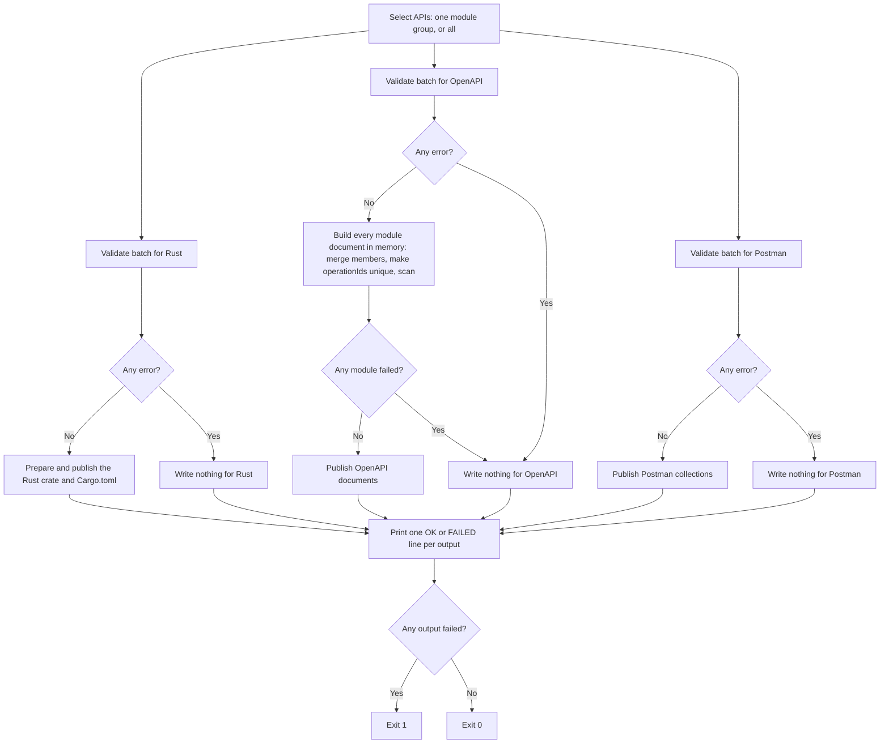

# Generation Validation

`schematic-gen` writes three outputs from the API definitions: the Rust
client crate (`schematic/schema/src`), OpenAPI documents
(`schematic/openapi`), and Postman collections (`schematic/postman`). Before
it writes an output, it validates **the whole batch of selected APIs for that
output**. An output with a blocking error is not written at all, and its
failure never stops the other outputs.

You can:

- see every problem with a definition before anything is written:
  `cargo run -p schematic-gen -- validate --api gitea`
- read each problem as one line naming the API, endpoint, feature, and output
- rely on warnings never failing a run, and on errors failing only their own
  output

## How a generate run proceeds



The outputs run in the order Rust, OpenAPI, Postman. Selecting one API
selects its whole module group, separately for each output. After validation,
each output is prepared in memory and its paths are checked before anything
is written; a refused or failed publication (for example, the OpenAPI
directory path is a file) is reported the same way as a validation failure:
that output fails, and the next output is still attempted. How preparation,
ownership checks, and partial runs work is described in
[partial-generation.md](partial-generation.md).

```text
$ schematic-gen generate --api gitea --openapi-out ./not-a-dir ...
[OK] rust output
[FAILED] openapi output
[OK] postman output
[ERROR] generation failed for output(s) openapi (succeeded: rust, postman)
```

## Reading a diagnostic

Each diagnostic is printed to stderr as one line, after a `[WARN]` or
`[ERROR]` label:

```text
severity=<severity> api=<api> endpoint=<endpoint> feature=<feature> output=<output>: <message>
```

`validate` runs all three validators for one API and ends with one line per
output:

```text
$ schematic-gen validate --api example
[ERROR] severity=error api=Example endpoint=ReadTree feature=query-in-path output=rust: path template `/repos/{owner}/{repo}/git/trees/{sha}?recursive=true` embeds a query string; declare it as query parameters so it can be separated from the path
[ERROR] ... output=openapi: ...
[ERROR] ... output=postman: ...
  [FAIL] rust
  [FAIL] openapi
  [FAIL] postman
```

For example:

```text
severity=error api=Example endpoint=ReadTree feature=query-in-path output=postman: path template `/repos/{owner}/{repo}/git/trees/{sha}?recursive=true` embeds a query string; declare it as query parameters so it can be separated from the path
severity=error api=Feed,FeedCompat endpoint=<none> feature=generated-name-collision output=rust: `SubscribeRequest` is generated for the request struct of Feed::Subscribe and the request struct of FeedCompat::Subscribe
```

- `severity` is `error` (the output is not written) or `warning` (reported
  only).
- `api` names every API involved; a module-group problem lists each member,
  separated by commas.
- `endpoint` is `<none>` when the problem belongs to the API or the group.
- `output` is `rust`, `openapi`, or `postman`.

The same fields are available to code as
`schematic_gen::diagnostics::ValidationDiagnostic`, which also implements
`serde::Serialize`:

```json
{
  "severity": "error",
  "api": ["Example"],
  "endpoint": "ReadTree",
  "feature": "query-in-path",
  "output": "postman",
  "message": "path template ... embeds a query string; ..."
}
```

## What each output checks

| Feature id | Rust | OpenAPI | Postman | Severity |
| --- | :-: | :-: | :-: | --- |
| `duplicate-endpoint-id`: two endpoints of one API share an id | ✓ | ✓ | ✓ | error |
| `duplicate-method-path`: two endpoints of one API share a method and path | ✓ | ✓ | ✓ | error (see below) |
| `query-in-path`: a path template contains `?` | ✓ | ✓ | ✓ | error (see below) |
| `invalid-output-filename`: the file name is not one safe path component, or a module would overwrite a shared generated file | ✓ | ✓ | ✓ | error |
| `invalid-identifier`: an API name, endpoint id, or parameter name cannot become the Rust identifier generated from it | ✓ | | | error |
| `invalid-request-suffix`: `request_suffix` is empty or not alphanumeric | ✓ | | | error |
| `invalid-module-path`: the module path is not one Rust identifier | ✓ | | | error |
| `invalid-type-syntax`: a body, response, or form JSON type, spelled through the API's schema components, is not a Rust type | ✓ | | | error |
| `generated-name-collision`: two generated items, fields, or client methods share a name, including two endpoints whose methods get one name and a call type named like another item | ✓ | | | error |
| `endpoint-method-rename`: an endpoint method or call-type setter was renamed to avoid a method every API struct or call type has (see below) | ✓ | | | warning |
| `invalid-schema-reference`: a body, response, or form JSON reference names no registered component in the API's `schemas`, or a component is malformed (see below) | ✓ | ✓ | | error |
| `duplicate-method-path` across a module group: two member APIs declare different operations on one method and path | | ✓ | | error (found while building the document) |
| `duplicate-operation-id`: a finished document declares one `operationId` twice | | ✓ | | error (found while building the document) |
| `unresolved-link-operation`: a link in a finished document names an `operationId` no operation declares | | ✓ | | error (found while building the document) |
| `text-request-body`, `binary-request-body`: the declared content type is empty or not a valid header value | ✓ | | | error |
| `api-key-param`: a query API-key parameter name is empty, or a cookie API-key name is not a cookie name | ✓ | | | error |
| `header-parameter`, `cookie-parameter`: the name is not an HTTP token | ✓ | | | error |
| `query-parameter`, `header-parameter`, `cookie-parameter`: the type is an array of arrays | ✓ | | | error |
| `pagination-strategy`: a pagination strategy is malformed, alone or on its endpoint (see below) | ✓ | | | error |
| `pagination-exception`: an endpoint collection has an unusable item selector, item type, item location, or alternates | ✓ | | | error |
| `pagination-parameter`: a strategy input collides with a declared parameter it cannot adopt, adopts one without the knob that replaces it, or manages a required one without a value to send | ✓ | | | error |

The Rust client sends text and binary bodies, header and cookie parameters,
and API keys in a query parameter or cookie, so its rules for those features
check only that the declared names and content types can go on the wire.
How each one is sent is described in
[request-side inputs](./request-side.md#text-and-binary-bodies).
OpenAPI declares header and cookie parameters in their own locations, and a
Postman collection carries each one as a request header, disabled when the
parameter is optional (see
[Postman parameter mapping](../io/export-postman.md#parameter-mapping)), so
neither export has a rule for them.

The Rust client sends each element of an array parameter as text: one
repeated pair per element in the query, one `,`-joined value in a header or
cookie. An element that is itself an array has no text form, so an array of
arrays is an error at every location rather than a shape the client would
drop or fail to compile. OpenAPI writes the nested shape as a parameter
schema, and Postman carries no parameter type, so both exports are still
written:

```rust
// Fails the Rust client only (`query-parameter`).
EndpointParams::default().with_query_param(
    "matrix",
    QueryParamType::Array(Box::new(QueryParamType::Array(Box::new(QueryParamType::Boolean)))),
    false,
    None,
)
```

Rust-only rules are never applied to the exports. An export carries type
names and endpoint ids as data, so a component whose Rust path is not valid
Rust syntax still produces a valid OpenAPI document and Postman collection:

```rust
// Fails the Rust client only (`invalid-type-syntax`); OpenAPI and Postman are still written.
response: ApiResponse::json_type("Model"),
// ...where the API's `schemas` holds:
SchemaComponent { name: "Model".into(), rust_path: Some("Vec<Model".into()), schema: json!({}) },
```

### Schema references

A JSON body, response, or form part stores a `TypeRef` that names schema
components, for example `Array(Named("Model"))`. The Rust client spells it
through the API's `schemas` (`Vec<::my_models::Model>`), and the OpenAPI export
writes it as a `$ref` to `#/components/schemas/Model`. Both outputs therefore
need every name to resolve, and both report `invalid-schema-reference` when one
does not:

```text
severity=error api=Items endpoint=ListItems feature=invalid-schema-reference output=rust: schema reference `Model` does not name a registered component of API `Items`; register the type in the API's definition context
```

Each dangling name is reported once per endpoint, including every name inside
a wrapped reference. A name that exists only nested inside another component
(its entry has no Rust path) cannot be referenced directly. When every name
resolves, `RestApi::validate_references` still runs, so an empty or duplicate
component name, a schema that is not a JSON Schema object or boolean, or an
empty map key is reported under the same feature. The Postman collection never
reads a schema, so it is written regardless.

An API built with `RestApi::builder` has already passed the same check, so
in practice the diagnostic catches a definition that was deserialized or
edited after it was built.

### Pagination rules

Pagination changes only the Rust client, so only its validator checks it.
Each message starts with the rule's id, then says what is wrong:

```text
severity=error api=Catalog endpoint=ListItems feature=pagination-exception output=rust: missing-item-type: collection requires an item type
```

The rules, by feature id:

- `pagination-strategy`: `cursor-without-end-signal`,
  `full-page-on-cursor`, `full-page-without-page-size`,
  `page-count-on-non-page-number`, `invalid-page-size`, `duplicate-input`
  (two parts of a strategy write one query name, header, or body path),
  `empty-value`, `empty-cursor-leg`, `inclusive-boundary-needs-item-key`,
  `adjustable-page-size-on-page-number`, `adjustable-link-size-not-query`,
  `next-link-with-follow-up-path`, `next-link-method-unspecified`,
  `body-input-on-get`, `unknown-carry-param`, `unknown-path-param`,
  `session-handle-unreachable`, `session-handle-not-sent`,
  `session-step-needs-handle`, `keep-alive-without-input`,
  `invalid-partition-max`.
- `pagination-exception`: `invalid-item-selector`, `not-an-array-location`, `missing-item-type`,
  `invalid-item-type`, `unknown-item-type`, `alternates-without-primary`,
  `alternates-on-unpaginated`, `duplicate-label`, `invalid-label`.
- `pagination-parameter`: `collides-with-endpoint-param`,
  `adoption-without-knob`, `pager-managed-required-without-default`.

An API default's own shape is reported once, with `endpoint=<none>`; each
endpoint that inherits it is checked only for what depends on the endpoint.
An item type named by an endpoint collection must be valid Rust type syntax, and a
single identifier other than a primitive must be a component in the API's
`schemas` (nested schemas count). An item location is checked against the
response type's component schema when there is one; when the components cannot
describe the type, the generated client checks the location at run time
instead, and nothing is reported.

### Routes and the uniqueness key

Two endpoints are the same route when their method and path match after
every placeholder is replaced by `{}`. `GET /items/{id}` and
`GET /items/{name}` are the same route; `GET /items/{id}` and
`DELETE /items/{id}` are not. This comparison lives in one function,
`schematic_gen::validation::endpoint_uniqueness_key`.

An endpoint **is** its method and path. Two endpoints of one API on the
same route are a `duplicate-method-path` **error** in every output, with no
exceptions, so none of the three outputs is written for that batch. Nothing
else joins the key: a query parameter, a request body, or a different
response does not make a second endpoint on the same route. Declare one
endpoint instead, with the distinguishing input as an optional parameter:

```rust
use schematic_define::{Endpoint, ParamDef, QueryParamType};

let endpoint = Endpoint::get("GetGitTree", "/repos/{owner}/{repo}/git/trees/{sha}")
    .describes("Fetch a tree")
    .returns_empty()
    .query(ParamDef::new("recursive", QueryParamType::Boolean)
        .describes("Fetch all levels instead of one"))
    .build()?;
```

When one route answers with different shapes (Bitbucket's `src` route
returns a JSON directory listing or raw file bytes, depending on what the
path names), the single endpoint declares a response that is true for every
shape: Bitbucket's `GetSource` returns `Binary`, and the caller decodes it.

The same route in two **different** APIs is not a duplicate for the Rust
client or Postman. For OpenAPI it matters only when both APIs share one
module document; see the next section.

Across the APIs of one module group (for example `OllamaNative` and
`OllamaOpenAI`, which both generate into `ollama`), the same endpoint id is
allowed: their request suffixes keep the generated Rust names apart. Only an
actual collision of generated names is an error.

### Endpoint method names

Every REST endpoint becomes a method on its API struct, named after the
endpoint id in snake case (`ListReleases` becomes `list_releases`), and that
method returns a call type named after the request type (`ListReleasesCall`
beside `ListReleasesRequest`). Each optional parameter becomes a setter on the
call type, named like its request field (`state`, matching
`with_state`). A parameter that the endpoint's pagination strategy adopts
has no setter: its pager control (`.page_size(..)`, `.page(..)`, ...)
replaces it.

Some of those names are taken by methods that every API struct or every call
type has. The generator renames the endpoint's name, never the shared one, so
`.full()` and `.new()` mean the same thing everywhere:

| The generated name would be | Because | It becomes |
| --- | --- | --- |
| an endpoint method named like an API-struct method (`new`, `send`, `base_url`, `clone`, …) | the API struct has that method | `new_endpoint` |
| a setter named like a call-type method (`full`, `build`, `anonymous`, `credential`, `deadline`, the pager entry points `pager`, `pages`, `fetch_page`, `collect_all`, `with_session`, or a trait method such as `clone`) | every call type has that method | `full_param` |
| a setter named like a pager control the endpoint's strategy authors (`page`, `offset`, `after`, `before`, `page_size`, `keep_alive`, `close_grace` on a session, or `partitioned` on a list without a session) | the endpoint's pager has a method of that name | `page_param` |
| an endpoint method whose snake-case id is a Rust keyword | it is not an identifier | `type_`, the same rule request fields use |

Each rename is reported as an `endpoint-method-rename` **warning** and never
blocks the client:

```text
severity=warning api=Widgets endpoint=ListWidgets feature=endpoint-method-rename output=rust: setter `full` is generated as `full_param`: every call type has a method of that name
```

A name still claimed twice after renaming is a `generated-name-collision`
**error**. The generator never invents a numbered name. Rename one of the
endpoint ids or parameters instead:

```text
severity=error api=Widgets endpoint=GetApikey feature=generated-name-collision output=rust: endpoint method `get_apikey` is generated for endpoints `GetAPIKey` and `GetApikey`; rename one of the endpoint ids
```

The same list is available to code as
`schematic_gen::codegen::endpoint_methods::endpoint_method_renames`. None of
the shipped definitions needs a rename today. A `schematic-gen` test pins that
list for the shipped definitions, so a definition change that causes a rename
fails the test and the new name is reviewed rather than appearing silently.

### OpenAPI documents of a module group

The APIs of one module group become one OpenAPI document (`ollama.json`
holds `OllamaNative` and `OllamaOpenAI`). Some problems only exist in that
merged document, so `schematic-gen` builds **every** module's document in
memory before it writes **any** of them; a failure in one module leaves the
whole OpenAPI directory untouched.

- **Same route, same operation:** when two members declare an operation that
  is identical apart from its authentication (EMQX Basic and EMQX Bearer),
  the document keeps one operation and both security alternatives.
- **Same route, different operations:** an OpenAPI path holds one operation
  per method, so this is a `duplicate-method-path` error for the OpenAPI
  output only. The Rust client and Postman collection are still written.
- **Same `operationId`, different routes:** every `operationId` in a document
  must be unique, so a clash is renamed rather than rejected.

The rename rule walks the operations in a fixed order: member APIs in
module group order, each API's paths in declaration order, and methods in the
order GET, POST, PUT, PATCH, DELETE, HEAD, OPTIONS, TRACE. The first
operation to declare an id keeps it. A later operation with a taken id gets
its own API's name prefixed (PascalCase). If that name is taken too, or is
any operation's original id, a number from 2 upward is appended:

```text
OllamaNative  POST /api/embeddings  Embeddings  ->  Embeddings
OllamaOpenAI  POST /v1/embeddings   Embeddings  ->  OllamaOpenAIEmbeddings
```

Original ids are reserved before any rename, so a rename never takes an id
that a later operation already declares: if `FooC` declares `FooBList`, the
renamed `List` of `FooB` becomes `FooBList2`. An OpenAPI link that names an
`operationId` is updated together with the operation it pointed to in its own
API's document; the same id in another API's link is left alone. Per-API
documents are not renamed. Both kinds of document then pass one final scan,
`export::openapi::operation_id_diagnostics`, which reports any id still
declared twice (`duplicate-operation-id`) and any link naming no operation
(`unresolved-link-operation`). The Rust client and Postman collections keep
the original endpoint ids.

### Repeated path segments

A repeated segment such as `/api/api/items` is never an error by itself: a
base URL ending in `/api` joined with a path starting `/api` can be correct.
`schematic-gen` does not judge base-plus-path composition.

### Embedded queries

A path template such as `/repos/{owner}/{repo}/git/trees/{sha}?recursive=true`
mixes a query into the path, where it cannot be separated, typed, or masked.
All shipped paths use declared query parameters. `query-in-path` is a
blocking error in every output, and endpoint/API builders reject it too.
Diagnostics identify the API, endpoint, and offending path. An OpenAPI import
normalizes supported query-bearing source paths before building endpoints;
malformed or conflicting expressions fail import. See
[request-side inputs](./request-side.md#path-templates-that-already-contain-a-query).

## Calling validation from code

Each output has a public validator that takes the whole batch:

```rust
use schematic_gen::validation::{validate_openapi, validate_postman, validate_rust_client};

let apis = schematic_gen::pipeline::resolve_all_apis();
let batch: Vec<_> = apis.iter().collect();
for diagnostic in validate_rust_client(&batch) {
    eprintln!("{diagnostic}");
}
```

`pipeline::generate_batch` runs every validator,
publishes the outputs that pass, and returns a `GenerationReport` naming the
succeeded and failed outputs.

The public writers keep the same boundary when called directly:
`output::prepare_rust_output`, `output::generate_and_write_all`,
`export::openapi::write_openapi[_grouped]`,
and `export::postman::write_postman[_grouped]` return
`GeneratorError::Validation` and write nothing when their output's validator
reports an error. `export::openapi::build_openapi_grouped` returns a module's
finished document without writing it, after the group checks above;
`write_openapi_document` writes a built document.

**Planned:** WebSocket definitions are not validated yet. When they are,
they will report through the same `ValidationDiagnostic`, `Severity`,
`Feature`, and `Output` types rather than a separate format.
