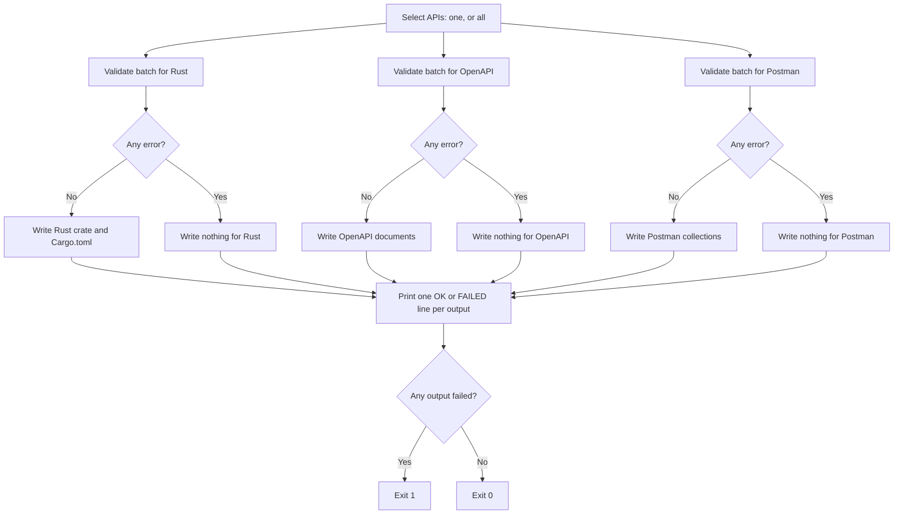

# Generation Validation

`schematic-gen` writes three outputs from the API definitions: the Rust
client crate (`schematic/schema/src`), OpenAPI documents
(`schematic/openapi`), and Postman collections (`schematic/postman`). Before
it writes an output, it validates **the whole batch of selected APIs for that
output**. An output with a blocking error is not written at all, and its
failure never stops the other outputs.

You can:

- see every problem with a definition before anything is written:
  `cargo run -p schematic-gen -- validate --api gitea`
- read each problem as one line naming the API, endpoint, feature, and output
- rely on warnings never failing a run, and on errors failing only their own
  output

## How a generate run proceeds



The outputs run in the order Rust, OpenAPI, Postman. A write failure in one
output (for example, the OpenAPI directory path is a file) is reported the
same way as a validation failure: that output fails, and the next output is
still attempted.

```text
$ schematic-gen generate --api gitea --openapi-out ./not-a-dir ...
[OK] rust output
[FAILED] openapi output
[OK] postman output
[ERROR] generation failed for output(s) openapi (succeeded: rust, postman)
```

## Reading a diagnostic

Each diagnostic is printed to stderr as one line, after a `[WARN]` or
`[ERROR]` label:

```text
severity=<severity> api=<api> endpoint=<endpoint> feature=<feature> output=<output>: <message>
```

`validate` runs all three validators for one API and ends with one line per
output:

```text
$ schematic-gen validate --api gitea
[WARN] severity=warning api=Gitea endpoint=GetGitTreeRecursive feature=query-in-path output=rust: path template `/repos/{owner}/{repo}/git/trees/{sha}?recursive=true` embeds a query string; declare it as query parameters so it can be separated from the path
[WARN] ... output=openapi: ...
[WARN] ... output=postman: ...
  [PASS] rust
  [PASS] openapi
  [PASS] postman
```

For example:

```text
severity=warning api=Gitea endpoint=GetGitTreeRecursive feature=query-in-path output=postman: path template `/repos/{owner}/{repo}/git/trees/{sha}?recursive=true` embeds a query string; declare it as query parameters so it can be separated from the path
severity=error api=Feed,FeedCompat endpoint=<none> feature=generated-name-collision output=rust: `SubscribeRequest` is generated for the request struct of Feed::Subscribe and the request struct of FeedCompat::Subscribe
```

- `severity` is `error` (the output is not written) or `warning` (reported
  only).
- `api` names every API involved; a module-group problem lists each member,
  separated by commas.
- `endpoint` is `<none>` when the problem belongs to the API or the group.
- `output` is `rust`, `openapi`, or `postman`.

The same fields are available to code as
`schematic_gen::diagnostics::ValidationDiagnostic`, which also implements
`serde::Serialize`:

```json
{
  "severity": "warning",
  "api": ["Gitea"],
  "endpoint": "GetGitTreeRecursive",
  "feature": "query-in-path",
  "output": "postman",
  "message": "path template ... embeds a query string; ..."
}
```

## What each output checks

| Feature id | Rust | OpenAPI | Postman | Severity |
| --- | :-: | :-: | :-: | --- |
| `duplicate-endpoint-id`: two endpoints of one API share an id | ✓ | ✓ | ✓ | error |
| `duplicate-method-path`: two endpoints of one API share a method and path | ✓ | ✓ | ✓ | warning (see below) |
| `query-in-path`: a path template contains `?` | ✓ | ✓ | ✓ | warning (see below) |
| `invalid-output-filename`: the file name is not one safe path component, or a module would overwrite a shared generated file | ✓ | ✓ | ✓ | error |
| `invalid-identifier`: an API name, endpoint id, or parameter name cannot become the Rust identifier generated from it | ✓ | | | error |
| `invalid-request-suffix`: `request_suffix` is empty or not alphanumeric | ✓ | | | error |
| `invalid-module-path`: the module path is not one Rust identifier | ✓ | | | error |
| `invalid-type-syntax`: a body, response, or form JSON type is not a Rust type | ✓ | | | error |
| `generated-name-collision`: two generated items, fields, or client methods share a name | ✓ | | | error |
| `incomplete-schema-registry`: a JSON type has no schema in the module's registry | | ✓ | | error |
| `text-request-body`, `binary-request-body`: the client cannot send this body yet | ✓ | | | error |
| `api-key-param`: an API key sent as a query parameter or cookie | ✓ | | | error |
| `header-parameter`, `cookie-parameter`: a declared parameter the output does not send | ✓ | | ✓ | error if `required`, warning otherwise |

Rust-only rules are never applied to the exports. An export carries type
names and endpoint ids as data, so a name that is not valid Rust syntax still
produces a valid OpenAPI document and Postman collection:

```rust
// Fails the Rust client only; OpenAPI and Postman are still written.
response: ApiResponse::json_type("Vec<Model"),
```

### Routes and the uniqueness key

Two endpoints are the same route when their method and path match after
every placeholder is replaced by `{}`. `GET /items/{id}` and
`GET /items/{name}` are the same route; `GET /items/{id}` and
`DELETE /items/{id}` are not. This comparison lives in one function,
`schematic_gen::validation::endpoint_uniqueness_key`.

`duplicate-method-path` is a **warning** today. GitHub (`GetGitTree`,
`GetGitTreeRecursive`) and Bitbucket (`ListDirectoryContents`,
`GetFileContentRaw`) each declare two endpoints on one route that differ only
by their query or response. The Rust client keeps both, but an OpenAPI path
item holds one operation per method, so those documents contain only the
later endpoint. The severity is the constant
`DUPLICATE_METHOD_PATH_SEVERITY`.

Across the APIs of one module group (for example `OllamaNative` and
`OllamaOpenAI`, which both generate into `ollama`), the same endpoint id is
allowed: their request suffixes keep the generated Rust names apart. Only an
actual collision of generated names is an error.

### Repeated path segments

A repeated segment such as `/api/api/items` is never an error by itself: a
base URL ending in `/api` joined with a path starting `/api` can be correct.
`schematic-gen` does not judge base-plus-path composition.

### Embedded queries

A path template such as `/repos/{owner}/{repo}/git/trees/{sha}?recursive=true`
mixes a query into the path, where it cannot be separated, typed, or masked.
Nine shipped endpoints still do this (one Gitea, one GitLab, seven OpenAI
`Beta*` endpoints), so `query-in-path` is a warning reported once per output
for each of them. Its severity is the constant `QUERY_IN_PATH_SEVERITY`.

## Calling validation from code

Each output has a public validator that takes the whole batch:

```rust
use schematic_gen::validation::{validate_openapi, validate_postman, validate_rust_client};

let apis = schematic_gen::pipeline::resolve_all_apis();
let batch: Vec<_> = apis.iter().collect();
for diagnostic in validate_rust_client(&batch) {
    eprintln!("{diagnostic}");
}
```

`validate_openapi_registry(module, apis, registry)` adds the schema-registry
check for one module. `pipeline::generate_batch` runs every validator, writes
the outputs that pass, and returns a `GenerationReport` naming the succeeded
and failed outputs.

The public writers keep the same boundary when called directly:
`output::generate_and_write_all`, `export::openapi::write_openapi[_grouped]`,
and `export::postman::write_postman[_grouped]` return
`GeneratorError::Validation` and write nothing when their output's validator
reports an error.

WebSocket validation is expected to report through the same
`ValidationDiagnostic`, `Severity`, `Feature`, and `Output` types rather than
a separate format.
