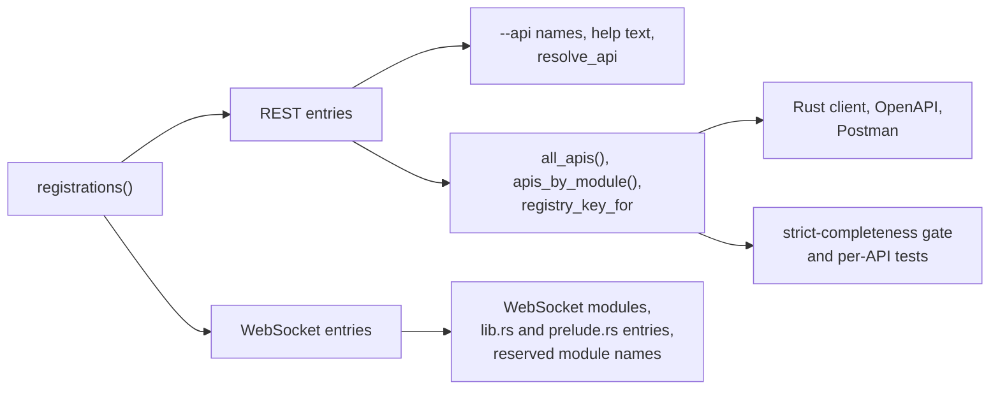
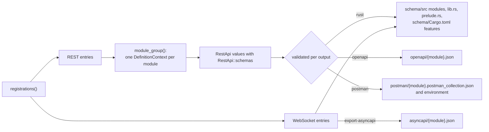

# Generate and verify API artifacts

Use `schematic-gen` to validate a definition or generate Rust clients, OpenAPI
3.0.3 documents, and Postman v2.1 collections from the same module group.
Run the examples below from the repository root.

## Shipped REST APIs

| CLI API name | Generated module | Endpoints |
| --- | --- | --- |
| `anthropic` | `anthropic` | 4 |
| `artificial-analysis-data` | `artificial_analysis` | 6 |
| `artificial-analysis-critpt` | `artificial_analysis` | 1 |
| `bitbucket` | `bitbucket` | 15 |
| `openai` | `openai` | 258 |
| `elevenlabs` | `elevenlabs` | 42 |
| `gitea` | `gitea` | 15 |
| `github` | `github` | 16 |
| `gitlab` | `gitlab` | 19 |
| `huggingface` | `huggingface` | 26 |
| `lmstudio` | `lmstudio` | 6 |
| `ollama-native` | `ollama` | 11 |
| `ollama-openai` | `ollama` | 4 |
| `emqx-basic` | `emqx` | 36 |
| `emqx-bearer` | `emqx` | 38 |
| `eversolo` | `eversolo` | 24 |
| `samsung-smart-tv` | `samsung_smart_tv` | 7 |
| `unfolded-circle-core-rest` | `unfolded_circle_core_rest` | 11 |

Gitea's `GetGitTree` accepts an optional `recursive` query value. GitLab's
`GetRepositoryFile` exposes the `git_ref` setter and sends it as one `ref` query
value: `client.get_repository_file(id, path).git_ref("HEAD".into())`. OpenAI's optional `beta` controls select ordinary query
values on the surviving endpoint IDs. Query values do not distinguish routes.

WebSocket clients also cover ElevenLabs TTS, Samsung Smart TV remote control,
and Unfolded Circle Core, Dock, and Integration APIs. Their definition types
remain separate from REST builders.

## Register an API

Every shipped API, REST or WebSocket, is one entry in
`schematic_definitions::registry::registrations()`
(`schematic/definitions/src/registry/inventory.rs`). Adding an API is that one
entry; every list of APIs is derived from it:

```rust
// A REST API: its name, its `--api` selection key, its generated module,
// the definitions module, the module group that builds it, and its index in
// what that group returns.
rest("OllamaOpenAI", "ollama-openai", "ollama", "ollama", ollama::module_group, 1),
// A WebSocket API: its name, its generated module, the definitions module,
// its constructor and that constructor's name, and a one-line summary for
// the generated docs.
websocket("ElevenLabsTTS", "elevenlabs_ws", "elevenlabs",
    elevenlabs::define_elevenlabs_websocket_api, "define_elevenlabs_websocket_api",
    "ElevenLabs Text-to-Speech WebSocket API definition"),
```



- **Order.** Entries are in catalog order, and every derived list keeps it:
  `--api` help, `lib.rs`, `prelude.rs`, and `apis_by_module()`.
- **Module groups.** REST APIs that share a generated module name the same
  `module_group` function and their index in what it returns. A group member
  without an entry, or an entry with the wrong index, panics the first time the
  registry is built, so a new member cannot be skipped silently.
- **Protocol.** A consumer that handles one protocol filters for it. WebSocket
  entries have no `--api` key; every Rust generation run packages them.
- **Tests.** A test that must cover every API derives its list from the
  inventory. A test that pins expected per-API values (for example
  `definitions/tests/api_policy.rs`) compares its table with the inventory, so
  a new API fails there until its row is added.
- **Fixtures.** Consumers that tests drive with a local inventory take the
  registrations as an argument (`resolve_api_in`, `available_apis_in`,
  `RustOutputRequest::registrations`, `validate_rust_client_in`), so a test
  never edits the shipped list.

## Generate artifacts

```sh
just -f schematic/justfile generate
just -f schematic/justfile generate-one gitea
just -f schematic/justfile generate-openapi
just -f schematic/justfile generate-postman
just -f schematic/justfile generate-asyncapi
just -f schematic/justfile check-drift
```



`generate` writes the first three outputs; each is validated and published on
its own, so a failure in one never stops the others, and nothing of a failed
output is written. The standard output roots are `schematic/schema/src`,
`schematic/openapi`, and `schematic/postman`. When the CLI output ends in `schema/src`, it selects the
sibling export directories automatically; `--no-openapi` and `--no-postman`
suppress those outputs, and `--postman-environment` (which the `just` recipes
pass) adds each collection's Postman environment. A Rust module can be a single file or a directory
containing `mod.rs`, `requests.rs`, and `responses.rs` when it exceeds the split
threshold. See [partial generation](partial-generation.md) for publication,
ownership, and cleanup rules.

WebSocket APIs are exported separately, one AsyncAPI 3.0 document each, to
`schematic/asyncapi` by `schematic-gen export-asyncapi`; `generate` and
`generate-asyncapi` run it.

```sh
schematic-gen validate --api openai
schematic-gen generate --api openai --output generated/src
schematic-gen generate --api openai --output generated/src --openapi-out specs/ --openapi-format yaml
schematic-gen import --input petstore.yaml --output generated/src --strict
schematic-gen export-asyncapi --output schematic/asyncapi
schematic-gen import-asyncapi --input stream.asyncapi.yaml --output imported/
schematic-gen bundle --api github --out github.bundle.json
schematic-gen export-bundle --input github.bundle.json --openapi-out specs/ --postman-out collections/
```

[OpenAPI import](../io/import-openapi.md), [OpenAPI export](../io/export-openapi.md),
[Postman export](../io/export-postman.md), and [AsyncAPI](../io/asyncapi.md) describe the complete options,
version selection, and format behavior. [Definition bundles](../io/definition-bundles.md)
describes the `bundle` file and the checks `export-bundle` applies before it
exports without the Rust registry.

## Share a generated module

APIs with one types module assemble their definitions and ordered schemas through
one `DefinitionContext`. Give sibling API builders the same `.module_path(...)`
and distinct `.request_suffix(...)` values; for example Ollama uses `ollama`,
`NativeRequest`, and `OaiRequest`. EMQX similarly shares `emqx`. Grouped exports
contain all sibling endpoints; their APIs still have distinct client structs.
See [typed registration](../typed-registration.md) for the assembly contract.

## Verify a change

```sh
just -f schematic/justfile test
just -f schematic/justfile lint
just -f schematic/justfile test-schema
just -f schematic/justfile doctest-schema
```

The ordinary test recipe includes the separate fresh-output compiler guards and
runtime misuse checks. Fresh temporary client crates compile and execute offline;
the dependency versions in `schematic/schema/Cargo.lock` must be cached. If Cargo
reports a missing offline dependency, populate the cache with
`cargo fetch --manifest-path schematic/schema/Cargo.toml` and rerun.

The schema recipe checks the committed generated crate, including paging and
compiler diagnostics; `doctest-schema` compiles every example in its docs with
the default features and with one module selected. Current artifact tests compare complete Rust, OpenAPI, and Postman file sets
and bytes. Loopback HTTP fixtures assert generated
wire requests, credentials, codecs, hooks, and paging behavior; they make no live
provider requests. Generated WebSocket clients are tested against a scriptable
loopback WebSocket server (`schematic/schema/tests/ws_mock/`) that records each
upgrade request (path, query, headers) and can accept, refuse, redirect, stall,
send frames, or drop a connection after a number of frames. This evidence establishes generated behavior against recorded
contracts, not the current behavior of every remote service.

When changing a response, check the endpoint's success type and codec:
`.returns_json::<T>(ctx)`, `.returns_text()`, `.returns_binary()`, and
`.returns_empty()` produce `Json<T>`, `Text`, `Binary`, and `Empty`, respectively;
a stream produces `Sse<T, End>`, `Ndjson<T, End>`, or `ByteStream`, and several
shapes produce `Shapes<{Id}Response>`.
Choosing JSON for binary audio would produce the wrong success type and a
malformed-success error at runtime. See [definition builders](../definition-builders.md)
and [success shapes](../responses-and-errors.md#generated-success-and-failure-types).

On Windows, the generator reserves an 8 MiB main-thread stack through its build
script for catalog assembly. Keep that build script when packaging the CLI;
Windows' default 1 MiB stack can overflow during debug generation, including
`schematic-gen generate --api gitea`. This applies to MSVC and GNU targets.
