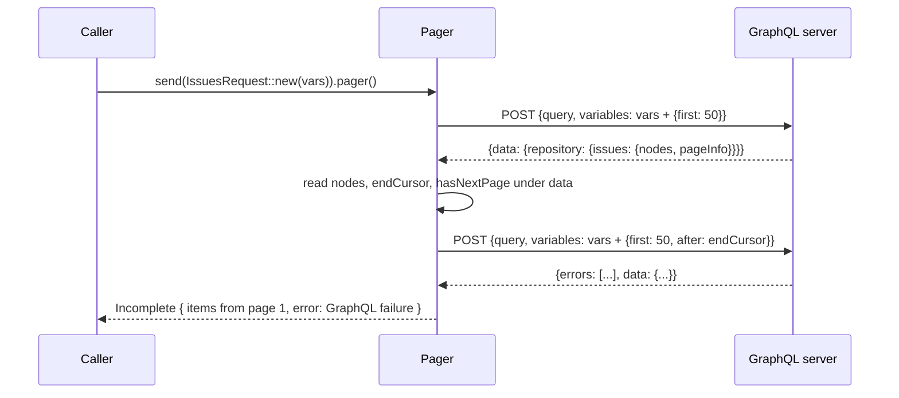

# GraphQL operations

A REST API definition can also carry GraphQL operations. They share the API's
base address, authentication, error defaults, and generated naming space with
its REST endpoints. This page covers authoring them in `schematic-define`.

## Declare an operation

```rust
use schematic_define::prelude::*;

let mut ctx = DefinitionContext::types_in("::models");
let issues = GraphQlOperation::query("Issues", ISSUES_DOCUMENT)
    .describes("Open issues of a repository")
    .variables::<IssuesVariables>(&mut ctx) // or .no_variables()
    .data::<IssuesData>(&mut ctx)
    .operation_name("Issues")               // optional
    .build()?;

let api = RestApi::builder(&ctx, "GitHub", "https://api.github.com")
    .describes("GitHub")
    .bearer_env(["GITHUB_TOKEN"])
    .endpoints(endpoints)
    .graphql(AddressRule::github())
    .operations([issues])
    .build()?;
```

`describes`, `variables`/`no_variables`, and `data` are required: an operation
missing one does not compile. `GraphQlOperation::mutation(..)` starts a
mutation; the kind is documentation and an export label only, both are sent the
same way.

- **The document is opaque.** It is stored and sent exactly as written. Nothing
  parses it, so an empty or invalid document builds and the server reports the
  problem.
- **Variables** are a registered type serializing to a JSON object (a named
  type or a map; a `Vec<T>` is rejected), or none with `no_variables()`, which
  omits `variables` from the request.
- **Data** is the registered type the reply's `data` decodes as. A type from
  another definition context fails API build with `GitHub operation Issues:
  unresolved schema reference "IssuesData"`.
- **`operation_name`** is sent as `operationName` when set, the empty string
  included, and omitted otherwise.
- **Ids** must be nonempty, unique among the API's operations, and different
  from every endpoint id. Generation also checks that an operation's request
  type (`{id}{suffix}`) collides with no other generated name in its module.

## Address rules

The GraphQL URL derives from the client's base URL by ordered rules; the first
that matches wins. Rules compare whole path segments and ignore a trailing
slash, so a reverse-proxy prefix survives.

| Rule | Example |
| --- | --- |
| `AddressRule::replace_suffix("/api/v3", "/api/graphql")` | `https://ghe.example/prefix/api/v3/` becomes `.../prefix/api/graphql` |
| `AddressRule::append("/graphql")` | `https://api.github.com` becomes `https://api.github.com/graphql` |

`AddressRule::github()` is those two rules in that order. API build rejects an
empty rule list, a rule path that does not start with `/` or has an empty
segment, query, or fragment, and a base URL with a query or fragment.
### How a client resolves the address

The runtime applies the rules to the client's *effective* base URL, so a
caller's `base_url(..)` moves the GraphQL address with it, and a caller can
replace the whole address with `graphql_url(..)` on the client:

```rust
use schematic_runtime::{AddressRule, ApiDefinition, Client};

const GITHUB: &[AddressRule] = &[
    AddressRule::ReplaceSuffix { suffix: "/api/v3", with: "/api/graphql" },
    AddressRule::Append("/graphql"),
];
let definition = ApiDefinition::new("https://api.github.com").graphql(GITHUB);

// GraphQL operations go to https://ghe.example/api/graphql.
let enterprise = Client::<GitHubApi>::new(definition.clone()).base_url("https://ghe.example/api/v3");
// GraphQL operations go to https://gql.example/graphql.
let proxied = Client::<GitHubApi>::new(definition).graphql_url("https://gql.example/graphql");
```

- An operation's request is sent to that address; the request's own path is
  ignored, and its declared query parameters are still appended.
- The address is resolved when the client is validated (`build()` or the
  first send). An override that is not an HTTP(S) URL with a host, carries
  user information, or carries a fragment fails with
  `BuildError::InvalidGraphQlUrl`; so does a base URL with a query or
  fragment when the API declares rules and no override is set.
- The address is checked against the operation's
  [cross-origin policy](runtime/origins-and-redirects.md) like a next-page
  link. A derived address shares the base URL's origin. An override on
  another origin is refused at send under the default same-origin policy,
  with `TransportErrorKind::CrossOriginRejected`, unless an `allow_origins`
  policy for the API or that operation names it.
- A client whose API declares no rules and that has no override refuses an
  operation before sending, with `TransportErrorKind::InvalidUrl`.

A generated API's `definition()` carries its rules as `.graphql(&[..])`, and
its API struct forwards `graphql_url`:

```rust
let client = GitHub::new()
    .base_url("https://ghe.example.com/api/v3")   // GraphQL: https://ghe.example.com/api/graphql
    .graphql_url("https://gql.example.com/graphql") // or replace the derived address whole
    .build()?;
```

## Errors

An operation's non-2xx replies use an error table resolved exactly like an
endpoint's (see [declared errors](responses-and-errors.md#declared-errors)):
`.errors(ErrorSet::new().on(..))` overlays the API defaults and
`.errors(ErrorSet::none())` opts out of them.
`RestApi::effective_operation_errors(&operation)` returns the table. GraphQL
`errors` inside a 2xx reply are separate and are never opted out of.

## Decoding a reply

The runtime's `GraphQl<D>` codec reads the JSON wrapper **before** it decodes
`data`, so a server's errors are never hidden by data that does not fit `D`.
Every 2xx status is classified this way and keeps its status:

| `errors` | `data` | Envelope outcome |
| --- | --- | --- |
| a non-empty array of valid entries | anything | `Declared(GraphQlOperationError::GraphQl(failure))`; `failure.partial_data` is `Some` only for non-null data that decodes as `D` |
| absent or `[]` | non-null and decodes as `D` | `Success(D)` |
| absent or `[]` | absent, `null`, or does not decode | `MalformedSuccess` |
| `null`, not an array, or any invalid entry | anything | `MalformedSuccess` |

An entry is valid when it has a string `message`; an optional `path` of
field names and non-negative indices; optional `locations` whose `line` and
`column` start at 1; and optional `extensions`. Every other member, such as
GitHub's top-level `"type": "RATE_LIMITED"`, is kept in `GraphQlError::other`.
Response-level members such as a top-level `extensions` stay readable in the
envelope's raw body, which every failure keeps.

```rust
match response.outcome {
    Outcome::Success(data) => use_data(data),
    Outcome::Failure(error) => match error.kind {
        ErrorKind::Declared(GraphQlOperationError::GraphQl(failure)) => {
            for error in &failure.errors {
                eprintln!("{error}: {:?}", error.other.get("type"));
            }
            if let Some(partial) = failure.partial_data { use_partial(partial) }
        }
        ErrorKind::Declared(GraphQlOperationError::Http(http)) => handle_http(http),
        _ => eprintln!("{error}"),
    },
}
```

A **non-2xx** reply is never read as a wrapper, whatever its media type: it
takes the operation's HTTP error table like a REST reply, so GitHub's 403
`{"message": "Resource not accessible …"}` is an HTTP failure. After an HTTP
opt-out (`H` is `NoDeclaredError`), every non-2xx reply is `Undeclared`, and
GraphQL errors in a 2xx reply are still declared failures.

Hooks follow the wire: the client's global JSON hook sees the whole wrapper,
once, on a 2xx reply and never on a non-2xx one; a typed mutator receives
`&mut D` and runs only after a reply with no errors, so it never touches
partial data. A hook's refusal is `ErrorKind::Hook` with the original bytes.

The request body is `{"query": document, "variables": …, "operationName": …}`,
built by `schematic_runtime::graphql::request_body`. The document is sent
exactly as written; an operation without variables omits `variables`;
`operationName` is sent only when the operation sets one; and variables that
do not serialize to a JSON object are refused before anything is sent.

## Generated operation requests

`schematic-gen` gives each operation a request struct named like an
endpoint's (`{id}` plus the API's request suffix), in the same module, sent
with the client's ordinary `send`. Typed variables are its one field, taken by
`new`; an operation without variables is a unit struct with `new()`. The
struct carries the document and operation name as constants and implements
`EndpointSpec` with `METHOD = POST`, `ADDRESS = Address::GraphQl`, an
`Accept: application/json` header, the `GraphQl<D>` codec, and the failure
`GraphQlOperationError<D, H>`, where `H` is the type the operation's effective
HTTP error table generates (as for an endpoint: `NoDeclaredError` when it is
empty or opted out, the one shape's type, or an `{id}Error` enum).

```rust
// operation CheckStatus: typed variables, data CheckData, 403 → Problem
let response = client.send(CheckStatusRequest::new(CheckVars { owner, name, n0: 7 })).full().await?;
match response.into_result() {
    Ok(data) => { /* CheckData */ }
    Err(error) => match error.kind {
        ErrorKind::Declared(GraphQlOperationError::GraphQl(failure)) => { /* failure.errors, failure.partial_data */ }
        ErrorKind::Declared(GraphQlOperationError::Http(problem)) => { /* the 403 body as Problem */ }
        _ => { /* undeclared, malformed, interrupted, … */ }
    },
}
```

A typed response mutator registered for the request receives `&mut D`.
Operation requests get no endpoint method on the API struct; send the request
value.

## Pagination

A Relay connection pages through the existing [pagination model](pagination.md).
`Relay` builds the cursor strategy and the item collection for you:

```rust
use schematic_define::pagination::Relay;

let issues = GraphQlOperation::query("Issues", ISSUES_DOCUMENT)
    .describes("Open issues")
    .variables::<IssuesVariables>(&mut ctx)
    .data::<IssuesData>(&mut ctx)
    .pagination(Relay::forward("repository.issues").max_page_size(100).collection("Issue"))
    .build()?;
```

Every response path is relative to the reply's decoded `data`, and every pager
input is a request-body path under `variables`:

| | `Relay::forward(root)` | `Relay::backward(root)` |
| --- | --- | --- |
| cursor written to | `variables.after` | `variables.before` |
| page size written to | `variables.first` | `variables.last` |
| cursor read from | `{root}.pageInfo.endCursor` | `{root}.pageInfo.startCursor` |
| more pages while | `{root}.pageInfo.hasNextPage` | `{root}.pageInfo.hasPreviousPage` |
| items | `{root}.nodes` | `{root}.nodes` |

- `.with_edges()` reads items from `{root}.edges[*].node` instead.
- `.cursor_variable(name)` and `.size_variable(name)` rename the variables.
- `.max_page_size(n)` refuses a larger `.page_size(..)` before sending;
  `.sent_page_size(n)` is sent when the caller sets none.
- `.resumable()` lets the caller start from a kept cursor with `.after(..)`.
- A pager pages one direction. The pagination model has one page-size input
  and one end signal per strategy, so reading a connection both ways takes two
  operations.

A hand-written `Strategy` works too; `Relay` only fills in the paths. Operation
build rejects pagination that cannot work this way: a strategy that is not
declared explicitly (an operation inherits no REST default), a next-link
strategy, a follow-up or session request, alternates, a missing item type, a
pager input that is not a body path under `variables` (`pager input `after`
must be a request-body path under `variables``), no typed variables, and a
pager-managed variable the variables type requires (`pager-managed variable
`first` must be optional in the variables type`).

### Paging a generated operation

A paginated operation's generated request implements the runtime's
`Paginated`, so `send(request).pager()` gives the same pager a REST list has,
with only the knobs the strategy authors:

```rust
let vars = IssuesVariables { owner: "acme".into(), first: None, after: None };
let issues = github.send(IssuesRequest::new(vars)).pager().page_size(50).collect_all().await?;
```



- The pager serializes the caller's variables, then writes its cursor and page
  size over them. Pager-managed fields must therefore be optional; a `null` or
  omitted first cursor is sent as the variables type serializes it.
- A page whose reply carries GraphQL errors stops paging. It is reported as a
  declared `GraphQlOperationError::GraphQl` failure with the body as received;
  its partial data stays in that error and never joins the collected items.
- A reply without data, or with data that does not decode as the operation's
  data type, is a malformed page.
- Page limits, repeated-cursor detection, missing or invalid continuations,
  and the shared deadline behave as for a REST pager. Calling a knob the
  strategy does not author, such as `.after(..)` on a pager that is not
  resumable, does not compile.

## Stored form

```json
"graphql": {
  "address": [{"ReplaceSuffix": {"suffix": "/api/v3", "with": "/api/graphql"}}, {"Append": "/graphql"}],
  "operations": [{
    "id": "Issues", "description": "Open issues", "kind": "Query",
    "document": "query Issues(...) { ... }",
    "variables": {"Typed": {"Named": "IssuesVariables"}},
    "data": {"Named": "IssuesData"},
    "operation_name": "Issues"
  }]
}
```

`graphql` is omitted when the API has no GraphQL surface, `operations` when it
is empty, and an operation's `errors`, `no_declared_errors`, `operation_name`,
and `pagination` when unset. `"variables": "Unit"` means no variables.
The OpenAPI exporter leaves every operation out and reports each as a
`graphql-operation` warning,
`<API> operation <id>: GraphQL operation skipped in OpenAPI output`; the
document is still written. The Postman exporter carries every operation as a
runnable `POST` to the derived GraphQL address, with `query`,
`operationName`, and example `variables` in its body (see
[Postman GraphQL operations](io/export-postman.md#graphql-operations)).
