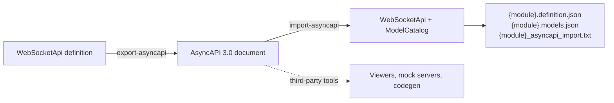

# AsyncAPI export and import

Schematic writes one [AsyncAPI 3.0](https://www.asyncapi.com/docs/reference/specification/v3.0.0)
document for each WebSocket API it ships, and reads AsyncAPI 2.x and 3.0
documents back into WebSocket definitions. A document Schematic exports
imports back into the same definition, within the subset described on this
page.

```sh
# write schematic/asyncapi/*.json (also part of `just generate`)
just -f schematic/justfile generate-asyncapi

# one API, or a preview of what would be written
cargo run -p schematic-gen -- export-asyncapi --output schematic/asyncapi --api ElevenLabsTTS
cargo run -p schematic-gen -- export-asyncapi --output schematic/asyncapi --dry-run

# read a document into a reusable definition
cargo run -p schematic-gen -- import-asyncapi --input stream.asyncapi.yaml --output imported/
```



## File names

Each document is named after the API's registered module:
`schematic/asyncapi/elevenlabs_ws.json`. When two WebSocket APIs share a
module, each document adds the API's snake-case name, so neither overwrites
the other: `shared_ws.stream_one.json` and `shared_ws.stream_two.json`.

A full export (no `--api`) also deletes `*.json` files in the output
directory that no API produces. An export of one API deletes nothing. The
committed documents are checked by the `artifact_drift` tests; regenerate
them after changing a WebSocket definition.

## What a document contains

The document always describes the **client application**, whatever the
endpoint's role:

| Definition | AsyncAPI 3.0 |
| --- | --- |
| `name`, `version`, `description`, `docs_url` | `info.title`, `info.version` (`1.0.0` when unset), `info.description`, `info.externalDocs.url` |
| `base_url` `wss://host:8443/api/v2` | `servers.default`: `protocol: wss`, `host: host:8443`, `pathname: /api/v2` |
| `auth` | `components.securitySchemes`, applied by `servers.default.security` |
| endpoint `id`, `path`, `description` | `channels.<id>` with `address` and `description` |
| path parameters | `channels.<id>.parameters` |
| query parameters | `channels.<id>.bindings.ws.query`, an object schema |
| constant `headers` | `channels.<id>.bindings.ws.headers`, each a string `const` |
| a message | `components.messages.<endpoint>.<message>`, listed in its channel's `messages` |
| a client message | an operation `<endpoint>.send.<message>` with `action: send` |
| a server message | an operation `<endpoint>.receive.<message>` with `action: receive` |
| a bidirectional message | both operations |
| `responds_with` | the send operation's standard `reply` |
| payload type `FeedEvent` | `components.schemas.FeedEvent` |

For example, a host endpoint's client message is still a `send` operation;
the role is carried separately, so a host endpoint never flips its
directions:

```json
"Host.send.Command": {
  "action": "send",
  "channel": { "$ref": "#/channels/Host" },
  "messages": [{ "$ref": "#/channels/Host/messages/Command" }]
}
```

Every `$ref` in an exported document is local and resolves, and each
document validates against the AsyncAPI 3.0.0 JSON Schema (checked offline in
the `asyncapi_export` tests with a vendored copy of the schema).

### Payload schemas

WebSocket payload types declare no JSON Schema, so each
`components.schemas.<Type>` is an unconstrained schema whose description names
the Rust type. Any JSON value validates against it. The type name is what
round-trips.

## Schematic extensions

Some of what a definition says has no standard AsyncAPI field. It travels in
extensions that third-party tools ignore. Those tools still see every
message, channel, and operation, but they cannot tell overlapping messages
apart; Schematic's own importer is what reads them back.

| Extension | Where | Shape | Meaning |
| --- | --- | --- | --- |
| `x-schematic-selectors` | component message | `[{"field": "type", "value": "event"}]` | the wire fields that select this message; `[]` is an explicit empty list |
| `x-schematic-fallback` | component message | `true` | the message an unmatched frame of its direction decodes as |
| `x-schematic-role` | channel | `"client"`, `"host"`, or `"both"` | which side the generator emits for the endpoint |
| `x-schematic-heartbeat` | channel | `{"interval_secs": 30, "timeout_secs": 10}` | the heartbeat hint; `timeout_secs` is optional |
| `x-schematic-param` | channel parameter, query property | `{"type": "integer", "secret": true}` | a path parameter's scalar `type`, and `style`, `explode`, `rust_name`, `secret`, `pager_managed`, or (path only) `deprecated` when they differ from the defaults |
| `x-schematic-value-prefix` | API key security scheme | `"Token "` | the prefix written before the key |
| `x-schematic-bearer-header` | bearer security scheme | `"X-Token"` | the header that carries the token instead of `Authorization` |

```json
"Feed.Update": {
  "name": "Update",
  "payload": { "$ref": "#/components/schemas/FeedEvent" },
  "x-schematic-selectors": [
    { "field": "type", "value": "event" },
    { "field": "msg", "value": "update" }
  ]
}
```

A path placeholder with no typed declaration is exported as an empty
parameter object (`"session": {}`); a declared parameter always carries
`x-schematic-param.type`, which is how the importer tells them apart.

## What the export leaves out

These parts of a definition are not in the supported subset. The round-trip
tests name, for each shipped API, which of them it loses:

| Not exported | Effect on re-import |
| --- | --- |
| `env_auth`, `env_mapping` | replaced by the importer's default, `{MODULE}_API_KEY` |
| an unset `version` | reads back as `1.0.0` |
| lifecycle `open`, `close`, `keepalive`, `open_credential_field` | the messages come back as ordinary messages |
| `runtime.correlation` | lost; an endpoint whose messages use `responds_with` then no longer lowers to a client |
| `runtime.auth_flow`, the API's `runtime` hints | lost |
| `auth_policy`, Basic credential variables | the auth strategy alone is kept |
| header and cookie parameters | reported as export warnings; WebSocket handshakes send only constant headers |
| OAuth2 auth | reported as an export warning; the document declares no security |
| a payload's `module_path` | lost |
| declaration order of endpoints, messages, query parameters, and headers | AsyncAPI maps are unordered; message selection never depends on order |

Correlation hints are the costly loss: the Unfolded Circle Core, Dock, and
Integration definitions re-import without them.

## Importing

`import-asyncapi` reads JSON (text starting with `{`) or YAML. A duplicate
key, trailing content, or a second YAML document fails the import.

The `asyncapi` version picks the reader. Any version other than `2.x.y` or
`3.0.y` is an error.

- **3.0**: the server's `host`, `protocol` (`ws` or `wss`), and `pathname`
  assemble the base URL. Directions come only from the operations that
  reference each channel message (`send`, `receive`, or both). An operation
  without `messages` covers every message of its channel. A message no
  operation uses is not imported (a warning).
- **2.x**: `servers.*.url` gives the base URL, and `publish`/`subscribe`
  follow `--ws-role` (`server` reads the document from the server's side), as
  they always have.

In both versions:

- auth comes from the security the first server **applies**. A declared but
  unapplied component scheme does not make the API authenticated;
- the Schematic extensions above are read on the same objects; without
  `x-schematic-selectors`, selectors are inferred from each payload's
  top-level string `const` properties;
- an endpoint without `x-schematic-role` takes the `--ws-role` role. In a 3.0
  document that never changes a direction;
- two fallback messages in one direction, or a fallback that also declares
  selectors, is a warning, and no message of that direction is imported as
  the fallback.

### Diagnostics

A malformed **standard** field is an `ERROR` at its JSON pointer, for example
`[ERROR] #/servers/default/protocol: Protocol 'https' is not ws or wss`, and
the import fails before anything is written. A malformed **extension** is a
`WARN` and reads as though it were absent. `--strict` also fails on any
`WARN`; `INFO` never fails.

### Saved output

Without `--dry-run`, the import writes three files to `--output`, named by
`--module-path` (default: the snake-case API name):

| File | Content |
| --- | --- |
| `{module}.definition.json` | the `WebSocketApi`, deserializable with `serde_json` |
| `{module}.models.json` | the `ModelCatalog` of payload type aliases |
| `{module}_asyncapi_import.txt` | counts and every diagnostic |

The files are planned before any is written: a directory or other foreign
entry at one of the paths fails the import with nothing written.
`schematic_gen::asyncapi_import::read_import_output` reads the first two back.
A `--dry-run` writes nothing.
