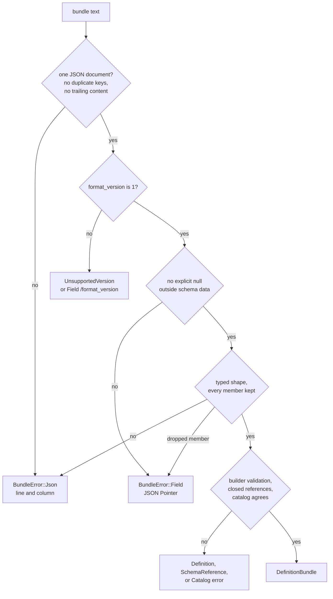

# Definition bundles

A definition bundle is one REST API definition saved as a single JSON file that
loads without the Rust code that defined it. Use a bundle to compare two
versions of a definition, or to export OpenAPI and Postman from a file, on a
machine or in a crate that cannot link `schematic-definitions`.

```sh
# Write GitHub's bundle, then export from the file alone.
schematic-gen bundle --api github --out github.bundle.json
schematic-gen export-bundle --input github.bundle.json --openapi-out openapi --postman-out postman
```

The exported files are byte-identical to what `schematic-gen generate` writes
for the same API. `export-bundle` writes only the bundle's own module files and
keeps every other file in the output directories. A bundle that does not load
writes nothing.

## What a bundle holds

```json
{
  "api": { "name": "GitHub", "endpoints": [ ... ], "schemas": [ ... ] },
  "format_version": 1,
  "models": { "types": [ ... ] }
}
```

| Member | Meaning |
| --- | --- |
| `format_version` | Always `1`. Any other number fails with `unsupported bundle format_version`. |
| `api` | The `RestApi`, including `schemas`: every component its definition context registered, in registration order. |
| `api.schemas[].name` | The component's schema identity, the target of `#/components/schemas/{name}`. |
| `api.schemas[].rust_path` | The Rust type bound to that name. Absent for a schema that only appears nested inside a registered one. An alias keeps both apart: `{"name": "Thing", "rust_path": "crate::models::Widget"}`. |
| `api.schemas[].schema` | The JSON Schema (OpenAPI 3.0 settings). It is data: `null` values and any keys inside it are kept. |
| `models` | Optional structural catalog of the definition context (for example a `one_of` composition). Omitted when not bundled; `{"types": []}` is an explicitly empty catalog. |

A loaded bundle is data. It holds Rust paths as strings, not executable types,
so it supports comparison and schema-based export but cannot compile a client.

## Build and load from Rust

```rust
use schematic_define::DefinitionBundle;

let json = DefinitionBundle::new(api.clone())?.to_json();
let loaded = DefinitionBundle::from_json(&json)?;
assert_eq!(loaded.api(), &api);
assert_eq!(loaded.to_json(), json); // byte-stable
```

Attach a context's catalog with `.with_models(ctx.models().clone())`. The
catalog must agree with the components: each model is a registered component,
listed once, naming only registered members, and a composition matches its
component's `oneOf`/`anyOf`/`allOf` schema.

## Canonical JSON

`to_json` sorts object keys at every depth, keeps array order (endpoint,
component, variant, and environment-fallback order are meaningful), omits
absent options instead of writing `null`, indents by two spaces, and ends with
a newline. Equal bundles produce identical bytes, so a bundle diff is a
definition diff.

## References are closed and local

Construction rewrites local schema references into the component namespace:

| Written by the schema generator | In the bundle |
| --- | --- |
| `#/$defs/Item`, `#/definitions/Item` | `#/components/schemas/Item` |
| `#` inside a registered component `Node` | `#/components/schemas/Node` |
| `#` inside a nested component, pointing at the registration that contained it | the containing registration's component |

Any other reference (a URL, another file, a pointer elsewhere in the document)
fails construction and loading; bundles never fetch files or URLs. Every
`#/components/schemas/{name}` must name a bundled component, and every endpoint
body type must name a component with a Rust binding. Values under `const`,
`default`, `enum`, `example`, and `examples` are instance data, so a `$ref` key
inside them is left alone.

## What loading rejects



Each rule, with the error it produces:

- **One JSON document.** Comments, trailing commas, a second document, and
  trailing text fail. A key repeated in the same object fails at any depth,
  including inside a schema: `bundle JSON line 7 column 15: duplicate key
  "base_url"`. Whitespace around the document is fine.
- **No explicit null for an option.** Write the option or omit it:
  `"docs_url": null` fails with `bundle field /api/docs_url: explicit null`.
  Two exceptions: values inside `api.schemas[].schema`, and an OAuth2 field the
  grant does not use (`authorization_url`, `device_authorization_url`, `pkce`),
  which may be absent or null but never a value.
- **Every member is kept.** A key the shape does not define fails as `unknown
  member` (or serde's `unknown field`) instead of being dropped, so a typo such
  as `"deprecatd": true` is an error. An explicit default the writer would omit
  (`"deprecated": false`, `"path": []`) is accepted.
- **The definition is valid.** The checks `RestApi::builder(..).build()`
  applies run again: URLs, header names, rate-limit and retry bounds, OAuth2
  grant requirements, typed path declarations, endpoint authentication, and
  pagination.
- **References resolve.** A missing endpoint component names the API, the
  endpoint, and the name: `Fixture endpoint Lookup: unresolved schema reference
  "Item"`. A missing nested component names its referrer: `Fixture schema
  component "Parent": reference "#/components/schemas/Child" names no component
  in the bundle`.

Absent optional vocabulary keeps its definition meaning: an endpoint without
`rate_limit`, `retry_guidance`, or `auth` inherits the API's; `deprecated`
absent is `false`; `params.path` absent or `[]` keeps untyped legacy path
placeholders; an empty Basic `names` list disables that environment fallback.

## Literals are preserved, not redacted

A bundle keeps every literal the definition authored: default headers,
examples, defaults, and environment variable *names*. It never reads the
environment, so it never contains a credential value, but literal headers and
examples travel as written. Review them before publishing a bundle.

## Relation to definition snapshots

[Definition snapshots](../definition-snapshots.md) serialize a bare `RestApi`
with plain Serde and compare shipped definitions with their historical
fixtures. Bundles are the strict, self-contained form: plain Serde treats
`null` as absent and ignores unknown members on several types, and the bundle
loader does neither.
