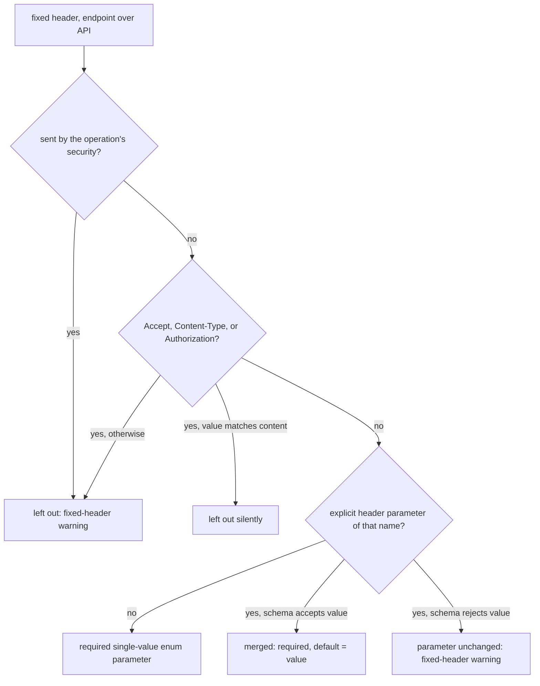
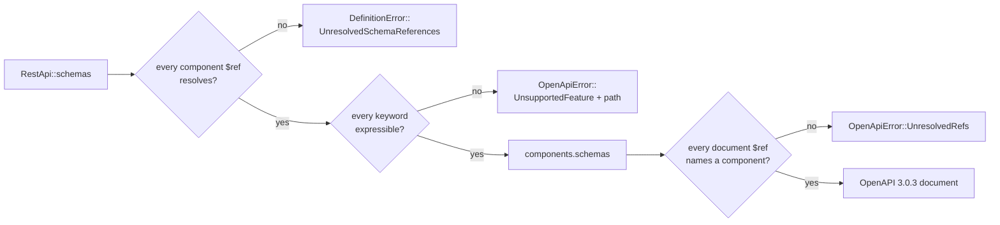

# Exporting OpenAPI from Schematic

Generate OpenAPI 3.0 documents alongside Rust clients from the same checked
module-group assembly. APIs sharing a generated module produce one document.

```sh
schematic-gen generate --api all --output schematic/schema/src \
    --openapi-out schematic/openapi
schematic-gen generate --api github --output schematic/schema/src \
    --openapi-out schematic/openapi --openapi-format yaml
```

From the area, `just generate-openapi` emits Rust and OpenAPI artifacts while
suppressing Postman output. `just generate` emits all three forms. Generated
files are never hand-edited. See [generation workflow](../generation/workflow.md).

## Schema source and validation

Author nominal types with `definition_type!` and register them in a
`DefinitionContext`. Build endpoints, then build the API against that context.
API build stores that context's components in `RestApi::schemas`, and
`assemble_module_group` gives every API of a module group the finished
context's components. Export reads nothing else: `openapi::export(api, options)`
writes `RestApi::schemas` as `components.schemas`, in the same order, with
types that appear only nested inside a registered type flattened into
components of their own. There is no separate registry to maintain.

An endpoint's JSON body is a `TypeRef` naming components, and export turns it
into a wire schema: `Named("Item")` becomes `$ref: '#/components/schemas/Item'`,
`Array(Named("Item"))` an inline array of that reference, `Optional(..)` a
nullable schema, and primitives and free-form JSON (`Primitive(Json)`) stay
inline without inventing components. Public aliases use typed `register_as`
before ordinary registration. Schema names and generated Rust paths remain
distinct.

API assembly rejects a reference naming no registered component, and the
generator reports it as `invalid-schema-reference` before writing anything.
The same holds for a `$ref` *inside* a component schema: API build, generation,
and `openapi::export` run `RestApi::validate_schema_closure`, which names the
parent component, the JSON pointer to the reference, and the missing name
(`Fixture schema Holder at /properties/owner/anyOf/0: unresolved schema
reference "Missing"`). Only `#/components/schemas/{name}` resolves; a URL,
another file, or a pointer into a schema is reported and never fetched.
Strict export completeness also rejects a `$ref` with no matching component
rather than emitting an incomplete document. Explicit unused registrations and
their order are retained. See [how component schemas
convert](#how-component-schemas-convert) for what each component becomes.
See [typed registration](../typed-registration.md) and
[the compiling example](../authoring-examples.md).

Query/header/cookie parameters export in their declared locations, with their
`style`. `explode: false` is always written; `explode: true` is written only
where it is not OpenAPI's default (`true` for `form`, `false` otherwise), that
is on a non-`form` parameter such as a `deepObject` query parameter. Query strings
do not belong in path templates; endpoint identity is method plus normalized
path. The API's effective auth policy determines the document's security
schemes and root `security` (see [Document security](#document-security));
an endpoint's own authentication adds operation-level `security` (see
[Endpoint security](#endpoint-security)).
Runtime-only origin/redaction policies do not become OpenAPI transport rules.
The supported extension fields, including rate-limit and retry metadata, are
described in [OpenAPI extensions](openapi-extensions.md).

## Responses

Each operation's `responses` map holds the endpoint's success shapes and its
resolved error table, one response object per status (see
[Responses and errors](../responses-and-errors.md#what-is-stored)); the rules
below apply to every shape it declares.

**Success statuses.** A shape exports under the statuses it declares, else
`204` when it is empty and `200` otherwise. Every shape under one status
shares that status's response object, one `content` entry per media type:

| Shape | Media key | Schema |
| --- | --- | --- |
| JSON | declared, else `application/json` | the referenced component |
| Text | declared, else `text/plain` | `type: string` |
| Binary, byte stream | declared, else `application/octet-stream` | `type: string, format: binary` |
| SSE stream | declared, else `text/event-stream` | the item component |
| NDJSON stream | declared, else `application/x-ndjson` | the item component |
| The fallback shape | `*/*` | a (binary) string |
| Empty | none | none |

A stream's framing and end condition, and anything else the map cannot say,
are written to the operation's [`x-schematic`](openapi-extensions.md#success-shapes-and-error-entries).
Two JSON shapes under one status and media type become a `oneOf`; when each
declares a field tag on the same field, a `discriminator` names it and maps
each string value to its component. Each shape's note joins the response
description as `<media type>: <note>`:

```yaml
"200":
  description: |-
    Successful response

    application/json: returned when `stream` is false

    text/event-stream: returned when `stream` is true
  content:
    application/json: { schema: { $ref: "#/components/schemas/Message" } }
    text/event-stream: { schema: { $ref: "#/components/schemas/Event" } }
```

**Error statuses.** Export writes the endpoint's *resolved* table (API
defaults, overlaid or opted out by the endpoint), as the client looks it up:

- an exact entry keys its status (`"404"`);
- a class range (`400-499`, `500-599`) keys `4XX`/`5XX` when it wins every
  status of its class;
- a class range that a narrower entry supersedes in part, and every other
  range, expands into exact statuses, each holding the entry that wins there.

```text
API defaults 4XX -> Problem, 5XX -> text; endpoint adds 404 -> empty
exported:    "400" ... "403" -> Problem, "404" -> no content,
             "405" ... "499" -> Problem, "5XX" -> text
```

Success statuses are 2xx and error statuses 400-599, so the two never share a
key. GraphQL operations are not exported: each is reported as the warning
`<API> operation <id>: GraphQL operation skipped in OpenAPI output` and the
document is still written.

**What standard OpenAPI cannot say.** A reader that ignores `x-schematic`
sees an approximation of the definition:

- a shape that declares no status is written under `200` (or `204`), though
  the client accepts it for any 2xx status;
- a byte stream looks like a binary body, and an SSE or NDJSON stream shows
  its item schema but not its end condition or `keep_end`;
- an array-versus-object JSON pair is a `oneOf` without a `discriminator`;
- a variant name appears nowhere, and a note only in the description;
- a range that is not a whole class, or a class an exact entry supersedes in
  part, becomes one key per status (a `4XX` default beside an exact `404`
  writes 100 keys);
- GraphQL operations are absent.

[Importing](import-openapi.md#several-success-shapes-and-declared-errors)
the document back restores the `responses` map, and from `x-schematic` the
shapes, end conditions, variants, notes, and declared error levels, once they
agree with that map (see
[Standard fields win](openapi-extensions.md#standard-fields-win)).

## Request bodies

A JSON, text, or binary body exports as one `requestBody.content` entry and
nothing else. A form body exports as an object schema under
`multipart/form-data` or `application/x-www-form-urlencoded`: one property
per field, `required` for required fields, a file as `{type: string, format:
binary}`, and several files as an array of those with `minItems`/`maxItems`
from the field's counts. A multipart body also writes an `encoding` entry for
each part whose content type is not the default:

```yaml
multipart/form-data:
  schema:
    type: object
    required: [samples]
    properties:
      samples: { type: array, items: { type: string, format: binary }, minItems: 1, maxItems: 5 }
      metadata: { $ref: "#/components/schemas/VoiceMetadata" }
  encoding:
    samples: { contentType: "audio/mpeg, audio/wav" }   # the accept list
    metadata: { contentType: application/json }         # a JSON part
```

A text part and a file that accepts any type get no `encoding` entry. A
URL-encoded body writes none. The form's field details are also written to
the operation's
[`x-schematic.request`](openapi-extensions.md#request-types); no other body
kind writes that member.

## Path parameters, deprecation, and composition

A path parameter declared with `path_param` exports with its type, its
description, `required: true`, and `deprecated: true` when it is deprecated.
An endpoint that declares none keeps one untyped `string` parameter per
placeholder. A placeholder repeated in the template, or written `{+name}`,
is declared once. An OpenAPI path key cannot hold the reserved-expansion
marker, so `{+name}` is written as `{name}` and the endpoint's full template
goes to the operation's
[`x-schematic.path_template`](openapi-extensions.md#parameter-details-and-path-templates);
a parameter's secret marker and Rust name go to its `params`:

```yaml
/items/{item_id}:
  parameters:
    - in: path
      name: item_id
      description: Item to read
      required: true
      schema: { type: integer }
      style: simple
  get: { ... }
  delete:
    parameters:            # this operation declares item_id differently
      - in: path
        name: item_id
        description: Item to delete
        required: true
        deprecated: true
        schema: { type: integer }
        style: simple
```

Path parameters live on the path item, shared by its operations. When the
operations of one path declare a parameter differently, the path item holds
the declaration of the first operation in the order `get`, `put`, `post`,
`delete`, `options`, `head`, `patch`, and each operation that differs carries
its own declaration as an operation-level override. The result never depends
on the order the endpoints were defined in. An `Enum` type exports as
`{type: string, enum: [..]}`.

A deprecated endpoint's operation has `deprecated: true`, as does a
deprecated query, header, or cookie parameter; nothing is written for one
that is not deprecated.

A composed component (`DefinitionContext::one_of`, `any_of`, or `all_of`;
see [typed registration](../typed-registration.md)) exports as that
composition of references, for example
`Pet: {oneOf: [{$ref: '#/components/schemas/Cat'}, {$ref: '#/components/schemas/Dog'}]}`.

## Document security

The root `security` lists one requirement per method the API's effective auth
policy accepts (its explicit methods, then its environment fallback), so any
one of them satisfies an inheriting operation. An API with a single auth
strategy has one requirement; one without authentication has none. Each
method's scheme is registered in `components.securitySchemes`:

| Method | Scheme |
| --- | --- |
| bearer token | `bearerAuth`: `{type: http, scheme: bearer}` |
| bearer token in another header | `bearerAuth`: `{type: apiKey, in: header, name: <header>}` |
| API key in a header, query, or cookie | `apiKeyAuth`: `{type: apiKey, in: <location>, name: <name>}` |
| HTTP Basic | `basicAuth`: `{type: http, scheme: basic}` |
| OAuth2 | `oauth2Auth`: an authorization-code or client-credentials flow |

Two facts have no standard spelling: a bearer token sent in a header other
than `Authorization`, and an API key's value prefix (Gitea sends
`Authorization: token <key>`). Each is written as an
[auth detail](openapi-extensions.md#auth-details) keyed by the scheme's name,
`{"bearer": true}` or `{"value_prefix": "token "}`. The extension holds
nothing else about authentication and never a credential; environment
variable names go to `env_auth` and `env_mapping`.

## Endpoint security

An endpoint that declares its own authentication gets an operation-level
`security`; one that inherits gets none and uses the document's:

| Endpoint declaration | Operation `security` |
| --- | --- |
| none (inherits) | absent |
| `.public()` | `[]`, no authentication |
| `.auth(policy)`, `.auth_with_env_mapping(..)` | one requirement object per method the policy accepts (its explicit methods, then its environment fallback), any one of which satisfies the operation |

A replacement's schemes are registered in `components.securitySchemes`
after the API's own. A scheme identical to one already registered reuses its
name; a different scheme takes its base name (`bearerAuth`, `apiKeyAuth`,
`basicAuth`, `oauth2Auth`) when free, else `bearerAuth2`, `bearerAuth3`, and
so on. A name is never reassigned to a different scheme, and endpoints are
visited in definition order, so the names are deterministic. A replacement's
auth details and its `env_mapping` are written to that operation's own
`x-schematic`, never merged with the document's.

OpenAPI 3.0 has no OAuth2 device-code flow. A device-code grant gets no
scheme and no requirement, and the generator reports an `oauth2-grant`
warning (see [Generation Validation](../generation/validation.md#what-each-output-checks)).
An endpoint replacement whose only method is a device-code grant has no
`security` of its own.

## Fixed headers

A fixed header is a name and value the client sends on every request:
`.header(name, value)` on the API builder or on one endpoint. Each operation
declares its fixed headers as required header parameters whose schema allows
only that value and defaults to it, so a client generated from the OpenAPI
file sends them too:

```rust,ignore
RestApi::builder(&ctx, "Anthropic", "https://api.anthropic.com/v1")
    .header("anthropic-version", "2023-06-01")
```

```json
{"in": "header", "name": "anthropic-version", "required": true, "style": "simple",
 "schema": {"type": "string", "enum": ["2023-06-01"], "default": "2023-06-01"}}
```

The rules, applied to each operation:

- **Endpoint over API.** An endpoint header replaces the API header of the
  same name, compared case-insensitively, as the runtime does; exactly one
  parameter is emitted, with the endpoint's spelling and value.
- **Credentials are security, not parameters.** A header the operation's
  effective security sends (its own `security`, else the document's) is left
  out: an `apiKey` scheme's header name, or `Authorization` for HTTP, OAuth2,
  and OpenID Connect schemes. A public endpoint sends no credential, so there
  the same header is an ordinary parameter.
- **Reserved names.** OpenAPI ignores header parameters named `Accept`,
  `Content-Type`, and `Authorization`, so none is emitted, fixed or explicit.
  A fixed `Accept` equal to a success response's media type, or a fixed
  `Content-Type` equal to the request body's, is already expressed by
  `content`; any other value is a gap.
- **Explicit parameters merge.** When the endpoint also declares a header
  parameter of that name whose schema accepts the value (an unconstrained
  string, or a string enum listing it), the two become one parameter: the
  declared one, now required, with the value as its default. A parameter whose
  schema rejects the value is exported unchanged.

Every header left out other than an expressed `Accept`/`Content-Type` is a
gap: the generator reports a `fixed-header` warning naming the endpoint (see
[Generation Validation](../generation/validation.md#what-each-output-checks)),
and `schematic_define::openapi::header_gaps` returns the same list. The fixed
value is never lost: the `x-schematic` extension keeps every declaration in
its `headers` (see [OpenAPI extensions](openapi-extensions.md)).



## Version Resolution

OpenAPI spec version is resolved with this priority chain:

1. `--openapi-version <VERSION>` CLI flag (highest priority)
2. `RestApi.version` field on the API definition
3. Fallback: `"0.1.0"`

## Shared Modules

OpenAPI artifacts are named from the resolved generated module, not from the
individual API definition name. APIs that share a module are exported into one
combined document:

- `OllamaNative` + `OllamaOpenAI` -> `ollama.json`
- `EmqxBasic` + `EmqxBearer` -> `emqx.json`

The same naming convention applies to single-API modules such as
`HuggingFaceHub` -> `huggingface.json`, `SamsungSmartTv` ->
`samsung_smart_tv.json`, and `UnfoldedCircleCoreRest` ->
`unfolded_circle_core_rest.json`.

Component coverage is intentionally strict. A reference that does not resolve
in its API's `schemas` fails generation for both Rust and OpenAPI output, so
neither a broken client nor an incomplete OpenAPI artifact is written.

## Grouped Export

APIs sharing a module (`ollama`, `emqx`) produce grouped OpenAPI documents that merge:

- **Components** — Union keyed by component name, in member order. Members
  of one module group carry the same `schemas`, so they collapse into one; a
  name that two members define differently fails the OpenAPI output with
  `invalid-schema-reference`, naming both APIs
- **Paths** — Union of all endpoints from all APIs. An operation that two
  members declare identically apart from authentication appears once and
  accepts what either side accepts: each side's own `security`, or else its
  document's requirements, are unioned, and a side that needs no
  authentication (a public `security: []`, or an API without auth)
  contributes the empty requirement `{}`, so its public alternative is kept.
  Two different operations on one method and path fail the OpenAPI output.
- **Path parameters** — Declared once per name and location on the path
  item. A later member that declares one differently gets an
  operation-level override on its own operations; the earlier member's
  declaration stays common.
- **operationId** — Unique across the document. The first member in module
  group order keeps an id; a later clash is prefixed with its API name
  (`OllamaOpenAIListModels`), with a numeric suffix if that is taken too.
- **Security schemes** — Union keyed by scheme name; a same-named scheme with
  different content is renamed `<scheme>_<api_snake>` for the later API, then
  `<scheme>_<api_snake>2`, `3`, ... while that name holds a different scheme.
  A rename never overwrites an existing scheme, and that API's operation and
  document requirements reference the new name.
- **Security** — Union of every member's document-level requirements
- **Servers, external docs, info** — From the first member, with the module
  name as `info.title`
- **`x-schematic-grouped-from`** — Every contributing API name

The full rule, including link updates and the final duplicate scan, is in
[Generation Validation](../generation/validation.md#openapi-documents-of-a-module-group).

## Schema Components

All 18 shipped REST APIs carry their components in `RestApi::schemas`; nominal models implement `Registration` with `JsonSchema`. A new API gets its components by building through a `DefinitionContext`, so there is nothing extra to register for export.

### How component schemas convert

Each component in `RestApi::schemas` is JSON Schema written by schemars, and
export rewrites it as an OpenAPI 3.0.3 schema object that accepts the same
values. A registration's root uses schemars' OpenAPI 3.0 spelling
(`nullable: true`); the definitions nested inside it keep JSON Schema 2020-12
spellings (`type` arrays, `const`, `{type: "null"}` members). Both convert:

| Rust field | schemars writes | export writes |
| --- | --- | --- |
| `Option<String>` | `{type: [string, "null"]}` or `{type: string, nullable: true}` | `{type: string, nullable: true}` |
| `Option<Struct>` | `{anyOf: [{$ref: Struct}, {type: "null"}]}` | `{anyOf: [{$ref: Struct}, {type: object, nullable: true, enum: [null]}]}` |
| `Option<Enum>` inline | `{type: [string, "null"], enum: [a, b, null]}` | `{type: string, nullable: true, enum: [a, b, null]}` |
| integer-or-number union | `{type: [integer, number]}` | `{anyOf: [{type: integer}, {type: number}]}` |
| tagged enum variant tag | `{type: string, const: circle}` | `{type: string, enum: [circle]}` |
| `HashMap<String, T>` | `{type: object, additionalProperties: {$ref: T}}` | unchanged |
| `serde_json::Value` | `true` | `{}` (deliberately free-form) |

The rules behind the table:

- OpenAPI 3.0 reads `nullable` only beside a `type`, and ignores every sibling
  of a `$ref`, so a nullable reference or composition joins an `anyOf` with a
  schema that admits only `null`. A nullable enum lists `null` among its values,
  since `nullable` alone would still reject it.
- Several non-null types become an `anyOf` of single-type members, each taking
  the keywords that apply to its type (`minLength` to `string`, `minimum` to
  `integer` and `number`). It is never `oneOf`: `3` is both an integer and a
  number, so `oneOf` would reject it.
- `oneOf`, `anyOf`, `allOf`, `properties`, `items`, `additionalProperties`
  (a schema or a boolean) and `not` convert recursively. A `$ref` member stays
  a reference; a `$ref` with annotations or constraints beside it becomes
  `allOf: [{$ref}]` with them alongside, because OpenAPI 3.0 would ignore them.
- Bounds, lengths, `pattern`, `format`, `required`, `default`, `enum`, and
  `multipleOf` are kept. A 2020-12 numeric `exclusiveMinimum: 0` becomes
  `minimum: 0, exclusiveMinimum: true`.
- `"default": null` is dropped: `openapiv3`, which the importer parses with,
  reads it as no default, so keeping it would make an artifact differ from its
  own parse. The field's `nullable` and its absence from `required` already
  say that a missing value means `null`.
- A keyword OpenAPI 3.0.3 cannot express (`patternProperties`, `prefixItems`,
  tuple-form `items`, `if`/`then`/`else`, ...) fails the export with
  `OpenApiError::UnsupportedFeature`, naming the keyword and its JSON pointer,
  for example `#/components/schemas/Fixture/properties/a~1b`. Nothing silently
  becomes unconstrained.



The `schematic-definitions` test `schema_fidelity` exports all 18 registries
and pairs every exported position with its source. It fails if a constrained
source exports untyped, or a typed export drops a constraint; free-form
positions, such as `serde_json::Value` fields, are listed as deliberate.
`schema_values` validates real instances against an exported fixture, so a
loosened schema fails on a value it should have rejected.

Containers never become components: a `Vec<Commit>` response exports inline as
`{type: array, items: {$ref: '#/components/schemas/Commit'}}`. Bitbucket's
generic `PaginatedResponse<T>` structs do export under keys such as
`PaginatedResponse<Repository>`, which OpenAPI 3.0.3's key pattern
(`^[a-zA-Z0-9.\-_]+$`) does not allow; the name comes from the definition type
itself.

## Default Artifact Generation

When the output path ends with `schema/src`, OpenAPI specs are generated automatically to `openapi/` without requiring explicit `--openapi-out`. Use `--no-openapi` to suppress.

## Open Questions / Future Enhancements

- Provide a `--bundle` flag to emit a single combined spec for `--api all`.
