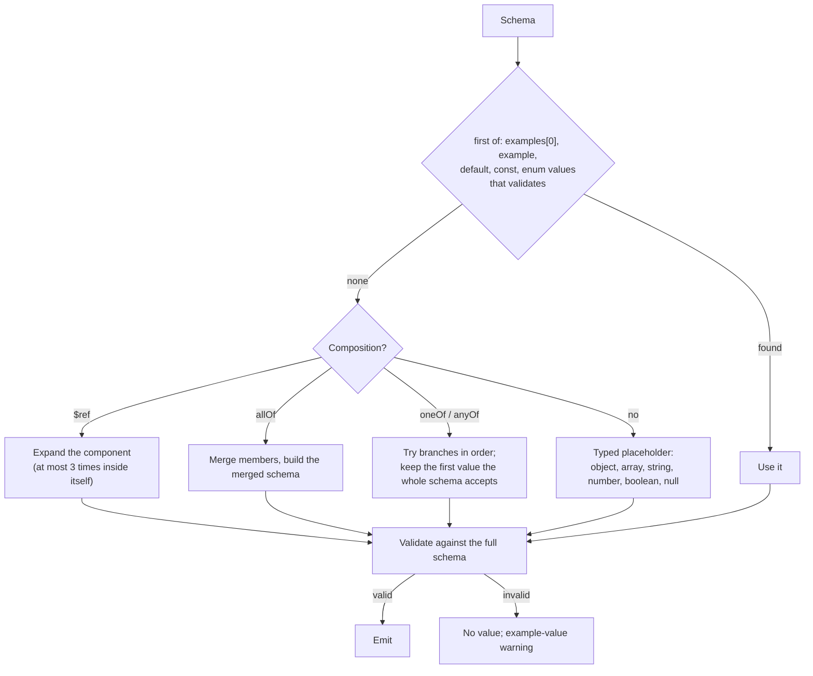

# Exporting Postman Collections from Schematic

Schematic generates runnable Postman Collection v2.1.0 files from API
definitions, alongside the Rust clients and OpenAPI documents. Each request
carries a JSON body example that validates against the API's registered
schema, saved example responses for its replies, and only variables the
collection declares. An optional Postman environment file lists the same
variables with values, so a collection can be imported and run as soon as
credentials are filled in.

## Quick Start

```bash
# Generate all artifacts (Rust + OpenAPI + Postman collections and environments)
just -f schematic/justfile generate

# Generate Rust and Postman collections and environments
just -f schematic/justfile generate-postman

# Single API, collection only
schematic-gen generate --api openai --output schema/src --postman-out postman

# Single API, collection and environment
schematic-gen generate --api openai --output schema/src --postman-out postman --postman-environment
```

## Output Layout

```
schematic/postman/
├── anthropic.postman_collection.json
├── anthropic.postman_environment.json
├── artificial_analysis.postman_collection.json
├── artificial_analysis.postman_environment.json
├── emqx.postman_collection.json          # Grouped: EmqxBasic + EmqxBearer
├── emqx.postman_environment.json
├── huggingface.postman_collection.json
├── huggingface.postman_environment.json
├── ollama.postman_collection.json        # Grouped: OllamaNative + OllamaOpenAI
├── ollama.postman_environment.json
└── …                                     # one pair per module
```

Every module has one collection, named `{module}.postman_collection.json`.
With `--postman-environment` (the `just` recipes pass it) each collection
gets its environment beside it as `{module}.postman_environment.json`.
Saved example responses live inside the collection, not in separate files.

## Collection Structure

Each collection includes:

- **Info** — Collection name, description, and schema version
- **Auth** — Collection-level authentication (`oauth2`, `bearer`, `apikey`,
  `basic`, or `noauth`)
- **Variables** — every variable any request references, in this order:
  base URLs, GraphQL addresses, credentials, then parameters (see
  [Variables and Environments](#variables-and-environments))
- **Items** — Endpoints organized into folders by URL path segment, then a
  `GraphQL` folder for GraphQL operations; each request holds its saved
  example responses

## Folder Grouping

Endpoints are automatically grouped into folders based on the first stable path segment:

| Path | Folder |
|------|--------|
| `/models` | Models |
| `/models/{model}` | Models |
| `/v1/audio/speech` | Audio |
| `/repos/{owner}/{repo}/issues` | Repos |
| `/{id}` | (root — no folder) |

The algorithm strips leading `/`, ignores path variables `{...}`, and skips version prefixes (`v1`, `v2`).

## Auth Mapping

| Schematic | Postman Type | Variable |
|-----------|-------------|----------|
| `BearerToken { header: None }` | `bearer` | `{{bearerToken}}` |
| `BearerToken { header: Some(h) }` | `apikey` | `{{apiKey}}` |
| `ApiKey { header }` | `apikey` | `{{apiKey}}` |
| `ApiKeyParam { location: Query, name }` | `apikey`, added to the query as `name` | `{{apiKey}}` |
| `ApiKeyParam { location: Cookie, name }` | `apikey`, added as a `Cookie` header valued `name={{apiKey}}` | `{{apiKey}}` |
| `Basic` | `basic` | `{{username}}`, `{{password}}` |
| `OAuth2(config)` | `oauth2` | `{{oauth2ClientId}}`, `{{oauth2ClientSecret}}` |
| `None` | `noauth` | — |

Postman's API-key auth can add a key only to a header or the query string,
so a cookie key travels in a `Cookie` header that holds the cookie pair.

### OAuth2

An OAuth2 configuration keeps its grant, URLs, and scopes:

```json
"auth": {
  "type": "oauth2",
  "oauth2": [
    { "key": "grant_type", "value": "authorization_code_with_pkce" },
    { "key": "authUrl", "value": "https://github.com/login/oauth/authorize" },
    { "key": "accessTokenUrl", "value": "https://github.com/login/oauth/access_token" },
    { "key": "challengeAlgorithm", "value": "S256" },
    { "key": "scope", "value": "repo read:user" },
    { "key": "clientId", "value": "{{oauth2ClientId}}" },
    { "key": "clientSecret", "value": "{{oauth2ClientSecret}}" },
    { "key": "client_authentication", "value": "body" },
    { "key": "addTokenTo", "value": "header" }
  ]
}
```

| Grant | Postman attributes |
| --- | --- |
| Authorization code with PKCE | `grant_type: authorization_code_with_pkce`, `authUrl`, `accessTokenUrl`, `challengeAlgorithm: S256` |
| Client credentials | `grant_type: client_credentials`, `accessTokenUrl` |
| Device code | `accessTokenUrl` and `accessToken: {{oauth2AccessToken}}`; Postman has no device-code grant, so the token is obtained outside Postman and pasted into that variable, and the generator reports an `oauth2-grant` warning |

Default scopes become one space-separated `scope`. A public client
(`OAuth2ClientAuthMethod::None`) has no `clientSecret`; `ClientSecretBasic`
sends the client credentials in the `header`, the others in the `body`. A
token revocation URL has no Postman attribute and is not exported.

### Endpoint authentication

A request whose endpoint declares its own authentication always carries a
request-level `auth`, which takes precedence over the collection's:

| Endpoint declaration | Request `auth` |
| --- | --- |
| none (inherits) | none of its own; the collection's applies |
| `.public()` | `{"type": "noauth"}` |
| `.auth(policy)` | the policy's first accepted method, mapped as in the table above |
| `.auth_with_env_mapping(policy, mapping)` | the same, with variables suffixed by the endpoint id |

A replacement that declares its own environment mapping names a credential
distinct from the API's, so its variables are suffixed with the endpoint id
(`{{bearerToken_Admin}}` for an endpoint `Admin`, or `{{username_Upload}}`
and `{{password_Upload}}`) instead of sharing `{{bearerToken}}`,
`{{apiKey}}`, `{{username}}`, or `{{password}}` with the API. In a shared
module the member's suffix follows (`{{bearerToken_Admin_EmqxBearer}}`; see
[Grouped Collections](#grouped-collections)). Every variable a request
references is declared on the collection.

A Postman request holds one auth. When a replacement policy accepts more
than one alternative, only the first is exported and the generator reports
an `endpoint-auth` warning; the collection is still written (see
[Generation Validation](../generation/validation.md#what-each-output-checks)).

## Parameter Mapping

Every declared parameter appears in the request it belongs to, valued with a
collection variable named for its location and name:

| Location | Postman entry | Variable |
|----------|---------------|----------|
| path | URL variable `name` valued `{{path_name}}`, described by its type when declared | `path_name` |
| query | URL query entry valued `{{query_name}}` | `query_name` |
| header | request header `name: {{header_name}}` | `header_name` |
| cookie | one `Cookie` header holding `name={{cookie_name}}` pairs | `cookie_name` |

The location prefix keeps a parameter's variable apart from the base-URL and
credential variables: a query parameter named `password` is
`{{query_password}}`, never the Basic auth's `{{password}}`. Characters
outside `A-Z a-z 0-9 _ -` become `_` (`filter[name]` → `query_filter_name_`).

A required parameter is enabled. An optional query entry or header is
written with `"disabled": true`, so Postman leaves it out until the user
switches it on. A declared description becomes the entry's description:

```json
"header": [
  { "key": "x-required", "value": "{{header_x-required}}" },
  { "key": "openai-beta", "value": "{{header_openai-beta}}", "disabled": true,
    "description": "Optional beta features to enable for this request." },
  { "key": "Cookie", "value": "session={{cookie_session}}; prefs={{cookie_prefs}}",
    "description": "Optional cookies, sent only when added: theme." }
]
```

Cookies are merged into **one** `Cookie` header, joined by `; ` as the
runtime sends them. The header holds the required cookies and its
description names the optional ones; when every cookie is optional, the
header holds them all and is disabled. Postman sends a variable's value as
typed, so a value needing the runtime's percent-encoding must be entered
encoded.

Headers follow this order and precedence:

1. The API's fixed headers, each replaced by an endpoint fixed header of the
   same name (case-insensitive).
2. A text or binary body's `Content-Type`, unless a fixed header sets it.
3. Header parameters. A fixed header of the same name wins, and a parameter
   naming the credential header (`Authorization` for bearer, Basic, and
   OAuth2; the API-key header for a header key) or `Cookie` is left out.
4. The merged `Cookie` header, left out when a fixed `Cookie` header exists.
   A cookie the API key travels in is left out of it, and a query parameter
   the API key travels in is left out of the URL.

A path parameter declared with `path_param` gives its URL variable a
description, since a Postman variable has no type: the parameter's
description followed by its type in parentheses, or the type alone. An enum
is listed by value:

```json
"variable": [
  { "key": "number", "value": "{{path_number}}", "description": "Issue number (integer)" },
  { "key": "kind", "value": "{{path_kind}}", "description": "one of: bug, help-wanted" }
]
```

## Body Mapping

| Schematic | Postman Mode | Body | Content-Type header |
|-----------|-------------|------|---------------------|
| `Json(TypeRef)` | `raw` (`json`) | a validated example (see below), or empty | — (Postman sets `application/json`) |
| `FormData` | `formdata` | one entry per field; files are `type: file` | — |
| `UrlEncoded` | `urlencoded` | one entry per field | — |
| `Text { content_type }` | `raw` (`text`) | empty | the declared content type |
| `Binary { content_type }` | `file` | the user attaches a file | the declared content type |

## Example Values

JSON bodies, saved JSON responses, stream items, and GraphQL `variables` are
built from the API's registered JSON Schemas (`RestApi::schemas`, the schemas
the definition registered, not their OpenAPI conversion) by
`schematic_gen::export::examples::ExampleSource`. Every value is validated
against its full schema with `jsonschema` (Draft 2020-12, offline, local
references only) before it is emitted. A value that cannot be built is never
emitted: the request body stays empty (or the saved response has no body)
and the generator reports an `example-value` warning naming the endpoint and
the schema path.



The rules, in order:

- A schema's first authored value that validates wins: its first `examples`
  entry, `example`, `default`, `const`, then each `enum` value. An authored
  value that fails its own schema is skipped.
- Otherwise a typed placeholder is built: `"string"` (or a `format`
  placeholder such as `"2000-01-01T00:00:00Z"` for `date-time`, `"2000-01-01"`
  for `date`, a nil UUID for `uuid`), `0`, `false`, `null`, `[]`, or an
  object. Numbers move into `minimum`/`exclusiveMinimum`/`maximum`/
  `exclusiveMaximum` and onto `multipleOf`; strings are padded to
  `minLength` with `x` and cut to `maxLength`; arrays hold `minItems` items.
- An object holds its required properties plus any property declaring its
  own example or default.
- `allOf` members are merged into one schema. `oneOf`/`anyOf` branches are
  tried in declaration order, and a branch's value is kept only when the
  whole schema accepts it, so a `oneOf` example matches exactly one branch.
- A component expanding inside itself more than three times on one path
  fails; an optional property is then left out and a nullable one becomes
  `null`. A required, non-nullable recursion is reported.
- There is no regex solver: a `pattern` the placeholder misses is reported,
  not satisfied.

The same definitions always produce the same bytes. Examples are valid, not
realistic: `"string"` and `0` are placeholders, and the first `oneOf`
branch is not necessarily the most common reply. Give a schema an `examples`
entry (schemars `#[schemars(example = …)]`) for a meaningful value.

## Saved Example Responses

Each request saves one example response per declared success shape, in
declaration order, then one per entry of the endpoint's effective error
table (the API's error defaults overlaid by the endpoint's own):

| Shape | Status | Body | `Content-Type` |
| --- | --- | --- | --- |
| JSON | the shape's first declared status, else 200 | the example; a field tag (`json_tag`) sets its field | the shape's media type |
| Text | as above | `string` | the shape's media type |
| Binary | as above | `<binary {media type} body; not representable as an example>` | the shape's media type |
| Empty | first declared status, else 204 | none | none |
| SSE stream | as JSON | one `data:` frame holding an item, then the terminator | `text/event-stream` |
| NDJSON stream | as JSON | one item line, then a terminator line when the end is a field value | `application/x-ndjson` |
| Byte stream | as JSON | the binary placeholder | the shape's media type |

A response is named `{status} {reason} ({media type})`, plus `— {variant}`
when an endpoint has several shapes and the shape names its variant.

An error entry for one status is saved under that status. A range is saved
under its lowest status that still resolves to it, so a narrower entry
keeps its own: with `4xx → Problem` and `400 → text`, the range is saved
as `401` and the text entry as `400`. A range every status of which a
narrower entry overrides is not saved.

Stream examples are finite and each item frame validates on its own; the
whole stream is never one JSON value. The terminator follows the declared
end: `data: [DONE]` for a data marker; `event: {name}` with data `{}` for an
event the runtime consumes (or the item when `keep` delivers it); an item
with the end field set for a field-value end; nothing more for a connection
close.

## Request Descriptions

A request's description is its endpoint's description, followed, after a
blank line, by one line for each piece of definition vocabulary that Postman
has no field for. Each line appears only when it applies:

| Line | When |
| --- | --- |
| ``Response content type: `…`.`` | the endpoint's first success shape declares a content type or is a stream (`text/event-stream`, `application/x-ndjson`, or the declared type); a plain JSON, text, binary, or empty shape adds no line |
| `Deprecated.` | the endpoint is deprecated |
| `Deprecated parameters: a, b.` | any path, query, header, or cookie parameter is deprecated |
| ``Rate limit headers: limit `…`, remaining `…`, reset `…` (unit), retry after `…`.`` | the endpoint has an effective rate limit (its own, else the API's) |
| `Retry guidance: retry on …; honor Retry-After: …; max attempts … (including the first); backoff ….` | the endpoint has effective retry guidance |

Every GitHub request, for example, ends with:

```text
Rate limit headers: limit `x-ratelimit-limit`, remaining `x-ratelimit-remaining`, reset `x-ratelimit-reset` (epoch seconds), retry after `retry-after`.
```

An endpoint that declares none of these keeps its description alone.

## GraphQL Operations

Each operation of an API's GraphQL surface becomes a runnable `POST` in a
`GraphQL` folder. The URL is the variable `{{graphqlUrl}}` (`graphqlUrl2`, …
for later members of a shared module), valued with the address the
surface's rules derive from the base URL, as the runtime derives it:
GitHub's rules turn `https://api.github.com` into
`https://api.github.com/graphql` and `https://ghe.example/api/v3` into
`https://ghe.example/api/graphql`.

The raw JSON body holds:

| Key | Value |
| --- | --- |
| `query` | the authored document, unchanged |
| `operationName` | the declared operation name, only when one is declared |
| `variables` | an [example](#example-values) of the registered variables type, or `{}` for an operation without variables |

```json
{
  "query": "query Issues($owner: String!) { repository(owner: $owner) { … } }",
  "operationName": "Issues",
  "variables": { "owner": "octocat" }
}
```

The request saves a `200` response holding `{"data": <example>}` and one
response per declared HTTP error. When no address rule matches the base URL,
the generator reports a `graphql-operation` warning and the API's operations
are left out. The [OpenAPI export](export-openapi.md) does not carry GraphQL
operations: it reports one `graphql-operation` warning per operation.

## Grouped Collections

APIs sharing a module (`ollama`, `emqx`) produce a single grouped collection
that merges endpoints from all APIs. The grouped collection:

- Uses the module name as the collection title (title-cased)
- Gives every member its own base-URL variable (`baseUrl`, `baseUrl2`, …),
  even when two members share a URL
- Suffixes every credential variable with the member's API name
  (`{{username_EmqxBasic}}`, `{{bearerToken_EmqxBearer}}`), so members never
  share a credential
- Sets collection-level auth only when every member's mapped auth is equal
  (with the suffixes, only when none authenticates); otherwise each request
  carries its member's auth
- Disambiguates a request id two members share as `Id (ApiName)` when the
  members' auths differ
- Combines descriptions from all APIs
- Merges all endpoints into shared folder groups

## Variables and Environments

A collection declares every variable it references, whether or not an
environment is exported, so an import never meets an undefined
`{{variable}}`. Declared values:

| Variable | Collection value | Environment value | Environment type |
| --- | --- | --- | --- |
| `baseUrl`, `baseUrl2`, … | the API's base URL | the same | `default` |
| `graphqlUrl`, … | the derived GraphQL address | the same | `default` |
| credentials (`bearerToken`, `apiKey`, `username`, `password`, `oauth2ClientId`, `oauth2ClientSecret`, `oauth2AccessToken`, and their suffixed forms) | empty | empty | `secret` |
| parameters (`path_*`, `query_*`, `header_*`, `cookie_*`) | empty | empty | `secret` for a parameter declared `secret`, otherwise `default` |

The environment is written only when requested (`--postman-environment`),
lists every collection variable in collection order, and never reads a value
from the host's environment variables:

```json
{
  "name": "Emqx",
  "values": [
    { "key": "baseUrl", "value": "http://localhost:18083/api/v5", "type": "default", "enabled": true },
    { "key": "username_EmqxBasic", "value": "", "type": "secret", "enabled": true }
  ],
  "_postman_variable_scope": "environment"
}
```

A complete run that does not request environments leaves existing
environment files alone; one that does replaces them and removes
environments of modules that no longer exist.

## CLI Flags

| Flag | Description |
|------|-------------|
| `--postman-out <DIR>` | Output directory for Postman collections |
| `--postman-environment` | Also write each collection's environment beside it |
| `--no-postman` | Skip Postman collection generation |

When `--output` ends with `schema/src` and no explicit `--postman-out` is provided, Postman output defaults to `postman/` as a sibling directory.

## Library API

```rust
use schematic_gen::export::postman::{build_postman_collection, write_postman};

let api = define_openai_api();
let collection = build_postman_collection(&api);
let path = write_postman(&api, Path::new("postman"), false)?;
```

For grouped collections:

```rust
use schematic_gen::export::postman::{build_postman_collection_grouped, write_postman_grouped};

let apis = vec![&api1, &api2];
let collection = build_postman_collection_grouped(&apis, "ollama");
let path = write_postman_grouped(&apis, "ollama", Path::new("postman"), false)?;
```

For environments:

```rust
use schematic_gen::export::postman::{build_postman_environment, write_postman_environment};

let environment = build_postman_environment(&apis, "ollama");
let path = write_postman_environment(&apis, "ollama", Path::new("postman"), false)?;
```

## Authoring inputs

Postman export consumes the same checked module-group assembly as Rust and
OpenAPI generation. Use [definition builders](../definition-builders.md) and
[typed registration](../typed-registration.md); do not fill a separate registry.
Parameters keep their declared query, header, cookie, or body location. Paths
contain placeholders, with query inputs represented separately. Authentication
comes from the effective API policy and each endpoint's own declaration; runtime origin/redaction settings are not
Postman transport enforcement.
