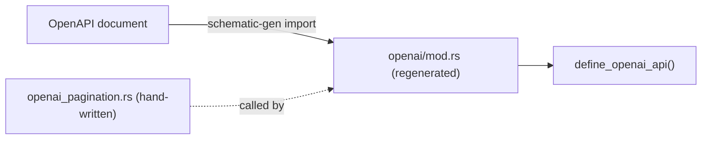

# Importing OpenAPI into Schematic

Use `OpenApiImport` or `schematic-gen import` to turn OpenAPI 3.0.x JSON or YAML
into Schematic definitions and generated Rust clients. The importer resolves
references, normalizes query-bearing routes, and reports unsupported input with
context. Definitions-crate output uses typed builders and ordered registration.

## Goals

- Import OpenAPI 3.0.x (JSON or YAML) into `schematic-define` primitives.
- Preserve intent and ergonomics while providing clear diagnostics for lossy mappings.
- Support a clean, builder-style API that is easy to discover via Rustdoc.
- Keep the import pipeline data-driven and deterministic.

## Non-goals

- OpenAPI 3.1 support (not covered by `openapiv3`).
- Full OpenAPI validation or linting (use external tools if required).
- Automatic server framework integration or server codegen.

## High-level approach

1. Parse OpenAPI into `openapiv3::OpenAPI` (JSON/YAML via serde).
2. Resolve `$ref` nodes into a stable, traversable graph.
3. Convert OpenAPI models to Schematic primitives:
   - `RestApi` and `Endpoint` for operations.
   - New model/schema primitives for type definitions.
   - New param primitives for query/header/cookie parameters.
4. Emit a structured result with diagnostics and override hooks.

## New primitives in `schematic-define`

### 1) `openapi` module

The `openapi` module provides import sources, options, and results. This is the primary
public surface for importing a spec.

```rust
pub mod openapi {
    use std::path::PathBuf;

    use openapiv3::OpenAPI;

    use crate::{RestApi};
    use crate::models::ModelCatalog;

    #[derive(Debug, Clone)]
    pub enum OpenApiSource {
        Path(PathBuf),
        Json(String),
        Yaml(String),
        Bytes(Vec<u8>),
        Document(OpenAPI),
    }

    #[derive(Debug, Clone, Default)]
    pub struct OpenApiImportOptions {
        pub api_name: Option<String>,
        pub module_path: Option<String>,
        pub base_url: BaseUrlPolicy,
        pub naming: NamingOptions,
        pub auth: AuthPolicy,
        pub responses: ResponsePolicy,
        pub params: ParamPolicy,
        pub schemas: SchemaPolicy,
        pub filters: ImportFilters,
    }

    #[derive(Debug, Clone)]
    pub struct OpenApiImportResult {
        pub api: RestApi,
        pub models: ModelCatalog,
        pub diagnostics: Vec<OpenApiDiagnostic>,
    }

    #[derive(Debug, Clone)]
    pub struct OpenApiDiagnostic {
        pub severity: DiagnosticSeverity,
        pub location: String,
        pub message: String,
    }

    #[derive(Debug, Clone, Copy)]
    pub enum DiagnosticSeverity {
        Info,
        Warn,
        Error,
    }
}
```

### 2) `models` module

Importing OpenAPI requires representing schema definitions. These new primitives capture
the shape of models so the generator can later emit Rust types.

```rust
pub mod models {
    #[derive(Debug, Clone)]
    pub struct ModelCatalog {
        pub module_path: Option<String>,
        pub types: Vec<ModelDef>,
    }

    #[derive(Debug, Clone)]
    pub enum ModelDef {
        Struct(StructDef),
        Enum(EnumDef),
        Alias(TypeRef),
    }

    #[derive(Debug, Clone)]
    pub struct StructDef {
        pub name: String,
        pub description: Option<String>,
        pub fields: Vec<FieldDef>,
        pub additional_properties: Option<TypeRef>,
    }

    #[derive(Debug, Clone)]
    pub struct EnumDef {
        pub name: String,
        pub description: Option<String>,
        pub variants: Vec<EnumVariant>,
        pub untagged: bool,
    }

    #[derive(Debug, Clone)]
    pub struct EnumVariant {
        pub name: String,
        pub value: Option<String>,
        pub description: Option<String>,
    }

    #[derive(Debug, Clone)]
    pub struct FieldDef {
        pub name: String,
        pub serde_rename: Option<String>,
        pub description: Option<String>,
        pub required: bool,
        pub field_type: TypeRef,
    }

    #[derive(Debug, Clone)]
    pub enum TypeRef {
        Primitive(PrimitiveType),
        Array(Box<TypeRef>),
        Map(Box<TypeRef>),
        Named(String),
        OneOf(Vec<TypeRef>),
        AnyOf(Vec<TypeRef>),
        AllOf(Vec<TypeRef>),
        Unknown,
    }

    #[derive(Debug, Clone, Copy)]
    pub enum PrimitiveType {
        String,
        Integer,
        Number,
        Boolean,
        Bytes,
        Json,
    }
}
```

### 3) `params` module

OpenAPI parameters can be in path, query, header, or cookie. Schematic currently captures
only path parameters (via template syntax). Importing OpenAPI benefits from explicit
parameter lists so generators can render query/header/cookie handling.

```rust
pub mod params {
    #[derive(Debug, Clone, Default)]
    pub struct EndpointParams {
        pub query: Vec<ParamDef>,
        pub header: Vec<ParamDef>,
        pub cookie: Vec<ParamDef>,
    }

    #[derive(Debug, Clone)]
    pub struct ParamDef { rust_name: None, secret: false, pager_managed: false,
        pub name: String,
        pub required: bool,
        pub description: Option<String>,
        pub param_type: ParamType,
        pub explode: Option<bool>,
        pub style: Option<ParamStyle>,
    }

    #[derive(Debug, Clone)]
    pub enum ParamType {
        String,
        Integer,
        Number,
        Boolean,
        Array(Box<ParamType>),
        Enum(Vec<String>),
        Json,
    }

    #[derive(Debug, Clone, Copy)]
    pub enum ParamStyle {
        Form,
        Simple,
        SpaceDelimited,
        PipeDelimited,
        DeepObject,
    }
}
```

`Endpoint` would gain an optional `params: EndpointParams` field with a default of empty.
This keeps current behavior unchanged while enabling richer imports.

## Import API sketch

```rust
use schematic_define::openapi::{OpenApiImport, OpenApiSource};

let result = OpenApiImport::new(OpenApiSource::path("./spec.yaml"))
    .api_name("MyService")
    .module_path("myservice")
    .base_url_from_servers()
    .prefer_json()
    .build()?;

let api = result.api;
let models = result.models;
```

## Import pipeline details

### 1) Parsing

- Use `openapiv3` for the OpenAPI AST.
- Use `serde_json` or `serde_yaml` based on source input.
- Detect and report empty or invalid documents with `OpenApiDiagnostic::Error`.

### 2) Reference resolution

`openapiv3` uses `ReferenceOr<T>` for many nodes. The importer must resolve local refs
(`#/components/...`) and detect cycles.

Design:

- `OpenApiRefResolver` stores a map of component locations to resolved nodes.
- Use a cache keyed by ref string.
- Detect cycles and emit a warning; fall back to `TypeRef::Unknown` unless configured
  to error.

### 3) API metadata

Mapping rules:

- `info.title` -> `RestApi.name` (sanitized to a Rust-friendly name).
- `info.description` -> `RestApi.description`.
- `externalDocs.url` -> `RestApi.docs_url` when present.
- `servers` -> `RestApi.base_url` using `BaseUrlPolicy`.

`BaseUrlPolicy` options:

- `FirstServer` (default)
- `ByIndex(usize)`
- `ByUrl(String)`
- `Override(String)`

### 4) Operations to endpoints

Each `PathItem` operation becomes an `Endpoint`.

Endpoint ID selection (configurable):

1. `operationId` (preferred)
2. `summary` (fallback)
3. Method + path template (`GetUsersById`)

Naming is normalized to PascalCase and de-conflicted with suffixes (`GetUser`, `GetUser2`).

### 5) Parameters

Mapping rules:

- `in: path` -> ensure `{param}` exists in the path template; warn if missing.
- `in: query` -> `EndpointParams.query`.
- `in: header` -> `EndpointParams.header`.
- `in: cookie` -> `EndpointParams.cookie`.

Parameter schema mapping uses `ParamType`, with `enum` values captured when possible.
Unsupported parameter shapes emit a warning and fall back to `ParamType::Json`.

### 6) Request bodies

Content types map to `ApiRequest`:

- `application/json` -> `ApiRequest::Json(Schema)`
- `multipart/form-data` -> `ApiRequest::FormData { fields }`
- `application/x-www-form-urlencoded` -> `ApiRequest::UrlEncoded { fields }`
- `text/*` -> `ApiRequest::Text { content_type }`
- `application/octet-stream` -> `ApiRequest::Binary { content_type }`

If multiple content types exist, the importer selects one based on `ResponsePolicy` and
emits a warning listing the alternates.

Multipart and URL-encoded fields are derived from object properties. File uploads map to
`FormField::file` or `FormField::files_with_constraints` when the schema indicates an
array of binary items.

### 7) Responses

OpenAPI supports multiple responses. The importer selects a primary success response using
`ResponsePolicy`:

- Prefer 200/201, then 204, then first 2xx, then `default`.
- Prefer content types by order: JSON, text, binary, empty.

Mapping to `ApiResponse`:

- JSON schema -> `ApiResponse::Json(Schema)`
- text -> `ApiResponse::Text`
- binary -> `ApiResponse::Binary`
- no body or 204 -> `ApiResponse::Empty`

Non-selected responses are recorded in diagnostics for visibility and future support.

### 8) Schema extraction

OpenAPI components and inline schemas are converted to `ModelCatalog` using `SchemaPolicy`:

- `components.schemas` -> named `ModelDef`s.
- Inline schemas -> synthesized names (based on operationId + "RequestBody" or
  "Response").
- `oneOf`/`anyOf` -> `EnumDef` (untagged by default).
- `allOf` -> struct flattening or alias (configurable).
- `nullable` -> `Option<T>` in generated code (represented via `FieldDef.required = false`).

`SchemaPolicy` includes format-to-type mapping (e.g., `uuid`, `date-time`) and allows
overrides to keep dependencies optional.

## Auth mapping

OpenAPI security schemes map to `AuthStrategy`.

Suggested extension to `AuthStrategy`:

```rust
pub enum ApiKeyLocation {
    Header,
    Query,
    Cookie,
}

pub enum AuthStrategy {
    None,
    BearerToken { header: Option<String> },
    ApiKey { header: String },
    ApiKeyParam { name: String, location: ApiKeyLocation },
    Basic,
}
```

Mapping rules:

- `http` + `bearer` -> `BearerToken`
- `http` + `basic` -> `Basic`
- `apiKey` in header -> `ApiKey`
- `apiKey` in query/cookie -> `ApiKeyParam`

If multiple security schemes are defined, prefer a single scheme by policy or allow
manual overrides. When unsupported, emit a warning and default to `AuthStrategy::None`.

## Diagnostics

All lossy conversions or unsupported features should surface as diagnostics, not silent
behavior. Examples:

- Unresolved `$ref` or cycles.
- Unsupported parameter styles (e.g., deepObject) falling back to JSON.
- Multiple response content types (not selected) omitted.
- OneOf/AnyOf flattening policy applied.

Diagnostics should be returned in `OpenApiImportResult` and optionally raised as errors
if the user selects a strict policy.

## Integration with existing generator

To make imported OpenAPI specs usable by `schematic-gen`, add a model generation phase
that consumes `ModelCatalog` and emits Rust types into the target schema module.

Suggested integration flow:

1. `schematic-define` import -> `OpenApiImportResult`.
2. `schematic-gen` reads `RestApi` and `ModelCatalog`.
3. Generate model Rust code first, then generate client code as usual.

This keeps the data-driven design intact while allowing end-to-end OpenAPI imports.

## Importing into `schematic-definitions`

`schematic-gen import --definitions-out <dir>` writes a definitions-crate
module instead of a standalone client: `<dir>/types.rs` holds the models and
`<dir>/mod.rs` holds `define_{module}_api()`, which rebuilds the imported
`RestApi` as a value, plus `openapi_registry()`. The imported API then joins
the catalog and flows through `schematic-gen generate` like a hand-written one.

```bash
schematic-gen import --input specs/openai/openapi.yaml --api-name OpenAI \
    --module-path openai --definitions-out definitions/src/openai
```

### Overlays: authored additions the import keeps

An OpenAPI document cannot express everything a definition carries;
pagination is the main example. Writing such additions into the imported
`mod.rs` does not work, because the next import overwrites it. Put them in a
hand-written overlay function instead and name it with `--overlay`:

```bash
schematic-gen import ... --definitions-out definitions/src/openai \
    --overlay crate::openai_pagination::apply
```

The overlay is a `fn(RestApi) -> RestApi` anywhere the module can reach by
that path. The importer never reads or writes it; it only emits the call, so
the factory every client and exporter uses returns the augmented definition:

```rust
fn imported_api(ctx: &mut DefinitionContext) -> Result<RestApi, DefinitionError> {
    let endpoints = Vec::from([/* typed endpoint builders, each ending in build()? */]);
    let api = RestApi::builder(ctx, "OpenAI", "https://api.openai.com/v1")
        .describes("OpenAI API")
        .bearer_env(Vec::<String>::new())
        .endpoints(endpoints)
        .build()?;
    Ok(crate::openai_pagination::apply(api))
}
```

Generated `module_group()` registers models in source order and assembles both
the API and registry from that context. The infallible catalog factory and
`openapi_registry()` unwrap this checked assembly. Nominal models implement
`Registration` beside their declarations; aliases reuse their underlying type,
and containers, primitives, and free-form JSON remain inline.




Rules:

- The value must be a plain Rust path: `crate::openai_pagination::apply`,
  `super::apply`, and `apply` are accepted; an empty value, generic arguments
  (`crate::x::apply::<T>`), or anything that is not a path (`apply()`) is
  rejected before anything is written.
- `--overlay` requires `--definitions-out`; a standalone client has no
  definitions factory to call it from, so the combination is rejected.
- Without `--overlay` the fallible assembly returns the built API directly.
- The module docs' regeneration hint includes the `--overlay` argument, so the
  emitted file records how to reproduce it. `just import-openai` passes
  `--overlay crate::openai_pagination::apply`.

## Example mapping (conceptual)

OpenAPI:

```yaml
paths:
  /users/{user_id}:
    get:
      operationId: GetUser
      parameters:
        - name: user_id
          in: path
          required: true
          schema: { type: string }
      responses:
        "200":
          content:
            application/json:
              schema:
                $ref: "#/components/schemas/User"
```

Schematic import:

```rust
Endpoint {
    id: "GetUser".to_string(),
    method: RestMethod::Get,
    path: "/users/{user_id}".to_string(),
    description: "".to_string(),
    request: None,
    response: ApiResponse::json_type("User"),
    params: EndpointParams::default(),
    headers: vec![],
}
```

`User` becomes a `ModelDef::Struct` in `ModelCatalog` and can be emitted by the generator.

## Compatibility notes

- All new primitives are additive and can be marked `#[non_exhaustive]`.
- Existing definitions are unaffected; imports are opt-in.
- The importer should default to safe, conservative mappings and provide
  configuration hooks for customization.

## Future extensions

- Support OpenAPI 3.1 by swapping the parser or adding a 3.1 feature gate.
- Multi-response modeling and error response mapping.
- Request examples and sample generation in Rustdoc.
- OpenAPI export from Schematic using the same `openapiv3` types.

### Query expressions in imported paths

The shared importer normalizes query-bearing paths before source emission. A
path such as `/items?beta=true` becomes `/items` plus an optional Boolean `beta`
query parameter. Callers select it with `.beta(true)`; omitting it preserves the
ordinary URL. A supported placeholder such as `/files?ref={git_ref}` becomes a
caller query input with wire name `ref` and Rust name `git_ref`.

If an operation already exists on the same method and base path, normalization
keeps the ordinary operation ID and order and uses the suffixed operation's
request and response only after both flattened schemas pass the compatibility
gate. Malformed expressions, duplicate query keys, conflicting declarations,
unsupported placeholders, and imported GET request bodies produce contextual
errors. The seven OpenAI beta operations are exposed through their ordinary
twins; the vendored source remains unchanged.

The changed input boundary rejects explicit null or malformed paths and
parameter declarations. Omitted parameters mean no declarations; an empty
array explicitly declares none. JSON and YAML both reject duplicate authored
keys and trailing invalid content. Metadata-only foundation imports can be empty. The normal `schematic-gen import`
invocation rejects an API with no usable endpoints before writing output.
