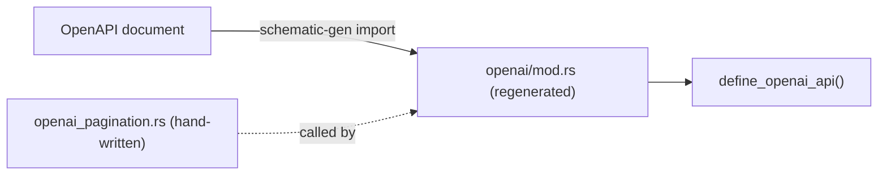

# Importing OpenAPI into Schematic

Import OpenAPI 3.0.x JSON or YAML into typed clients or a reusable definitions
module. The vendored OpenAI document uses this same import path; never edit its
emitted models or definition module manually.

```sh
schematic-gen import --input api.yaml --output generated/src
schematic-gen import --input api.yaml --api-name Items \
    --module-path items --definitions-out definitions/src/items
```

The library entry point is feature-gated by `schematic-define/openapi`:

```rust
use schematic_define::openapi::{OpenApiImport, OpenApiSource};

let result = OpenApiImport::new(OpenApiSource::path("api.yaml"))
    .api_name("Items")
    .module_path("items")
    .build()?;
let api = result.api;
let models = result.models;
```

Import reads the OpenAPI AST, resolves local references, extracts a `ModelCatalog`,
and lowers operations into definitions. Inspect the result's diagnostics for lossy
mappings. The generator emits models before clients. Definitions-module output
uses typed registration and fallible builders; direct library import retains the
transfer representation used by the import pipeline.

## Mapping rules

| OpenAPI input | Definition or generated model |
| --- | --- |
| info, servers, externalDocs | API name, description, base URL, docs URL; import options may override metadata |
| operationId or operation fallback | PascalCase endpoint id, de-conflicted as needed |
| path parameter | Path template placeholder |
| query, header, cookie | Parameter in the declared transport location |
| JSON body | Typed model or free-form JSON |
| multipart / URL-encoded body | Form fields, with file constraints where supported |
| text / binary body | Raw body with content type |
| responses | One selected success; other responses remain diagnostic information |
| component / inline schemas | Named models or synthesized model names |
| oneOf / anyOf | Untagged enum; unnamed members may remain free-form JSON |
| allOf | Merged schema/model according to import support |
| nullable | Optional Rust representation |
| bearer, basic, header/query/cookie API key | Existing auth strategy and environment mapping |

The importer does not implement OpenAPI 3.1 or general multi-success response
modeling. Full provider HTTP fidelity is not established by a successful import;
compile the generated crate and test its wire behavior.

## Importing into `schematic-definitions`

`schematic-gen import --definitions-out <dir>` writes a definitions-crate
module instead of a standalone client: `<dir>/types.rs` holds the models and
`<dir>/mod.rs` holds `define_{module}_api()`, which rebuilds the imported
`RestApi` as a value, plus `openapi_registry()`. The imported API then joins
the catalog and flows through `schematic-gen generate` like a hand-written one.

```bash
schematic-gen import --input specs/openai/openapi.yaml --api-name OpenAI \
    --module-path openai --definitions-out definitions/src/openai
```

### Overlays: authored additions the import keeps

An OpenAPI document cannot express everything a definition carries;
pagination is the main example. Writing such additions into the imported
`mod.rs` does not work, because the next import overwrites it. Put them in a
hand-written overlay function instead and name it with `--overlay`:

```bash
schematic-gen import ... --definitions-out definitions/src/openai \
    --overlay crate::openai_pagination::apply
```

The overlay is a `fn(RestApi) -> RestApi` anywhere the module can reach by
that path. The importer never reads or writes it; it only emits the call, so
the factory every client and exporter uses returns the augmented definition:

```rust
fn imported_api(ctx: &mut DefinitionContext) -> Result<RestApi, DefinitionError> {
    let endpoints = Vec::from([/* typed endpoint builders, each ending in build()? */]);
    let api = RestApi::builder(ctx, "OpenAI", "https://api.openai.com/v1")
        .describes("OpenAI API")
        .bearer_env(Vec::<String>::new())
        .endpoints(endpoints)
        .build()?;
    Ok(crate::openai_pagination::apply(api))
}
```

Generated `module_group()` registers models in source order and assembles both
the API and registry from that context. The infallible catalog factory and
`openapi_registry()` unwrap this checked assembly. Nominal models implement
`Registration` beside their declarations; aliases reuse their underlying type,
and containers, primitives, and free-form JSON remain inline.




Rules:

- The value must be a plain Rust path: `crate::openai_pagination::apply`,
  `super::apply`, and `apply` are accepted; an empty value, generic arguments
  (`crate::x::apply::<T>`), or anything that is not a path (`apply()`) is
  rejected before anything is written.
- `--overlay` requires `--definitions-out`; a standalone client has no
  definitions factory to call it from, so the combination is rejected.
- Without `--overlay` the fallible assembly returns the built API directly.
- The module docs' regeneration hint includes the `--overlay` argument, so the
  emitted file records how to reproduce it. `just import-openai` passes
  `--overlay crate::openai_pagination::apply`.

### Query expressions in imported paths

The shared importer normalizes query-bearing paths before source emission. A
path such as `/items?beta=true` becomes `/items` plus an optional Boolean `beta`
query parameter. Callers select it with `.beta(true)`; omitting it preserves the
ordinary URL. A supported placeholder such as `/files?ref={git_ref}` becomes a
caller query input with wire name `ref` and Rust name `git_ref`.

If an operation already exists on the same method and base path, normalization
keeps the ordinary operation ID and order and uses the suffixed operation's
request and response only after both flattened schemas pass the compatibility
gate. Malformed expressions, duplicate query keys, conflicting declarations,
unsupported placeholders, and imported GET request bodies produce contextual
errors. The seven OpenAI beta operations are exposed through their ordinary
twins; the vendored source remains unchanged.

The changed input boundary rejects explicit null or malformed paths and
parameter declarations. Omitted parameters mean no declarations; an empty
array explicitly declares none. JSON and YAML both reject duplicate authored
keys and trailing invalid content. Metadata-only foundation imports can be empty. The normal `schematic-gen import`
invocation rejects an API with no usable endpoints before writing output.
