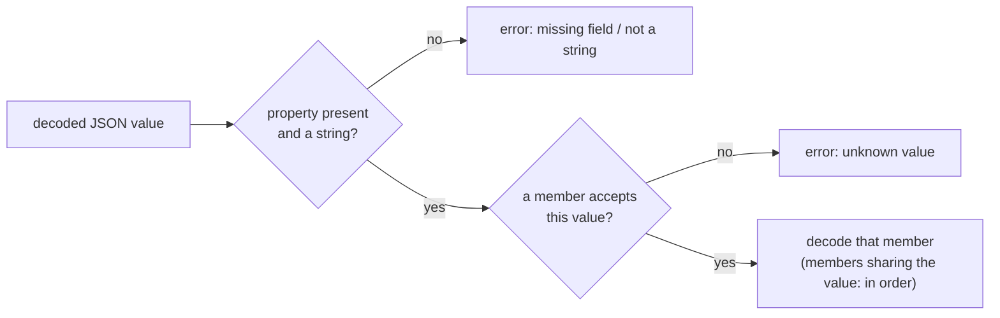
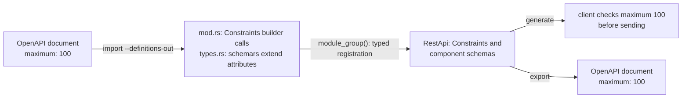
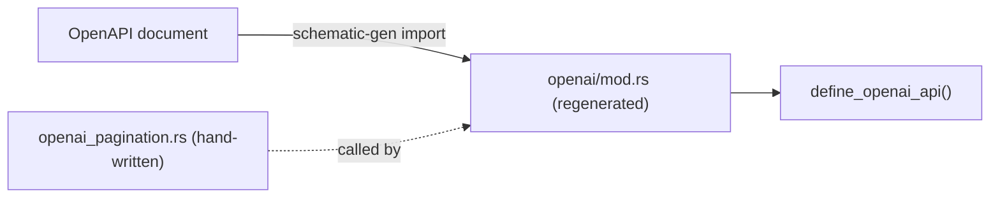

# Importing OpenAPI into Schematic

Import OpenAPI 3.0.x JSON or YAML into typed clients or a reusable definitions
module. The vendored OpenAI document uses this same import path; never edit its
emitted models or definition module manually.

```sh
schematic-gen import --input api.yaml --output generated/src
schematic-gen import --input api.yaml --api-name Items \
    --module-path items --definitions-out definitions/src/items
```

The library entry point is feature-gated by `schematic-define/openapi`:

```rust
use schematic_define::openapi::{OpenApiImport, OpenApiSource};

let result = OpenApiImport::new(OpenApiSource::path("api.yaml"))
    .api_name("Items")
    .module_path("items")
    .build()?;
let api = result.api;
let models = result.models;
```

Import reads the OpenAPI AST, resolves local references, extracts a `ModelCatalog`,
and lowers operations into definitions. Inspect the result's diagnostics for lossy
mappings. The generator emits models before clients. Definitions-module output
uses typed registration and fallible builders.

The imported `api` is ready to validate and export. It carries one schema
component per catalog model, in source order: the model's final name, its Rust
path, and the source schema. Endpoint bodies and responses name those
components, so `api.validate_references()` passes and
`schematic_define::openapi::export` accepts the API as it is.

```rust
let pet = result.api.component("Pet").unwrap();
assert_eq!(pet.rust_path.as_deref(), Some("items::Pet")); // `Pet` without module_path
```

- **Rust paths** are `{module_path}::{Name}`, or the bare name when no module
  path is set; the models are generated into that module.
- **Renamed models** keep their references consistent. A schema whose name an
  endpoint's request struct claims (`CreatePetRequest` for the `CreatePet`
  endpoint) becomes `CreatePetRequest2`; the component, the catalog model,
  `$ref`s inside other components, and every reference the definition holds
  use the new name. That covers JSON requests and JSON-encoded multipart
  parts, JSON success bodies, SSE and NDJSON stream items, endpoint error
  tables, and API-level error defaults, at any depth inside an array,
  optional, map, or composition (`Vec<CreatePetRequest>` becomes
  `Vec<CreatePetRequest2>`).
- **A dangling reference fails the import.** If an operation's JSON request or
  response names a schema the document does not define, `build()` returns
  `OpenApiError::Definition(DefinitionError::UnresolvedReference { api,
  endpoint, name })` instead of an API that cannot be generated or exported.
- **A document without components** imports with no schema components; inline
  bodies are free-form JSON (`Primitive(Json)`), which needs none.

## Mapping rules

| OpenAPI input | Definition or generated model |
| --- | --- |
| info, servers, externalDocs | API name, description, version (`info.version`), base URL, docs URL; import options may override metadata. No `servers` is a warning and the base URL defaults to `https://api.example.com` |
| operationId or operation fallback | PascalCase endpoint id, de-conflicted as needed |
| operation `deprecated` | A deprecated endpoint |
| path parameter | Path template placeholder; typed path parameters when any is typed (see [Parameters](#parameters)) |
| query, header, cookie | Parameter in the declared transport location, with its `required`, `style`, `explode`, and `deprecated`; an absent `explode` takes OpenAPI's default, `true` for `form` style (query and cookie) and `false` otherwise. Path-item parameters merge into each operation |
| JSON body | Typed model or free-form JSON |
| multipart / URL-encoded body | Form fields, with file `accept` lists, file counts, and JSON parts from `encoding` and `minItems`/`maxItems` (see [Form bodies](#form-bodies)) |
| text / binary body | Raw body with content type |
| responses | Every 2xx response becomes a success shape and every 400-599 response an endpoint error entry (see [Several success shapes and declared errors](#several-success-shapes-and-declared-errors)) |
| component / inline schemas | Named models or synthesized model names |
| oneOf / anyOf | Enum with one variant per member, selected by the `discriminator` when every member has a tag value, else untagged (first member that fits); unnamed members may remain free-form JSON (see [Unions and discriminators](#unions-and-discriminators)) |
| allOf | Merged schema/model according to import support |
| nullable | Optional Rust representation |
| bearer, basic, header/query/cookie API key | Auth strategy or policy from the root `security`, and endpoint overrides from operation `security` (see [Authentication](#authentication)) |
| `x-schematic` | Everything else Schematic exported, checked against the standard fields (see [Schematic extensions](#schematic-extensions)) |

The importer does not implement OpenAPI 3.1. Full provider HTTP fidelity is
not established by a successful import; compile the generated crate and test
its wire behavior.

### Unions and discriminators

A component `oneOf` or `anyOf` becomes a Rust enum with one variant per
member. When the schema declares a `discriminator`, the importer works out
which values of that property select each member, and the generated enum
decodes by that value instead of trying members in order:

```yaml
Pet:
  oneOf:
    - $ref: "#/components/schemas/Cat"   # kind: {type: string, enum: [cat]}, required
    - $ref: "#/components/schemas/Dog"   # no `kind` property
  discriminator:
    propertyName: kind
```

```rust
let pet: Pet = serde_json::from_str(r#"{"kind":"Dog","bark":true}"#)?; // Pet::Dog
let err = serde_json::from_str::<Pet>(r#"{"kind":"lizard"}"#);         // Err: unknown `kind` value
```

A member's values come from the first of these that applies:

1. the `discriminator.mapping` keys that name it (`'#/components/schemas/Cat'`
   or `Cat`);
2. the string `enum` of the property, found on the member itself, through a
   `$ref`, in an `allOf` member, or across a nested union's own members (one
   value or several);
3. the member's component name, when it does not declare the property or
   declares it as an unrestricted string.



The decoded value is never handed to a member whose tag differs, and a
member that rejects its own tagged value is the error. Serialization is
unchanged: each member already writes its own property.

When some member has no value (it declares the property optional, the
property is not a string, its `enum` allows `null`, or an inline member
declares no `enum`), the enum stays untagged and the import reports a warning
at the union, for example:

```text
[WARN] #/components/schemas/InputItem - discriminator `type` has no value for `EasyInputMessage` (the property is optional); the union decodes as the first alternative that fits
```

A union without a `discriminator` keyword is always untagged, even when its
members happen to carry distinct values of a required property.

The enum's `Default` is its first member's `Default`, whose tag is empty, so
a defaulted discriminated enum does not decode again; it exists only so a
struct holding the enum can derive `Default`.

### Response checks

Before mapping, the importer rejects response members that the OpenAPI parser
would otherwise read loosely, naming the API, operation, and member:

- `responses`, `content`, a media entry's `schema`, and a `discriminator`
  that is `null` or not an object;
- a status key other than `default`, `100`-`599`, `1XX`-`5XX`, or an `x-`
  extension (`"600"`, `"abc"`), and two spellings of one status (`4XX`, `4xx`);
- a media key that is not `type/subtype` or a media range (`json`), and two
  spellings of one media type (`application/json`, `Application/JSON`);
- an empty or non-string `$ref`, an empty `oneOf` or one with a member that
  is not an object, and an empty or non-string `discriminator.propertyName`;
- exact duplicate keys anywhere, and trailing content after the document.

```text
Validation error at 'API Pets endpoint ListPets GET /pets responses':
Response key `abc` is not `default`, a status 100-599, or a class 1XX-5XX
```

### Several success shapes and declared errors

Every operation's responses are mapped to success shapes and endpoint error
entries by `openapi::classify_responses(api, endpoint, &operation.responses,
&resolver)`, which `build()` runs for each operation and which is public for
callers that classify one operation themselves.

| Response | Imports as |
| --- | --- |
| `text/event-stream` | SSE stream of the schema's component |
| `application/x-ndjson`, `application/jsonl` | NDJSON stream of the schema's component |
| `application/json`, `application/*+json` | JSON shape |
| other `text/*` | text shape with that content type |
| any other media type | binary shape with that content type |
| `*/*` | the fallback shape |
| several media types under one status | one shape each |
| JSON `oneOf` with a `discriminator`, or of one array and one object, inline or behind a schema `$ref` | one tagged JSON shape per member |
| 204 or no `content` | empty shape |
| `2XX` | shapes that declare no status, used for every 2xx status no exact key names |
| exact `400`-`599`, `4XX`, `5XX` | the endpoint's own error entries (never hoisted to the API) |

Media types are compared normalized (`Text/Event-Stream; charset=utf-8` is an
SSE stream). Identical shapes under several statuses import once; when the
statuses carry different shapes (apart from a body-less 204), each shape
declares the statuses it appears under. A stream's end condition cannot be
inferred from a media type, so it ends at connection close.

A `oneOf` is recognized wherever the media schema leads: written inline, or
reached through a `$ref` (or a chain of them) to `components.schemas`. Both
spellings below import as the same two shapes, `Directory` tagged
`type: "dir"` and `File` tagged `type: "file"`:

```yaml
# inline
schema:
  oneOf: [{ $ref: "#/components/schemas/Directory" }, { $ref: "#/components/schemas/File" }]
  discriminator: { propertyName: type, mapping: { dir: "#/components/schemas/Directory", file: "#/components/schemas/File" } }
# referenced: the same object moved to components.schemas.Reply
schema: { $ref: "#/components/schemas/Reply" }
```

A member's tag value is the one the component union's generated
`Deserialize` dispatches on (see [Unions and discriminators](#unions-and-discriminators)):
its `mapping` key, else the single value of the property's `enum`, else its
component name. Each member must be a component `$ref` with exactly one
value; a member with an optional or non-string property, or several `enum`
values, leaves the `oneOf` inseparable. Each separated shape is named after
its member's component, or `Array` / `Object` when the member has no name,
so the generated success enum has one variant per member.

When a referenced `oneOf` cannot be separated, the body keeps that one named
schema (the union's own enum, which still decodes every member) with a
warning. An unresolvable or cyclic reference also keeps its named schema.
An error status always holds one shape: a referenced union stays its named
schema there, with no warning.

Each of these imports with a warning naming the API, operation, and what was
lost, rather than being guessed:

- a `default`, 1xx, or 3xx response (not imported);
- a media range other than `*/*` (not imported);
- a `oneOf` neither a discriminator nor array/object separates (one
  `serde_json::Value` JSON shape when inline, or the referenced named
  schema);
- an inline separable `oneOf` on an error status (one `serde_json::Value`
  JSON shape);
- a JSON body or stream without a named schema (`serde_json::Value`);
- an error status whose media types need different shapes (the first is
  kept);
- an error body under `*/*` (not imported: an error entry needs a concrete
  media type).

The standard `responses` map alone cannot carry every fact of a success
shape or error table. A document Schematic exported carries the rest in the
operation's `x-schematic` `success` and `errors` members, and the importer
restores them when re-exporting them reproduces the operation's standard
responses (see
[Standard fields win](openapi-extensions.md#standard-fields-win)). Without
those members (a third-party document, one exported with
`skip_extensions()`, or one whose members disagree with its responses) these
facts are lost or approximated:

| Exported fact | After import from `responses` alone |
| --- | --- |
| an SSE or NDJSON end condition (`[DONE]`, an event, a field) and `keep_end` | the stream ends at connection close, and nothing is kept |
| a byte stream | a binary shape |
| a shape's `variant` name | a separated `oneOf` member is named after its component (`Array` / `Object` when unnamed), any other shape by its kind |
| a shape's `note` | none; it survives only in the exported description |
| an API's default errors | one exact or class entry per exported status on each endpoint, never on the API |
| a class expanded because an exact entry supersedes part of it | one exact entry per status |

Keys, media types, and schemas survive either way, so exporting the imported
definition again gives the same `content` for every response.

An operation with no representable success is an import error for that
operation: it is left out with an `error` diagnostic naming the API and
operation (the import fails under `--strict`), and the other operations
still import.

### Parameters

An operation's parameters are its own list merged over its path item's
`parameters`. A parameter's identity is its name and location (`in`), with
header names compared case-insensitively; an operation parameter replaces the
inherited one of the same identity in place, and one with the same name in a
different location is a second parameter:

```yaml
/items/{id}:
  parameters:
    - { in: path, name: id, required: true, schema: { type: integer } }
    - { in: header, name: X-Trace, schema: { type: string } }
  get:
    parameters:
      - { in: header, name: x-trace, required: true, schema: { type: string } }
# GET /items/{id}: path `id` (integer) and one required header `x-trace`
```

A local `#/components/parameters/<name>` reference is resolved before the
merge. A reference that does not resolve, and any remote reference (a URL or
another file, never fetched), is an ERROR at its pointer, such as
`#/paths/~1items~1{id}/get/parameters/0`, and the parameter is skipped.

**Typed path parameters.** When any path parameter has a non-string schema, a
description, or `deprecated`, every placeholder of the path is declared as a
typed path parameter, in template order, and a placeholder with no declaration
becomes a plain string. When all are plain undescribed strings, none is
declared: such a parameter exports exactly like an undeclared placeholder, so
the endpoint keeps plain placeholders. Around that rule:

- an array or object path schema imports as `String` with a warning, since a
  path segment cannot carry one;
- a path parameter whose name is not a placeholder of the path is skipped with
  a warning;
- a path parameter without `required: true` is an ERROR, as OpenAPI requires
  it.

`deprecated: true` on an operation or parameter marks the endpoint or
parameter deprecated.

### Form bodies

A `multipart/form-data` or `application/x-www-form-urlencoded` body becomes
form fields from its object schema: `properties` give the fields, `required`
and `description` their flags, a `format: binary` string a file part, and an
array of those a repeated file part. The multipart `encoding` and the array
bounds add the rest:

```yaml
multipart/form-data:
  schema:
    type: object
    required: [samples]
    properties:
      samples: { type: array, items: { type: string, format: binary }, minItems: 1, maxItems: 5 }
      metadata: { $ref: "#/components/schemas/VoiceMetadata" }
      label: { type: string }
  encoding:
    samples: { contentType: "audio/mpeg, audio/wav" }
    metadata: { contentType: application/json }
# samples: Files { accept: [audio/mpeg, audio/wav], min: 1, max: 5 }
# metadata: Json(VoiceMetadata); label: Text
```

- **`encoding.<part>.contentType`** on a file part is its `accept` list, split
  at commas. A JSON content type on any other part makes it a JSON part of the
  part's schema. An empty `contentType` is an ERROR, and the file accepts any
  type.
- **`minItems`/`maxItems`** on a repeated file part are its file counts.
- **Without an encoding**, a part follows OpenAPI's default: a primitive, a
  component naming one, or a composition of primitives is a text part,
  silently. An object-valued part without a JSON encoding is a warning and
  stays a text part, rather than silently becoming something else.
- A part whose `$ref` (or array `items` `$ref`) does not resolve is an ERROR,
  and the part is skipped.
- Each of these is a warning and is ignored: an `encoding` entry naming no
  property; an encoding's `headers`, `style`, `explode`, or `allowReserved`;
  an array part whose items are not files (imported as one text part); and a
  binary property on a URL-encoded body (imported as text).

A request body whose `content` is empty is an ERROR, and the body is omitted.

### Value constraints

Value rules (`minLength`, `maximum`, `multipleOf`, `uniqueItems`, `enum`,
`const`, and the rest of the [value constraints](../value-constraints.md)
keywords) are kept wherever the source writes them:

| Source position | Imported as |
| --- | --- |
| A parameter's schema (and its array `items`) | `ParamDef::constraints` |
| A text body, or a JSON body whose schema is inline rather than a `$ref` | `Endpoint::request_constraints` |
| An inline text or JSON form-part schema | `FormField::constraints` |
| A component schema, at any depth | The component's stored schema in `RestApi::schemas` |

```yaml
- name: limit
  in: query
  schema: { type: integer, minimum: 0, exclusiveMinimum: true, maximum: 18446744073709551616 }
# ParamDef "limit": Constraints { exclusive_minimum: "0", maximum: "18446744073709551616" }
```

**Numbers are never narrowed.** `openapiv3`, which parses the document, reads
bounds as `i64` or `f64`, so the importer first reads every numeric keyword's
text from the source (YAML or JSON) and takes the value from there. A bound
beyond `u64`, or a decimal no `f64` holds exactly (`0.10000000000000000001`),
arrives exactly. In a stored component schema such a value keeps the nearest
`f64` and adds its exact text in an `x-schematic-exact` member beside it:

```json
{"type": "integer", "maximum": 1e20, "x-schematic-exact": {"maximum": "99999999999999999999"}}
```

An integer bound beyond `i64` also keeps its schema's `integer` type. A
numeric keyword no decimal can represent, YAML's `.inf`/`.nan` or an exponent
beyond ±10 000, fails the import with `OpenApiError::Validation` at the
keyword's pointer, such as `#/components/schemas/Pet/properties/age/maximum`.
A parsed `OpenApiSource::Document` has no source text, so its numbers are the
ones `openapiv3` holds.

**Spelling is normalized.** OpenAPI 3.0's Boolean `exclusiveMinimum: true`
beside `minimum: 5` becomes the numeric bound `exclusiveMinimum: 5`, both in
constraints and in stored component schemas; a `false` flag is dropped. A
`const`, which `openapiv3` would drop, is kept.

**Patterns.** A pattern inside the [enforced subset](../value-constraints.md#patterns)
imports as an enforced rule. A valid pattern outside it is kept as an
unenforced pattern (`Constraints::unenforced_pattern`) for export and
documentation, with a warning at its pointer. A pattern that is not a regular
expression at all (`(a`, `[a`) fails the import, as below. `format`, `title`,
and `description` never produce a warning.

**Invalid rules fail the import**, in permissive and strict mode alike, with
`OpenApiError::Validation` at the offending keyword. The check is the one API
build applies to stored components (see
[definition errors](../value-constraints.md#definition-errors)), and it runs on
every parameter (path, query, header, cookie), request body, form field, and
component schema: a lower bound above its upper bound, an empty interval, a
`multipleOf` of zero or less, an empty `enum`, or an invalid pattern. Nothing
is dropped to make the document fit, so the valid rules beside an invalid one
are never lost silently:

```yaml
- name: tags
  in: query
  schema:
    type: array
    uniqueItems: true
    items: { type: string, minLength: 20, maxLength: 12 }
# Validation error at '#/paths/~1items/get/parameters/0/schema/items/minLength':
#   `minLength` 20 is above the maximum 12
```

**Rules a definition cannot carry** are removed one keyword at a time, with a
warning naming the input and keyword, so the import stays usable: a numeric
rule on a URL-encoded text field keeps that field's `maxLength`. A component
schema's rule that applies to none of its declared `type` names is removed
the same way, warned at the keyword's schema path, so the stored component
passes the [definition check](../value-constraints.md#definition-errors):
`{type: integer, minimum: 1, maxLength: 3}` is stored as
`{type: integer, minimum: 1}`. A keyword no
input rule can carry is reported where it was written and not preserved:
`minProperties` and `maxProperties`, and the JSON Schema subschema keywords
OpenAPI 3.0 lacks (`prefixItems`, `additionalItems`, `contains`,
`unevaluatedItems`, `unevaluatedProperties`, `patternProperties`,
`propertyNames`, `dependentSchemas`, `dependencies`, `if`, `then`, `else`),
which the OpenAPI parser would otherwise drop without a trace. The parser
drops those subschema keywords wherever they appear, so one inside a component
schema, a request body, a form, or a response is reported at its own schema
path the same way, and the stored schema does not hold it; strict mode fails
on it like any other warning:

```yaml
components:
  schemas:
    Item:
      properties:
        code: { type: string, if: { minLength: 1 } }
# WARN at '#/components/schemas/Item/properties/code/if':
#   `if` is a JSON Schema keyword OpenAPI 3.0 does not define, ...; not preserved
```

A positional `items` list is not an OpenAPI 3.0 schema and fails to parse.
Valid rules inside component schemas are kept as written.

### Authentication

The API's authentication comes from the root `security`. With no
requirement the API is anonymous, with one it is that scheme's method, and
with several it is an auth policy accepting any of them. A document without a
root `security` takes the first supported scheme in
`components.securitySchemes`. An operation's own `security` is an endpoint
override: absent inherits, `[]` is public, and any other list (unless it equals
the root's) replaces the API's authentication for that endpoint. The full
table is in
[OpenAPI extensions](openapi-extensions.md#authentication), together with the
two auth details the extension adds.

An `apiKey` scheme with an empty `name` is an ERROR and is not mapped, and a
`security: null`, at the root or on an operation, fails the import: it is not
the same as omitting `security`.

## Schematic extensions

A document Schematic exported carries `x-schematic` objects at its root and on
each operation, and the importer reads them back: module path, request
suffix, environment mapping, fixed headers, auth details, secret names,
rate-limit and retry metadata, cross-origin policy, request-id header,
success shapes, declared error tables, form field details, reserved-expansion
paths, and parameter details. Each member is decoded on its own; one that is
malformed is a WARN at its pointer and dropped, and one that disagrees with
the standard fields is a WARN and the standard value is used. An unsupported
`x-schematic.version` turns off every extension in the document with one
WARN. The rules, the members, and what does not round-trip are in
[OpenAPI extensions](openapi-extensions.md#reading-extensions-back).

`schematic-gen import --module-path` and `--request-id-header` override the
extension's `module_path` and `request_id_header` when given.

## Diagnostics and strict mode

Import returns its diagnostics in `result.diagnostics`, each with a severity,
a location in the source document (an RFC 6901 pointer for every extension,
parameter, form, and security diagnostic), and a message:

```text
[WARN] #/servers: the document declares no server; the base URL defaults to `https://api.example.com`
```

| Severity | Meaning | Fails `--strict` |
| --- | --- | --- |
| INFO | Nothing was lost (an unknown extension member, an alternative content type, a grouped document) | no |
| WARN | Something was approximated or ignored | yes |
| ERROR | Something could not be imported and was skipped | yes |

Strict import (`--strict`, `OpenApiImport::strict()`) fails with
`OpenApiError::Validation` located at the first WARN or ERROR and quoting
their count; a document with only INFO diagnostics imports strictly.

Besides those described above, these standard inputs are ERRORs: an empty
`info.version`, `servers[0].url`, or `externalDocs.url`.

## Importing into `schematic-definitions`

`schematic-gen import --definitions-out <dir>` writes a definitions-crate
module instead of a standalone client: `<dir>/types.rs` holds the models and
`<dir>/mod.rs` holds `define_{module}_api()`, which rebuilds the imported
`RestApi` as a value, plus the fallible `module_group()` it unwraps. The
imported API then joins the catalog and flows through `schematic-gen generate`
like a hand-written one.

```bash
schematic-gen import --input specs/openai/openapi.yaml --api-name OpenAI \
    --module-path openai --definitions-out definitions/src/openai
```

The emitted module rebuilds the import's [value constraints](#value-constraints)
when it is assembled:

- parameter, form-field, and body-root rules become `Constraints` builder
  calls, with every number passed as text (`.maximum("18446744073709551616")`);
  an endpoint's typed path parameters are emitted when one of them carries
  rules;
- a model's rules become `#[schemars(extend(..))]` attributes, read from
  its component's stored schema: one on each field whose property has rules,
  and one on the model itself for rules on its schema root and on its extra
  properties (`additionalProperties`). `extend` attaches to any field
  type, where schemars' native `length`/`range` would silently drop on a
  mismatched one, and it expresses `exclusiveMinimum`, `multipleOf`, `enum`,
  and `const`, which have no native attribute. A field typed by a plain
  alias (`pub type Limit = i64;`) carries the alias' rules; an `enum` or
  `const` is copied as written, so `null` is an allowed value only where the
  source lists it (OpenAPI 3.0.3's `nullable: true` does not add it), and an
  absent optional field is never checked; a number no JSON number holds exactly
  keeps its `x-schematic-exact` text:

```rust
#[schemars(extend("maximum" = 18446744073709552000f64, "minimum" = 1u64,
    "x-schematic-exact" = {"maximum": "18446744073709551616"}))]
pub quantity: i64,
```

The Rust type decides where a rule is written. Whether the rule is kept
does not depend on it, except beneath a free-form value, where most
compositions are not rebuilt (see below):

| Source position | Emitted Rust | Rebuilt as |
|---|---|---|
| a property's own rules, any type | the field | `extend("maxLength" = 3u64)` on the field |
| `format` | the field | `extend("format" = "uuid")`, replacing the format Schemars writes for the Rust type; still an annotation, never checked |
| a primitive or model array's items | `Vec<T>` | `extend("items" = {..})`, the item schema Schemars would write plus the rules |
| an inline object, a map, or an untyped value | `serde_json::Value` | the rules at every `properties`, `items`, and `additionalProperties` level, without `type`; each applies to a value of its kind, so `maxLength` checks a string value. Beside a kept `additionalProperties` rule, every declared property is kept, as `{}` when it has no rules, so its value is never checked as an extra one. A `$ref` to a model with rules is kept too, and so are a nullable alternative and a one-member `allOf` around rules or such a reference; any other `allOf`/`anyOf`/`oneOf`/`not` is not (see below) |
| a rule beside a model reference | `Owner` | `extend("const" = {..})` on that field; the `Owner` component is unchanged |
| a model's root, or its extra properties | the struct or enum | a container `extend` |

A rule beside a model reference reaches the registered schema as a
one-member `allOf` holding the `$ref` (Schemars' OpenAPI 3.0 form); the
generated checks enter that `allOf` as they enter the reference.

```rust
#[schemars(extend("additionalProperties" = {"maxLength": 3u64, "type": "string"}))]
pub struct Extras {
    pub id: Option<String>,
    #[serde(flatten)]
    pub additional_properties: HashMap<String, String>,
}
```

Beneath a free-form value, references and the two transparent wrappers
around them are rebuilt, and other compositions are not:

- **References.** A `$ref` to a model whose schema holds a rule (directly
  or through its own references) stays a reference. The Rust type of a
  free-form value does not name that model, so the field's schema is written
  by a `schema_with` function that asks the Schemars generator for the
  model's schema. That adds the model to the registered schema wherever the
  containing type is reached, nested or not, and Schemars ends a recursive
  reference at the model's component. An `Option` field written this way
  also gets `#[serde(default)]`, which keeps it optional in the schema
  without changing how it deserializes.

  ```rust
  #[serde(skip_serializing_if = "Option::is_none")]
  #[serde(default)]
  #[schemars(schema_with = "Item::field_rules_schema_details")]
  pub details: Option<serde_json::Value>,

  impl Item {
      fn field_rules_schema_details(generator: &mut schemars::SchemaGenerator) -> schemars::Schema {
          let reference_0 = generator.subschema_for::<Owner>();
          let mut schema = generator.subschema_for::<Option<serde_json::Value>>();
          schema.insert("properties".to_owned(), serde_json::json!({"owner": reference_0}));
          schema
      }
  }
  ```

  A rule or `nullable: true` beside the `$ref` stays beside it. A plain
  alias (`pub type`) is not a component once assembled, so a reference to
  one also carries the alias' own rules. A reference to a model without
  rules adds nothing and is left out. A struct's flattened extra values
  that reference a model are written the same way, on the flattened field.
- **Transparent wrappers.** Two compositions are kept in their source
  shape, because generated checks pass through them as they pass through a
  reference: a nullable alternative (an `anyOf` of two members, exactly one
  of which admits only null, as an `Option` is written) and a one-member
  `allOf` with no `$ref` beside it. The member is rebuilt like any other
  free-form schema, so its rules and references survive, and the null-only
  member is copied as written, so null is still accepted. A wrapper whose
  member holds no rule is left out. A wrapper inside a wrapper's member is
  kept the same way.

  ```yaml
  details:                 # typed serde_json::Value in the rebuilt definition
    anyOf:                 # kept: Owner's maxLength is checked, null accepted
      - $ref: "#/components/schemas/Owner"
      - {type: "null"}
  ```

  The same holds for a property whose own schema is such a wrapper, since
  import types an inline composition as `serde_json::Value`.
- **Other compositions.** Any other `allOf`, `anyOf`, `oneOf`, or `not`
  beneath a free-form value (an `anyOf` without exactly one null-only
  member, any `oneOf`, an `allOf` of two or more members, a `not`) is left
  out of the rebuilt definition with everything beneath it, including a
  `$ref` inside a member. Its rules are not carried into the rebuilt
  definition, so a client generated from it does not check them, and
  generation does not report them.

  A client generated straight from the OpenAPI document keeps them: there,
  a rule beneath such a composition is a generation error. For example, OpenAI's fine-tuning `learning_rate_multiplier` (a `oneOf` of
  `"auto"` and a number above 0, inside an inline object) is reported when a
  client is generated straight from the OpenAPI document, but the client
  generated from the rebuilt definition neither checks nor reports it.

Two plain-alias shapes hold rules the rebuilt Rust form has nowhere to put.
A plain alias is emitted as `pub type` and registers no component, so
`--definitions-out` fails the import for them, before writing either file,
with an error naming the alias, the endpoint or reference, and the rule's
location:

- **A plain alias that refers back to itself through a free-form value**,
  such as an array alias whose item objects hold the alias again in a
  `children` property. The inner occurrence has no component to point back
  to, so it would lose the alias' rules. A recursive alias without rules
  imports normally.
- **A JSON request body typed as a plain alias** whose rules reach past the
  body's own keywords and its items' own rules: a rule on a property
  beneath the items (`pub type Forest = Vec<serde_json::Value>;` with a
  `maxLength` on each item's `label`), beneath `additionalProperties`, or a
  reference to a model with rules. The body's rules become the endpoint's
  `Constraints`, which cannot hold them. A body alias over constrained
  scalars, such as an array of strings with `maxLength`, imports normally.

```text
endpoint `PlantForest` has a JSON body typed as the plain alias `Forest`,
whose rule at `#/components/schemas/Forest/items/properties/label/maxLength`
cannot be rebuilt: ...
```

To import such a document, give the alias' item or object schema a
component name: move it under `components.schemas` and point `items` (or
the property) at it with a `$ref`. The named schema is emitted as a model,
which keeps its rules and gives the recursion a component to refer to:

```yaml
Forest:
  type: array
  maxItems: 3
  items: {$ref: "#/components/schemas/Tree"}
Tree:
  type: object
  properties:
    label: {type: string, maxLength: 11}
```



### Overlays: authored additions the import keeps

An OpenAPI document cannot express everything a definition carries;
pagination is the main example. Writing such additions into the imported
`mod.rs` does not work, because the next import overwrites it. Put them in a
hand-written overlay function instead and name it with `--overlay`:

```bash
schematic-gen import ... --definitions-out definitions/src/openai \
    --overlay crate::openai_pagination::apply
```

The overlay is a `fn(RestApi) -> RestApi` anywhere the module can reach by
that path. Besides adding facts, an overlay can narrow what the import
declares: the OpenAI overlay keeps every success shape and error entry only
for the endpoints it lists, and gives every other endpoint the one shape the
importer chose before it read several (the first JSON shape, else the first;
for a referenced union the importer now separates, the union itself, as for
`GetConversationItem` and `ConversationItem`) and no errors, so re-importing
never changes an unmigrated endpoint's generated types. The importer never reads or writes it; it only emits the call, so
the factory every client and exporter uses returns the augmented definition:

```rust
fn imported_api(ctx: &mut DefinitionContext) -> Result<RestApi, DefinitionError> {
    let endpoints = Vec::from([/* typed endpoint builders, each ending in build()? */]);
    let api = RestApi::builder(ctx, "OpenAI", "https://api.openai.com/v1")
        .describes("OpenAI API")
        .bearer_env(Vec::<String>::new())
        .endpoints(endpoints)
        .build()?;
    Ok(crate::openai_pagination::apply(api))
}
```

Generated `module_group()` registers models in source order and returns
`Result<Vec<RestApi>, DefinitionError>`. The API it builds carries every
registered model in `RestApi::schemas`, and its endpoints name those components.
The infallible catalog factory unwraps this checked assembly. Nominal models
implement `Registration` beside their declarations; aliases reuse their
underlying type, and containers, primitives, and free-form JSON remain inline
(free-form JSON is the reference `Primitive(Json)`).

Assembly orders components by registration, with each model's nested
definitions flattened directly after it, so its order can differ from the
library import's source order (Petstore: `Pet`, `PetStatus`,
`CreatePetRequest2` against `Pet`, `CreatePetRequest2`, `PetStatus`). Its
schemas are the generated models' JSON Schema rather than the source schemas.
Names and endpoint references are the same.

A standalone import (`--output`) keeps the library import's components but
spells each Rust path as the bare model name, because the standalone API module
glob-imports the generated `types` module.




Rules:

- The value must be a plain Rust path: `crate::openai_pagination::apply`,
  `super::apply`, and `apply` are accepted; an empty value, generic arguments
  (`crate::x::apply::<T>`), or anything that is not a path (`apply()`) is
  rejected before anything is written.
- `--overlay` requires `--definitions-out`; a standalone client has no
  definitions factory to call it from, so the combination is rejected.
- Without `--overlay` the fallible assembly returns the built API directly.
- The module docs' regeneration hint includes the `--overlay` argument, so the
  emitted file records how to reproduce it. `just import-openai` passes
  `--overlay crate::openai_pagination::apply`.

### Query expressions in imported paths

The shared importer normalizes query-bearing paths before source emission. A
path such as `/items?beta=true` becomes `/items` plus an optional Boolean `beta`
query parameter. Callers select it with `.beta(true)`; omitting it preserves the
ordinary URL. A supported placeholder such as `/files?ref={git_ref}` becomes a
caller query input with wire name `ref` and Rust name `git_ref`.

If an operation already exists on the same method and base path, normalization
keeps the ordinary operation ID and order and uses the suffixed operation's
request and response only after both flattened schemas pass the compatibility
gate. Malformed expressions, duplicate query keys, conflicting declarations,
unsupported placeholders, and imported GET request bodies produce contextual
errors. The seven OpenAI beta operations are exposed through their ordinary
twins; the vendored source remains unchanged.

The changed input boundary rejects explicit null or malformed paths and
parameter declarations. Omitted parameters mean no declarations; an empty
array explicitly declares none. JSON and YAML both reject duplicate authored
keys and trailing invalid content. Metadata-only foundation imports can be empty. The normal `schematic-gen import`
invocation rejects an API with no usable endpoints before writing output.
