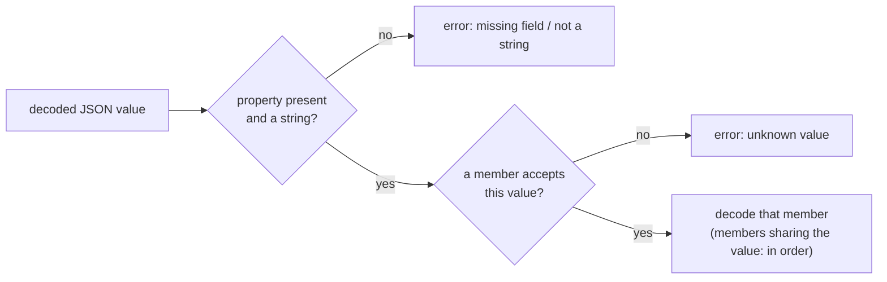
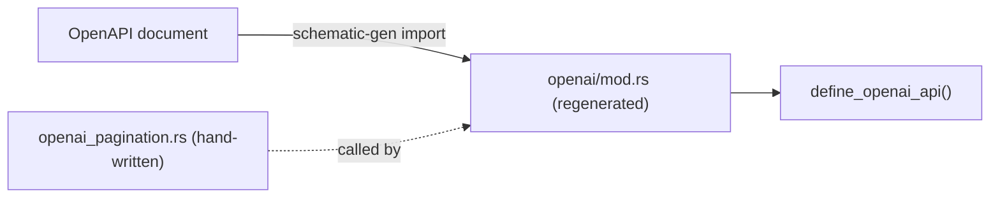

# Importing OpenAPI into Schematic

Import OpenAPI 3.0.x JSON or YAML into typed clients or a reusable definitions
module. The vendored OpenAI document uses this same import path; never edit its
emitted models or definition module manually.

```sh
schematic-gen import --input api.yaml --output generated/src
schematic-gen import --input api.yaml --api-name Items \
    --module-path items --definitions-out definitions/src/items
```

The library entry point is feature-gated by `schematic-define/openapi`:

```rust
use schematic_define::openapi::{OpenApiImport, OpenApiSource};

let result = OpenApiImport::new(OpenApiSource::path("api.yaml"))
    .api_name("Items")
    .module_path("items")
    .build()?;
let api = result.api;
let models = result.models;
```

Import reads the OpenAPI AST, resolves local references, extracts a `ModelCatalog`,
and lowers operations into definitions. Inspect the result's diagnostics for lossy
mappings. The generator emits models before clients. Definitions-module output
uses typed registration and fallible builders.

The imported `api` is ready to validate and export. It carries one schema
component per catalog model, in source order: the model's final name, its Rust
path, and the source schema. Endpoint bodies and responses name those
components, so `api.validate_references()` passes and
`schematic_define::openapi::export` accepts the API as it is.

```rust
let pet = result.api.component("Pet").unwrap();
assert_eq!(pet.rust_path.as_deref(), Some("items::Pet")); // `Pet` without module_path
```

- **Rust paths** are `{module_path}::{Name}`, or the bare name when no module
  path is set; the models are generated into that module.
- **Renamed models** keep their references consistent. A schema whose name an
  endpoint's request struct claims (`CreatePetRequest` for the `CreatePet`
  endpoint) becomes `CreatePetRequest2`; the component, endpoint references,
  and `$ref`s inside other components all use the new name.
- **A dangling reference fails the import.** If an operation's JSON request or
  response names a schema the document does not define, `build()` returns
  `OpenApiError::Definition(DefinitionError::UnresolvedReference { api,
  endpoint, name })` instead of an API that cannot be generated or exported.
- **A document without components** imports with no schema components; inline
  bodies are free-form JSON (`Primitive(Json)`), which needs none.

## Mapping rules

| OpenAPI input | Definition or generated model |
| --- | --- |
| info, servers, externalDocs | API name, description, base URL, docs URL; import options may override metadata |
| operationId or operation fallback | PascalCase endpoint id, de-conflicted as needed |
| path parameter | Path template placeholder |
| query, header, cookie | Parameter in the declared transport location, with its `required`, `style`, and `explode`; an absent `explode` takes OpenAPI's default, `true` for `form` style (query and cookie) and `false` otherwise |
| JSON body | Typed model or free-form JSON |
| multipart / URL-encoded body | Form fields, with file constraints where supported |
| text / binary body | Raw body with content type |
| responses | Every 2xx response becomes a success shape and every 400-599 response an endpoint error entry (see [Several success shapes and declared errors](#several-success-shapes-and-declared-errors)) |
| component / inline schemas | Named models or synthesized model names |
| oneOf / anyOf | Enum with one variant per member, selected by the `discriminator` when every member has a tag value, else untagged (first member that fits); unnamed members may remain free-form JSON (see [Unions and discriminators](#unions-and-discriminators)) |
| allOf | Merged schema/model according to import support |
| nullable | Optional Rust representation |
| bearer, basic, header/query/cookie API key | Existing auth strategy and environment mapping |

The importer does not implement OpenAPI 3.1. Full provider HTTP fidelity is
not established by a successful import; compile the generated crate and test
its wire behavior.

### Unions and discriminators

A component `oneOf` or `anyOf` becomes a Rust enum with one variant per
member. When the schema declares a `discriminator`, the importer works out
which values of that property select each member, and the generated enum
decodes by that value instead of trying members in order:

```yaml
Pet:
  oneOf:
    - $ref: "#/components/schemas/Cat"   # kind: {type: string, enum: [cat]}, required
    - $ref: "#/components/schemas/Dog"   # no `kind` property
  discriminator:
    propertyName: kind
```

```rust
let pet: Pet = serde_json::from_str(r#"{"kind":"Dog","bark":true}"#)?; // Pet::Dog
let err = serde_json::from_str::<Pet>(r#"{"kind":"lizard"}"#);         // Err: unknown `kind` value
```

A member's values come from the first of these that applies:

1. the `discriminator.mapping` keys that name it (`'#/components/schemas/Cat'`
   or `Cat`);
2. the string `enum` of the property, found on the member itself, through a
   `$ref`, in an `allOf` member, or across a nested union's own members (one
   value or several);
3. the member's component name, when it does not declare the property or
   declares it as an unrestricted string.



The decoded value is never handed to a member whose tag differs, and a
member that rejects its own tagged value is the error. Serialization is
unchanged: each member already writes its own property.

When some member has no value (it declares the property optional, the
property is not a string, its `enum` allows `null`, or an inline member
declares no `enum`), the enum stays untagged and the import reports a warning
at the union, for example:

```text
[WARN] #/components/schemas/InputItem - discriminator `type` has no value for `EasyInputMessage` (the property is optional); the union decodes as the first alternative that fits
```

A union without a `discriminator` keyword is always untagged, even when its
members happen to carry distinct values of a required property.

The enum's `Default` is its first member's `Default`, whose tag is empty, so
a defaulted discriminated enum does not decode again; it exists only so a
struct holding the enum can derive `Default`.

### Response checks

Before mapping, the importer rejects response members that the OpenAPI parser
would otherwise read loosely, naming the API, operation, and member:

- `responses`, `content`, a media entry's `schema`, and a `discriminator`
  that is `null` or not an object;
- a status key other than `default`, `100`-`599`, `1XX`-`5XX`, or an `x-`
  extension (`"600"`, `"abc"`), and two spellings of one status (`4XX`, `4xx`);
- a media key that is not `type/subtype` or a media range (`json`), and two
  spellings of one media type (`application/json`, `Application/JSON`);
- an empty or non-string `$ref`, an empty `oneOf` or one with a member that
  is not an object, and an empty or non-string `discriminator.propertyName`;
- exact duplicate keys anywhere, and trailing content after the document.

```text
Validation error at 'API Pets endpoint ListPets GET /pets responses':
Response key `abc` is not `default`, a status 100-599, or a class 1XX-5XX
```

### Several success shapes and declared errors

Every operation's responses are mapped to success shapes and endpoint error
entries by `openapi::classify_responses(api, endpoint, &operation.responses,
&resolver)`, which `build()` runs for each operation and which is public for
callers that classify one operation themselves.

| Response | Imports as |
| --- | --- |
| `text/event-stream` | SSE stream of the schema's component |
| `application/x-ndjson`, `application/jsonl` | NDJSON stream of the schema's component |
| `application/json`, `application/*+json` | JSON shape |
| other `text/*` | text shape with that content type |
| any other media type | binary shape with that content type |
| `*/*` | the fallback shape |
| several media types under one status | one shape each |
| JSON `oneOf` with a `discriminator`, or of one array and one object, inline or behind a schema `$ref` | one tagged JSON shape per member |
| 204 or no `content` | empty shape |
| `2XX` | shapes that declare no status, used for every 2xx status no exact key names |
| exact `400`-`599`, `4XX`, `5XX` | the endpoint's own error entries (never hoisted to the API) |

Media types are compared normalized (`Text/Event-Stream; charset=utf-8` is an
SSE stream). Identical shapes under several statuses import once; when the
statuses carry different shapes (apart from a body-less 204), each shape
declares the statuses it appears under. A stream's end condition cannot be
inferred from a media type, so it ends at connection close.

A `oneOf` is recognized wherever the media schema leads: written inline, or
reached through a `$ref` (or a chain of them) to `components.schemas`. Both
spellings below import as the same two shapes, `Directory` tagged
`type: "dir"` and `File` tagged `type: "file"`:

```yaml
# inline
schema:
  oneOf: [{ $ref: "#/components/schemas/Directory" }, { $ref: "#/components/schemas/File" }]
  discriminator: { propertyName: type, mapping: { dir: "#/components/schemas/Directory", file: "#/components/schemas/File" } }
# referenced: the same object moved to components.schemas.Reply
schema: { $ref: "#/components/schemas/Reply" }
```

A member's tag value is the one the component union's generated
`Deserialize` dispatches on (see [Unions and discriminators](#unions-and-discriminators)):
its `mapping` key, else the single value of the property's `enum`, else its
component name. Each member must be a component `$ref` with exactly one
value; a member with an optional or non-string property, or several `enum`
values, leaves the `oneOf` inseparable. Each separated shape is named after
its member's component, or `Array` / `Object` when the member has no name,
so the generated success enum has one variant per member.

When a referenced `oneOf` cannot be separated, the body keeps that one named
schema (the union's own enum, which still decodes every member) with a
warning. An unresolvable or cyclic reference also keeps its named schema.
An error status always holds one shape: a referenced union stays its named
schema there, with no warning.

Each of these imports with a warning naming the API, operation, and what was
lost, rather than being guessed:

- a `default`, 1xx, or 3xx response (not imported);
- a media range other than `*/*` (not imported);
- a `oneOf` neither a discriminator nor array/object separates (one
  `serde_json::Value` JSON shape when inline, or the referenced named
  schema);
- an inline separable `oneOf` on an error status (one `serde_json::Value`
  JSON shape);
- a JSON body or stream without a named schema (`serde_json::Value`);
- an error status whose media types need different shapes (the first is
  kept);
- an error body under `*/*` (not imported: an error entry needs a concrete
  media type).

Import reads only the standard `responses` map; it never reads
`x-schematic` back. A document that Schematic exported therefore imports with
these facts lost or approximated:

| Exported fact | After import |
| --- | --- |
| an SSE or NDJSON end condition (`[DONE]`, an event, a field) and `keep_end` | the stream ends at connection close, and nothing is kept |
| a byte stream | a binary shape |
| a shape's `variant` name | not read back; a separated `oneOf` member is named after its component (`Array` / `Object` when unnamed), any other shape by its kind |
| a shape's `note` | none; it survives only in the exported description |
| an API's default errors | one exact or class entry per exported status on each endpoint, never on the API |
| a class expanded because an exact entry supersedes part of it | one exact entry per status |

Keys, media types, and schemas survive, so exporting the imported definition
again gives the same `content` for every response.

An operation with no representable success is an import error for that
operation: it is left out with an `error` diagnostic naming the API and
operation (the import fails under `--strict`), and the other operations
still import.

## Importing into `schematic-definitions`

`schematic-gen import --definitions-out <dir>` writes a definitions-crate
module instead of a standalone client: `<dir>/types.rs` holds the models and
`<dir>/mod.rs` holds `define_{module}_api()`, which rebuilds the imported
`RestApi` as a value, plus the fallible `module_group()` it unwraps. The
imported API then joins the catalog and flows through `schematic-gen generate`
like a hand-written one.

```bash
schematic-gen import --input specs/openai/openapi.yaml --api-name OpenAI \
    --module-path openai --definitions-out definitions/src/openai
```

### Overlays: authored additions the import keeps

An OpenAPI document cannot express everything a definition carries;
pagination is the main example. Writing such additions into the imported
`mod.rs` does not work, because the next import overwrites it. Put them in a
hand-written overlay function instead and name it with `--overlay`:

```bash
schematic-gen import ... --definitions-out definitions/src/openai \
    --overlay crate::openai_pagination::apply
```

The overlay is a `fn(RestApi) -> RestApi` anywhere the module can reach by
that path. Besides adding facts, an overlay can narrow what the import
declares: the OpenAI overlay keeps every success shape and error entry only
for the endpoints it lists, and gives every other endpoint the one shape the
importer chose before it read several (the first JSON shape, else the first;
for a referenced union the importer now separates, the union itself, as for
`GetConversationItem` and `ConversationItem`) and no errors, so re-importing
never changes an unmigrated endpoint's generated types. The importer never reads or writes it; it only emits the call, so
the factory every client and exporter uses returns the augmented definition:

```rust
fn imported_api(ctx: &mut DefinitionContext) -> Result<RestApi, DefinitionError> {
    let endpoints = Vec::from([/* typed endpoint builders, each ending in build()? */]);
    let api = RestApi::builder(ctx, "OpenAI", "https://api.openai.com/v1")
        .describes("OpenAI API")
        .bearer_env(Vec::<String>::new())
        .endpoints(endpoints)
        .build()?;
    Ok(crate::openai_pagination::apply(api))
}
```

Generated `module_group()` registers models in source order and returns
`Result<Vec<RestApi>, DefinitionError>`. The API it builds carries every
registered model in `RestApi::schemas`, and its endpoints name those components.
The infallible catalog factory unwraps this checked assembly. Nominal models
implement `Registration` beside their declarations; aliases reuse their
underlying type, and containers, primitives, and free-form JSON remain inline
(free-form JSON is the reference `Primitive(Json)`).

Assembly orders components by registration, with each model's nested
definitions flattened directly after it, so its order can differ from the
library import's source order (Petstore: `Pet`, `PetStatus`,
`CreatePetRequest2` against `Pet`, `CreatePetRequest2`, `PetStatus`). Its
schemas are the generated models' JSON Schema rather than the source schemas.
Names and endpoint references are the same.

A standalone import (`--output`) keeps the library import's components but
spells each Rust path as the bare model name, because the standalone API module
glob-imports the generated `types` module.




Rules:

- The value must be a plain Rust path: `crate::openai_pagination::apply`,
  `super::apply`, and `apply` are accepted; an empty value, generic arguments
  (`crate::x::apply::<T>`), or anything that is not a path (`apply()`) is
  rejected before anything is written.
- `--overlay` requires `--definitions-out`; a standalone client has no
  definitions factory to call it from, so the combination is rejected.
- Without `--overlay` the fallible assembly returns the built API directly.
- The module docs' regeneration hint includes the `--overlay` argument, so the
  emitted file records how to reproduce it. `just import-openai` passes
  `--overlay crate::openai_pagination::apply`.

### Query expressions in imported paths

The shared importer normalizes query-bearing paths before source emission. A
path such as `/items?beta=true` becomes `/items` plus an optional Boolean `beta`
query parameter. Callers select it with `.beta(true)`; omitting it preserves the
ordinary URL. A supported placeholder such as `/files?ref={git_ref}` becomes a
caller query input with wire name `ref` and Rust name `git_ref`.

If an operation already exists on the same method and base path, normalization
keeps the ordinary operation ID and order and uses the suffixed operation's
request and response only after both flattened schemas pass the compatibility
gate. Malformed expressions, duplicate query keys, conflicting declarations,
unsupported placeholders, and imported GET request bodies produce contextual
errors. The seven OpenAI beta operations are exposed through their ordinary
twins; the vendored source remains unchanged.

The changed input boundary rejects explicit null or malformed paths and
parameter declarations. Omitted parameters mean no declarations; an empty
array explicitly declares none. JSON and YAML both reject duplicate authored
keys and trailing invalid content. Metadata-only foundation imports can be empty. The normal `schematic-gen import`
invocation rejects an API with no usable endpoints before writing output.
