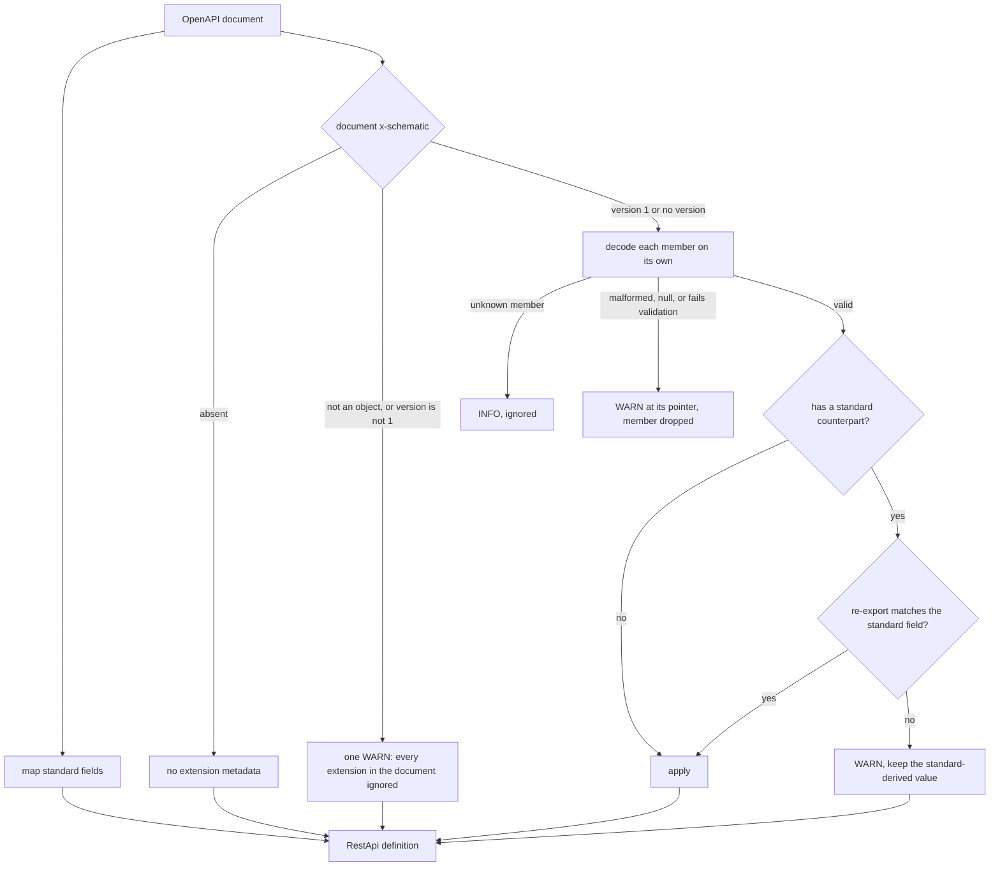

# OpenAPI Vendor Extensions (x-schematic)

This page describes the `x-schematic` vendor extensions Schematic writes when it
exports an API definition to OpenAPI 3.0.3, and how the importer reads them
back. Standard OpenAPI fields carry everything they can express; the extensions
carry the rest, so an exported document states the whole definition and
importing it restores that definition, apart from the
[facts listed below](#what-does-not-round-trip).

The extensions are always optional. A document without them imports from its
standard fields alone, and a document with them imports the same standard
fields plus the extra detail. Where an extension member and a standard field
describe the same thing, **the standard field wins**: the member adds detail,
it never overrides.

## Overview

Schematic writes one `x-schematic` object in two places:

| Extension | Level | Purpose |
|-----------|-------|---------|
| `x-schematic` | Document | The extension version and API-wide configuration: module path, headers, environment mapping, auth details, secret names, rate-limit and retry metadata, default error entries |
| `x-schematic` | Operation | Endpoint-specific metadata: form-body field details, success shapes, error entries, headers, an endpoint's own rate-limit, retry, cross-origin, and auth details, reserved-expansion paths, parameter details |

The extensions never repeat what a standard field already says: the auth
method, credential location and header or parameter name, scopes, deprecation,
and JSON, text, or binary request bodies stay in `securitySchemes`,
`security`, `deprecated`, and `requestBody`. They never hold a credential
either, only environment variable *names*.

## Versioning

The document-level `x-schematic` carries `version: 1`, the extension's major
version. Operation-level extensions never carry a version.

| Document `x-schematic` | What the importer does |
| --- | --- |
| `version: 1` | reads every extension in the document |
| no `version` member | reads it as version 1 (documents written before the member existed) |
| any other `version` (`2`, `"1"`, `1.0`, `null`, …), or `x-schematic` that is not an object | one WARN, then ignores **every** Schematic extension in the document, operations included |

```text
[WARN] #/x-schematic/version: unsupported `x-schematic` version 2 (this importer reads the integer major 1); every Schematic extension in the document is ignored
```

The document still imports from its standard fields.

## Document-Level Extension

Added at the OpenAPI document root alongside `openapi`, `info`, and `paths`.

```yaml
openapi: "3.0.3"
info:
  title: Gitea
  version: 1.0.0
x-schematic:
  version: 1
  module_path: gitea
  env_auth: ["GITEA_TOKEN"]
  auth:
    apiKeyAuth:
      value_prefix: "token "
  headers:
    - ["Accept", "application/json"]
security:
  - apiKeyAuth: []
```

### Fields

| Field | Type | Description |
|-------|------|-------------|
| `version` | `integer` | Always `1`. See [Versioning](#versioning). |
| `module_path` | `string?` | Override generated Rust module name. Used when multiple APIs share a definitions module. |
| `request_suffix` | `string?` | Custom suffix for generated request wrapper structs (default: "Request"). |
| `env_mapping` | `object?` | Environment variable configuration for authentication. See [Env Mapping](#env-mapping). |
| `env_auth` | `array<string>?` | The environment variable names a token or key credential is read from (Gitea: `["GITEA_TOKEN"]`). Absent when empty. |
| `headers` | `array<[string, string]>` | Default headers applied to all endpoints. |
| `auth` | `object?` | Auth details `securitySchemes` cannot express, keyed by scheme name. See [Auth details](#auth-details). |
| `rate_limit` | `object?` | The API's rate-limit headers. Absent when undeclared. See [Rate-Limit and Retry Metadata](#rate-limit-and-retry-metadata). |
| `retry_guidance` | `object?` | The API's retry guidance. Absent when undeclared. See [Rate-Limit and Retry Metadata](#rate-limit-and-retry-metadata). |
| `errors` | `array?` | The API's default error entries, as declared. Absent when there are none. See [Success Shapes and Error Entries](#success-shapes-and-error-entries). |
| `cross_origin` | `string \| object?` | The API's policy for redirects and next-page links that leave the base origin: `"AllowWithoutCredentials"`, `"DangerAllowAny"`, `"Deny"`, or `{"AllowOrigins": ["https://…"]}`. Absent for the default, `SameOrigin`. |
| `request_id_header` | `string?` | The response header that carries the provider's request id, for example GitHub's `x-github-request-id`. Absent when the provider is not known to send one. The importer lower-cases it. |
| `secret_names` | `array<string>?` | Extra header and query names whose values are never shown. Absent when empty. |

Deprecation and authentication are not repeated here: they are exported as the
standard OpenAPI `deprecated` flag and `security` / `securitySchemes` members.

### Env Mapping

The `env_mapping` object specifies how to resolve authentication credentials from environment variables:

```yaml
env_mapping:
  bearer_token:
    names: ["OPENAI_API_KEY", "OPENAI_TOKEN"]
  api_key:
    names: ["ANTHROPIC_API_KEY"]
    header: X-Api-Key
  basic_user:
    names: ["API_USER"]
  basic_pass:
    names: ["API_PASSWORD"]
```

| Field | Type | Description |
|-------|------|-------------|
| `bearer_token` | `{names: string[]}` | Env vars for Bearer token authentication |
| `api_key` | `{names: string[], header: string}` | Env vars and header name for API key auth |
| `basic_user` | `{names: string[]}` | Env vars for HTTP Basic auth username |
| `basic_pass` | `{names: string[]}` | Env vars for HTTP Basic auth password |
| `oauth_client_id`, `oauth_client_secret`, `oauth_redirect_uri` | `{names: string[]}` | Env vars for OAuth2 client credentials, omitted when unset |

The writer emits `null` for each of the first four members when it is unset
(`"basic_user": null`); the importer reads those nulls as "no mapping". A
mapping that names different variables than the API's authentication
declaration is a WARN and is not applied.

For Basic authentication the mapping is also where the username and password
variable lists come from on import, so `basic_user` and `basic_pass` restore
the API's `Basic` lists.

### Auth details

OpenAPI cannot say that an `apiKey` header carries a bearer token rather than
a raw key, nor that a key is sent with a prefix. Exactly these two details are
written, keyed by the name of a scheme in `components.securitySchemes`:

```yaml
components:
  securitySchemes:
    apiKeyAuth: { type: apiKey, in: header, name: Authorization }
    bearerAuth: { type: apiKey, in: header, name: X-Session-Token }
x-schematic:
  auth:
    apiKeyAuth: { value_prefix: "token " }   # sent as "Authorization: token <key>"
    bearerAuth: { bearer: true }             # a bearer token in X-Session-Token
```

- An entry holds either `bearer: true` or a string `value_prefix` (which may
  be `""`), never both, and nothing else. `bearer: false`, a `null`, or any
  other key rejects the whole `auth` member with a WARN.
- The header name stays in the scheme's standard `name`; the method, location,
  and scopes stay in the scheme. No credential is ever written.
- A detail applies only to an `apiKey` scheme in a header that the relevant
  `security` applies. A detail naming another kind of scheme, or a scheme no
  requirement applies, is a WARN and the standard scheme wins.
- Document-level details apply to the root `security`. An operation whose own
  `security` replaces the root's carries its own `auth` (see
  [Operation-Level Extension](#operation-level-extension)); document details
  never apply to it.

## Operation-Level Extension

Added at the operation level (inside GET, POST, etc.) to preserve endpoint-specific metadata.

```yaml
paths:
  /models:
    get:
      operationId: ListModels
      x-schematic:
        response:
          Json:
            Named: ListModelsResponse
```

### Fields

| Field | Type | Description |
|-------|------|-------------|
| `request` | `object?` | A form body's field details (multipart or URL-encoded). Absent for JSON, text, and binary bodies, which `requestBody` carries alone. See [Request Types](#request-types). |
| `response` | `object \| string` | The first success shape's kind, in the form below. Always written, for compatibility with earlier documents. See [Response Types](#response-types). |
| `headers` | `array<[string, string]>` | Endpoint-specific headers. |
| `rate_limit` | `object?` | The endpoint's own rate-limit headers, which replace the API's whole. Absent when the endpoint inherits the document's value. |
| `retry_guidance` | `object?` | The endpoint's own retry guidance, which replaces the API's whole. Absent when the endpoint inherits the document's value. |
| `success` | `array?` | Every success shape, present only when `response` cannot say it all: several shapes, a stream, or any content type, status, tag, fallback, note, or variant name. See [Success Shapes and Error Entries](#success-shapes-and-error-entries). |
| `errors` | `array?` | The endpoint's own error entries, which overlay the document's `errors`. Absent when there are none. |
| `no_declared_errors` | `bool?` | `true` when the endpoint opts out of the document's error entries. Absent when false. |
| `cross_origin` | `string \| object?` | The endpoint's own cross-origin policy, in the document-level form, which replaces the API's. Absent when the endpoint inherits it. |
| `auth` | `object?` | [Auth details](#auth-details) of the schemes this operation's own `security` names. |
| `env_mapping` | `object?` | The [environment mapping](#env-mapping) of an endpoint auth override. Written only when the operation's own `security` replaces the root's. |
| `path_template` | `string?` | The endpoint path with its reserved-expansion markers, written only when the path holds one. See [Parameter details and path templates](#parameter-details-and-path-templates). |
| `params` | `object?` | Secret markers and Rust names of parameters. See [Parameter details and path templates](#parameter-details-and-path-templates). |

### Rate-Limit and Retry Metadata

Both values are descriptive: they tell a reader which response headers
report the rate limit and how the provider says to retry, and nothing in
Schematic acts on them. Each appears in the document extension when the API
declares it, and in an operation extension only when that endpoint declares
its own value; an operation without one uses the document's. Neither is
written when undeclared, and [`skip_extensions()`](#skipping-extensions)
leaves both out with the rest of `x-schematic`.

```yaml
x-schematic:
  rate_limit:
    limit_header: x-ratelimit-limit
    remaining_header: x-ratelimit-remaining
    reset_header: x-ratelimit-reset
    reset_unit: epoch_seconds       # seconds | epoch_seconds | http_date
    retry_after_header: retry-after # optional
  retry_guidance:
    retry_on:                       # status codes and inclusive ranges
      - code: 429
      - range: { start: 500, end: 503 }
    honor_retry_after: true
    max_attempts: 4                 # including the first attempt
    backoff:                        # none | fixed | exponential
      fixed: { delay_ms: 750 }
```

`backoff` is the string `none`, `{fixed: {delay_ms}}`, or
`{exponential: {base_ms, cap_ms}}`. Every `retry_guidance` member is
required; only `retry_after_header` is optional in `rate_limit`. Neither
object accepts an unknown member. GitHub's document declares the
`rate_limit` above (without `retry_guidance`).

### Schema references

A JSON body or response stores a `TypeRef`, never a Rust path or a copy of the
schema. A reference is one or more component names plus wrapper shape:
`Named`, `Array`, `Optional`, `Map`, `KeyedMap` (a map whose Rust key type is
not `String`), or `Primitive` for an inline type such as `String`, `U32`, or
free-form `Json`. Each name resolves through the API's `schemas`, which also
supply the Rust path and become `components.schemas`:

```yaml
x-schematic:
  response:
    Json:
      Array:
        Named: Item            # resolves to components.schemas.Item
```

```yaml
# The matching entry in the definition's `schemas` (RestApi::schemas)
schemas:
  - name: Item
    rust_path: ::my_definitions::models::Item
    schema: { type: object, properties: { id: { type: string } } }
```

Generated Rust spells this response `Vec<::my_definitions::models::Item>`; the
OpenAPI response schema is an array of `$ref: '#/components/schemas/Item'`.
`Schema { type_name, module_path }` remains only for WebSocket messages.

This is transfer data, not an authoring constructor. Build with the typed JSON
methods; a deserialized definition is checked with `RestApi::validate_references`
before use. The endpoint OAuth scope field is removed; API authentication policy
remains supported.

### Request Types

Only a form body writes `request`, because the standard schema of a form
cannot hold every field detail. JSON, text, and binary bodies are carried by
`requestBody` alone.

```yaml
# Multipart form data
request:
  FormData:
    fields:
      - name: document
        kind:
          File:
            accept: ["application/pdf", "image/*"]
        required: true
        description: The file to upload
      - name: samples
        kind:
          Files:
            accept: []
            min: null          # the writer emits null for unset counts
            max: 5
        required: true
        description: null      # and for an unset description
      - name: metadata
        kind:
          Json:
            Named: FileMetadata
        required: false
        description: null

# URL-encoded form
request:
  UrlEncoded:
    fields:
      - name: username
        kind: Text
        required: true
        description: null
```

On import the standard schema decides the field set, `required`, and each
description. The extension only fills what the standard form left unsaid: a
file part's `accept` when its `encoding` has no `contentType`, a `Files`
part's `min`/`max` when the items have no `minItems`/`maxItems`, and a JSON
part's component reference when the standard part is untyped. Any
disagreement is a WARN and the standard value is kept.

A document written before forms were the only `request` may still hold a
`Json`, `Text`, or `Binary` request. The importer re-exports it and compares
it with the standard `requestBody`: a match is silent, a mismatch is a WARN,
and the standard body is used either way.

### Response Types

```yaml
# JSON response
response:
  Json:
    Named: MessageResponse

# JSON array of a component
response:
  Json:
    Array:
      Named: Model

# Free-form JSON
response:
  Json:
    Primitive: Json

# Binary response (audio, images)
response: Binary

# Plain text response
response: Text

# No content (204)
response: Empty
```

### Success Shapes and Error Entries

The standard `responses` map carries each shape's status, media type, and
schema (see [Exporting OpenAPI](export-openapi.md#responses)). What it cannot
carry, such as a stream's end condition or the JSON tag that tells two shapes
apart, is written here in the definition's own serialized form, so the
document records every fact of the definition. An endpoint with a single plain shape writes no `success` member, which
keeps existing documents unchanged.

```yaml
x-schematic:
  response: Empty
  success:
    - shape:
        Json:
          Named: Message
      note: returned when `stream` is false
    - shape:
        Stream:
          framing:
            Sse:
              Named: Event
          end:
            EventNamed: message_stop
      note: returned when `stream` is true
    - shape: Binary
      fallback: true
  errors:
    - status:
        Exact: 404
      shape: Empty
  no_declared_errors: false   # omitted when false
```

The error entries are the declared levels (document defaults, then the
endpoint's overlay or opt-out), not the resolved table: the `responses` map
already shows the resolved table.

On import these members restore stream end conditions, byte streams, variant
names, notes, and the document's default errors, but only after the
importer has checked them against the standard `responses` (see
[Standard fields win](#standard-fields-win)). When `success` is present it
wins over `response`, which only ever summarized the first shape.

### Parameter details and path templates

Two operation members carry what a standard parameter cannot.

`params` marks secret parameters and records a generated Rust field name that
differs from the wire name, keyed by location (`query`, `header`, `cookie`,
`path`) and then wire name. Only parameters with a detail are listed:

```yaml
x-schematic:
  params:
    query:
      api-key: { secret: true }
      type: { rust_name: kind }
```

Each entry must name a standard parameter at that location (header names
compare case-insensitively); otherwise it is a WARN and ignored. A `path`
entry may name a plain-string path parameter the standard parameters left
undeclared, and the importer then declares the endpoint's path parameters so
the detail has somewhere to live.

`path_template` keeps reserved-expansion markers (`{+name}`), which an OpenAPI
path key cannot hold. It is written only when the endpoint path has one:

```yaml
/models/{repo_id}/blob/{revision}/{path}:
  get:
    x-schematic:
      path_template: /models/{+repo_id}/blob/{revision}/{+path}
```

The importer applies it only when removing its markers gives the path key
exactly; otherwise it is a WARN and the path key wins. Hugging Face's
document carries sixteen of these.

## Reading extensions back

[OpenAPI import](import-openapi.md) reads the standard fields first, then
decodes the extensions and reconciles them with what it read:



### Decoding rules

Each member, at both levels, is decoded and validated on its own, so one bad
member never discards its siblings:

- **Unknown member:** INFO, ignored. Inside `rate_limit`, `retry_guidance`,
  and an `auth` entry an unknown key is a WARN instead, because those objects
  allow no extra fields.
- **Malformed member:** the wrong type, a bad element, or a value that fails
  the same checks API build runs (a header name, a Rust identifier, an origin,
  a rate-limit header, a retry status, an error status outside 400–599, a
  stream shape on an error entry, a second fallback shape, …). One WARN at
  the member's RFC 6901 pointer, and the member is dropped.
- **Explicit `null`:** a WARN like any malformed value, except where the
  writer itself writes `null`: the four legacy `env_mapping` members, and a
  form field's `description` and `Files` `min`/`max`. There `null` means none.
- **An empty value** is legal where it means something (`{}` for `auth` or
  `env_mapping`, `[]` for `secret_names`, `""` for a `value_prefix`) and a
  WARN where it does not (`""` for `module_path`, `[]` for `success`).

Pointers name the member, with `#/x-schematic/<member>…` at the document level
and `#/paths/<escaped path>/<method>/x-schematic/<member>…` on an operation,
escaping `/` as `~1` and `~` as `~0`:

```yaml
x-schematic:
  version: 1
  module_path: items
  retry_guidance:
    retry_on: [{ code: 429 }]
    honor_retry_after: true
    max_attempts: 0          # invalid
    backoff: none
```

```text
[WARN] #/x-schematic/retry_guidance: malformed `x-schematic.retry_guidance`: `max_attempts` must be at least 1, got 0; the member is ignored
```

`module_path` still applies; the API simply has no retry guidance.

### Standard fields win

Where a member and a standard field describe the same thing, the importer
re-exports the member and compares the result with the standard field. A match
applies the member's extra detail; a mismatch keeps the standard-derived value
and reports a WARN at the member.

| Member | Compared with | On a match |
| --- | --- | --- |
| `success`, or `response` when there is no `success` | the operation's 2xx `responses` (descriptions ignored) | the declared shapes, with end conditions, variants, notes, and fallback |
| `errors`, `no_declared_errors`, and the document's `errors` | the operation's 4xx/5xx `responses` | the declared levels instead of one entry per exported status |
| `request` (form) | the standard form schema and `encoding` | fills `accept`, file counts, and JSON part references |
| `request` (legacy JSON, text, binary) | `requestBody.content` | nothing to add; a mismatch is still reported |
| `auth` | the applied `security` and its schemes | a bearer header override or a key prefix |
| `path_template` | the path key | the path with its `{+name}` markers |
| `params` | the standard parameters | secret markers and Rust names |
| `headers` | single-value `enum` header parameters | the fixed header, and the parameter is not imported |

For example, an operation whose standard responses say `404` returns nothing
while its extension declares a `Problem` body:

```yaml
responses:
  "404": { description: Not found }
x-schematic:
  response: Empty
  errors:
    - { status: { Exact: 404 }, shape: { Json: { Named: Problem } } }
```

```text
[WARN] #/paths/~1items/get/x-schematic/errors: the declared error table disagrees with the operation's standard error responses; the standard responses win
```

The endpoint gets an empty `404` entry, as the standard response says.

A disagreeing legacy `response` is not reported: it never said more than the
first shape. When the document's `errors` are what disagrees (the statuses
that differ come only from the document defaults), the importer withdraws the
document's `errors` as a whole with one WARN at `#/x-schematic/errors`, and
every operation that inherited them keeps the error table its standard
responses give.

Fixed headers are exported as required header parameters whose schema is a
single-value `enum` (see
[Fixed headers](export-openapi.md#fixed-headers)). On import such a parameter,
matching an effective fixed header from `headers` (endpoint over API,
case-insensitive), is recognized as that header and not imported again as a
parameter.

### Authentication

Authentication comes from the standard fields; the extension only adds the
[auth details](#auth-details).

| Standard input | Imported as |
| --- | --- |
| root `security` with no requirement | no authentication |
| root `security` with one requirement | that method as the API's `AuthStrategy` |
| root `security` with several requirements | an `AuthPolicy` accepting each method, its environment fallback the first method the environment can supply |
| no root `security` | the first supported scheme in `components.securitySchemes` (documents written before root `security` was exported) |
| operation `security` absent | inherits the API's |
| operation `security: []` | public |
| operation `security` equal to the root's, with no operation `auth` or `env_mapping` | inherits the API's |
| any other operation `security` | an endpoint auth override, with the operation's `auth` details and `env_mapping` |

An operation `auth` or `env_mapping` on an operation that does not replace
the root's `security` is a WARN and ignored. A requirement naming several
schemes at once cannot be represented and is a WARN; a requirement naming an
undeclared scheme is an ERROR.

### Command-line overrides

`schematic-gen import --module-path` and `--request-id-header` replace the
extension's `module_path` and `request_id_header` when given; without them the
extension's values apply.

### Strict import

A WARN fails a strict import (`--strict`, `OpenApiImport::strict()`), so a
document whose extension members disagree with its standard fields, or are
malformed, does not import strictly. INFO, such as an unknown member, never
fails it. Every committed artifact under `schematic/openapi/` imports strictly.

## What round-trips

Exporting a definition and importing the document restores every member on
this page, every standard field, and the definition's components (names and
schemas). A test exports each shipped definition, imports the committed
artifact, exports again, and compares both the documents and the definitions.

### What does not round-trip

- **Pagination:** an API's default pagination, an endpoint's pagination, and a
  parameter's `pager_managed` flag. Re-add them with an
  [import overlay](import-openapi.md#overlays-authored-additions-the-import-keeps).
- **GraphQL** operations, which are not exported.
- **Component Rust paths.** The importer rebuilds each as
  `{module_path}::{Name}`, or the bare name without a module path.
- **The split of a hand-written auth policy** into explicit methods and an
  environment fallback. The import accepts every exported method explicitly
  and falls back to the first one the environment can supply.
- **OAuth2 details beyond the standard flows:** a revocation URL, PKCE, the
  client authentication method, and a device-code grant.
- **Grouped documents** (several APIs sharing a module): only the first API's
  metadata applies, `info.title` is the module name rather than an API name,
  and the document imports as one API. The importer reports the generator's
  `x-schematic-grouped-from` member as INFO.
- **A declared, undescribed, plain-string path parameter.** It exports exactly
  like an undeclared placeholder, so it imports as one, unless `params` names
  it.

## Complete Example

```yaml
openapi: "3.0.3"
info:
  title: OpenAI
  description: OpenAI REST API for model management
  version: 1.0.0
servers:
  - url: https://api.openai.com/v1
    description: OpenAI API Server
externalDocs:
  url: https://platform.openai.com/docs/api-reference
  description: API Documentation
x-schematic:
  version: 1
  env_mapping:
    bearer_token:
      names: ["OPENAI_API_KEY"]
    basic_user: null
    basic_pass: null
    api_key: null
security:
  - bearerAuth: []
paths:
  /models:
    get:
      operationId: ListModels
      summary: Lists the currently available models
      description: Lists the currently available models
      x-schematic:
        response:
          Json:
            Named: ListModelsResponse
      responses:
        "200":
          description: Successful JSON response
          content:
            application/json:
              schema:
                $ref: '#/components/schemas/ListModelsResponse'
  /models/{model}:
    get:
      operationId: RetrieveModel
      summary: Retrieves a model instance
      description: Retrieves a model instance
      x-schematic:
        response:
          Json:
            Named: Model
      responses:
        "200":
          description: Successful JSON response
          content:
            application/json:
              schema:
                $ref: '#/components/schemas/Model'
    parameters:
      - name: model
        in: path
        required: true
        schema:
          type: string
    delete:
      operationId: DeleteModel
      summary: Delete a fine-tuned model
      description: Delete a fine-tuned model
      x-schematic:
        response:
          Json:
            Named: DeleteModelResponse
      responses:
        "200":
          description: Successful JSON response
          content:
            application/json:
              schema:
                $ref: '#/components/schemas/DeleteModelResponse'
components:
  securitySchemes:
    bearerAuth:
      type: http
      scheme: bearer
      bearerFormat: JWT
      description: Bearer token authentication
  schemas:
    Model:
      type: object
      description: An OpenAI model object.
      properties:
        id:
          type: string
        object:
          type: string
        created:
          type: integer
        owned_by:
          type: string
      required:
        - id
        - object
        - created
        - owned_by
    ListModelsResponse:
      type: object
      description: Response from the List Models endpoint.
      properties:
        object:
          type: string
        data:
          type: array
          items:
            $ref: '#/components/schemas/Model'
      required:
        - object
        - data
    DeleteModelResponse:
      type: object
      description: Response from the Delete Model endpoint.
      properties:
        id:
          type: string
        object:
          type: string
        deleted:
          type: boolean
      required:
        - id
        - object
        - deleted
```

## Skipping Extensions

To generate OpenAPI documents without vendor extensions (for maximum compatibility with third-party tools), use the `skip_extensions()` option:

```rust
use schematic_define::openapi::{export, ExportOptions};

let options = ExportOptions::new().skip_extensions();
let doc = export(&api, &options)?;
```

Such a document imports from its standard fields alone, losing what only the
extensions carry.

Or via CLI:

```bash
# Note: --skip-extensions flag not yet implemented in CLI
# Extensions are included by default
schematic-gen generate --api openai --openapi-out ./openapi
```

## Compatibility

These extensions are designed to be safely ignored by tools that don't understand them. Standard OpenAPI 3.0.3 parsers will process the core specification correctly while skipping `x-schematic` fields.

The extensions follow OpenAPI's vendor extension naming convention (prefix with `x-`) and use standard JSON types for all values.
