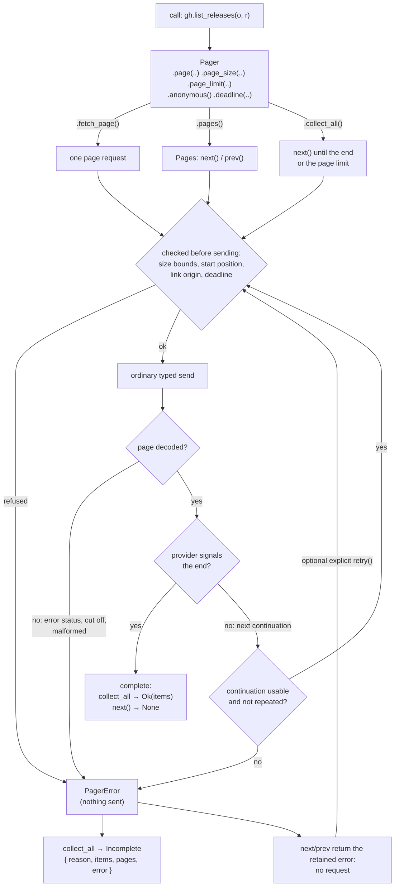
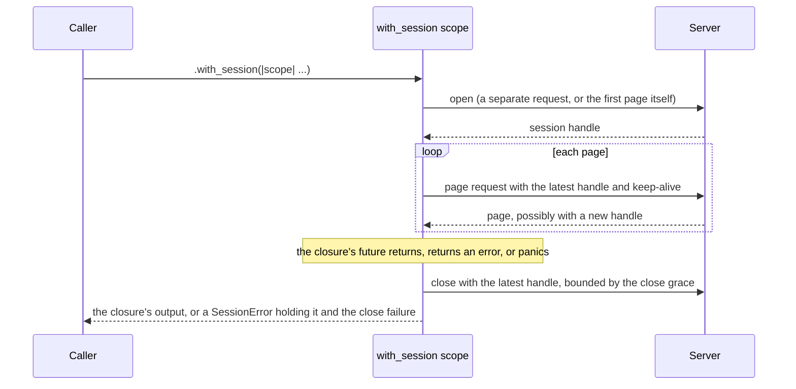
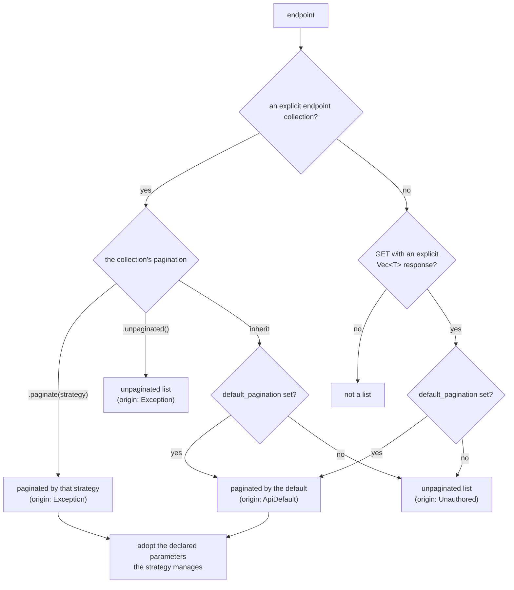
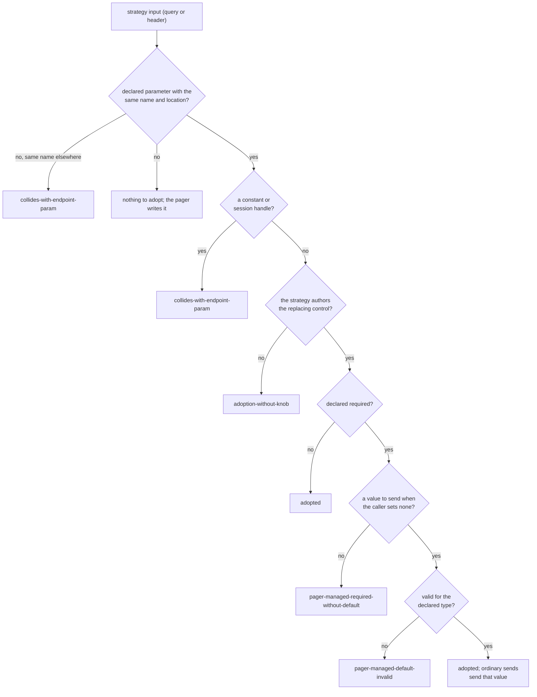

# Pagination

A list endpoint that a definition paginates gets a **pager** in its generated
client. You can:

- collect every item of a list with one call, and get `Ok` only when the
  provider has said the list is complete;
- walk a list page by page, forward and (where the provider supports it)
  backward, reading each page's items, total, and response metadata;
- fetch exactly one page with a chosen start position and page size;
- resume from a cursor kept from an earlier traversal;
- iterate a server-side session (a scroll or point in time) that is closed
  for you when you are done, and split it into partitions you poll yourself;
- rely on the compiler to reject a control the endpoint does not have.

As a definition author, you describe pagination **once per API**: a default
strategy that list endpoints inherit, and a table of exceptions.

```rust
use schematic_schema::github::GitHub;

let gh = GitHub::new();

// Every release, or Err(Incomplete) with the reason and the items gathered so far
let releases = gh.list_releases("rust-lang", "rust").page_size(100).collect_all().await?;

// Page by page
let mut pages = gh.list_releases("rust-lang", "rust").pages();
while let Some(page) = pages.next().await? {
    println!("page {}: {} releases", page.number, page.items.len());
}

// Exactly one request: page 3, ten items
let page = gh.list_releases("rust-lang", "rust").page(3).page_size(10).fetch_page().await?;
```

The paging itself lives in `schematic_runtime::pager`; the generator only
describes each endpoint's strategy. The rest of this page covers the caller's
side first, then how a definition authors pagination, then which shipped
APIs are paginated.

## Paging a list

### The three ways to read a list

A paginated call keeps all its ordinary behavior: awaiting it sends one
request and returns the endpoint's own response type, as described in
[Calling an API](./runtime/calling-an-api.md). In addition, it has three
entry points:

| Entry point | Sends | Returns |
| --- | --- | --- |
| `.collect_all()` | pages until the provider signals the end, or the page limit | `Result<Vec<Item>, Incomplete<Item, E>>` |
| `.pages()` | nothing until `next()`; then one request per `next()` or `prev()` | `Pages`, an iterator of `Page<Item>` |
| `.fetch_page()` | exactly one request, following no continuation | `Result<Page<Item>, PagerError<E>>` |

`Page<Item>` has `items` (in document order), `total` (when the strategy
authors one), `number` (the page's position in this traversal, from 1), and
`meta` (the response's status, headers, and request id). The same number is
in the request metadata's `page` field
([Metadata and redaction](./runtime/metadata-and-redaction.md)).

`Pages` also reports `pages_fetched()`, `items_delivered()`, and
`is_finished()`, and `pages.items()` turns it into an iterator of single
items that reads each page once:

```rust
let mut tags = bitbucket.list_tags("team", "widgets").pages().items();
while let Some(tag) = tags.next().await? {
    println!("{:?}", tag.name);
}
```

### Configuring a pager

A control such as `.page_size(..)` returns a `Pager`, the traversal's
configuration. Chain the endpoint's own setters first, then the controls,
then the entry point. `.pager()` gives a `Pager` with no control set.

```rust
let runs = gh.list_workflow_runs("o", "r")
    .page_size(50)          // the size the definition authors (`per_page`, 1..=100)
    .page_limit(10)         // at most 10 page requests for collect_all
    .anonymous()            // per-call settings work on the pager too
    .collect_all()
    .await?;
```

`Pager` keeps the call's request and its per-call settings
(`.anonymous()`, `.credential(..)`, `.deadline(..)`), and offers the same
three methods so they can come before or after a control. Every page
request is an ordinary typed send of the endpoint: the client's credentials,
origin policy, redirects, per-request timeout, global JSON hook, and
redaction all apply, and the runtime never retries a page.

| Control | On | Effect |
| --- | --- | --- |
| `.page(n)` | page-number lists | starts at page `n`, in the strategy's own index base (0 or 1) |
| `.offset(n)` | offset lists | starts at item offset `n` |
| `.after(cursor)` | resumable cursor lists | starts forward from a cursor kept from an earlier traversal |
| `.before(cursor)` | resumable cursor lists with a backward leg | starts backward from a cursor |
| `.page_size(n)` | lists with an authored size | requests `n` items per page |
| `.page_limit(n)` | every pager, after a control or `.pager()` | bounds `collect_all` to `n` page requests (default 100) |
| `pages.prev()` | lists with a backward direction | the page before the earliest page seen |
| `pages.total()` / `page.total` | lists with an authored total | the latest total the provider reported |
| `pages.set_page_size(n)` | lists with an adjustable size | changes the size from the next request on |
| `.keep_alive(..)`, `.close_grace(..)`, `.with_session(..)` | session lists | see [Sessions](#sessions) |
| `.partitioned(n)` | partitioned lists | see [Partitions](#partitions) |

A cursor is a `String`. A composite cursor, whose continuation has several
parts, is a tuple of up to four `String`s.

### Moving from one-page calls to `fetch_page`

A parameter that the pagination strategy manages is no longer a request
field or a call setter (see [Adopted parameters](#adopted-parameters)).
Code that set one to shape a single request now asks the pager for one
page. `sniff`'s `list_workflow_runs`, which reads the most recent workflow
runs of a repository, changed like this:

```rust
// Before: `per_page` was a setter, and the reply was the endpoint's wrapper type
let call = client.list_workflow_runs(owner, repo).per_page(limit as i64);
let response = call.clone().await?;                  // WorkflowRunsResponse
let runs = response.workflow_runs;

// After: the size is a pager control; one request returns a Page
let call = client.list_workflow_runs(owner, repo);
let page_size = u32::try_from(limit.clamp(1, 100)).unwrap_or(100);
let page = call.clone().page_size(page_size).fetch_page().await?; // Page<WorkflowRun>
let runs = page.items;
```

Three things change for such a caller:

- **The result is a `Page<Item>`,** not the endpoint's response type. The
  wrapper's items are `page.items`; its total, when the definition authors
  one, is `page.total`; the reply's metadata is `page.meta`.
- **The error is a `PagerError`,** whose `Transport` and `Api { error, meta }`
  variants carry the same evidence as `CallError`'s. Single-page calls can be
  repeated explicitly; a retained traversal also offers `pages.retry().await`.
- **A size outside the authored bounds is refused before sending.**
  Previously an out-of-range `per_page` went to the provider unchecked; now
  `page_size(0)` or `page_size(101)` on GitHub fails without a request. Clamp
  a caller-supplied size into the bounds, as `sniff` does.

`fetch_page` sends exactly one request even when the page says more follows.

### Only authored controls compile

Each control is bounded by a capability trait that the generator implements
only when the definition authors that control. Calling a control the
endpoint does not have is a compile error that names what is missing:

| Control | Capability | Message when missing |
| --- | --- | --- |
| `client.send(request).pager()` on an unpaginated endpoint (its call type has no `pager()` at all) | `Paginated` | "is not paginated" |
| `.page(n)` | `StartPage` | "is not paginated by page number" |
| `.offset(n)` | `StartOffset` | "is not paginated by offset" |
| `.after(cursor)` | `ResumeAfter` | "has no resumable cursor" |
| `.before(cursor)` | `ResumeBefore` | "has no resumable backward cursor" |
| `.page_size(n)` | `PageSizeKnob` | "has no authored page size" |
| `pages.set_page_size(n)` | `AdjustablePageSize` | "has no adjustable page size" |
| `pages.prev()` | `HasPrev` | "has no backward direction" |
| `pages.total()` | `HasTotal` | "has no authored total" |
| `.partitioned(n)` | `Partitioned` | "has no partitions" |
| `.pages()`, `.fetch_page()`, `.collect_all()` | `Sessionless` | "pages only inside its session scope" |
| `.with_session(..)`, `.close_grace(..)` | `Sessioned` | "has no server-side session" |
| `.keep_alive(..)` | `KeepAliveKnob` | "has no adjustable keep-alive" |
| `scope.renew()`, `pages.renew()` | `Renewable` | "has no session renew step" |

OpenAI's `ListBatches` pages by cursor, so asking it for a page number
fails:

```text
error[E0277]: `ListBatchesRequest` is not paginated by page number
  |
  |     let _ = client.list_batches().pager().page(2);
  |                                           ^^^^ `.page(n)` exists only for page-number strategies
  |
  = help: the trait `StartPage` is not implemented for `ListBatchesRequest`
  = note: the definition authors a different pagination strategy for `ListBatchesRequest`
```

On the call type itself the control is simply absent, so
`client.list_batches().page(2)` is `E0599` (no method named `page`). The same
applies to a removed field: `list_releases(..).per_page(5)` and
`ListReleasesRequest { per_page: .. }` do not compile. Controls exist only on
`Pager`, before iteration; `Pages` has no configuration method, so a control
called after `.pages()` does not compile either.

## The pager lifecycle



## A complete list or an honest failure

`collect_all` returns `Ok` **only after the provider signaled the end of the
list**. Every other stop is `Err(Incomplete)`, never a partial list
presented as complete:

```rust
use schematic_schema::schematic_runtime::pager::IncompleteReason;

match gh.list_releases("o", "r").pager().page_limit(5).collect_all().await {
    Ok(releases) => println!("all {} releases", releases.len()),
    Err(incomplete) => {
        // incomplete.items: every item of every page that decoded
        // incomplete.pages: page requests attempted, including the one that failed
        // incomplete.error: the PagerError; None for PageLimitReached
        eprintln!("{incomplete}"); // safe to log
        if incomplete.reason == IncompleteReason::PageLimitReached { /* raise the limit? */ }
    }
}
```

| `IncompleteReason` | When |
| --- | --- |
| `PageLimitReached` | the page limit was reached before the provider signaled the end |
| `RepeatedContinuation` | a continuation came back that this traversal already sent, a page made no progress, or an empty page claimed more |
| `HttpError` | a page's response is an error status, was cut off, was refused at a redirect, failed a hook, or is malformed |
| `DeadlineExceeded` | the shared deadline expired before a page's response head |
| `CrossOriginRejected` | a next link points to an origin the endpoint's effective policy refuses |
| `InvalidContinuation` | a continuation, end signal, or total was missing where required, or unusable |
| `InvalidArgument` | a page size, start position, or page limit was refused before sending |
| `TransportError` | any other failure before a response arrived, including a failed redirect hop |

### How the end is detected

An explicit signal decides when the response carries it; otherwise the
pager falls back to the shape of the page:

| Authored signal (`MoreSignal`) | More follows while | When the signal is absent |
| --- | --- | --- |
| `has_more("has_more")` | the body flag is `true` | as if no signal was authored |
| `is_last("done")` | the body flag is `false` | as if no signal was authored |
| `header_present("X-Next-Page")` | the header is present and non-empty | the list ends |
| `link_rel("next")` | a `Link` header has `rel="next"` | the list ends |
| `total_items(..)`, `total_pages(..)` | the pages so far cover less than the total | as if no signal was authored |
| `NonEmptyPage` | a page has items | |
| `FullPage` | a page is full at the effective size (the caller's, else `sent_default`) | a non-empty page |

Without a signal, a cursor list ends when the reply carries no cursor (a
missing, `null`, or empty value; `0` and `false` are cursor values, not
ends), a next-link list ends when there is no next link, and a page-number
or offset list ends on an empty page. A flag of the wrong type is
`InvalidContinuation`, never completion, and an empty page-number or offset
page whose signal says more is `EmptyPageClaimsMore` (which `collect_all`
reports as `RepeatedContinuation`).

### Rules every traversal follows

- **The page limit** defaults to `DEFAULT_PAGE_LIMIT` (100) and is set with
  `.page_limit(n)`. It counts page requests, including empty and failed
  ones. The last permitted page still completes the list when it shows the
  end. A limit of `0` is `InvalidArgument` with nothing sent.
- **Loops are detected exactly.** Every continuation sent in one direction
  is remembered, including the caller's starting cursor; any value that comes
  back is `RepeatedContinuation`. Links are compared by their resolved URL.
  Stepping backward and then forward again is not a loop: accepting a page in
  one direction clears the other direction's history.
- **The start page is always sent.** A page-number traversal sends its first
  page explicitly (`page=1` on GitHub) even when the caller set no `.page(..)`.
- **Sizes follow the definition.** A size the caller sets is sent on every
  request. An unset size is omitted, unless the definition authors a
  `sent_default`, which is then sent. A `server_default` only documents the
  provider's own default and is never sent.
- **Next links are sent as the provider wrote them,** with GET. A relative
  link resolves against the URL of the response that carried it, after any
  redirect. The pager does not re-add the page size to a followed link unless
  the caller changed the size during the traversal. When it does add a value
  to a link (a changed size or a carried query parameter), it replaces only
  the pairs of that name: the link's other pairs are kept byte for byte, and
  the added value is encoded as every declared query value is (a space is
  `%20`). A response that names two different next links is
  `InvalidContinuation`.
- **Next links obey the API's cross-origin policy.** Each link is checked
  with the listing endpoint's policy before it is requested, and a refused
  link reaches no server; see
  [Origins and redirects](./runtime/origins-and-redirects.md).
- **A page whose continuation is bad is still delivered.** When a page
  decodes but its continuation is missing, unusable, or repeated, its items
  are returned (and kept by `collect_all`); the failure is returned by the
  next request, before anything is sent. A page whose collection or items do
  not decode contributes no items.
- **Failure evidence stays available.** After any error, further `next()`
  and `prev()` calls return that specific error with the same details without
  sending. An explicit `retry().await` is always available, regardless of the
  error category; each failed retry replaces the retained error with its own
  complete evidence. Retry is optional and never automatic.
- **One deadline covers the traversal.** A `.deadline(&deadline)` on the call
  or the pager bounds every page request; see
  [Deadlines and timeouts](./runtime/deadlines-and-timeouts.md).
- **The global JSON hook runs on every page,** before items and continuations
  are read; an endpoint's typed mutator does not. This applies to `.pages()`,
  `.fetch_page()`, and `.collect_all()`, including session pages. Ordinary
  endpoint sends still run both hooks; see
  [Response hooks](./runtime/hooks.md).

### Bounds are checked before sending

A page size outside the authored `min..=max`, a start page or offset below
the strategy's index base, and an arithmetic overflow of the next position
are refused before the request that would carry them. The refusal is a
`PagerError::Transport` whose `TransportError` has kind `InvalidArgument`
and the request metadata; nothing is sent:

```rust
let refused = gh.list_releases("o", "r").page_size(101).fetch_page().await;
// Err(PagerError::Transport(error)) with error.kind = InvalidArgument; no request left the client
```

`collect_all` reports the same refusal as `IncompleteReason::InvalidArgument`
with `pages` counting the refused request.

### Explicit recovery of a traversal

Use a retained traversal when you need to decide whether to retry:

```rust
let mut pages = client.list_files().pages();
if let Err(error) = pages.next().await {
    report(&error);
    pages.retry().await?; // optional; immediately attempts the failed position
}
let recovered = pages.next().await?; // the recovered page is delivered once
```

`retry()` returns `Result<(), PagerError<_>>` and sends nothing when no failure
is retained. On success, the next iteration call yields the recovered page.
Earlier pages, their delivered-item identities, and the failed page's number
are preserved; `pages_fetched()` counts every attempted request, including
retries. `items_delivered()` excludes a recovered page until iteration yields
it; on `Items`, it counts each item only when `next()` returns it.
`Items::retry()` offers the same recovery for item iteration.

When a page's items were already delivered but its continuation failed,
retry refreshes that source page to recover continuation evidence and discards
its replayed items. The next iteration continues from the repaired continuation;
no item from that source page is delivered again. If the refreshed continuation
is still unusable or loops, retry returns the new specific error and metadata.
This refresh also applies after loop detection; it does not erase loop history.

Retries retain credentials, origin policy, partition, direction, and deadline.
They cannot guarantee recovery: an expired deadline remains expired, an invalid
argument remains invalid unless an available setter corrects it, and a refused
origin remains refused. The caller can still retry every such error and inspect
the new attempt's evidence. `collect_all()` and `fetch_page()` consume their
traversal and return its error; use `.pages()` or `.items()` to retain a position
for recovery. Renew failures are ordinary independent calls and may be retried
by calling `renew()` again; cleanup still makes one bounded close attempt.

The `Api` variant shares its `ApiError` through `Arc`, retaining decoded provider
errors and exact raw response bytes without requiring the provider error to
implement `Clone`. Paginated endpoint failure types must implement `Sync`, so
shared evidence can cross tasks; ordinary endpoint failure types still require
only `Send`.

## Errors and the evidence they keep

| `PagerError` variant | When | Keeps |
| --- | --- | --- |
| `Transport(TransportError)` | no response head arrived: a refused argument, a refused cross-origin link, a connection failure | the transport error and its request metadata |
| `Api { error, meta }` | a response arrived but is an error status, was cut off, is not JSON, or does not hold decodable items | the `ApiError` (kind and raw body) and the `ResponseMeta` |
| `MissingContinuation { meta }` | the page said more follows but carried no continuation, or only some parts of a composite cursor | the response metadata |
| `InvalidContinuation { problem, meta }` | a cursor, link, end signal, or total is present but unusable (`ContinuationProblem` says which) | the problem and the response metadata |
| `RepeatedContinuation { meta }` | a continuation this traversal already sent came back | the response metadata |
| `BoundaryNoProgress { meta }` | every record of a page was already delivered at an inclusive cursor boundary | the response metadata |
| `EmptyPageClaimsMore { meta }` | an empty page-number or offset page said more follows | the response metadata |
| `MissingSessionHandle { meta }` | a session's open request succeeded without a usable handle | the response metadata |
| `DeadlineExceeded { completed_pages, error }` | the shared deadline expired before the next page's head | the pages received and the transport error |

`error.kind()` gives the variant without its evidence, `error.response_meta()`
the response when one arrived, and `error.incomplete_reason()` the reason
`collect_all` reports. A deadline that expires while a page's body is still
arriving cuts the body off, so that page is an `Api` error
(`ErrorKind::BodyInterrupted`), not `DeadlineExceeded`.

The `Display` text of every pager error, of `Incomplete`, and of
`SessionError` names the endpoint, the page, the status, and the failure, and
never a cursor value, a session handle, a credential, or a followed link.
Response metadata is redacted as on every send. Raw response bodies are kept
as evidence with the envelope's documented limits: a body the server wrote a
handle into still shows it in `Debug` output.

## Sessions

Some providers page through a server-side result set with a lifetime: an
Elasticsearch scroll or point in time. Such an endpoint is iterated **only
inside** `with_session`, which opens the session, tracks its handle, and
sends one close request when the scope ends. There is no `open()` or
`close()` to call, and `.pages()`, `.fetch_page()`, and `.collect_all()` do
not compile outside the scope.

No shipped definition authors a session yet; the examples use a
hypothetical search endpoint.

```rust
use std::time::Duration;

let hits = es.search(index)
    .keep_alive("5m")                    // only if the definition makes it adjustable
    .close_grace(Duration::from_secs(2)) // default DEFAULT_CLOSE_GRACE (5 s)
    .with_session(|scope| Box::pin(async move { scope.collect_all().await }))
    .await?;
```

The closure receives a `SessionScope` with `pages()`, `fetch_page()`,
`collect_all()`, `partitioned(n)`, and `renew()`, and returns a boxed future
that may borrow it. The boxed form keeps the whole operation `Send`, so a
session can be spawned.



- **Open.** The session opens with the first page request, not before the
  closure runs. A failed open is that page's error inside the closure, and
  later traversals retain that same complete open error. `pages.retry().await`
  can explicitly retry opening; a successful open is shared by later traversals.
  An open reply without a handle is `MissingSessionHandle`.
- **Handle.** Each page may return a new handle; the latest one received
  wins, and is used by the next request and by the close.
- **Keep-alive.** The authored default is sent on the open request and on
  every page, unless the caller set `.keep_alive(..)`.
- **Renew.** `scope.renew()` (or `pages.renew()` while a traversal borrows
  the scope) sends the authored renew request, and returns `Ok(false)`
  without sending when no handle is known yet.
- **Close.** One close request is sent after the closure's future completes,
  returns an error, or panics while it is built or polled, but only when the
  definition authors a close and a handle was received. It is bounded by the
  close grace (further limited by the client's per-request timeout) instead of
  the pages' deadline, so it is still sent after that deadline expired. After
  a panic the close is attempted and the panic then resumes.
- **Result.** `with_session` returns the closure's output unchanged when the
  close succeeds or is not needed. When the close fails or runs out of grace,
  it returns `Err(SessionError { outcome, close })`: `outcome` is still the
  closure's output, so a fully collected list is kept intact.
- **Cancellation.** Rust has no asynchronous drop, and the runtime spawns no
  task. Dropping the scope's future, a process that aborts on panic or exits,
  and a cancellation during the open or close all leave the session to the
  server's lease; no close is sent.

## Partitions

A partitioned list (such as a sliced point-in-time search) is read as `n` independent
traversals. Traversal `i` sends slice index `i` (from 0) and the count `n`
on every request, including followed links. Each has its own continuation
and loop detection, so one partition can fail while the others complete.
Nothing is spawned and requests are not serialized: the caller polls the
iterators, in any order or concurrently. The endpoints below are
hypothetical; no shipped definition authors partitions yet.

```rust
// Without a session: on the call
let mut slices = api.list_entries().partitioned(4)?; // Vec<Pages>
for slice in &mut slices {
    while let Some(page) = slice.next().await? { /* … */ }
}

// With a session: inside the scope
es.search(index).with_session(|scope| Box::pin(async move {
    let slices = scope.partitioned(4)?;
    // poll the slices, for example with a join of their futures
    Ok::<_, Box<dyn std::error::Error + Send + Sync>>(())
})).await?;
```

A count of `0`, or above the authored maximum, is `InvalidArgument` and
nothing is sent, not even a session open.

Partitions of one session share its open request (sent once), its latest
handle, and its single close. The latest handle is the one whose response
**arrived** last, not the one requested last. When partitions' responses
complete out of order, that may not be the provider's newest handle; a
provider that invalidates older handles could then reject a request or keep a
newer handle open until its lease expires. The pager neither serializes
partitions nor guards against this.

Definitions combining partitions with `Session::opened_by_first_page()` are
rejected with `partitioned-first-page-session`: each partition would open
independent server state, while the scope closes only one handle. Use a
separate open request for a shared partition session. First-page sessions
remain supported without partitions. Independent-session tracking and cleanup
must be designed before the combination can be supported.

## Authoring pagination

### An API default and endpoint collections

Use `RestApiBuilder::default_pagination(strategy)` for the inherited strategy
and `EndpointBuilder::pagination(collection)` for wrapper lists, opt-outs,
overrides, and non-GET lists. Types live in `schematic_define::pagination`.

```rust
use schematic_define::prelude::*;

let mut context = DefinitionContext::types_in("::my_models");
let endpoint = Endpoint::get("ListItems", "/items")
    .describes("List items")
    .returns_json::<Vec<String>>(&mut context)
    .pagination(Collection::root().unpaginated())
    .build()?;
```

This endpoint remains an unpaginated list even when the API has a default.
For a wrapper response, use `Collection::at("data").item_type("Item")`.
Provider-local strategy helpers supply the paging mechanism and remain local
to each provider module.

An endpoint's `Collection` says where the items are and how the list pages:

| Collection | Meaning |
| --- | --- |
| `Collection::root()` | the body is the array of items |
| `Collection::at("data")` | the items are at a path; `at("edges[*].node")` and `at("data.children[*].data")` reach nested records |
| `.item_type("WorkflowRun")` | the Rust type of one item; required unless the collection is a root array of an explicit `Vec<T>` response, where `T` is used |
| (nothing more) | inherit the API default; unpaginated when there is none |
| `.paginate(strategy)` | this strategy instead of the default |
| `.unpaginated()` | a list without pagination, whatever the default |
| `.or_paginate("keyset", strategy)` | an alternate strategy, validated but not generated |

### How an endpoint is resolved

`pagination::resolve(&api, &endpoint)` decides every endpoint, in a fixed
order:



- Only the literal spelling `Vec<..>` is recognized. A type alias, a
  qualified `std::vec::Vec`, `serde_json::Value`, or any non-GET endpoint is a
  list only with an explicit collection.
- A GET `Vec<T>` endpoint that is not a list the provider pages, such as a
  lookup, needs an explicit opt-out: `Collection::root().unpaginated()`.
- Only a paginated list gets a pager. An unpaginated list and a non-list
  generate no pagination code at all.

### Adopted parameters

A strategy input with the same name and location as a parameter the endpoint
declares **adopts** it: the pager manages the value, and the field leaves the
request struct, its `new()`, and the call's setters. The caller reaches it
through the pager control instead:

| Adopted parameter | Reached through |
| --- | --- |
| page number | `.page(n)` |
| offset | `.offset(n)` |
| page size | `.page_size(n)` |
| cursor | `.after(..)` / `.before(..)`, only on a `resumable()` cursor |
| keep-alive | `.keep_alive(..)`, only when adjustable |
| partition index and count | `.partitioned(n)` |

A query input matches a declared query parameter by exact name, and a header
input a declared header without regard to case. Body inputs are not
matched, because a body has no declared parameter list. Adoption happens only
when the strategy authors the control that replaces the field:



A required adopted parameter needs a value the pager sends when the caller
sets none: the first page or offset of the index base, the size's
`sent_default`, or the keep-alive default. A cursor or partition input has
none, so it cannot be required. The value must also suit the parameter's
declared type: a size of `50` cannot fill a `Boolean` parameter or an enum
without a `"50"` value. An ordinary `.await` of the endpoint sends
that value too; an optional adopted parameter is omitted from an ordinary
send.

Adoption changes only the Rust client. The OpenAPI and Postman exports keep
every declared parameter. A remaining setter named like a pager control
gains a `_param` suffix; see
[Endpoint method names](./generation/validation.md#endpoint-method-names).

### Building strategies

Every strategy is one of four kinds plus shared dimensions:

| Builder | Kind |
| --- | --- |
| `Strategy::page_number("page", more)` | page number, from 1; `.zero_based()` for 0 |
| `Strategy::offset("offset", more)` | item offset, from 0; `.one_based()` for 1 |
| `Strategy::cursor("after", CursorSource::body("last_id"))` | cursor; `.backward(..)`, `.tiebreak(..)`, `.inclusive("id")`, `.more_when(..)`, `.resumable()` |
| `Strategy::next_link(LinkSource::body("next"))` | follow a link; `.prev(..)` for a backward link |

| Dimension | Builder |
| --- | --- |
| page size | `.page_size(PageSize::new("per_page").max(100).server_default(30))`; `.min(..)`, `.sent_default(..)`, `.adjustable()` |
| total | `.total(ValueSource::body("total_count"))` or `ValueSource::header("X-Total")` |
| constant on every request | `.constant("pagination", "keyset")` |
| a continuation value that means "none", beyond missing, `null`, and empty | `.terminal_value("null")` |
| follow-up request shape | `.follow_up(FollowUp::to(method, path))`, `FollowUp::carry(Carry::Only(..))` |
| session | `.session(Session::opened_by(step, handle) …)` or `Session::opened_by_first_page()` |
| partitions | `.partition(Partition::new("slice.id", "slice.max").max(4))` |

Values are read with `ValueSource::body(path)` or `ValueSource::header(name)`;
a cursor can also come from an item, `CursorSource::last_item("id")` or
`first_item(..)`; a link from a `Link` header, `LinkSource::link_header("next")`.
An input is a query parameter by default; `InputParam::header(..)` and
`InputParam::body("pit.id")` place it elsewhere. Follow-ups re-send every
ordinary input by default, except a followed link, which carries nothing.

A hypothetical point-in-time search with four partitions:

```rust
use schematic_define::RestMethod;
use schematic_define::pagination::{
    CursorSource, InputParam, KeepAlive, MoreSignal, PageSize, Partition, Session, SessionStep,
    Strategy, ValueSource,
};

let point_in_time = Strategy::cursor(InputParam::body("search_after"), CursorSource::last_item("sort"))
    .more_when(MoreSignal::NonEmptyPage)
    .page_size(PageSize::new(InputParam::body("size")).max(10_000))
    .session(
        Session::opened_by(SessionStep::new(RestMethod::Post, "/{index}/_pit"), ValueSource::body("id"))
            .pages_at(RestMethod::Post, "/_search")
            .handle_from_page(ValueSource::body("pit_id"))
            .send_handle_as(InputParam::body("pit.id"))
            .keep_alive(KeepAlive::new("1m").on_open("keep_alive").on_page(InputParam::body("pit.keep_alive")).adjustable())
            .close(SessionStep::new(RestMethod::Delete, "/_pit").handle(InputParam::body("id"))),
    )
    .partition(Partition::new(InputParam::body("slice.id"), InputParam::body("slice.max")).max(4));
```

### Validation

`pagination::validate_pagination(&api)` checks every strategy and endpoint collection, and
`schematic-gen` runs it before writing the Rust client. A definition with an
error generates nothing:

```text
severity=error api=Catalog endpoint=ListItems feature=pagination-exception output=rust: missing-item-type: collection requires an item type
```

Every rule is listed in
[Generation validation](./generation/validation.md#pagination-rules).
`pagination::caller_knobs` lists the controls a resolution gives the caller,
and `pagination::param_adoptions` what happens to each declared parameter a
strategy names; the generator emits exactly those.

Pagination is authored only through strategies and endpoint collections; legacy pagination enums, helpers, and API exception tables are removed.

### Imported definitions

An imported definition (such as OpenAI's) is regenerated from its OpenAPI
document, so its pagination lives in a hand-written overlay that the
importer calls; see
[Importing into `schematic-definitions`](./io/import-openapi.md).

## Paginated APIs

| API | Paginated lists | Strategy | Adopted request fields |
| --- | --- | --- | --- |
| GitHub | 9 | page number `page` from 1, `per_page` 1..=100, more while `Link` has `rel="next"`; `ListWorkflowRuns` adds the body's `total_count` | `page`, `per_page` |
| GitLab | 9 | page number `page` from 1, `per_page` 1..=100, more while `X-Next-Page` is present, total `X-Total`; two lists also model a `keyset` alternate | `page`, `per_page` |
| Gitea | 8 | page number `page` from 1, `limit` 1..=50, more while `Link` has `rel="next"`, total `X-Total-Count` | `page`, `limit` |
| Bitbucket | 8 | follows the body's `next` (and `previous`), `pagelen` 1..=100, total `size` | `pagelen` (`page` stays a field) |
| OpenAI | 58 | cursor `after` from the body's `last_id`, `next`, `next_page`, or the last item's `id`, more while `has_more`, size `limit`; nine lists also go backward with `before` | `after`, `before`, `limit`, `page` (`order` stays a field) |
| ElevenLabs | 2 | `GetHistory`: cursor `start_after_history_item_id` from `last_history_item_id`; `ListSharedVoices`: page number from 0; both `page_size` and `has_more` | none (the endpoints declare no such parameter) |

Every other shipped API has no paginated list. Anthropic, EMQX (basic and
bearer), and Hugging Face Hub have lists that stay unpaginated until their
pagination is verified (below); the remaining APIs have no list endpoints.

`schematic/definitions/tests/pagination_coverage/` holds one row for every
list endpoint of every shipped API, asserting its origin, item location and
type, strategy, exact controls, and adopted fields. A new list endpoint, a
changed default, or a re-import that renames an endpoint fails it until the
row is updated.

### Lists left unpaginated

A list stays unpaginated, with an opt-out row or no default, when its
provider's pagination has not been verified or cannot be expressed. Each
reason is a distinct state:

- **Unverified**: the strategy below is recalled, not checked against the
  provider's reference.
- **Definition gap**: the definition disagrees with the provider evidence;
  fixing it needs verification and a change to the endpoint itself.
- **Provider gap**: the provider replies with a continuation but documents no
  request input to send it back.

| API | Endpoint | Status | Recalled strategy | Source needed |
| --- | --- | --- | --- | --- |
| Anthropic | `ListModels` | unverified | cursor `after_id` from `last_id`, `before_id` from `first_id`, more while `has_more`; `limit` 1..1000, default 20 | Anthropic API reference for `GET /v1/models` |
| ElevenLabs | `ListVoices` | definition gap: the definition sends the cursor as `page_token`; the research note names the input `next_page_token` | cursor `next_page_token` from `next_page_token`, more while `has_more`; `page_size` max 100, default 10; total `total_count` | ElevenLabs API reference for `GET /v2/voices`, confirming the cursor's request parameter name |
| GitLab | `ListIssueParticipants` | unverified | the API default: page number `page`, `per_page`, more while `X-Next-Page`, total `X-Total` | GitLab REST API reference for `GET /projects/:id/issues/:issue_iid/participants` |
| Gitea | `GetGitTree` | unverified | page number `page`, `per_page`, flag `truncated`; total `total_count` | Gitea API reference (swagger) for `GET /repos/{owner}/{repo}/git/trees/{sha}` |
| EMQX basic, EMQX bearer | `ListAlarms` | unverified | page number `page`, `limit`, flag `meta.hasnext`; total `meta.count` | EMQX 5 REST API reference for `GET /api/v5/alarms` |
| EMQX basic, EMQX bearer | `ListClients` | unverified | as `ListAlarms` | … for `GET /api/v5/clients` |
| EMQX basic, EMQX bearer | `ListSubscriptions` | unverified | as `ListAlarms` | … for `GET /api/v5/subscriptions` |
| EMQX basic, EMQX bearer | `ListTopics` | unverified | as `ListAlarms` | … for `GET /api/v5/topics` |
| EMQX basic, EMQX bearer | `ListRetained` | unverified | as `ListAlarms` | … for `GET /api/v5/retainer/messages` |
| EMQX basic, EMQX bearer | `ListRules` | unverified | as `ListAlarms` | … for `GET /api/v5/rules` |
| EMQX basic, EMQX bearer | `ListBanned` | unverified | as `ListAlarms` | … for `GET /api/v5/banned` |
| EMQX basic, EMQX bearer | `ListAuthUsers` | definition gap: the definition declares a root `Vec<AuthUser>`; the server is believed to reply `{data, meta}` | as `ListAlarms` | … for `GET /api/v5/authentication/{id}/users` |
| Hugging Face Hub | `ListModels` | unverified | next link from `Link` `rel="next"`, size `limit` | Hugging Face Hub API reference for `GET /api/models` |
| Hugging Face Hub | `ListModelFiles` | unverified | as `ListModels` | … for `GET /api/models/{repo_id}/tree/{revision}` |
| Hugging Face Hub | `ListDatasets` | unverified | as `ListModels` | … for `GET /api/datasets` |
| Hugging Face Hub | `ListDatasetFiles` | unverified | as `ListModels` | … for `GET /api/datasets/{repo_id}/tree/{revision}` |
| Hugging Face Hub | `ListSpaces` | unverified | as `ListModels` | … for `GET /api/spaces` |
| Hugging Face Hub | `ListSpaceFiles` | unverified | as `ListModels` | … for `GET /api/spaces/{repo_id}/tree/{revision}` |
| Hugging Face Hub | `ListModelCommits` | unverified | page number `p` from 0, ends on an empty page | … for `GET /api/models/{repo_id}/commits/{revision}` |
| Hugging Face Hub | `ListDatasetCommits` | unverified | as `ListModelCommits` | … for `GET /api/datasets/{repo_id}/commits/{revision}` |
| Hugging Face Hub | `ListModelDiscussions` | unverified | page number `p` from 0, ends at the body's `count` | … for `GET /api/models/{repo_id}/discussions` |
| Hugging Face Hub | `ListUserRepos` | unverified | unknown; the endpoint itself is unverified | … for `GET /api/users/{username}/repos` |
| Hugging Face Hub | `GetUserCollections` | unverified | unknown; the endpoint itself is unverified | … for `GET /api/users/{username}/collections` |
| OpenAI | `RetrieveVectorStoreFileContent` | provider gap | the reply carries `has_more` and `next_page`, but the request has no documented input to send `next_page` back | |
| OpenAI | `SearchVectorStore` | provider gap | as `RetrieveVectorStoreFileContent` | |

The EMQX rows count once per API, so the unverified and definition-gap rows
cover 32 endpoints. A few more lists are unpaginated by design: Gitea's
`GetTagReference` is a prefix lookup that returns every matching ref,
OpenAI's `ListModels` reply has no continuation, and ElevenLabs'
`ListModels` is a root array with no evidence of paging.

### Endpoint collections for imported APIs

An endpoint can state its collection with `.pagination(Collection::at("data")
.item_type("Item").paginate(strategy))`. Its collection takes precedence over
root-array inference. Without an endpoint collection, GET root-array inference
and the API default determine whether the endpoint pages.

OpenAI's importer leaves pagination to its hand-written overlay. The overlay
finds each named imported endpoint, assigns its collection, and rejects an
unknown ID. Its seven beta Responses operations share their ordinary endpoint
IDs with optional `beta` query inputs. `ListInputItems` uses `BetaItemResource`
for its compatible superset. The serialized resolution origin remains
`Exception` for explicit endpoint collections to preserve the transfer format.
All 93 shipped pagers use the same resolution rules.
