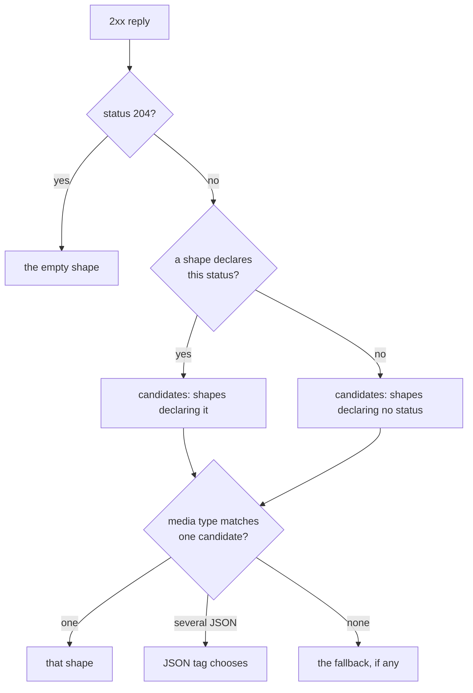

# Success shapes and declared errors

An endpoint says what a successful reply looks like with one or more
**success shapes**, and what a failed reply's body looks like with **declared
errors**. This page covers both as they are authored in `schematic-define`.
For how the generated client decodes them, see
[sending and responses](runtime/sending-and-responses.md).

## Success shapes

Each `.returns(..)` call adds a shape. A shape is JSON of a registered type,
text, binary, empty, or a stream:

```rust
use schematic_define::prelude::*;

let mut ctx = DefinitionContext::types_in("::models");
let message = ctx.register::<Message>()?;
let event = ctx.register::<MessageStreamEvent>()?;

let create = Endpoint::post("CreateMessage", "/v1/messages")
    .describes("Create a message")
    .request_json::<CreateMessageBody>(&mut ctx) // `stream: Option<bool>` is a plain field
    .returns(Success::json(message).note("returned when `stream` is false or omitted"))
    .returns(Success::sse(event).ends_at_event("message_stop").note("returned when `stream` is true"));
```

| Constructor | Reply | Default media type |
| --- | --- | --- |
| `Success::json(desc)` / `returns_json::<T>(&mut ctx)` | JSON decoded as `T` | `application/json` |
| `Success::text()` / `returns_text()` | text | `text/plain` |
| `Success::binary()` / `returns_binary()` | bytes | `application/octet-stream` |
| `Success::empty()` / `returns_empty()` | no body | none |
| `Success::sse(item)` | server-sent events of `item` | `text/event-stream` |
| `Success::ndjson(item)` | one JSON `item` per line | `application/x-ndjson` |
| `Success::bytes()` | raw byte chunks | `application/octet-stream` |

Modifiers on a `Success`:

| Modifier | Effect |
| --- | --- |
| `.content_type("audio/mpeg")` | Declares a concrete media type. Case and parameters are ignored when comparing; wildcards such as `audio/*` are rejected. |
| `.status(202)` | Selects the shape by an exact 2xx status; may repeat. |
| `.tagged("type", "commit_file")` | Selects a JSON shape by a top-level field's value. |
| `.json_array()`, `.json_object()` | Selects a JSON shape by whether the reply is an array or an object. |
| `.fallback()` | A text or binary shape taking every media type no other shape matches. It declares no content type. |
| `.note("returned when ...")` | Documentation only; the client never reads it. |
| `.variant("Directory")` | Names this shape's variant of the generated success enum (an UpperCamelCase identifier, unique in the endpoint). Only on an endpoint with several shapes. |
| `.ends_at_data_line("[DONE]")` | An SSE stream ends at the event whose data equals the text (the empty string is allowed). |
| `.ends_at_event("message_stop")` | An SSE stream ends at the named event. |
| `.ends_when_field("done", true)` | An SSE or NDJSON stream ends at the item whose field (a dotted path, no `[*]`) equals a string, number, or boolean. |
| `.keep_end()` | Delivers the terminator as the last item instead of consuming it. |

A stream with no `ends_*` modifier ends when the server closes the connection.
Byte streams can only end that way, and `keep_end` needs a terminator.

### How a client tells shapes apart

One shape is used for every 2xx reply, unchecked. With several shapes, the
client picks one from the reply, and the definition must make that choice
unambiguous. Endpoint build rejects a set it could not choose from, naming
the shapes (numbered from 1), statuses, and media type.



The rules endpoint build enforces:

- the set is nonempty, and at most one shape is empty. An empty shape takes
  status 204 only, and no other shape may declare 204.
- declared statuses lie in 200–299, each once per shape.
- two candidates with the same media type must both be JSON, separated by a
  tag: every shape in the group tagged with the same field and distinct
  values, or exactly one array and one object shape. A JSON shape whose type
  is a sequence or a map is tagged as an array or object automatically when it
  needs one, and so is a struct passed to `returns_json::<T>`.
- at most one fallback, never on a single-shape endpoint.

For example, `returns_json::<Vec<Entry>>(&mut ctx).returns_json::<Entry>(&mut ctx)`
is accepted (array versus object), while two struct shapes with no tags fail
with `... share media type `application/json` for statuses no shape declares
and no JSON tag separates them`.

### What is stored today

`Endpoint::response` still holds one `ApiResponse`. Build stores a lone JSON,
text, binary, or empty shape with no modifiers there. Anything else (several
shapes, streams, or a content type, status, tag, or note) passes the rules
above and is then refused with `... are stored once Endpoint::response holds
response model v2 shapes`. Storing those shapes is **planned**.
`Endpoint::success_shapes()` returns the stored response as a one-shape list,
and the generator and exporters read every endpoint through it, so they
already handle several shapes and streams (see
[Generated success and failure types](#generated-success-and-failure-types)).

The runtime already applies these rules to a reply: the stream codecs and
the multi-shape `Shapes` codec are described in
[Codecs and decoding](runtime/codecs.md#several-shapes-shapes), including
`UnexpectedContentType` for a reply no shape matches.

## Declared errors

A non-2xx reply is looked up in the endpoint's **effective error table**. The
API declares defaults; an endpoint adds entries, replaces an API entry whose
match is identical, or opts out:

```rust
let problem = ctx.register::<Problem>()?;
let get = Endpoint::get("GetItem", "/items/{id}")
    .describes("Get an item")
    .returns_json::<Item>(&mut ctx)
    .errors(ErrorSet::new().on(StatusMatch::exact(404), ErrorShape::empty()))
    .build()?;
let api = RestApi::builder(&ctx, "Items", "https://api.example.com")
    .describes("Items").no_auth()
    .default_errors(ErrorSet::new()
        .on(StatusMatch::class(4), ErrorShape::json(problem))
        .on(StatusMatch::class(5), ErrorShape::text()))
    .endpoints([get])
    .build()?;

let table = api.effective_errors(&api.endpoints[0]);
assert!(matches!(table.lookup(404).unwrap().shape, ResponseShape::Empty)); // endpoint exact entry
assert!(matches!(table.lookup(422).unwrap().shape, ResponseShape::Json(_))); // API class
```

- **Matches.** `StatusMatch::exact(404)`, `StatusMatch::range(400, 449)`, or
  `StatusMatch::class(4)` (400–499). Bounds lie in 400–599 and are ordered.
- **Shapes.** `ErrorShape::json(desc)`, `text()`, `binary()`, or `empty()`,
  with an optional `.content_type(..)`. A stream is never an error shape.
- **Lookup.** The most specific match wins: an exact status, then the
  narrowest range. An endpoint's range never displaces an API exact entry
  inside it.
- **Rejected.** Two entries with an identical match at one level; two
  equal-width ranges that overlap, at one level or after the endpoint overlays
  the API (`error ranges 400-449 and 420-469 have equal width and overlap on
  statuses 420-449`); and an endpoint that opts out while declaring entries.
- **Opting out.** `errors(ErrorSet::none())` on an endpoint empties its table,
  API defaults included. On the API, `default_errors(ErrorSet::none())` simply
  declares no defaults; an empty API table is not an endpoint opt-out.

An endpoint that declares nothing inherits the API defaults. Each error
entry's JSON type must be registered in the API's context; an unregistered one
fails API build with `Items endpoint GetItem: unresolved schema reference
"Problem"`. The runtime decodes an error body through a `const` error table
with the same exact-then-narrowest rule (see
[Codecs and decoding](runtime/codecs.md#declared-error-bodies-errorbody-and-the-error-table)),
which the generator emits from the effective table.

## Generated success and failure types

Each endpoint's request struct implements `EndpointSpec`; its `Success`,
`Decoder`, and `Failure` follow from the shapes and the effective error table.

| Declared | `Success` | `Decoder` |
| --- | --- | --- |
| one JSON shape | the registered type `T` | `Json<T>` |
| one text, binary, or empty shape | `String`, `bytes::Bytes`, `()` | `Text`, `Binary`, `Empty` |
| one SSE or NDJSON stream of `T` | `ItemStream<T>` | `Sse<T, End>`, `Ndjson<T, End>` |
| one byte stream | `ByteStream` | `ByteStream` |
| several shapes | `{Id}Response` | `Shapes<{Id}Response>` |

`End` is `UntilClose` for a stream that ends at connection close, and
otherwise a generated unit struct `{Id}End` (`{Id}{Variant}End` for a stream
inside an enum) whose `StreamEnd` constants hold the terminator and `keep`.

`{Id}Response` has one variant per shape, in declaration order, documented by
the shape's note. A variant is named by `.variant(..)`, else by its kind
(`Json`, `Text`, `Binary`, `Empty`, `Stream`); two shapes of one kind take
their content type's subtype (`application/problem+json` gives `JsonProblem`).
Names still equal after that fail validation with `name them with
Success::variant`. The enum implements `Alternatives` (its route table) and,
only when every shape is JSON, `JsonAlternatives`, which is what lets a typed
response mutator be registered for the endpoint.

```rust
// .returns(Success::json(listing).variant("Directory"))
// .returns(Success::binary().fallback().variant("File"))
match client.send(GetSourceRequest::new("docs")).full().await?.into_result()? {
    GetSourceResponse::Directory(listing) => { /* JSON listing */ }
    GetSourceResponse::File(bytes) => { /* any other media type */ }
}
```

`Failure` comes from the effective error table:

| Effective table | `Failure` | `ERRORS` |
| --- | --- | --- |
| empty, or opted out | `NoDeclaredError` (every non-2xx is `Undeclared`) | not emitted |
| one distinct shape | its type: `String`, `bytes::Bytes`, `()`, `serde_json::Value`, or the registered JSON type | one route per entry |
| several distinct shapes | `{Id}Error`, one variant per shape named after its type | one route per entry, pointing at its variant |

Shapes are distinct by kind, type, and content type. A registered JSON type
gets one `impl ErrorBody<{Api}Api>` per API module however many endpoints
fail with it. A lone JSON shape whose Rust type the runtime already decodes
as something else (`String`, `bytes::Bytes`, `()`) gets the `{Id}Error` enum
instead, so the body is read as JSON.

## Stored forms

Every type above serializes to JSON (and loads from a
[definition bundle](io/definition-bundles.md)):

| Value | Serialized |
| --- | --- |
| `StatusMatch::exact(404)` | `{"Exact": 404}` |
| `StatusMatch::class(4)` | `{"Range": {"lo": 400, "hi": 499}}` |
| an error entry | `{"status": {"Exact": 404}, "shape": "Text", "content_type": "text/html"}` |
| a success shape | `{"shape": {"Json": {"Named": "Entry"}}, "statuses": [200], "json_tag": "Array", "note": "...", "variant": "Entries"}` |
| an SSE stream | `{"Stream": {"framing": {"Sse": {"Named": "Event"}}, "end": {"EventNamed": "message_stop"}, "keep": true}}` |
| terminators | `{"DataLineEquals": "[DONE]"}`, `{"FieldEquals": {"field": "done", "value": true}}`, `"ConnectionClose"` |

Members at their default (`errors: []`, `no_declared_errors: false`,
`statuses: []`, `fallback: false`, `keep: false`) are omitted, so a definition
that uses none of this serializes exactly as before.
