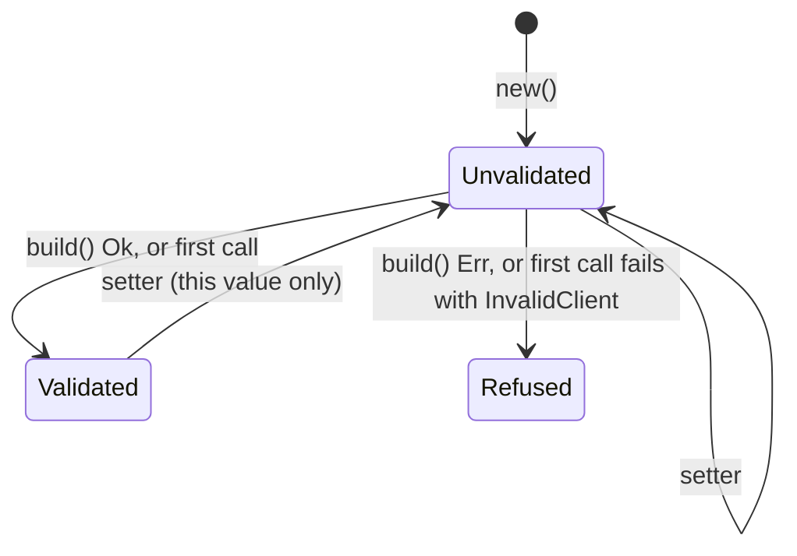

# Building Clients

Each generated API is one struct named after the API (`GitHub`, `OpenAI`,
…), and that struct is the client. `{Api}::new()` returns a usable client
and never fails; settings are chained onto it by value:

```rust
use std::time::Duration;

use schematic_schema::prelude::*;

let client = GitHub::new()
    .base_url("http://127.0.0.1:8080")             // e.g. a local mock
    .connect_timeout(Duration::from_secs(5))
    .timeout(Duration::from_secs(10))
    .api_key(token);
```

`new()` seeds the client with the API's definition (base URL, accepted
credentials, environment fallback, cross-origin policy, secret names,
request-id header) and its static default headers. Every setting and every
send is an inherent method of the struct, so no trait import is needed: one
generated method per endpoint (`client.list_releases("o", "r")`), plus
`send`, `send_raw`, and `check_link`. An endpoint method and
`send(request)`, which takes a request object as its one argument, both
return a call that sends when awaited; see
[Calling an API](./calling-an-api.md).

## When settings are checked

Settings are validated together, once. Nothing invalid is replaced by a
default: a bad setting is always reported.

- **On the first call.** A client that was never validated validates itself
  on its first awaited call, `send_raw`, or `check_link`. An invalid setting fails
  that call with `TransportErrorKind::InvalidClient(BuildError)`, before any
  network work.
- **Earlier, if you ask.** `build()` validates now and returns the same
  client type, so bad configuration surfaces where the client is made:

```rust
let client: GitHub = GitHub::new().base_url(url).build()?; // Err(BuildError)
```



The validated result, including its connection pool, is cached and shared by
every clone of the client, whichever clone validated first. A setter applied
afterward discards the cached result for that value only; the value
validates again on its next use, and clones made earlier keep theirs.

## Settings

| Method | Effect |
| --- | --- |
| `base_url(url)` | send to `url` instead of the definition's base URL; it must be an absolute HTTP(S) URL with a host and no user information |
| `timeout(duration)` | the per-request timeout (default `DEFAULT_TIMEOUT`, 30 s); see [Deadlines and timeouts](./deadlines-and-timeouts.md) |
| `connect_timeout(duration)` | bound on establishing a connection |
| `proxy(url)` | send every request through this proxy |
| `add_root_certificate(pem_or_der)` | trust an extra root certificate, in addition to the platform's |
| `danger_accept_invalid_certificates()` | accept any server certificate, including self-signed and expired ones; only for devices that cannot present a valid one |
| `user_agent(value)` | the `User-Agent` of every request |
| `default_header(name, value)` | a header sent with every request unless the request sets the same header |
| `api_key(secret)` | the client [credential](./credentials.md#setting-a-client-credential), placed wherever the API takes a single secret |
| `basic_auth(user, password)` | an HTTP Basic client credential; exists only on APIs that accept Basic |
| `credentials(credential)` | the client credential in its general form |
| `env_order([..])` | replace the order of the environment variables the fallback reads |
| `cross_origin(policy)` | tighten the API's [cross-origin policy](./origins-and-redirects.md) |
| `transport(&shared)` | take connections from a `SharedTransport` |
| `pre_response_json(hook)`, `mutate_response::<R, _>(hook)` | register [response hooks](./hooks.md) |
| `build()` | validate now; returns the same client or the `BuildError` |

There is no option to inject your own HTTP client, and no client follows
redirects on its own: the runtime builds every HTTP client itself with
redirect following turned off, and follows redirects one hop at a time so
the origin policy is checked at each hop.

## Sharing connections

A `SharedTransport` is one connection pool that several clients use. Two
clients attached to the same transport reuse each other's idle connections
to the same origin:

```rust
use std::time::Duration;

use schematic_schema::prelude::*;
use schematic_schema::schematic_runtime::SharedTransport;

let transport = SharedTransport::builder()
    .proxy("http://proxy.internal:3128")
    .connect_timeout(Duration::from_secs(5))
    .build()?;

let github = GitHub::new().transport(&transport);
let gitlab = GitLab::new().transport(&transport);
```

The transport is built eagerly, through its own `builder().build()?`: it is
one pool shared by many clients, so there is no single client whose first
call could report its errors.

Settings are split by owner:

| Owner | Settings |
| --- | --- |
| the transport | `proxy`, `add_root_certificate`, `danger_accept_invalid_certificates`, `connect_timeout` |
| each client | `base_url`, `timeout`, credentials, default headers, user agent, the origin policy, and hooks |

A client attached to a transport that also sets a transport-owned setting is
refused with `BuildError::TransportOptionConflict`, naming the setting, even
when its value matches the transport's. The refusal surfaces at `build()`
or, without one, on the client's first call:

```rust
let refused = GitHub::new()
    .transport(&transport)
    .proxy("http://other:3128") // owned by the transport
    .build();
assert!(refused.is_err());
```

The HTTP library fixes these settings when it creates the connection pool,
so one pool cannot apply two values. Refusing every transport-owned setting
on an attached client, rather than accepting a matching one, means no
setting is silently ignored and no certificate has to be compared for
equality.

Clients that need different connection settings use separate transports;
connections are then not shared between the two groups:

```rust
let fast = SharedTransport::builder()
    .connect_timeout(Duration::from_secs(2))
    .build()?;
let patient = SharedTransport::builder()
    .connect_timeout(Duration::from_secs(30))
    .build()?;

let github = GitHub::new().transport(&fast);
let gitlab = GitLab::new().transport(&fast);     // shares connections with `github`
let device = Eversolo::new().transport(&patient); // its own pool
```

A client that needs its own connection settings and nothing shared can also
skip the transport and set them on the client, which then builds a private
pool.

## Build errors

`BuildError` is `#[non_exhaustive]`. It is returned by `build()`, and is
carried by `TransportErrorKind::InvalidClient` when the first call finds it:

| `BuildError` | Cause |
| --- | --- |
| `InvalidBaseUrl { reason }` | the base URL is not absolute, not HTTP(S), has no host, or carries user information |
| `InvalidAllowedOrigin { reason }` | an `allow_origins` entry is not a bare HTTP(S) origin (it has a path, query, fragment, or user information) |
| `OriginPolicyNotPermitted { definition, requested }` | `cross_origin(..)` would loosen the API's policy |
| `TransportOptionConflict { option }` | a transport-owned setting was set on a client attached to a `SharedTransport` |
| `AuthBearingDefaultHeader { name }` | a default header would carry a credential (for example `Authorization`, `Cookie`, or the API's key header); set a credential instead |
| `InvalidHeader { name }` | a default header name or value is not valid HTTP |
| `IncompatibleCredential { supplied }` | the client credential is of a kind the API does not accept, including `api_key` on an API that takes no single-secret credential |
| `InvalidProxy` | the proxy URL is not valid |
| `InvalidCertificate` | a root certificate could not be parsed |
| `Transport` | the HTTP client could not be initialized |

Neither a `BuildError` nor an `InvalidClient` transport error displays a
credential or a header value.

For example, an API defined as `deny` cannot be loosened to `same_origin`:

```rust
let client = SomeDenyApi::new()
    .cross_origin(OriginPolicy::same_origin())
    .build(); // Err(OriginPolicyNotPermitted { definition: "deny", requested: "same_origin" })
```

## Building a client by hand

A generated API struct wraps a runtime `Client<{Api}Api>`, where the tag
type `{Api}Api` implements the `Api` trait and is the `EndpointSpec::Api` of
every request of that API, so the client sends only that API's requests.
The `schematic_runtime::api_client!` macro gives the struct its settings and
sends as one-line forwards.

Tests and hand-written integrations can use the runtime `Client` directly,
with any tag that implements `Api` and request types that implement
`EndpointSpec`. `Client::new(definition)` takes the same chained settings:

```rust
use schematic_runtime::{ApiDefinition, AuthConfig, Client, CredentialPlacement, EnvFallback};

let definition = ApiDefinition::new("https://api.example.com")
    .auth(
        AuthConfig::none()
            .accept(CredentialPlacement::Bearer { header: None })
            .env_fallback(EnvFallback::new(
                CredentialPlacement::Bearer { header: None },
                ["EXAMPLE_TOKEN"],
            )),
    )
    .request_id_header("x-request-id")
    .secret_names(["X-Session"]);

let client = Client::<ExampleApi>::new(definition).build()?;
```

`ApiDefinition::cross_origin(policy)` sets the API's own policy (default
`same_origin`); callers can only tighten it afterward.
