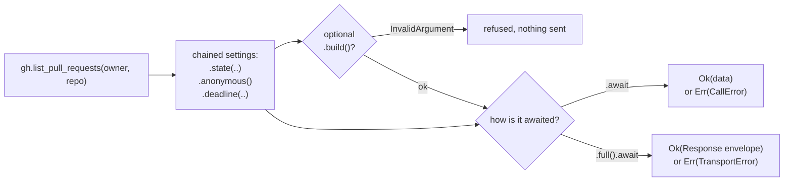

# Calling an API

Every generated client in `schematic-schema` (`GitHub`, `OpenAI`, `ElevenLabs`,
…) has one method per endpoint. You can:

- find what an API can do by typing `client.` in your editor, with no other
  import;
- pass an endpoint's required values as arguments and chain its optional ones;
- send with `.await` and get the data back with one `?`;
- override the credential or deadline for one call;
- get the whole reply (status, headers, request id) with `.full()`;
- check a call before sending it with `.build()?`, and send a built call more
  than once;
- page through a list endpoint, or fetch one customized page, with its pager.

```rust
use schematic_schema::github::GitHub;

let gh = GitHub::new();

// required values are arguments; optional ones are chained; `.await` sends
let pulls = gh.list_pull_requests("yankeeinlondon", "rusty-biscuit")
    .state("open".to_string())
    .await?; // Vec<PullRequestSummary>
```

## The life of a call

An endpoint method sends nothing. It returns a **call**: the client, the
request, and this call's settings. The call is sent when you await it.



## Creating a client

`new()` cannot fail. Client-wide settings chain on it and apply to every
call made through that client:

```rust
use std::time::Duration;
use schematic_schema::openai::OpenAI;

let openai = OpenAI::new()
    .base_url("http://localhost:8080/v1") // a local mock or a compatible server
    .api_key("sk-…")                      // sent with every call
    .timeout(Duration::from_secs(10))     // per request; the default is 30 s
    .proxy("http://proxy.internal:3128");
```

A setting is checked when the client is first used. To find a bad setting at
startup instead, call the client's `.build()?`, which returns the same client
or a `BuildError`. Clients are cheap to clone and share one connection pool.
The full list of settings is in [Building clients](./building-clients.md).

## Calling an endpoint

The method is the endpoint's id in snake case: `ListReleases` becomes
`list_releases`, and `RetrieveModel` becomes `retrieve_model`.

**Required values are arguments**: each path value, then the request body
when the endpoint has one, in the order `{Endpoint}Request::new` takes them.
Query, header, and cookie values are always setters, even when the API marks
them required; the generated client does not enforce them.

```rust
let model = openai.retrieve_model("gpt-4").await?; // Model
let models = openai.list_models().await?;          // ListModelsResponse
```

**Optional values are setters** on the call, named after the value:

```rust
let open_prs = gh.list_pull_requests("rust-lang", "rust")
    .state("open".to_string())
    .sort("updated".to_string())
    .await?;
```

A setter takes the value's exact type, as the endpoint defines it.

Your editor's hover text on an endpoint method shows everything else you need:
the endpoint's description, its HTTP method and path, its arguments, and the
optional setters on its call.

## Per-call overrides

These methods exist on every call, whatever the endpoint:

| Method | Effect for this call only |
| --- | --- |
| `.credential(Credential)` | sends this credential instead of the client's or the environment's; dropped on a public endpoint |
| `.anonymous()` | sends no credential from any source |
| `.deadline(&Deadline)` | bounds the call by a deadline shared with other calls |
| `.full()` | returns the whole reply instead of the data; chain it after the endpoint's setters |
| `.build()` | checks the call's arguments without sending it |

```rust
use schematic_schema::prelude::*;

// a read that should not spend the user's token
let repo = gh.get_repository("yankeeinlondon", "rusty-biscuit")
    .anonymous()
    .await?;

// one call made as a different user
let repo = gh.get_repository("yankeeinlondon", "rusty-biscuit")
    .credential(Credential::access_token(user_token))
    .await?;
```

`.credential(..)` and `.anonymous()` replace each other, and the last one set
wins. The order in which credentials are chosen, and what `.anonymous()`
strips, are described in [Credentials](./credentials.md). An endpoint can
also authenticate differently from its API: one declared public never sends
a credential, and one with its own policy fails before sending when no
credential it accepts resolves; its method's docs say so, and
[Endpoint authentication](./credentials.md#endpoint-authentication) has the
rules. Deadlines are described in
[Deadlines and timeouts](./deadlines-and-timeouts.md).

If an endpoint has an optional value with one of these names, its setter is
generated with a `_param` suffix (`.full_param(..)`), so `.full()` means the
same thing on every call. An endpoint method named like a client method gets
an `_endpoint` suffix in the same way. The generator reports each rename; see
[Endpoint method names](../generation/validation.md#endpoint-method-names).

## When a call fails

Awaiting a call returns `Result<Data, CallError<E>>`. `CallError` covers both
ways a call can fail:

- **`CallError::Transport`**: no reply arrived. The connection, TLS, or wait
  for the response failed, the deadline had expired, or the request was refused
  before sending.
- **`CallError::Api { error, meta }`**: a reply arrived but is not the data.
  It is an error status, or its body was cut off, could not be decoded, or was
  refused by a response hook. `error` holds the kind and the raw body, and
  `meta` holds the status, headers, and request id.

`CallError` may gain variants later, so a `match` needs a wildcard arm:

```rust
use schematic_schema::prelude::*;

match gh.get_repository("o", "r").await {
    Ok(repo) => println!("{}", repo.full_name),
    Err(CallError::Api { error, meta }) if meta.status.as_u16() == 404 => {
        println!("no such repository: {}", error.kind);
    }
    Err(CallError::Transport(error)) => eprintln!("no reply: {error}"),
    Err(other) => eprintln!("{other}"),
}
```

Either variant gives the request that was sent through `request_meta()`. A
`CallError`'s `Display` text never contains a credential, so it is safe to log.
To test the `Api` case, run the call against a local fake server such as
`wiremock`. Code outside the runtime cannot construct the reply metadata
directly.

Every error kind is listed in [Sending and responses](./sending-and-responses.md).

## The whole reply: `.full()`

When you need more than the data, chain `.full()` last. Awaiting it returns the
`Response` envelope for any reply that arrived, whatever its status:

```rust
let response = gh.list_releases("yankeeinlondon", "rusty-biscuit").full().await?;

println!("{}", response.meta.status);       // 200
println!("{:?}", response.meta.request_id); // the provider's request id
if let Some(releases) = response.data() {
    println!("{} releases", releases.len());
}
```

The only error here is `TransportError`, for when no reply arrived. An error
status is a value inside the envelope (`response.error()`), not an `Err`.

Chain `.full()` after the endpoint's setters: the result still accepts
`.anonymous()`, `.credential(..)`, `.deadline(..)`, and `.build()`, but not
the endpoint's own setters.

## Checking first: `.build()?`

`.build()` checks the call's arguments without sending anything, and returns
the same call or an `InvalidArgument`. It runs the same preparation the send
runs, with the call's per-call credential or `.anonymous()`, so it refuses
exactly what the send would refuse:

- a request that cannot be encoded, such as a JSON body that fails to
  serialize;
- a header name or value that is not a valid header, including the body's
  content type (a value ending in a newline is a common cause);
- a credential of a kind the API does not accept, such as Basic credentials
  for an API that takes a bearer token;
- a credential that cannot be placed: a token that is not a valid header
  value, or a request that already sets the header, query parameter, or
  cookie the credential goes in.

```rust
let call = gh.get_repository("octo", "widgets")
    .credential(Credential::basic("user", "password"));
assert!(call.build().is_err()); // GitHub takes a token, not Basic credentials
```

Without `.build()`, the same checks run when the call is awaited, so it is only
needed when you want the failure early. They run again at the await even after
a successful `.build()`, because client settings, environment variables, and
time can change in between. Failures that are not about the call's arguments
are reported only when it is awaited: an invalid client setting (check those
with the client's own `.build()?`), a cross-origin target the policy refuses,
and an expired deadline.

```rust
let call = gh.list_pull_requests("yankeeinlondon", "rusty-biscuit")
    .state("open".to_string())
    .build()?;   // nothing has been sent yet
let pulls = call.await?;
```

A call can be cloned, and each await is a separate request. That makes a
retry straightforward:

```rust
let call = gh.list_workflow_runs("o", "r").build()?;

let runs = match call.clone().await {
    // the token was rejected; try once more without it
    Err(CallError::Api { meta, .. }) if matches!(meta.status.as_u16(), 401 | 403) => {
        call.anonymous().await?
    }
    other => other?,
};
```

The runtime itself never retries.

## Paginated lists

When the definition authors pagination for a list endpoint, its call also
has a pager. Its page and page-size parameters are then not setters: the
pager's controls (`.page(..)`, `.page_size(..)`, `.after(..)`, …) set them,
and only the controls the definition authors exist on that call.

```rust
// every release, only after GitHub signals the end of the list
let releases = gh.list_releases("yankeeinlondon", "rusty-biscuit")
    .page_size(100)
    .collect_all()
    .await?; // Vec<Release>, or Err(Incomplete) with the items gathered so far

// exactly one request with these settings
let page = gh.list_releases("yankeeinlondon", "rusty-biscuit")
    .page(2)
    .page_size(10)
    .fetch_page()
    .await?; // Page<Release>: page.items, page.meta
```

Awaiting the call directly still sends one ordinary request and returns the
endpoint's own response type. Iteration, completeness, and every pager
control are described in [Pagination](../pagination.md).

## When to use request objects instead

Behind every endpoint method is a request type with the same name and a
`Request` suffix (`ListReleasesRequest`), and the method's call type has a
`Call` suffix (`ListReleasesCall`). Use the request type directly when:

- you write code that is generic over many endpoints of one API;
- the request is built or stored somewhere other than where it is sent.

Pass it to the client's `send`, which returns the same kind of call, with the
same per-call methods and the same `.await` and `.full()` behavior:

```rust
use schematic_schema::github::{GitHub, ListPullRequestsRequest};

let request = ListPullRequestsRequest::new("rust-lang", "rust")
    .with_state("open".to_string());
let prs = gh.send(request).anonymous().await?;
```

On a request, optional values are set with `with_*` methods. On a call, they
are set without the prefix.

For a reply's bytes without decoding, `send_raw(request, &CallOptions)` takes a
request object and per-call `CallOptions`; see
[Sending and responses](./sending-and-responses.md).
