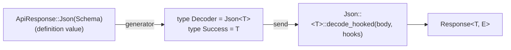
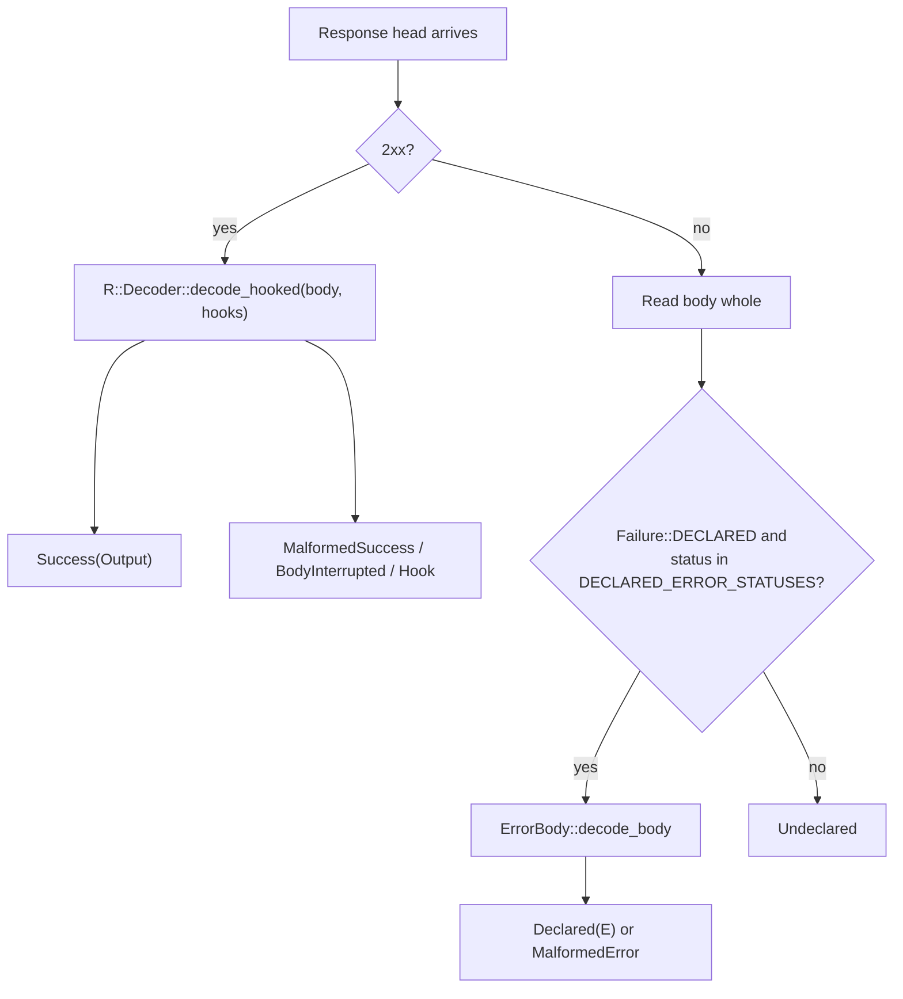

# Codecs and Decoding

A codec turns the body of a successful reply into an endpoint's success
type. This page describes the contract between the runtime and its codecs.
Read it when you want to:

- know why a call returns `Vec<PullRequestSummary>` rather than a generic
  decoded value
- write a new codec (a streaming or multi-shape reply, for example)
- decode an endpoint's declared error body
- make a codec run the client's [response hooks](./hooks.md)

For which built-in codec each endpoint uses and what it accepts, see
[Codecs judge the body, not the `Content-Type`](./sending-and-responses.md#codecs-judge-the-body-not-the-content-type).

## The endpoint fixes the result type

An API definition describes a reply with a value, the `ApiResponse` enum
from `schematic-define` (`Json(Schema)`, `Text`, `Binary`, or `Empty`). The
generator turns that value into a **type**: each request struct's
`EndpointSpec` names a codec as `Decoder` and the codec's output as
`Success`.

```rust
// Definition: response: ApiResponse::json_vec_type("PullRequestSummary")
// Generated:
impl schematic_runtime::EndpointSpec for ListPullRequestsRequest {
    type Api = GitHubApi;
    type Success = Vec<PullRequestSummary>;
    type Failure = schematic_runtime::NoDeclaredError;
    type Decoder = schematic_runtime::Json<Vec<PullRequestSummary>>;
    // ...
}
```

Because the codec is part of the request type, `client.send(request, …)`
returns `Response<Vec<PullRequestSummary>, _>`, and the caller never names a response
type or runs a decode step.



## The `Decode` trait

A codec is a type, not a value. `Decode::decode` is an associated function
with no `self`, so a codec holds no per-call state; a codec that needs state
keeps it in its `Output`.

```rust
pub trait Decode: 'static {
    type Output: Send + 'static;

    fn decode(body: LiveBody) -> impl Future<Output = Result<Self::Output, DecodeFailure>> + Send;

    // Provided; see "Hooks" below.
    fn decode_hooked(body: LiveBody, hooks: HookStage<'_>)
        -> impl Future<Output = Result<Self::Output, DecodeFailure>> + Send;
}
```

A small buffering codec:

```rust
use schematic_runtime::{Decode, DecodeFailure, DecodeFailureKind, LiveBody};

/// Decodes a body of newline-separated lines.
pub struct Lines;

impl Decode for Lines {
    type Output = Vec<String>;

    async fn decode(body: LiveBody) -> Result<Vec<String>, DecodeFailure> {
        let bytes = body.collect().await?; // an interruption keeps the bytes that arrived
        let text = std::str::from_utf8(&bytes)
            .map_err(|_| DecodeFailure::new(DecodeFailureKind::Malformed, bytes.clone()))?;
        Ok(text.lines().map(str::to_owned).collect())
    }
}
```

### Failures keep their evidence

A codec returns a `DecodeFailure`, never a library error, because the
envelope must keep the bytes as evidence. The runtime maps its kind onto the
envelope:

| `DecodeFailureKind` | `retained` holds | Envelope `ErrorKind` |
| --- | --- | --- |
| `Interrupted` | the bytes that arrived before the read failed or timed out | `BodyInterrupted` |
| `Malformed` | the whole body, which did not decode | `MalformedSuccess` |
| `Hook` | the whole body, which a hook refused | `Hook` |

## `LiveBody`: the body as it arrives

A codec receives a `LiveBody`, which **owns** the body stream and its time
bounds. It does not expose the HTTP library's response type, so a codec
depends only on `schematic-runtime`.

| Method | Use |
| --- | --- |
| `status()`, `headers()` | the response head; the headers are **not** redacted, so read them and never store them |
| `chunk().await` | the next piece of the body, or `None` at its end |
| `collect().await` | the whole body; an interruption returns `Interrupted` with the bytes that arrived |
| `into_streaming()` | switch to stream bounds, for an output that keeps reading after `decode` returns |
| `LiveBody::new(status, headers, stream, read_until)` | build one from any stream, for a codec's own tests |

By default every read must finish before the send's expiration. A streaming
codec calls `into_streaming()` and may return an `Output` that owns the
`LiveBody`; from then on each read must arrive within the per-request
timeout of the previous one, and a shared `Deadline` bounds the whole
stream (see [Deadlines and timeouts](./deadlines-and-timeouts.md)). The
envelope's `elapsed` always stops when `decode` returns, so for a buffering
codec it includes the whole body and for a streaming output it is about the
time to the response head.

## Declared error bodies: `ErrorBody`

Error replies do not go through the codec. An endpoint's `Failure` type
implements a separate trait, and the runtime decodes it on arrival when the
status is in the endpoint's `DECLARED_ERROR_STATUSES` (400 through 599 by
default):

```rust
pub trait ErrorBody: Sized + Send + 'static {
    const DECLARED: bool = true;
    fn decode_body(body: &[u8]) -> Option<Self>; // None → MalformedError
}
```

The error body is always read whole before `decode_body` runs. Every
generated endpoint uses `NoDeclaredError` (`DECLARED = false`), so its error
replies are `Undeclared`.



## Hooks: `decode_hooked` and `SupportsHooks`

For a 2xx reply the runtime always calls `decode_hooked`, passing the
client's hooks for that endpoint as a `HookStage`. The provided
implementation **ignores the hooks** and calls `decode`, which is right for
a codec that cannot run them, such as `Text` or `Binary`.

`SupportsHooks` is a marker trait. Registering a typed mutator with
`mutate_response::<R, _>` requires `R::Decoder: SupportsHooks`, so a mutator
for an endpoint whose codec cannot run it does not compile. Today only
`Json<T>` implements it.

A codec that implements `SupportsHooks` **must**:

1. override `decode_hooked` and apply the `HookStage` it receives
   (`pre_response_json` on the parsed JSON, then `mutate` on the decoded
   value), reporting a hook's refusal as `DecodeFailureKind::Hook` with the
   original bytes; and
2. ship a test proving that registered hooks run on its output.

The test is required because the mistake is silent. A codec that implements
`SupportsHooks` but keeps the provided `decode_hooked` compiles, accepts
mutator registrations, and never runs them.

```rust
impl<T: DeserializeOwned + Send + 'static> SupportsHooks for Json<T> {}

impl<T: DeserializeOwned + Send + 'static> Decode for Json<T> {
    type Output = T;

    async fn decode(body: LiveBody) -> Result<T, DecodeFailure> { /* … */ }

    async fn decode_hooked(body: LiveBody, hooks: HookStage<'_>) -> Result<T, DecodeFailure> {
        if hooks.is_empty() {
            return Self::decode(body).await;
        }
        // parse, hooks.pre_response_json(json), decode, hooks.mutate(&mut value)
        // …
    }
}
```

## What a decoder checks

Decoding checks structure: a `Json<T>` codec accepts a body only if serde
can deserialize it into `T`, so wrong types, missing required fields, and
unknown enum values are `MalformedSuccess`. JSON Schema **value**
constraints, such as `minLength`, `pattern`, or `maximum`, are not checked.
The OpenAPI importer discards them, and a definition's `Schema` carries only
a type name, so no generated type knows them.

## Planned

Server-sent events, NDJSON, and GraphQL codecs built on this contract are
**planned**. Each of them that implements `SupportsHooks` carries the hook
obligation above.
