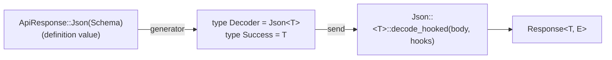
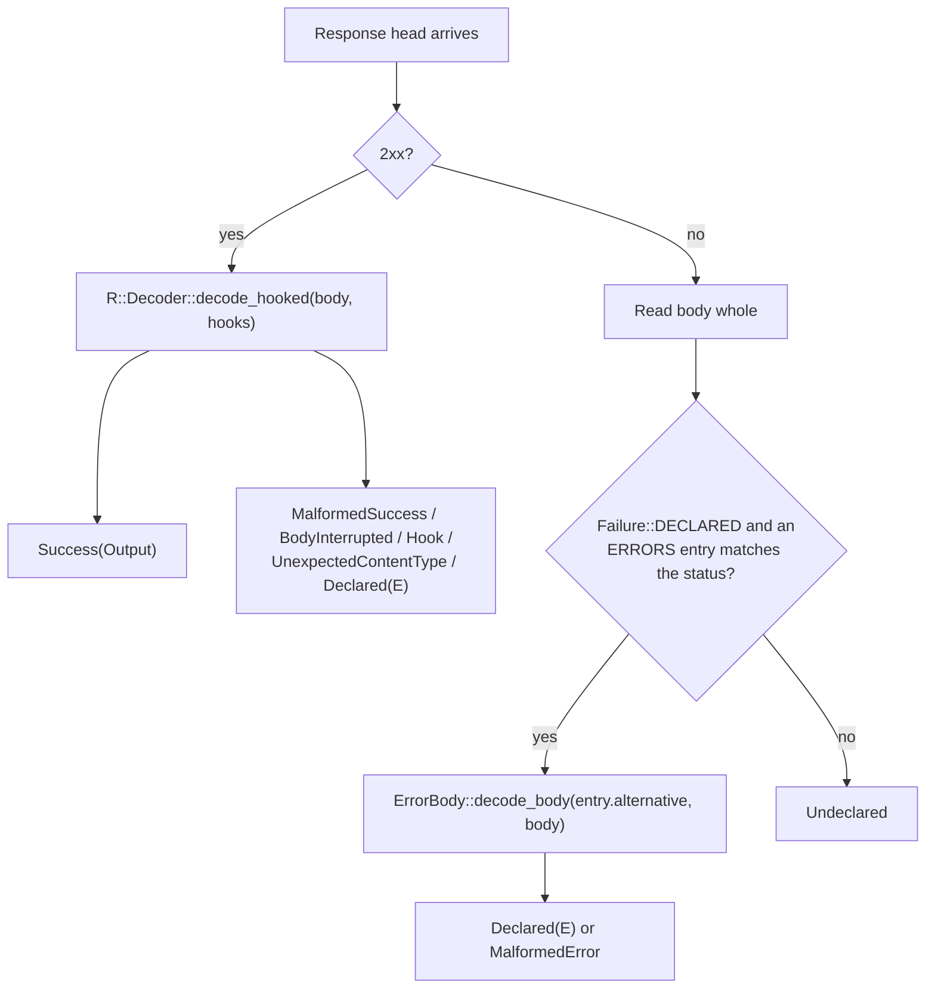
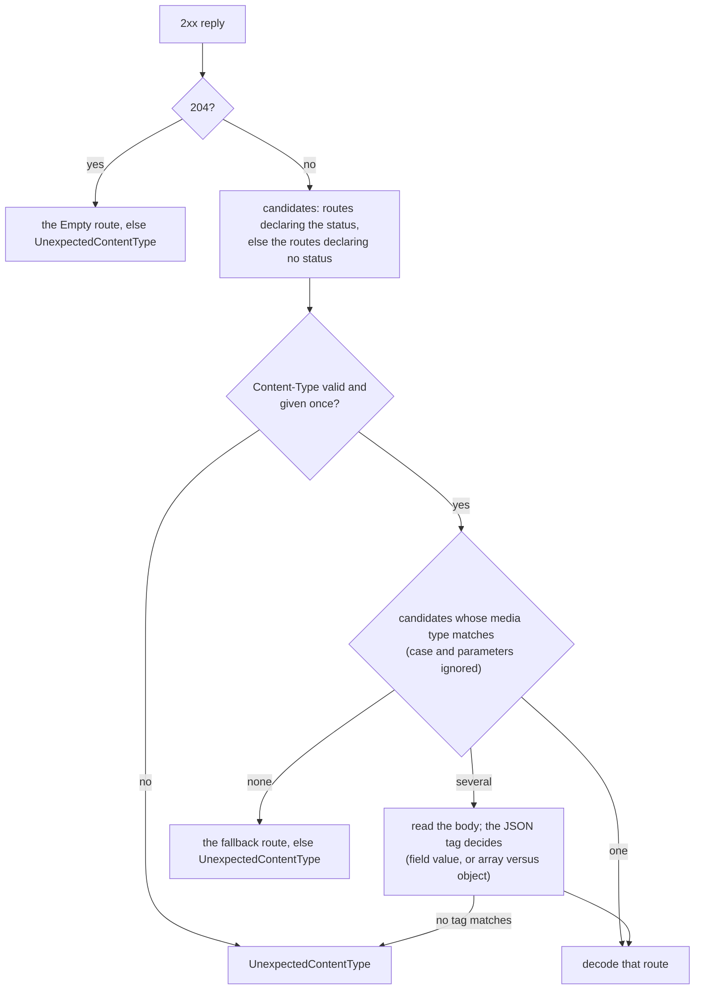

# Codecs and Decoding

A codec turns the body of a successful reply into an endpoint's success
type. This page describes the contract between the runtime and its codecs.
Read it when you want to:

- know why a call returns `Vec<PullRequestSummary>` rather than a generic
  decoded value
- read a server-sent event, NDJSON, or raw byte stream item by item
- let one endpoint reply with one of several declared shapes
- decode an endpoint's declared error bodies, chosen by status
- decode a GraphQL reply (see [GraphQL](../graphql.md))
- write a new codec, or make one run the client's
  [response hooks](./hooks.md)

For which built-in codec each endpoint uses and what it accepts, see
[Codecs judge the body, not the `Content-Type`](./sending-and-responses.md#codecs-judge-the-body-not-the-content-type).

## The endpoint fixes the result type

An API definition describes a reply with values, the success shapes of
`Endpoint::response` in `schematic-define` (`Json(reference)`, `Text`,
`Binary`, `Empty`, or a stream). The generator turns them into a **type**: each request struct's
`EndpointSpec` names a codec as `Decoder` and the codec's output as
`Success`.

```rust
// Definition: .returns_json::<Vec<PullRequestSummary>>(ctx)
// Generated:
impl schematic_runtime::EndpointSpec for ListPullRequestsRequest {
    type Api = GitHubApi;
    type Success = Vec<PullRequestSummary>;
    type Failure = schematic_runtime::NoDeclaredError;
    type Decoder = schematic_runtime::Json<Vec<PullRequestSummary>>;
    // ...
}
```

Because the codec is part of the request type, awaiting
`client.list_pull_requests("o", "r")` returns `Vec<PullRequestSummary>` (a
`.full()` call returns `Response<Vec<PullRequestSummary>, _>`), and the
caller never names a response type or runs a decode step.



## The `Decode` trait

A codec is a type, not a value. `Decode::decode` is an associated function
with no `self`, so a codec holds no per-call state; a codec that needs state
keeps it in its `Output`.

```rust
pub trait Decode: 'static {
    type Output: Send + 'static;

    fn decode(body: LiveBody) -> impl Future<Output = Result<Self::Output, DecodeFailure>> + Send;

    // Provided; see "Hooks" below.
    fn decode_hooked(body: LiveBody, hooks: HookStage<'_>)
        -> impl Future<Output = Result<Self::Output, DecodeFailure>> + Send;
}
```

A small buffering codec:

```rust
use schematic_runtime::{Decode, DecodeFailure, DecodeFailureKind, LiveBody};

/// Decodes a body of newline-separated lines.
pub struct Lines;

impl Decode for Lines {
    type Output = Vec<String>;

    async fn decode(body: LiveBody) -> Result<Vec<String>, DecodeFailure> {
        let bytes = body.collect().await?; // an interruption keeps the bytes that arrived
        let text = std::str::from_utf8(&bytes)
            .map_err(|_| DecodeFailure::new(DecodeFailureKind::Malformed, bytes.clone()))?;
        Ok(text.lines().map(str::to_owned).collect())
    }
}
```

### Failures keep their evidence

A codec returns a `DecodeFailure`, never a library error, because the
envelope must keep the bytes as evidence. The runtime maps its kind onto the
envelope:

| `DecodeFailureKind` | `retained` holds | Envelope `ErrorKind` |
| --- | --- | --- |
| `Interrupted` | the bytes that arrived before the read failed or timed out | `BodyInterrupted` |
| `Malformed` | the whole body, which did not decode | `MalformedSuccess` |
| `Hook` | the whole body, which a hook refused | `Hook` |
| `UnexpectedContentType` | the whole body, which no declared shape matches | `UnexpectedContentType` |
| `Declared` | the whole body, which carries a declared failure (built by `DecodeFailure::declared`) | `Declared(E)`, through `ErrorBody::from_declared`; `MalformedSuccess` if `E` refuses it |

## `LiveBody`: the body as it arrives

A codec receives a `LiveBody`, which **owns** the body stream and its time
bounds. It does not expose the HTTP library's response type, so a codec
depends only on `schematic-runtime`.

| Method | Use |
| --- | --- |
| `status()`, `headers()` | the response head; the headers are **not** redacted, so read them and never store them |
| `chunk().await` | the next piece of the body, or `None` at its end |
| `collect().await` | the whole body; an interruption returns `Interrupted` with the bytes that arrived |
| `into_streaming()` | switch to stream bounds, for an output that keeps reading after `decode` returns |
| `mark_item()` | restart a streamed body's idle bound; call it each time the output yields an item |
| `max_frame_bytes()` | the per-frame byte limit a framing codec enforces (the client's `max_frame_bytes`, 16 MiB by default) |
| `LiveBody::new(status, headers, stream, read_until)` | build one from any stream, for a codec's own tests |
| `with_max_frame_bytes(limit)` | set the frame limit on a body built with `new`, for a codec's own tests |

By default every read must finish before the send's expiration. A streaming
codec calls `into_streaming()` and may return an `Output` that owns the
`LiveBody`; from then on a read fails with `BodyReadError::TimedOut` once
the per-request timeout has passed since the head arrived or since the
codec last called `mark_item()`, and with `BodyReadError::DeadlineExceeded`
once a shared `Deadline` passes (see
[Deadlines and timeouts](./deadlines-and-timeouts.md)). Bytes that arrive
without completing an item do not restart the idle bound. The
envelope's `elapsed` always stops when `decode` returns, so for a buffering
codec it includes the whole body and for a streaming output it is about the
time to the response head.

## Declared error bodies: `ErrorBody` and the error table

Error replies do not go through the codec. Each endpoint carries a `const`
error table, `EndpointSpec::ERRORS`, and its `Failure` type implements
`ErrorBody<Api>`, where `Api` is the endpoint's API marker. The runtime reads the error body whole, looks the status up in
the table, and decodes the body as the shape the matching entry names:

```rust
pub trait ErrorBody<A>: Sized + Send + 'static {
    const DECLARED: bool = true;
    // `alternative` is the matched entry's shape index; None → MalformedError
    fn decode_body(alternative: usize, body: &[u8]) -> Option<Self>;
    // A failure a 2xx body carried (GraphQL errors); None, the default, → MalformedSuccess
    fn from_declared(failure: Box<dyn Any + Send>) -> Option<Self> { None }
}

// A table with an exact entry and two ranges; order does not matter.
const ERRORS: &'static [ErrorRoute] = &[
    ErrorRoute::new(StatusMatch::Range { lo: 400, hi: 499 }, 1), // text
    ErrorRoute::new(StatusMatch::Range { lo: 420, hi: 429 }, 2), // empty
    ErrorRoute::new(StatusMatch::Exact(404), 0),                  // JSON problem
];
```

`ErrorRoute::lookup` picks the most specific entry: an exact status, then
the narrowest range. With that table a 404 decodes as alternative 0, a 425
as alternative 2, and a 400 as alternative 1; a 500 matches nothing and is
`Undeclared`. The default table sends every 4xx and 5xx status to
alternative 0, the one shape of a single-shape failure type.

The runtime implements `ErrorBody<A>` for every API marker `A` for the plain
shapes a single-shape table can name: `String` (text), `Bytes` (binary), `()`
(empty), and `serde_json::Value` (any JSON). A registered JSON type, or the
enum of a table with several distinct shapes, implements it in generated code,
once per API module, for that module's marker:

```rust
// In the generated `github` module; `Problem` lives in `schematic-definitions`.
impl schematic_runtime::ErrorBody<GitHubApi> for ::schematic_definitions::github::Problem {
    fn decode_body(_: usize, body: &[u8]) -> Option<Self> {
        serde_json::from_slice(body).ok()
    }
}
```

The marker parameter is what makes that impl legal. Rust's orphan rule
forbids implementing a trait from one crate for a type from another in a
third crate, unless a type local to the third crate appears among the trait's
parameters; the generated marker is that local type.
`NoDeclaredError` (`DECLARED = false`) makes every error reply
`Undeclared`, whatever the table says.



## Streams: `Sse`, `Ndjson`, and `ByteStream`

A stream endpoint's success value reads its body item by item as the
caller polls it. The envelope is returned as soon as the response head
arrives, so its `elapsed` is about the time to the head.

| Codec | Output | One item per |
| --- | --- | --- |
| `Sse<T, End>` | `ItemStream<T>` | server-sent event (its `data:` lines joined) |
| `Ndjson<T, End>` | `ItemStream<T>` | non-blank line |
| `ByteStream` | `ByteStream` | body chunk, as `Bytes` |

Each item is `Result<T, StreamError>`. Both outputs implement
`futures_core::Stream` and have an inherent `next().await`. A stream is
`Send`, owns the body, keeps working after its client is dropped, and
releases the connection when it is dropped; it starts no background task.

```rust
use schematic_runtime::{EndCondition, Sse, StreamEnd};

/// OpenAI's `data: [DONE]` terminator, consumed.
struct Done;
impl StreamEnd for Done {
    const CONDITION: EndCondition = EndCondition::DataLineEquals("[DONE]");
}

// type Decoder = Sse<ChatChunk, Done>;
let mut chunks = client.send(CreateChatCompletion::streaming(request)).await?;
while let Some(chunk) = chunks.next().await {
    match chunk {
        Ok(chunk) => print!("{}", chunk.delta()),
        Err(error) if error.is_terminal() => return Err(error.into()),
        Err(malformed) => eprintln!("skipped: {malformed}"),
    }
}
```

The end condition is a marker type implementing `StreamEnd`:
`DataLineEquals(text)` and `EventNamed(name)` (SSE only),
`FieldEquals { path, value }` (SSE or NDJSON; `path` is object keys, and a
missing field never matches), or `ConnectionClose` (the `UntilClose` marker,
and the only end of a `ByteStream`). The terminator is matched **before**
its frame is decoded, so `[DONE]` is never a malformed item. It is consumed
by default; a marker with `const KEEP: bool = true` delivers it as the last
item, which is how Ollama's final `done: true` line keeps its statistics.

| `StreamError` | When | Then |
| --- | --- | --- |
| `Malformed { raw }` | a frame did not decode as `T`; `raw` is its bytes | the stream continues, unless the frame was a kept terminator |
| `EndedEarly` | the body ended cleanly before the terminator | the stream ends |
| `Interrupted { pending }` | the connection broke; `pending` is the frame being assembled | the stream ends, never followed by `EndedEarly` |
| `IdleTimeout` | no item within the per-request timeout of the previous item (or of the head) | the stream ends |
| `DeadlineExceeded` | the shared deadline passed | the stream ends |
| `FrameLimitExceeded { limit, prefix }` | an event or line grew past the frame limit; `prefix` is at most its first 1 KiB | the stream ends |

A provider's error event inside a 200 stream, such as Anthropic's
`event: error`, is not a `StreamError`: it is `Ok(item)` when the item type
has a variant for it. An `Ok` item means the item decoded, not that the
provider's operation succeeded.

Framing does not depend on how the body was chunked. SSE follows the
[event-stream rules](https://html.spec.whatwg.org/multipage/server-sent-events.html#event-stream-interpretation):
LF, CRLF, and CR line endings, `:` comments, joined `data:` lines, and a
leading byte order mark; `id:` and `retry:` are ignored because nothing
reconnects, and an event the body cuts off before its blank line is
discarded. NDJSON accepts LF and CRLF, skips blank lines, and decodes a
last line that has no newline. Each SSE event or NDJSON line is limited to
the client's `max_frame_bytes` (16 MiB by default); a `ByteStream`
assembles no frame and has no limit.

A non-2xx reply to a stream endpoint is never decoded as a stream: it takes
the error table like any other.

## Several shapes: `Shapes`

An endpoint that declares several success shapes has a generated enum,
with one variant per shape, as its success type. The enum implements
`Alternatives`, a `const` table of `Route`s in variant order plus a decode
of the chosen variant, and the endpoint's codec is `Shapes<Enum>`:

```rust
enum CreateMessageResponse {
    Message(Message),
    Events(ItemStream<MessageEvent>),
}

impl Alternatives for CreateMessageResponse {
    const ROUTES: &'static [Route] = &[
        Route::new(ShapeKind::Json).media("application/json"),
        Route::new(ShapeKind::Stream).media("text/event-stream"),
    ];

    async fn decode_alternative(index: usize, body: LiveBody) -> Result<Self, DecodeFailure> {
        match index {
            0 => Json::<Message>::decode(body).await.map(Self::Message),
            _ => Sse::<MessageEvent, MessageStop>::decode(body).await.map(Self::Events),
        }
    }
}
// type Decoder = Shapes<CreateMessageResponse>;
```

For a 2xx reply, `Shapes` chooses a route the way the definition's
[selection rules](../responses-and-errors.md) describe:



`UnexpectedContentType` keeps the status, headers, and whole body. A route
that is chosen but does not decode is `MalformedSuccess`. A **single-shape**
endpoint does not use `Shapes` and never checks the `Content-Type`.

## GraphQL: `GraphQl`

`GraphQl<D>` decodes a GraphQL reply's `data` into `D`. It reads the JSON
wrapper first, so a non-empty `errors` array is reported as the endpoint's
declared failure even when `data` is missing or does not decode: the codec
returns `DecodeFailure::declared(GraphQlFailure { errors, partial_data })`
and the endpoint's failure type, `GraphQlOperationError<D, H>`, accepts it
through `ErrorBody::from_declared`. [GraphQL](../graphql.md#decoding-a-reply)
describes the classification in full.

## Hooks: `decode_hooked` and `SupportsHooks`

For a 2xx reply the runtime always calls `decode_hooked`, passing the
client's hooks for that endpoint as a `HookStage`. The provided
implementation **ignores the hooks** and calls `decode`, which is right for
a codec that cannot run them, such as `Text` or `Binary`.

`SupportsHooks` is a marker trait. Registering a typed mutator with
`mutate_response::<R, _>` requires `R::Decoder: SupportsHooks`, so a mutator
for an endpoint whose codec cannot run it does not compile. Three codecs
implement it:

- `Json<T>`;
- `Shapes<A>`, only when `A` also implements `JsonAlternatives`, which
  generated code does when every shape is JSON. With a stream, text,
  binary, or empty shape among them, a mutator does not compile. Either way
  the global JSON hook runs whenever the chosen shape is JSON;
- `GraphQl<D>`, whose global hook sees the wire wrapper and whose mutator
  sees `D` only after a reply without errors.

`Text`, `Binary`, `Empty`, `Sse`, `Ndjson`, and `ByteStream` do not, so
neither hook ever runs on a text, binary, empty, or streamed body.

A codec that implements `SupportsHooks` **must**:

1. override `decode_hooked` and apply the `HookStage` it receives
   (`pre_response_json` on the parsed JSON, then `mutate` on the decoded
   value), reporting a hook's refusal as `DecodeFailureKind::Hook` with the
   original bytes; and
2. ship a test proving that registered hooks run on its output.

The test is required because the mistake is silent. A codec that implements
`SupportsHooks` but keeps the provided `decode_hooked` compiles, accepts
mutator registrations, and never runs them.

```rust
impl<T: DeserializeOwned + Send + 'static> SupportsHooks for Json<T> {}

impl<T: DeserializeOwned + Send + 'static> Decode for Json<T> {
    type Output = T;

    async fn decode(body: LiveBody) -> Result<T, DecodeFailure> { /* … */ }

    async fn decode_hooked(body: LiveBody, hooks: HookStage<'_>) -> Result<T, DecodeFailure> {
        if hooks.is_empty() {
            return Self::decode(body).await;
        }
        // parse, hooks.pre_response_json(json), decode, hooks.mutate(&mut value)
        // …
    }
}
```

## What a decoder checks

Decoding checks structure: a `Json<T>` codec accepts a body only if serde
can deserialize it into `T`, so wrong types, missing required fields, and
unknown enum values are `MalformedSuccess`. JSON Schema **value**
constraints, such as `minLength`, `pattern`, or `maximum`, are not checked.
The OpenAPI importer discards them, and a definition's `Schema` carries only
a type name, so no generated type knows them.

## What generated code emits

The generator emits these pieces from the definition: the stream codecs and
end markers, the multi-shape enum with its `Alternatives` routes, the `ERRORS`
table, the `ErrorBody<{Api}Api>` impls, and GraphQL operation requests (see
[Generated success and failure types](../responses-and-errors.md#generated-success-and-failure-types)).
An endpoint that declares one plain shape and no errors keeps a buffering
codec, the default error table, and `NoDeclaredError`.

Storing several success shapes and streams in a definition is **planned**, so
today every shipped endpoint is in that last case; a streaming endpoint is
still declared binary and framed by the caller until its definition migrates.
