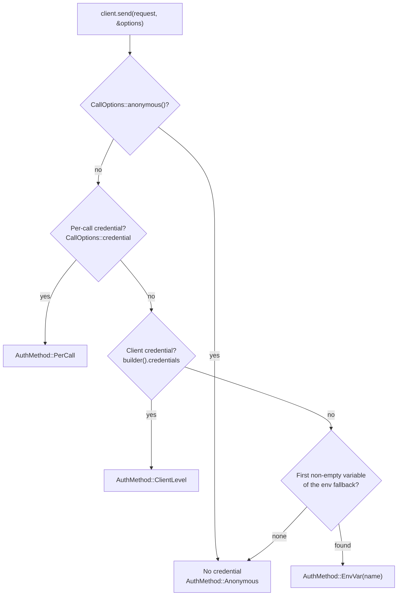

# Credentials

A `Credential` is a secret you hand to the runtime: an access token, an API
key, or a Basic username and password. The API definition decides where it
goes on the wire (an `Authorization: Bearer` header, a named key header, a
query parameter, or a cookie); you only choose the value and when it
applies.

```rust
use schematic_schema::prelude::*;

let token = Credential::access_token("ghp_…");     // bearer and OAuth tokens
let key = Credential::api_key("sk-…");             // header, query, or cookie keys
let basic = Credential::basic("user", "password"); // HTTP Basic
```

A credential's `Debug` and `Display` output shows its kind, never its value.

## Where the credential for a send comes from

The runtime resolves **one** credential per send, once, before the first
request leaves. The first source that supplies one wins:



```rust
use schematic_schema::github::GetRepositoryRequest;
use schematic_schema::prelude::*;

// 1. Per call: wins over everything else for this one send.
let options = CallOptions::new().credential(Credential::access_token(user_token));
client.send(GetRepositoryRequest::new("o", "r"), &options).await?;

// 2. Per client: used whenever a call supplies none.
let client = GitHub::builder()
    .credentials(Credential::access_token(service_token))
    .build()?;

// 3. Environment: GitHub reads GITHUB_TOKEN, then GH_TOKEN, at send time.
//    env_order replaces that list for this client.
let codeberg = Gitea::builder()
    .base_url("https://codeberg.org/api/v1")
    .env_order(["CODEBERG_TOKEN", "GITEA_TOKEN"])
    .build()?;

// 4. Explicitly anonymous: no credential from any source.
client.send(GetRepositoryRequest::new("o", "r"), &CallOptions::anonymous()).await?;
```

The metadata of every reply records which source was used, as
`response.meta.request.auth` (an `AuthMethod`), naming a variable but never
its value.

### The environment fallback

- The variables come from the API definition's environment mapping; each
  generated module's docs list them. `env_order([..])` replaces the list
  for one client.
- The **first variable that is set and non-empty** wins: with
  `EXAMPLE_KEY=""` and `EXAMPLE_KEY_2="k"`, `k` is sent.
- Variables are read at send time, not when the client is built, so a
  client never stores an environment secret.
- For Basic authentication both a username variable and a password variable
  must resolve; otherwise the send is anonymous. `env_order` replaces the
  password variables.
- An API whose definition has no fallback reads no variable, even if one
  with a familiar name is set.

## A missing credential is not an error

When no source supplies a credential, the request is sent without one.
There is no missing-credential error and no pre-send failure; the server's
reply (typically a 401) arrives in the envelope like any other, with
`AuthMethod::Anonymous` in its metadata.

## Anonymous calls

`CallOptions::anonymous()` skips every source, and also removes from the
request any header, query parameter, or cookie in a slot the API uses for
credentials. Use it for public endpoints when a token is configured but
should not be sent. `CallOptions::credential` and `anonymous` replace each
other; the last one set wins.

## The runtime never retries

A send is attempted once. The runtime does not retry on a 401, on a
timeout, or with another credential. A consumer that wants "try with the
token, then without it" makes that second call itself, and can see from the
metadata whether the first one carried a credential:

```rust
use schematic_schema::schematic_runtime::AuthMethod;

let first = client.send(request.clone(), &CallOptions::new()).await?;
let reply = if matches!(first.meta.status.as_u16(), 401 | 403)
    && first.meta.request.auth != AuthMethod::Anonymous
{
    client.send(request, &CallOptions::anonymous()).await?
} else {
    first
};
```

## When a credential is refused

| Situation | Result |
| --- | --- |
| a client credential of a kind the API does not accept (for example `Credential::basic` for a bearer API) | `build()` fails with `BuildError::IncompatibleCredential` |
| a per-call credential of a kind the API does not accept | the send fails with `TransportErrorKind::InvalidArgument`; nothing is sent |
| the request already sets the header, query parameter, or cookie the credential goes in | the send fails with `TransportErrorKind::InvalidArgument`; a credential never overwrites a value the request set itself |
| a default header that would carry a credential | `build()` fails with `BuildError::AuthBearingDefaultHeader` |

Each placement accepts one kind: a bearer (or OAuth) placement takes
`Credential::access_token`, a key header, query parameter, or cookie takes
`Credential::api_key`, and Basic takes `Credential::basic`. The module docs
of each generated API name its authentication method.

## Credentials across redirects

The resolved credential is attached to each request the send makes only
when the [origin policy](./origins-and-redirects.md) allows it for that
request's target. A hop that may not carry the credential is sent with
every secret header, cookie, and secret query value removed.

## OAuth

The runtime does not run OAuth flows. Obtain a token with `schematic-oauth`
(or any other source) and pass it as an access token:

```rust
let token = manager.get_valid_token().await?; // schematic_oauth::OAuth2Manager
let options = CallOptions::new().credential(Credential::access_token(token));
```
