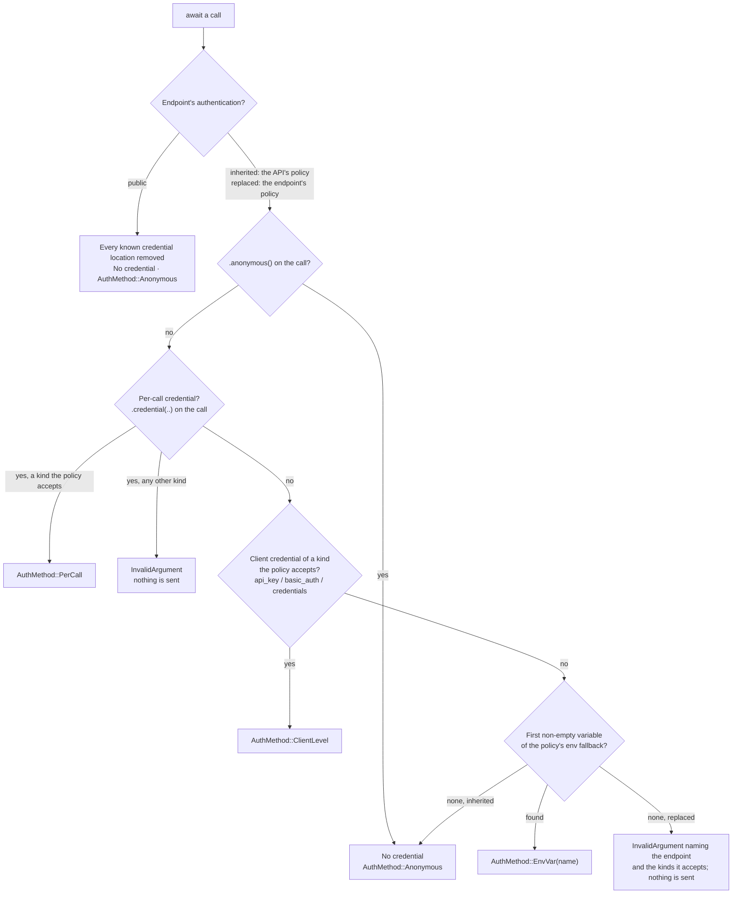

# Credentials

A `Credential` is a secret you hand to the runtime: an access token, an API
key, or a Basic username and password. The API definition decides where it
goes on the wire (an `Authorization: Bearer` header, a named key header, a
query parameter, or a cookie); you only choose the value and when it
applies.

```rust
use schematic_schema::prelude::*;

let token = Credential::access_token("ghp_…");     // bearer and OAuth tokens
let key = Credential::api_key("sk-…");             // header, query, or cookie keys
let basic = Credential::basic("user", "password"); // HTTP Basic
```

A credential's `Debug` and `Display` output shows its kind, never its value.

## Where the credential for a send comes from

The runtime resolves **one** credential per send, once, before the first
request leaves. The endpoint's authentication decides which sources count
(see [Endpoint authentication](#endpoint-authentication)); among those, the
first source that supplies one wins:



```rust
use schematic_schema::prelude::*;

// 1. Per call: wins over everything else for this one send.
client
    .get_repository("o", "r")
    .credential(Credential::access_token(user_token))
    .await?;

// 2. Per client: used whenever a call supplies none.
let client = GitHub::new().api_key(service_token);

// 3. Environment: GitHub reads GITHUB_TOKEN, then GH_TOKEN, at send time.
//    env_order replaces that list for this client.
let codeberg = Gitea::new()
    .base_url("https://codeberg.org/api/v1")
    .env_order(["CODEBERG_TOKEN", "GITEA_TOKEN"]);

// 4. Explicitly anonymous: no credential from any source.
client.get_repository("o", "r").anonymous().await?;
```

The metadata of every reply records which source was used, as
`response.meta.request.auth` (an `AuthMethod`), naming a variable but never
its value.

## Setting a client credential

A client holds at most one credential; each of these setters replaces the
one set before:

- **`api_key(secret)`** takes the API's single secret, whatever the API
  calls it, and places it where the definition says: in the **first**
  placement of the definition's accepted list that carries a single secret,
  a bearer token or an API key in a header, query parameter, or cookie. For
  GitHub that is `Authorization: Bearer <secret>`; for Gitea it is
  `Authorization: token <secret>`; for an API keyed by a query parameter it
  is that parameter. An API that accepts more than one such placement gets
  the one its definition lists first. When the API's own policy takes no
  single secret, the first endpoint policy that replaces the API's and does
  take one decides the key's kind.
- **`basic_auth(user, password)`** exists only on APIs whose definition
  accepts HTTP Basic, on the API's policy or on any endpoint's replacement
  policy, so calling it on another API does not compile.
- **`credentials(Credential::…)`** is the general form, for a credential of
  an explicit kind. It is accepted when the API's policy or any endpoint's
  replacement policy accepts its kind.

A client credential is sent only to endpoints whose policy accepts its kind,
and never reinterpreted: a bearer token is not sent as a Basic password, an
API key, or a cookie. An endpoint whose policy does not accept its kind
skips it and reads that policy's environment fallback instead.

An API that has nowhere to put a single secret, because neither its policy
nor any endpoint replacement accepts one (it accepts only Basic credentials,
or none), refuses `api_key` with `BuildError::IncompatibleCredential` at
`build()` or on the first call, never dropping it.

```rust
let gitea = Gitea::new().api_key(token);                // Authorization: token …
let emqx = EmqxBasic::new().basic_auth("app", secret);  // Authorization: Basic …
```

### The environment fallback

- The variables come from the API definition's environment mapping; each
  generated module's docs list them. `env_order([..])` replaces the list
  of the API's fallback for one client. An endpoint whose policy replaces
  the API's reads its own variables, in its own order, which `env_order`
  does not change; the endpoint's generated docs list them.
- The **first variable that is set and non-empty** wins: with
  `EXAMPLE_KEY=""` and `EXAMPLE_KEY_2="k"`, `k` is sent.
- Variables are read at send time, not when the client is built, so a
  client never stores an environment secret.
- For Basic authentication both a username variable and a password variable
  must resolve; otherwise nothing resolves from the environment (see
  [When no credential resolves](#when-no-credential-resolves)). `env_order`
  replaces the password variables.
- An API whose definition has no fallback reads no variable, even if one
  with a familiar name is set.

## When no credential resolves

For an endpoint that uses the API's policy, a send with no credential from
any source is sent without one. There is no pre-send failure; the server's
reply (typically a 401) arrives like any other, as `CallError::Api` or in
the `.full()` envelope, with `AuthMethod::Anonymous` in its metadata.

An endpoint whose definition replaces the API's policy is different: it
declared what it needs, so a send that resolves nothing fails before any
request with `TransportErrorKind::InvalidArgument`, naming the endpoint and
the credential kinds it accepts. A call made `.anonymous()` is the
exception; it is sent without a credential.

## Anonymous calls

`.anonymous()` on a call skips every source, and also removes from the
request any header, query parameter, or cookie in a slot the endpoint's
policy (the API's, or the endpoint's replacement) uses for credentials. Use
it when a token is configured but should not be sent. `.credential(..)` and
`.anonymous()` replace each other; the last one set wins.
(`CallOptions::anonymous()` and `CallOptions::credential` do the same for
`send_raw`.) An endpoint the definition declares public needs neither; see
[Endpoint authentication](#endpoint-authentication).

## Endpoint authentication

An endpoint inherits the API's authentication unless its definition says
otherwise (`.public()`, `.auth(..)`, or `.auth_with_env_mapping(..)`; see
[Building REST definitions](../definition-builders.md)). The generated
`definition()` tells the runtime with `ApiDefinition::endpoint_public(id)`
or `ApiDefinition::endpoint_auth(id, AuthConfig)`, and each endpoint's
generated docs say which applies.

```rust
use schematic_schema::schematic_runtime::{ApiDefinition, AuthConfig, CredentialPlacement, EnvFallback};

let definition = ApiDefinition::new("https://api.example.com")
    .auth(AuthConfig::none().accept(CredentialPlacement::Bearer { header: None }))
    // GET /health needs no credential.
    .endpoint_public("Health")
    // Uploads take HTTP Basic, from the call, the client, or UPLOAD_USER / UPLOAD_PASS.
    .endpoint_auth(
        "Upload",
        AuthConfig::none()
            .accept(CredentialPlacement::Basic)
            .env_fallback(EnvFallback::new(CredentialPlacement::Basic, ["UPLOAD_PASS"]).username_vars(["UPLOAD_USER"])),
    );
```

**A public endpoint** sends no credential, whatever is configured: not the
client's (`api_key`, `basic_auth`, `credentials`), not the environment's,
and not a per-call `.credential(..)`, which is silently dropped rather than
refused. The runtime also removes from the request every header, query
parameter, and cookie in a location where the API or any endpoint
replacement places a credential, including a value the request set there
itself, so a raw `Authorization` header never leaks to a public endpoint.
Ordinary headers and cookies are kept, and nothing about the call carries
over to the next one. Its metadata records `AuthMethod::Anonymous`.

**A replacement policy** is used instead of the API's, never merged with
it:

- The sources are tried in the usual order: per call, then client, then the
  endpoint's own environment fallback (its own variables and order, which
  `env_order` does not change).
- A credential counts only when the replacement accepts its kind. A per-call
  credential of another kind fails the send with `InvalidArgument` before
  anything is sent; a client credential of another kind is passed over.
- When nothing resolves, the send fails with `InvalidArgument` naming the
  endpoint and the kinds it accepts, unless the call is `.anonymous()`, which
  sends without a credential and strips the replacement's locations.

The names whose values are never stored or shown (see
[Metadata and redaction](./metadata-and-redaction.md)) include every
location of every replacement policy, so a client default header in such a
location is refused with `BuildError::AuthBearingDefaultHeader`, as for the
API's own locations. The [redirect rules](#credentials-across-redirects)
apply to an endpoint's credential exactly as to the API's.

## The runtime never retries

A send is attempted once. The runtime does not retry on a 401, on a
timeout, or with another credential. A consumer that wants "try with the
token, then without it" makes that second call itself, and can see from the
metadata whether the first one carried a credential. A call is `Clone`, so
build it once and await a clone first; each await is a separate send:

```rust
use schematic_schema::schematic_runtime::AuthMethod;

let call = client.get_repository("o", "r");
let repo = match call.clone().await {
    Err(CallError::Api { meta, .. })
        if matches!(meta.status.as_u16(), 401 | 403)
            && meta.request.auth != AuthMethod::Anonymous =>
    {
        call.anonymous().await?
    }
    result => result?,
};
```

## When a credential is refused

| Situation | Result |
| --- | --- |
| a client credential of a kind neither the API nor any endpoint replacement accepts (for example `Credential::basic` for a bearer-only API, or `api_key` for a Basic-only API) | `build()`, or else the first call, reports `BuildError::IncompatibleCredential` |
| a per-call credential of a kind the endpoint's policy does not accept | the send fails with `TransportErrorKind::InvalidArgument`; nothing is sent |
| no credential resolves for an endpoint whose policy replaces the API's, on a call that is not `.anonymous()` | the send fails with `TransportErrorKind::InvalidArgument`; nothing is sent |
| the request already sets the header, query parameter, or cookie the credential goes in | the send fails with `TransportErrorKind::InvalidArgument`; a credential never overwrites a value the request set itself (on a public endpoint the value is removed instead) |
| a default header that would carry a credential, for the API or any endpoint replacement | `build()`, or else the first call, reports `BuildError::AuthBearingDefaultHeader` |

Each placement accepts one kind: a bearer (or OAuth) placement takes
`Credential::access_token`, a key header, query parameter, or cookie takes
`Credential::api_key`, and Basic takes `Credential::basic`. The module docs
of each generated API name its authentication method, and an endpoint's
docs name its own when it is public or replaces the API's.

## Credentials across redirects

The resolved credential is attached to each request the send makes only
when the [origin policy](./origins-and-redirects.md) allows it for that
request's target. A hop that may not carry the credential is sent with
every secret header, cookie, and secret query value removed.

## Handshakes another transport sends

A generated WebSocket client does not send through the runtime's HTTP
client, but it selects and places its upgrade credential with the same
rules. `AuthConfig::select_handshake(per_call, client)` picks one source —
the per-connect credential, else the client credential, else the first
non-empty environment variable, else none — and returns a
`HandshakeCredential` whose `apply(&mut url, &mut headers)` writes it as a
header, a query parameter, or a cookie merged into `Cookie`:

```rust
use schematic_runtime::{AuthConfig, CredentialPlacement, Credential, Url};

let auth = AuthConfig::none().accept(CredentialPlacement::ApiKeyQuery { name: "token".into() });
let selected = auth.select_handshake(None, Some(&Credential::api_key("k")))?;
let mut url = Url::parse("wss://tv.local/channel")?;
let mut headers = http::HeaderMap::new();
selected.apply(&mut url, &mut headers)?;
assert_eq!(url.query(), Some("token=k"));
```

A credential kind the API does not accept, or a request that already sets
the header, query parameter, or cookie the credential would use, is an
`InvalidArgument`: two explicit sources are refused, never both sent.
`AuthConfig::secret_names()` gives the redaction set for the handshake's
error text. The selection is made once; a caller that reconnects reuses it.

A protocol that also carries the credential in a message after the upgrade
(an opening payload field, or an answer to an authentication challenge)
reads it with `HandshakeCredential::expose_secret()`: the selected key or
token without the prefix or `Bearer ` scheme its placement adds, or `None`
for an anonymous selection or a Basic pair. `Debug` never shows it.

## OAuth

The runtime does not run OAuth flows. Obtain a token with `schematic-oauth`
(or any other source) and pass it as an access token. `OAuth2Manager` runs
each flow only for the grant the provider declares (the authorization-code
flow for `AuthorizationCodePkce`, the client-credentials flow for
`ClientCredentials`; it has no device-code flow) and authenticates to the
token endpoint as the grant's `client_auth` says: `ClientSecretBasic` in the
`Authorization` header, `ClientSecretPost` in the body, `None` with the client
id alone.

```rust
let token = manager.get_valid_token().await?; // schematic_oauth::OAuth2Manager
client
    .get_repository("o", "r")
    .credential(Credential::access_token(token))
    .await?;
```
