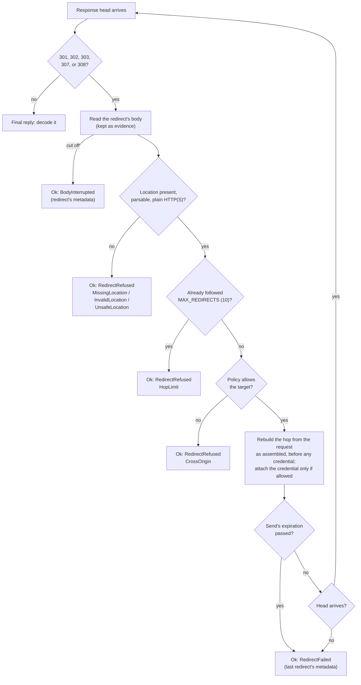

# Origins and Redirects

A redirect or a next-page link can point anywhere, including a host that
should never see your API key. The runtime therefore checks every URL a send
is about to request against the API's **cross-origin policy**, and decides
separately whether the credential may go with it.

## Origins

An origin is exact: scheme, host, and effective port. There is no domain
matching.

| URL | Same origin as `https://a.test`? |
| --- | --- |
| `https://a.test:443/v2` | yes (443 is the default port) |
| `http://a.test` | no (scheme) |
| `https://a.test:8443` | no (port) |
| `https://api.a.test` | no (host) |

The client's **base origin** is the origin of its base URL.

## Policies

Each API definition sets one policy (`CrossOrigin` in `schematic-define`,
`OriginPolicy` at run time); the default is `same_origin`.

| Policy | Redirect to base | Redirect elsewhere | Link to base | Link elsewhere |
| --- | --- | --- | --- | --- |
| `same_origin` | with credentials | refused | allowed | refused |
| `allow_origins([..])` | with credentials | with credentials if listed, else refused | allowed | with credentials if listed, else refused |
| `allow_without_credentials` | with credentials | without credentials | allowed | without credentials |
| `danger_allow_any` | with credentials | with credentials | allowed | with credentials |
| `deny` | refused | refused | allowed | refused |

- Whether the credential goes is decided by comparing the target with the
  **base** origin, never with the previous hop. Under
  `allow_without_credentials`, a chain A → B → B stays anonymous after the
  first hop, and B → A carries the credential again.
- `deny` follows no redirect at all, not even one back to the base origin,
  but a same-origin link is still allowed so paging keeps working.
- A target whose scheme is not `http` or `https`, or that carries user
  information, is refused under every policy.

A caller can only **tighten** the policy, with
`builder().cross_origin(..)`: `deny` over anything, `same_origin` over
anything but `deny`, and an `allow_origins` list that is a subset of the
API's own list. Anything else fails `build()` with
`BuildError::OriginPolicyNotPermitted`:

```rust
use schematic_schema::prelude::*;

// Never follow a redirect from this client, even though GitHub allows same-origin ones.
let strict = GitHub::builder().cross_origin(OriginPolicy::deny()).build()?;
```

## How a redirect is followed

The HTTP library never follows redirects; the runtime does, one hop at a
time, within the one send:



Details that matter in practice:

- **Every outcome after the first head is `Ok`.** A refused redirect is
  `ErrorKind::RedirectRefused { reason }`, carrying the redirect's own
  status, headers, and body. A hop that gets no head is
  `ErrorKind::RedirectFailed { target, category }`, describing the last
  redirect that did arrive; `target` is the redacted URL of the hop that
  failed. A raw send reports the same through `RawCompletion`.
- **Credentials per hop.** Each hop is rebuilt from the request as your code
  assembled it, so a credential is never carried over by accident. When the
  policy allows the credential for the target, it is attached again; when
  it does not, every secret header (including `Cookie`) and secret query
  value is removed. A relative `Location` is resolved before any credential
  is added, so it never inherits a query-string key.
- **Methods.** A 301 or 302 in reply to `POST`, and a 303 in reply to
  anything but `HEAD`, continue as `GET` without the body. A 307 or 308
  replays the same method and body.
- **One clock.** All hops share the send's single expiration (see
  [Deadlines and timeouts](./deadlines-and-timeouts.md)); a redirect chain
  cannot extend it.
- **Fragments** are dropped from the target.

`MAX_REDIRECTS` is exported by the runtime: a send follows at most ten
redirects, and the eleventh is refused with `RedirectRefusal::HopLimit`.

## Checking a link before you request it

An endpoint's path can be an absolute URL, as when you follow a next-page
link a provider returned. The runtime checks such a URL against the same
policy before sending, and refuses it as
`TransportErrorKind::CrossOriginRejected` without any network work.

`client.check_link::<R>(&url)` runs that check on its own, so you can reject
a link before building a request from it:

```rust
use schematic_schema::github::ListPullRequestsRequest;
use schematic_schema::schematic_runtime::Url;

let next = Url::parse(next_page_link)?;
client.check_link::<ListPullRequestsRequest>(&next)?; // Err: CrossOriginRejected
```

A same-origin URL passes under every policy, including `deny`. Pagers that
call `check_link` for every next-page link are **planned**.
