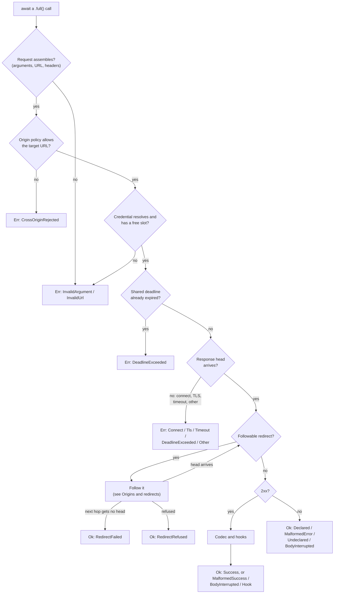

# Sending and Responses

A generated client has three ways to send a request:

- **Awaiting a call**, such as `client.get_repository("o", "r").await`,
  decodes the reply with the endpoint's codec and returns
  `Result<T, CallError<E>>`: the value, or one error for every way the call
  can fail.
- **Awaiting a `.full()` call**, such as
  `client.get_repository("o", "r").full().await`, decodes the same way and
  returns a typed `Response` envelope with the reply's status, headers, and
  request id, whatever the status was.
- **`client.send_raw(request, &options)`** returns the reply's metadata and
  body bytes without decoding them.

All three go through the same execution: credential resolution, the origin
policy, redirect following, the timeout and deadline, and redaction. This
page covers what they return and how to read it. How to create a client,
pass optional values, and override settings per call is covered by
[Calling an API](./calling-an-api.md).

## The typed send

Awaiting a call is the short path when the value is all you need:

```rust
use schematic_schema::prelude::*;

let client = GitHub::new();
let repo = client.get_repository("rust-lang", "rust").await?; // CallError<E> on failure
println!("{}", repo.full_name);
```

Chain `.full()`, last, when you need the status, a header such as
`Retry-After`, or the request id of the reply, success or not:

```rust
use schematic_schema::prelude::*;
use schematic_schema::schematic_runtime::{ErrorKind, Outcome};

let client = GitHub::new();
let response = client
    .get_repository("rust-lang", "rust")
    .full()
    .await?; // TransportError: no response head arrived

match &response.outcome {
    Outcome::Success(repo) => println!("{}", repo.full_name),
    Outcome::Failure(error) => {
        let status = response.meta.status;              // any status, 404 included
        let request_id = response.meta.request_id.as_deref();
        let retry_after = response.meta.headers.get("retry-after");
        let raw_body = &error.body;                     // bytes exactly as received
        if matches!(error.kind, ErrorKind::MalformedSuccess) {
            // a 2xx whose body did not decode
        }
    }
}
```

The success type is fixed by the endpoint, never chosen by the caller:
`get_repository` (and its request type, `GetRepositoryRequest`) always
decodes into `RepositoryInfo`. A request built for one API does not compile
when sent through another API's client.

### The envelope

`Response<T, E>`, what a `.full()` call returns, has two public fields, `meta` (a
[`ResponseMeta`](./metadata-and-redaction.md)) and `outcome`
(`Outcome::Success(T)` or `Outcome::Failure(ApiError<E>)`), and these
helpers:

| Method | Returns |
| --- | --- |
| `data()` | `Some(&T)` for a success |
| `error()` | `Some(&ApiError<E>)` for a failure |
| `into_result()` | `Result<T, ApiError<E>>`, **discarding the metadata** |
| `into_parts()` | `(ResponseMeta, Outcome<T, E>)`, keeping it |
| `is_decode_failure()` | whether the failure is `MalformedSuccess` |
| `is_interrupted()` | whether the failure is `BodyInterrupted` |

When only the value matters, await the call without `.full()` rather than
calling `into_result()`: the result is the same value, and a failure keeps
its metadata inside [`CallError`](#callerror). `into_result()` is for code
that already holds an envelope:

```rust
let response = client.get_repository("rust-lang", "rust").full().await?;
println!("{}", response.meta); // status and redacted request line
let repo = response.into_result()?; // ApiError<E> on failure; the status and headers are gone
```

Use `into_parts()`, or match on `outcome`, when you need the status, a
header such as `Retry-After`, or the request id of a failure.

## Where a result lands

The governing rule: a `.full()` call (and `send_raw`) returns **`Ok`** if
and only if an HTTP response head arrived. Every status, including a reply
whose body could not be read or decoded, is inside the envelope with its raw
bytes. It returns **`Err(TransportError)`** only when no head arrived.
Awaiting a call without `.full()` runs the same flow and then folds the
result into a [`CallError`](#callerror).



So a 404, a 500, an HTML error page on a JSON endpoint, and a body cut off
halfway are all `Ok` responses you can inspect, and a refused connection or a
cross-origin URL is an `Err`. Once a redirect has been received, a later hop
that fails is still `Ok`: the envelope then describes the last redirect that
did arrive.

### `TransportError`

`TransportError` has three public fields: `request` (the redacted
`RequestMeta` as assembled), `kind`, and `elapsed`. Its `kind` is one of:

| `TransportErrorKind` | When |
| --- | --- |
| `InvalidArgument(InvalidArgument)` | a parameter could not be encoded, a header is not valid HTTP, a per-call credential is of a kind the API does not accept, or the request already sets the header, query parameter, or cookie the credential goes in; nothing was sent |
| `InvalidUrl` | the request URL could not be built |
| `CrossOriginRejected { target }` | an absolute request URL points at an origin the policy refuses; nothing was sent |
| `Connect` | DNS failure, or the connection was refused or reset before a head |
| `Tls` | the TLS handshake failed |
| `Timeout` | the per-request timeout expired before a head |
| `DeadlineExceeded { completed_requests, deadline_elapsed }` | the shared [deadline](./deadlines-and-timeouts.md) had expired before the send, or expired before a head |
| `Other` | any other failure before a head |

An `InvalidArgument` reason names the argument but never quotes its value,
which may be secret. The HTTP library's own error text is never kept,
because it can include the unredacted URL.

### `CallError`

Awaiting a call without `.full()` returns `Result<T, CallError<E>>`. It is
the envelope folded into one `Result`, with nothing thrown away:

| `.full()` would return | Awaiting the call returns |
| --- | --- |
| `Ok(response)` with `Outcome::Success(value)` | `Ok(value)` |
| `Ok(response)` with `Outcome::Failure(error)` | `Err(CallError::Api { error, meta })`, where `meta` is the envelope's `ResponseMeta`, boxed |
| `Err(TransportError)` | `Err(CallError::Transport(error))` |

So `CallError::Api` means a reply arrived (an error status, a body that was
cut off or did not decode, a refusal by a response hook, or a refused or
failed redirect) and carries the same `ApiError<E>` and `ResponseMeta` the
envelope would have held. `CallError::Transport` means no head arrived.
`request_meta()` returns the redacted `RequestMeta` from either variant: the
request as assembled, or the hop that received the reply.

`CallError` is `#[non_exhaustive]`, so a `match` on it outside the runtime
needs a wildcard arm:

```rust
match client.get_repository("o", "r").await {
    Ok(repo) => println!("{}", repo.full_name),
    Err(CallError::Api { error, meta }) => {
        // a reply arrived: status, headers, request id, and the raw body
        eprintln!("{}: {} bytes", meta.status, error.body.len());
    }
    Err(CallError::Transport(error)) => eprintln!("no reply: {error}"),
    Err(other) => eprintln!("{other}"),
}
```

Its `Display` names the endpoint and, for a reply, the status and the
redacted request; it carries no credential. It implements
`std::error::Error`, and `source()` is the inner `TransportError` or
`ApiError`, so the inner text is not repeated in the outer message. A
`TransportError` converts into a `CallError` with `From`, so `?` on the
result of a `.full()` call or `send_raw` works inside a function that
returns `CallError<E>`.

`ResponseMeta` has no public constructor, so code outside the runtime cannot
build a `CallError::Api` by hand. Test those paths against a local fake
server, such as one built with `wiremock`.

## Failure kinds inside the envelope

`ApiError<E>` has two public fields: `kind` and `body`, the bytes exactly as
received (the whole body, or the bytes that arrived before an interruption).
`ErrorKind<E>` is `#[non_exhaustive]`; match it with a wildcard arm.

| `ErrorKind` | Status | Meaning | Helper |
| --- | --- | --- | --- |
| `Declared(E)` | declared error status | the body decoded into the endpoint's declared error type | `ApiError::declared()` |
| `MalformedError` | declared error status | the endpoint declares an error body, and this one did not decode | |
| `Undeclared` | other non-2xx, or 3xx not followed | the endpoint declares no body for this status | |
| `MalformedSuccess` | 2xx | the body did not decode with the endpoint's codec | `is_decode_failure()` |
| `BodyInterrupted` | any | the body was cut off, or its read timed out, after the head arrived | `is_interrupted()` |
| `RedirectRefused { reason }` | 3xx | a redirect was received and not followed | |
| `RedirectFailed { target, category }` | 3xx | a followed hop got no head; the envelope describes the last redirect | |
| `Hook` | 2xx | a [response hook](./hooks.md) refused the body | |

**Declared errors are decoded on arrival.** An endpoint's error type
implements `ErrorBody`; when a reply's status falls in the endpoint's
`DECLARED_ERROR_STATUSES` (400 through 599 by default), the runtime decodes
it before returning, so the caller never runs a decode step. Every endpoint
generated today uses `NoDeclaredError`, which has no values, so its error
replies are `Undeclared`. Declaring error bodies in an API definition is
**planned**.

A redirect status other than 301, 302, 303, 307, and 308 (for example 300
or 304) is not followed and is reported as a final reply.

## Codecs judge the body, not the `Content-Type`

Each request type names its codec, chosen from the definition's
`ApiResponse`:

| `ApiResponse` | Codec | Success type | Accepts |
| --- | --- | --- | --- |
| `Json(schema)` | `Json<T>` | `T` | any body that parses as `T` |
| `Text` | `Text` | `String` | any body; invalid UTF-8 is replaced |
| `Binary` | `Binary` | `bytes::Bytes` | any body |
| `Empty` | `Empty` | `()` | any body; it is read to the end and dropped |

A successful parse is the only check the `Json` codec makes. Valid JSON
served as `text/plain` decodes; an HTML error page served with status 200 on
a JSON endpoint is `MalformedSuccess`, and `error.body` holds the HTML.

Codecs implement the `Decode` trait, which reads the body as it arrives
rather than a pre-buffered copy; [Codecs and decoding](./codecs.md)
describes that contract and how to write a codec. Server-sent events, NDJSON, and GraphQL
codecs built on it are **planned**; none ships today.

## The raw send

`send_raw` skips decoding and hooks. It is the only send that takes a
`CallOptions` value for its per-call settings. No status counts as a
failure, so a 404 with its whole body is a complete `RawResponse`:

```rust
use schematic_schema::github::GetRepositoryRequest;
use schematic_schema::schematic_runtime::RawCompletion;

let raw = client
    .send_raw(GetRepositoryRequest::new("rust-lang", "rust"), &CallOptions::new())
    .await?; // the same TransportError cases as a call

println!("{} with {} bytes", raw.status(), raw.body.len());
if raw.is_complete() {
    let value: serde_json::Value = raw.json()?; // any status
}
```

`RawResponse` has `meta`, `body` (never redacted), and `completion`:

| `RawCompletion` | `body` holds |
| --- | --- |
| `Complete` | the final reply's whole body, whatever its status |
| `BodyInterrupted` | the bytes that arrived before the cut-off or timeout |
| `RedirectRefused { reason }` | the body of the redirect that was not followed |
| `RedirectFailed { target, category }` | the body of the last redirect received |

`raw.json::<T>()` returns `RawJsonError::Incomplete` without parsing when
the body is not complete, even if the bytes that arrived form valid JSON,
and `RawJsonError::Malformed` when a complete body does not parse.

## Many sends at once

The futures a call becomes when awaited, and the future `send_raw` returns,
are boxed: the future you hold is one heap pointer, not the whole request
state machine. Joining many calls in one future therefore needs no large
stack, and callers do not need to box them:

```rust
let (repo, pulls) = tokio::join!(
    client.get_repository("o", "r"),
    client.list_pull_requests("o", "r"),
);
```

A client is cheap to clone: clones share the connection pool and
configuration.

## What is safe to log

| Output | Credentials | Bodies |
| --- | --- | --- |
| `ResponseMeta`, `RequestMeta`, `TransportError` (any form) | redacted | never printed |
| `Display` of `Response`, `ApiError`, `RawResponse` | redacted | never printed; only the byte count |
| `Display` of `CallError` | redacted | never printed |
| `Debug` of `ApiError`, `CallError`, `RawResponse`, a decoded value | as the provider sent them | printed |

Body bytes and decoded provider values are kept unchanged on purpose, as
evidence. A provider that echoes a credential in an error body (for example
"invalid key sk-…") exposes it through `Debug`. Log the `Display` form or the
metadata when a log line may be shared. See
[Metadata and redaction](./metadata-and-redaction.md).
