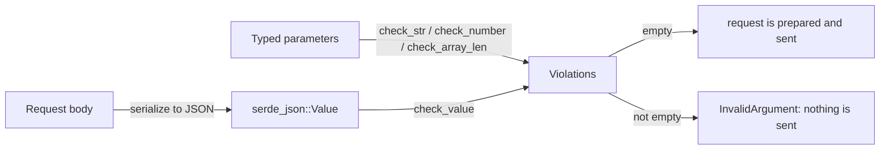

# Request Validation

`schematic_runtime::validate` checks the values of an outgoing request
against the constraints its definition declares, such as "a string of at
most 100 characters" or "an integer between 1 and 100", before anything is
sent. Read this page when you want to:

- know which rules are checked, and what each one means exactly
- read a violation report and know it is safe to log
- understand why `0.3` is a multiple of `0.1` here, and why a bound larger
  than `u64::MAX` still works
- write or review the constraint plans the generator emits

The module checks requests only. Replies are never validated: a reply that
decodes into its type is accepted even when a value is outside a declared
bound.

## How a check runs

A **plan** describes the rules for one value and the values inside it. A
**check** walks a value with its plan and appends every **violation** it
finds to a report. Nothing stops at the first problem, so one report lists
everything wrong with a request.



```rust
use schematic_runtime::validate::{self, PathSegment, Plan, Property, Violations};

// A body whose `name` is 1–20 characters and whose `tags` are unique.
static BODY: Plan = Plan::new().properties(&[
    Property::new("name", &Plan::new().min_length(1).max_length(20)),
    Property::new("tags", &Plan::new().unique_items()),
]);

let body = serde_json::json!({"name": "", "tags": ["a", "a"]});
let mut violations = Violations::new();
validate::check_value(&body, &BODY, &[PathSegment::Name("body")], &mut violations);

assert_eq!(violations.len(), 2);
// body.name violates minLength: must be at least 1 character long
// body.tags violates uniqueItems: must not repeat an item; items 0 and 1 are equal
```

Generated code calls these checks for you. Each generated request with
rules gets a `validate(&self)` method returning every violation, and
request preparation runs the same checks before any credential or network
work, so `.build()?`, an awaited call, `.full()`, `client.send(request)`,
and `send_raw` all refuse a violating request with the existing
`InvalidArgument` error (see [value rules](../generation/request-side.md#value-rules)).
The pager checks each page size it chooses against the strategy's `min`
and `max` with the same bound comparison, inside the runtime; see
[bounds are checked before sending](../pagination.md#bounds-are-checked-before-sending).

## The checks

| Function | Use it for | Rules it applies |
| --- | --- | --- |
| `check_value(value, plan, path, out)` | a JSON value: a serialized body, a JSON form field | every rule, recursively |
| `check_str(value, plan, path, out)` | a string parameter | length, pattern, `enum`, `const` |
| `check_number(value, plan, path, out)` | a numeric parameter (any integer type, `f32`, `f64`) | bounds, `multipleOf`, `enum`, `const` |
| `check_array_len(len, plan, path, out)` | an array parameter, before it is joined or exploded into a query | `minItems`, `maxItems` |

Parameters are checked as typed values; check each item of an array
parameter with `check_str` or `check_number` under an `Index` path segment.

## What each rule means

The meanings are JSON Schema's validation vocabulary. Each rule applies only
to a value of its own JSON kind: a length rule ignores a number, and a
numeric bound ignores the string `"12"`. Checking that a value has the right
type is the deserializer's job, not this module's.

### Strings

| Plan method | Keyword | Meaning |
| --- | --- | --- |
| `min_length(n)`, `max_length(n)` | `minLength`, `maxLength` | counted in Unicode code points: `"😀"` is one, `"e\u{301}"` (e plus a combining accent) is two |
| `pattern(&P)` | `pattern` | the string **contains** a match; `"[0-9]"` matches `"abc1"`, and only `^`/`$` anchor |

A pattern is a `Pattern` in its own `static`, compiled once per process on
first use:

```rust
use schematic_runtime::validate::{Pattern, Plan};

static SLUG: Pattern = Pattern::new("^[a-z0-9-]+$");
static NAME: Plan = Plan::new().pattern(&SLUG);
```

The source is Rust `regex` syntax. The generator writes it only after
proving it means the same as the definition's pattern; a definition pattern
that cannot be translated is reported at generation and left unenforced
rather than approximated. If a source somehow fails to compile, its rule is
unenforced: the check never panics and never recompiles per request.

### Numbers

| Plan method | Keyword | Passes when |
| --- | --- | --- |
| `minimum("1")` | `minimum` | value ≥ 1 |
| `exclusive_minimum("1")` | `exclusiveMinimum` | value > 1 |
| `maximum("100")` | `maximum` | value ≤ 100 |
| `exclusive_maximum("100")` | `exclusiveMaximum` | value < 100 |
| `multiple_of("0.1")` | `multipleOf` | value ÷ 0.1 is an integer |

Limits are written as JSON number text and compared **exactly**, as
`Decimal`s (a sign, an arbitrary-precision mantissa, and a power of ten).
There is no floating-point arithmetic and no tolerance:

- `1`, `1.0`, and `1e0` are equal
- `0.3` is a multiple of `0.1`, although `0.3 / 0.1` is not `3.0` in `f64`
- a bound of `18446744073709551616` (one past `u64::MAX`) keeps its value
- a JSON float in a body is read through the text `serde_json` writes for
  it, which is the text that is sent: `0.3`, not the nearest binary fraction
- a NaN or infinite parameter value fails every numeric rule

`Decimal` refuses exponents beyond ±10 000 (`MAX_EXPONENT`), which keeps
comparison cost bounded. Limit text that does not parse leaves its rule
unenforced; the generator writes only text that parses.

### Arrays

| Plan method | Keyword | Meaning |
| --- | --- | --- |
| `min_items(n)`, `max_items(n)` | `minItems`, `maxItems` | the item count |
| `unique_items()` | `uniqueItems` | no two items are equal JSON values |
| `items(&plan)` | | every item is checked against `plan` |

Equality is JSON equality: `{"a": 1, "b": 2}` equals `{"b": 2, "a": 1}`,
`1` equals `1.0`, and `[1, 2]` does not equal `[2, 1]`.

### Any value

| Plan method | Keyword | Meaning |
| --- | --- | --- |
| `allowed_values(&[..])` | `enum` | the value equals one of these whole JSON values |
| `constant(&literal)` | `const` | the value equals this whole JSON value |

Allowed values and constants are `Literal`s, JSON written as constant data:

```rust
use schematic_runtime::validate::{Literal, Plan};

const SORT: Plan = Plan::new().allowed_values(&[Literal::String("asc"), Literal::String("desc")]);
const VERSION: Plan = Plan::new().constant(&Literal::Number("2"));
```

### Objects, maps, and references

| Plan method | Meaning |
| --- | --- |
| `properties(&[Property::new("name", &plan), ..])` | each **present** property is checked by its serialized name; an absent one is not |
| `values(&plan)` | every entry that is not a declared property (a map's values) |
| `Plan::reference(&NAMED)` | check against another plan, typically a named `static`: local references and recursive models |
| `nullable()` | JSON `null` passes every rule of this plan, including `enum`, `const`, and a reference |

Recursion is followed only as deep as the submitted value goes, so a
recursive model's plan is finite:

```rust
use schematic_runtime::validate::{Plan, Property};

static TREE: Plan = Plan::new().properties(&[
    Property::new("children", &Plan::new().items(&Plan::reference(&TREE))),
    Property::new("name", &Plan::new().min_length(1)),
]);
```

### Absent, empty, and null

| Value | Outcome |
| --- | --- |
| an absent optional property or parameter | not checked |
| a present empty string `""` or array `[]` | checked: `""` fails `min_length(1)` |
| `null` under a `nullable()` plan | passes |
| `null` otherwise | passes the kind rules (it is not a string, number, or array); it must be a member of an `enum` that declares `Literal::Null`, or equal a `const` of null |

Schema `default` values are never injected.

## Reading a report

Each `Violation` has:

- a **path**: `query.limit`, `header.limit`, or, for a body,
  `body.items[2].displayName`, built from serialized property names and
  array indices
- a **keyword**: the `Keyword` that failed, such as `Keyword::MaxLength`
  (`maxLength`)
- a **reason**: fixed text plus the declared limit, such as
  `must be at most 100`

`Violations` displays one violation as a sentence and several with a count:

```text
query.limit violates maximum: must be at most 100
2 constraint violations: query.name violates minLength: must be at least 1 character long; body.score violates multipleOf: must be a multiple of 0.5
```

`InvalidArgument::from(violations)` keeps that text as the reason, prefixed
`invalid argument:` when displayed. Callers that need the individual
violations use the report itself.

### Order

The report order is deterministic:

1. the order in which the checks are called; generated code checks
   parameters in their declaration order, then the body
2. within a value, its own keywords in `Keyword` order (lengths, pattern,
   bounds, `multipleOf`, item counts, `uniqueItems`, `enum`, `const`)
3. then its object entries in bytewise key order (never the map's own
   iteration order) and its array items by index
4. then the rules of a referenced plan

### Safe to log

A report never contains a submitted value, in `Display`, `Debug`, or as an
error source, whether or not the field is marked secret:

- path names are `&'static str` from the plan or the generated code; a
  submitted string cannot become one (it does not compile)
- a map key, which may be a secret, is shown as `[redacted]`:
  `body.labels[[redacted]]`
- reasons quote declared limits and array positions only; they never quote
  an allowed-value set, a constant, or a pattern
- only the runtime's checks construct a `Violation`

Checking before credentials are applied is not itself a secrecy guarantee: a
body or ordinary parameter can carry a token, which is why reports carry no
values at all.

## Formats

`format` (`date-time`, `email`, `uuid`, ...) is an annotation. No check
rejects a value for its format.
