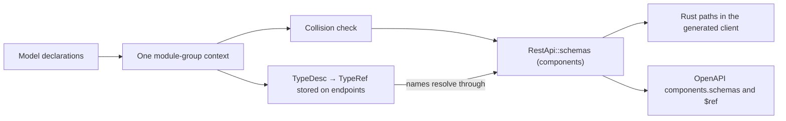

# Typed type registration

Use `schematic_define::DefinitionContext` to collect the types for one generated
module. Registration returns a `TypeDesc`: the `TypeRef` an endpoint stores
(component names plus wrapper shape) and its Rust spelling. Every shipped REST
provider and imported module uses one typed module-group assembly, and every
API it builds carries the context's schema components in `RestApi::schemas`.

```rust
use schematic_define::{definition_type, DefinitionContext, TypeRef};
use schemars::JsonSchema;

definition_type! {
    #[derive(JsonSchema)]
    pub struct Model { pub id: String }
}

let mut context = DefinitionContext::types_in("::my_definitions::models");
let response = context.register::<Option<Vec<Model>>>()?;
// Stored reference: Optional(Array(Named("Model")))
assert_eq!(response.type_ref(), &TypeRef::Optional(Box::new(
    TypeRef::Array(Box::new(TypeRef::Named("Model".into()))))));
assert_eq!(response.rust_path(),
    "::std::option::Option<::std::vec::Vec<::my_definitions::models::Model>>");
context.finish()?;
```

`definition_type!` wraps a named, tuple, or unit struct or an enum declaration and emits its
`Registration` implementation beside it. Its Rust identifier comes from the
declaration; its component name comes from `JsonSchema`, including Serde or
Schemars renaming. There is no blanket implementation for every `JsonSchema`
type. Nominal types containing collections still produce nominal components.

The module path must name a public module accessible from the generated crate.
Compilation of the generated crate proves that visibility. `type_name` is used
only for diagnostics, never to derive emitted Rust paths.

For aliases and public re-exports, register the exceptional spelling first:

```rust
use schematic_define::{definition_type, DefinitionContext, rust_path};
use schemars::JsonSchema;
definition_type!(#[derive(JsonSchema)] pub struct CommitInfo { pub id: String });
pub type Commit = CommitInfo;
let mut context = DefinitionContext::types_in("::my_definitions::models");
let commit = context.register_as::<CommitInfo>(rust_path!(Commit)
    .schema_name("Commit"))?;
```

`rust_path!` requires a resolvable Rust type path and proves it names the type
passed to `register_as`. Concrete generic paths are supported. Authors must
choose paths accessible from the generated crate; a local import can compile
at registration time and still fail there. The hidden token constructor and
custom registration traits are authoring contracts, not protection against
deliberately dishonest trait implementations.

The first registration of a canonical Rust type fixes its component name, path,
and insertion position. Registering an alias later reuses those choices.
Distinct types with the same component name fail registration; `finish()`
returns every collected collision in encounter order. A collision never replaces
an earlier schema. Use `error.diagnostics(api_name)` for one contextual line per
collision. `register_as` accepts nominal leaves; it rejects containers,
primitives, and free-form JSON. Foreign types need an implementation owned by
`schematic-define`; currently `Duration` and `Range<u64>` are adapted.

`Vec`, `Option`, and `HashMap` recursively reuse leaf registrations. They do not
create components. Primitive types, strings, unit, and `serde_json::Value` are
inline. Options preserve Rust wrappers and wire nullability. Nullable schemas
use the same OpenAPI 3.0 transforms as nominal schema generation. Maps accept
String and all Serde-supported signed/unsigned integer widths. A string-like
newtype can implement `MapKey` with an explicit public Rust path when its Serde
representation is a string. Boolean and floating-point keys fail before the
value type is registered. Use `register_for::<T>(api, endpoint)` for contextual
registration errors.

## From registration to references

`DefinitionContext::components()` turns the registrations into the list an API
stores as `RestApi::schemas`. Each `SchemaComponent` has a `name` (the
`#/components/schemas/{name}` target), a `rust_path`, and a `schema` with its
nested definitions removed. Types that appear only nested inside a registered
type (`$defs`) become components of their own with `rust_path: None`; they are
exported to OpenAPI but cannot be referenced by an endpoint. Components follow
registration order, with a nested-only type placed after the first type that
contains it; registering that type later takes over its entry in place.
Explicit registrations survive even when no endpoint uses them.

One component name holds one wire schema. When a name arrives a second time,
as another nested copy or as an explicit registration, its schema must equal
the one already stored, or `components()` (and therefore API build and module
group assembly) fails with `DefinitionError::Collisions` listing one
`ComponentConflict { schema_name, first, second }` per name. Each source is a
registered Rust type or "a schema nested in" one:

```rust,ignore
mod left  { pub struct Status { pub value: String } pub struct Left  { pub status: Status } }
mod right { pub struct Status { pub value: bool }   pub struct Right { pub status: Status } }

ctx.register::<left::Left>()?;
ctx.register::<right::Right>()?;
ctx.components() // Err: schema component "Status" has different definitions
                 // from a schema nested in …::left::Left and a schema nested in …::right::Right
```

The same type reached twice is not a conflict. The comparison ignores the
top-level `title`, and it applies the OpenAPI 3.0 transforms (such as
`nullable`) to nested copies, because schemars applies them only to a root
schema. It also reads a recursive type's `"$ref": "#"` as a reference to the
registration it was found under.

Endpoints never store a Rust path. They store a `TypeRef`, and every reader
resolves its names through the API's `schemas` (Rust spellings abbreviated):

| Stored reference | Rust spelling (`RestApi::rust_type`) | OpenAPI wire schema |
| --- | --- | --- |
| `Named("Model")` | `::my_definitions::models::Model` | `$ref: '#/components/schemas/Model'` |
| `Array(Named("Model"))` | `::std::vec::Vec<…::Model>` | array of that `$ref` |
| `Optional(Named("Model"))` | `::std::option::Option<…::Model>` | nullable `$ref` |
| `Map(Named("Model"))` | `::std::collections::HashMap<::std::string::String, …::Model>` | object with `additionalProperties` |
| `KeyedMap { key: "u32", value: Named("Model") }` | `::std::collections::HashMap<u32, …::Model>` | same as `Map` |
| `Primitive(U32)`, `Primitive(Json)` | `u32`, `::serde_json::Value` | inline, no component |

`KeyedMap` holds the one Rust spelling a reference ever carries, because a map
key type has no component of its own. The primitive widths cover `i8`–`i128`,
`u8`–`u128`, `isize`, `usize`, `f32`, `f64`, `bool`, `char`, `String`, `()`,
bytes (`Vec<u8>`), and free-form `serde_json::Value` (`Json`).



`schematic_definitions::registry::assemble_module_group` calls an author-supplied
assembly function with one context and returns `Result<Vec<RestApi>,
DefinitionError>`. There is no separate schema registry: the components come
from the context alone. Each API the module group returns is then listed once
in the registration inventory, `registry::registrations()`, which every
generator input, export, and test derives from (see
[Register an API](generation/workflow.md#register-an-api)). Because a module group's
APIs are built one at a time, an early member's build sees only the types
registered so far; assembly therefore gives every member the finished context's
components and re-runs `validate_references`, so all members carry identical
`schemas`. Collisions are checked first, even if the callback swallowed one.
Shared API variants use one context; isolated modules may reuse component names.

## Polymorphic bodies: `oneOf`, `anyOf`, `allOf`

A hand-written serde type can be bound to a structural composition of types
registered in the same context. The structure you state is what OpenAPI
receives, and the Rust generator references your type:

```rust,ignore
let cat = ctx.register::<Cat>()?;
let dog = ctx.register::<Dog>()?;
let pet = ctx.one_of::<Pet>([cat, dog])?; // also any_of, all_of
// api.schemas: Pet = {"oneOf":[{"$ref":"#/components/schemas/Cat"},
//                              {"$ref":"#/components/schemas/Dog"}]}
Endpoint::post("Adopt", "/pets").request_json::<Pet>(&mut ctx) // references Pet
```

- `oneOf` means exactly one member matches, `anyOf` at least one, `allOf` every
  member. Matching the Rust serde representation to the declared structure is
  the author's job: an untagged enum does not by itself prove `oneOf`
  exclusivity, so give the variants distinguishable shapes. Use a struct that
  satisfies every member for `allOf`.
- The composition replaces schemars' own schema for the bound type in
  `components()`. The returned `TypeDesc` names the bound type, and
  `TypeDesc::structure()` returns the composition; a structure can only be
  attached through these methods.
- Registration fails, and the error is also collected for `finish()`, for an
  empty member list, a duplicate member, a primitive or container member
  (`NonNominalMember`), or a member this context did not register
  (`ForeignMember`). A member must match this context's entry by name, Rust path,
  and structure; a descriptor carries no context identity, so an identical
  descriptor from another context is indistinguishable. A bound type that was
  registered earlier without this composition, or with a different one
  (including reordered members), is a `ComponentConflict`. Repeating the same
  composition, or a later plain `register::<Pet>()`, returns the composed
  descriptor.
- `DefinitionContext::models()` lists every composition as a
  `ModelDef::Alias` in registration order. The model catalog types serialize
  with serde; unknown members and explicit `null` for optional fields are
  rejected.
- OpenAPI export writes a composed component as `oneOf`, `anyOf`, or `allOf`
  over `$ref`s to its members, for example
  `Pet: {oneOf: [{$ref: '#/components/schemas/Cat'}, {$ref: '#/components/schemas/Dog'}]}`.
- Postman has no schema-composition declaration, but its examples honor
  compositions: `allOf` members are merged and `oneOf`/`anyOf` branches are
  tried in order until one value validates against the whole composition.
  When none does (two `oneOf` branches accepting the same value, for
  example), the body is left empty with an `example-value` warning. See
  [Postman example values](io/export-postman.md#example-values).

## Value rules on registered models

A rule such as "a name is 1 to 40 characters" is written as a Schemars
attribute on the model's field. Registration stores the generated JSON Schema
keywords in the model's schema component, and that component is the rule's
only source:

```rust
use schematic_define::{definition_type, DefinitionContext};
use schemars::JsonSchema;
use serde::Deserialize;

definition_type! {
    #[derive(JsonSchema, Deserialize)]
    pub struct Signup {
        #[schemars(length(min = 1, max = 40))]
        pub name: String,
        #[serde(rename = "displayName")]
        #[schemars(regex(pattern = r"^[a-z][a-z0-9-]*$"))]
        pub display_name: String,
        #[schemars(length(max = 5), inner(length(max = 12)))]
        pub tags: Vec<String>,
        #[schemars(range(min = 1, max = 10))]
        pub seats: Option<i32>,
        #[schemars(extend("multipleOf" = 0.5))]
        pub price: f64,
    }
}

let mut context = DefinitionContext::types_in("::my_definitions::models");
context.register::<Signup>()?;
let components = context.components()?;
let properties = &components[0].schema["properties"];
assert_eq!(properties["name"]["maxLength"], 40);
assert_eq!(properties["displayName"]["pattern"], "^[a-z][a-z0-9-]*$");
assert_eq!(properties["tags"]["items"]["maxLength"], 12);
```

Each rule follows its field's wire name (`displayName` above), and a rule
on a nested model lives in that model's own component.

| JSON Schema keyword | Attribute |
| --- | --- |
| `minLength`, `maxLength` | `length(min = 1, max = 100)`, or `length(equal = 3)` for both, on a string |
| `minItems`, `maxItems` | the same `length(..)`, on a `Vec` or set |
| `pattern` | `regex(pattern = r"^[a-z]+$")` or `pattern(r"^[a-z]+$")` |
| `minimum`, `maximum` | `range(min = 1, max = 100)`, or `range(equal = n)` |
| `format` | `email`, `url` (writes `uri`), `ip`; otherwise `extend("format" = "uuid")` |
| `exclusiveMinimum`, `exclusiveMaximum` | `extend("exclusiveMinimum" = 0)` |
| `multipleOf` | `extend("multipleOf" = 0.1)` |
| `uniqueItems` | implied by `HashSet`/`BTreeSet`; otherwise `extend("uniqueItems" = true)` |
| `enum` | a Rust unit enum, or `extend("enum" = ["a", "b"])` |
| `const` | `extend("const" = "fixed")` |
| rules on each array item | `inner(length(..))`, `inner(range(..))`, `inner(regex(..))` |
| rules on each map value | `extend("additionalProperties" = {..})`, which replaces the generated value schema |

`format` is an annotation: nothing rejects a value for its format. Schemars
also writes a Rust integer width's own bounds (`minimum: 0` on a `u32`,
`0..=255` on a `u8`); those come from the type, not from an attribute.

**A mismatched attribute vanishes silently.** Schemars writes a native rule
only when the field's schema has the matching type, and reports nothing
otherwise: `length` on an `i32`, `range` on a `String`, `length` on an
`Option<Model>` (a reference has no type), and `inner(..)` on a `HashMap` or
an `Option<String>` all produce no keyword. Check the stored component when a
rule matters, and use `extend(..)` or a newtype whose own field carries the
rule. `extend` is never checked, so it also accepts values that are not valid
JSON Schema, and it overrides a native rule for the same keyword.

Endpoints reference the component by name and store no copy of its rules. A
model shared by several endpoints is stored once, and no endpoint can change
it: `EndpointBuilder::request_constraints` on a JSON body whose root is a
component fails the build. To constrain one endpoint differently, register a
different model.

A rule is enforceable only where the value's schema is a plain chain of
properties, array items, map values, and `Option`s. An `anyOf` counts as an
`Option` only when it has exactly two members and one admits only `null`; an
untagged enum is an `anyOf` of its variants and does not. A rule beneath
`oneOf`, any other `anyOf`, `allOf`, or `not`, or beside a `$ref` that names
no component, is still stored and exported, but cannot be enforced.
`schematic_define::constraints::unenforceable_rules(&api, &body)` lists each
such rule with its component, JSON pointer, keyword, and reason:

```rust,ignore
let rules = unenforceable_rules(&api, &TypeRef::Named("Order".into()));
// Order.choice is an untagged `enum Choice { Text(String), Number(i64) }`
// whose variants carry `length(max = 3)` and `range(min = 1)`:
// [(Some("Choice"), "/anyOf/0", "maxLength"), (Some("Choice"), "/anyOf/1", "minimum")]
```

A generated client checks a registered model's enforceable rules before
sending a request whose JSON body reaches it (see
[value rules](generation/request-side.md#value-rules)). For the
unenforceable ones, generation reports a `type-constraint` diagnostic: a
warning for a rule inside a member of a union that is itself a component
(the shape of a Rust enum of structs), an error for any other. The
`enum`/`const` values Schemars writes for a Rust enum's own variants and
tags are guaranteed by the Rust type, so neither is reported.

## References in transferred definitions

`TypeDesc` is an authoring handle only: it has no Serde derives and no public
constructor. A `RestApi` does serialize, and its references and components
travel with it. Treat a deserialized definition as untrusted and call
`RestApi::validate_references` and `RestApi::validate_schema_closure` before
using it. They are the checks API build runs:

- every name in every JSON body, response, and form-part reference resolves to
  a component with a Rust path, or the error is
  `DefinitionError::UnresolvedReference { api, endpoint, name }`
- component names are nonempty and unique, Rust paths are nonempty, and each
  schema is a JSON Schema object or boolean
- compositions, `Unknown`, and empty map keys are rejected
- every `$ref` inside every component schema names a component
  (`#/components/schemas/{name}`, with `~1`/`~0` and `%XX` escapes decoded), or
  the error is `DefinitionError::UnresolvedSchemaReferences`, listing each
  reference with its parent component and JSON pointer; a reference to another
  document is listed with no missing name and is never fetched

```json
{
  "name": "Fixture",
  "endpoints": [{ "id": "Get", "response": { "Json": { "Array": { "Named": "Model" } } } }],
  "schemas": [{ "name": "Model", "rust_path": "::models::Model", "schema": { "type": "object" } }]
}
```

Renaming the component to `Renamed` in this excerpt fails with
`Fixture endpoint Get: unresolved schema reference "Model"`; changing its
`rust_path` to `::other::Model` changes the generated Rust spelling and nothing
else. Components reject unknown fields, a missing `name` or `schema`, wrong
types, duplicate keys, and trailing content while reading JSON. An absent or
null `rust_path` reads as a nested-only component, which a reference cannot
name. The `builders` integration target covers this matrix; shipped definition
snapshots and artifact drift tests exercise the catalog through normal
generation.

[Definition builders](definition-builders.md) describe how endpoint builders
lower a registration to its reference and how API build stores the components.
WebSocket messages keep their separate `Schema { type_name, module_path }`
representation.

A nominal generic model needs a concrete Rust path for each instantiation it
registers. For example, Bitbucket registers `PaginatedResponse<Repository>` with
both the wrapper and `Repository` qualified through their public module. Its
registration implementations live beside `PaginatedResponse`; a context can
register one directly without first assembling the provider. Writing the
literal path `PaginatedResponse<T>` inside a generic implementation would leave
an unbound `T` in generated client code.

[The compiling authoring example](authoring-examples.md) combines ordinary nominal
registration, alias-first registration, nested containers, and complete API assembly.
