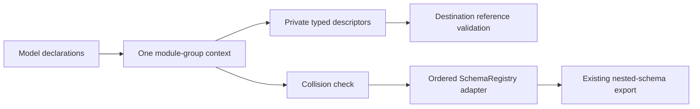

# Typed type registration

Use `schematic_define::DefinitionContext` to collect the types for one generated
module. Registration returns a `TypeDesc` with separate component and Rust names.
Every shipped REST provider and imported module uses one typed module-group
assembly for its APIs and ordered registry.

```rust
use schematic_define::{definition_type, DefinitionContext};
use schemars::JsonSchema;

definition_type! {
    #[derive(JsonSchema)]
    pub struct Model { pub id: String }
}

let mut context = DefinitionContext::types_in("::my_definitions::models");
let response = context.register::<Option<Vec<Model>>>()?;
context.validate_reference("Catalog", "ListModels", &response)?;
context.finish()?;
```

`definition_type!` wraps a named, tuple, or unit struct or an enum declaration and emits its
`Registration` implementation beside it. Its Rust identifier comes from the
declaration; its component name comes from `JsonSchema`, including Serde or
Schemars renaming. There is no blanket implementation for every `JsonSchema`
type. Nominal types containing collections still produce nominal components.

The module path must name a public module accessible from the generated crate.
Compilation of the generated crate proves that visibility. `type_name` is used
only for diagnostics, never to derive emitted Rust paths.

For aliases and public re-exports, register the exceptional spelling first:

```rust
use schematic_define::{definition_type, DefinitionContext, rust_path};
use schemars::JsonSchema;
definition_type!(#[derive(JsonSchema)] pub struct CommitInfo { pub id: String });
pub type Commit = CommitInfo;
let mut context = DefinitionContext::types_in("::my_definitions::models");
let commit = context.register_as::<CommitInfo>(rust_path!(Commit)
    .schema_name("Commit"))?;
```

`rust_path!` requires a resolvable Rust type path and proves it names the type
passed to `register_as`. Concrete generic paths are supported. Authors must
choose paths accessible from the generated crate; a local import can compile
at registration time and still fail there. The hidden token constructor and
custom registration traits are authoring contracts, not protection against
deliberately dishonest trait implementations.

The first registration of a canonical Rust type fixes its component name, path,
and insertion position. Registering an alias later reuses those choices.
Distinct types with the same component name fail registration; `finish()`
returns every collected collision in encounter order. A collision never replaces
an earlier schema. Use `error.diagnostics(api_name)` for one contextual line per
collision. `register_as` accepts nominal leaves; it rejects containers,
primitives, and free-form JSON. Foreign types need an implementation owned by
`schematic-define`; currently `Duration` and `Range<u64>` are adapted.

`Vec`, `Option`, and `HashMap` recursively reuse leaf registrations. They do not
create components. Primitive types, strings, unit, and `serde_json::Value` are
inline. Options preserve Rust wrappers and wire nullability. Nullable schemas
use the same OpenAPI 3.0 transforms as nominal schema generation. Maps accept
String and all Serde-supported signed/unsigned integer widths. A string-like
newtype can implement `MapKey` with an explicit public Rust path when its Serde
representation is a string. Boolean and floating-point keys fail before the
value type is registered. Use `register_for::<T>(api, endpoint)` for contextual
registration errors.



`schematic_definitions::registry::assemble_module_group` calls an author-supplied
assembly function with one context and returns `ModuleGroup { apis, registry }`.
There is no separate API inventory in the adapter. `SchemaRegistry::from_context`
checks collisions before adapting entries, preserving both insertion order and
the existing nested-schema extraction. Explicit registrations survive even when
no endpoint uses them. Shared API variants use one context; isolated modules
may reuse component names.

A `TypeDesc` derives Serde but has no public string constructor or structural
setter. Deserialized descriptors are untrusted transfer data. Call
`validate_reference(api, endpoint, &descriptor)` before lowering them into a
definition. The destination must have registered the complete matching shape,
including schema name, Rust path, key type, wrappers, and inline schema. This
accepts matching data from another context without serializing process identity.
An unrelated context or changed wrapper fails with API, endpoint, and type
context. The reserved `structure: Option<TypeRef>` is always `None` in authored
registrations; valid non-null structural data can round-trip through Serde but
is rejected by reference validation.

Descriptor JSON uses these field contracts. All malformed cells reject through
JSON reading or public destination validation, rather than silently clearing data.
The named, inline, and map controls are produced by real registration calls.

| JSON shape | shape discriminator/wrapper | Named.schema_name | Named/Inline.rust_path | Inline.schema | Map.key | Map.value | structure |
| --- | --- | --- | --- | --- | --- | --- | --- |
| Control | Registered shape | Registered name | Registered path | Exact inline schema | Registered key | Registered nested shape | null accepts |
| Absent | Reject | Reject | Reject | Reject | Reject | Reject | Accept None |
| Null | Reject | Reject | Reject | Reject | Reject | Reject | Accept None |
| Wrong type | Reject | Reject | Reject | Reject | Reject | Reject | Reject |
| Mixed invalid array | Reject | Reject | Reject | Reject | Reject | Reject | Reject |
| All-invalid array | Reject | Reject | Reject | Reject | Reject | Reject | Reject |
| Empty | Reject | Reject | Reject | Reject for the String control; explicit Value uses {} | Reject | Reject | Reject |
| Duplicate key | Reject | Reject | Reject | Reject | Reject | Reject | Reject |
| Trailing/invalid content | Reject document | Reject document | Reject document | Reject document | Reject document | Reject document | Reject document |

Unknown fields and variants are rejected. Missing and null are equivalent only
for reserved structure. The focused `typed_registration` integration target
covers the matrix and repeated read/write/read transfer round trips. Existing
shipped definition snapshots and artifact drift tests continue to exercise the
unchanged catalog through normal generation.

[Definition builders](definition-builders.md) retain descriptor evidence in typed schemas and validate it against the destination module context at API build. REST JSON schemas without that evidence fail API build; WebSocket schemas retain their separate compatibility representation.

A nominal generic model needs a concrete Rust path for each instantiation it
registers. For example, Bitbucket registers `PaginatedResponse<Repository>` with
both the wrapper and `Repository` qualified through their public module. Its
registration implementations live beside `PaginatedResponse`; a context can
register one directly without first assembling the provider. Writing the
literal path `PaginatedResponse<T>` inside a generic implementation would leave
an unbound `T` in generated client code.

[The compiling authoring example](authoring-examples.md) combines ordinary nominal
registration, alias-first registration, nested containers, and complete API assembly.
