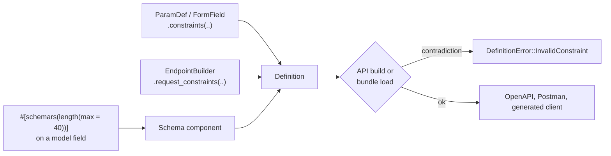

# Value constraints

A definition can say more about a request input than its type: "a string of
at most 100 characters", "an integer between 1 and 100", "at most ten unique
tags". These are **value constraints**, the JSON Schema validation keywords
that Schematic carries from a definition into its exports and generated
clients.

```rust
use schematic_define::prelude::*;
use schematic_define::constraints::Constraints;

let endpoint = Endpoint::get("ListItems", "/items")
    .describes("List items")
    .returns_empty()
    .query(ParamDef::new("limit", QueryParamType::Integer)
        .constraints(Constraints::new().minimum(1).maximum(100)))
    .query(ParamDef::new("tags", QueryParamType::Array(Box::new(QueryParamType::String)))
        .constraints(Constraints::new().max_items(10).unique_items()
            .items(Constraints::new().min_length(1).max_length(40))))
    .build()?;
```

## Where rules are written

There is one place for each rule, so no two sources can disagree:

| Constrained value | Write its rules with |
| --- | --- |
| A query, path, header, or cookie parameter | `ParamDef::constraints(..)` |
| A text or JSON form field | `FormField::constraints(..)` |
| The root of a text body, or of a JSON body whose root is an array, map, or primitive | `EndpointBuilder::request_constraints(..)` |
| A field of a registered model (a JSON body, response, or form part type) | Schemars attributes on the model, as in [typed registration](typed-registration.md#value-rules-on-registered-models) |

A registered model's schema component is the only source of its rules, so
`request_constraints` on a JSON body that *is* a component fails: put the
rule on the model instead. A rule written on one endpoint never changes a
model other endpoints share.



## Keywords

| Method | JSON Schema keyword | Applies to |
| --- | --- | --- |
| `min_length(n)`, `max_length(n)` | `minLength`, `maxLength` | strings, counted in Unicode code points |
| `pattern(source)` | `pattern` | strings; searches unless anchored with `^`/`$` |
| `format(name)` | `format` | strings and numbers; an annotation only |
| `minimum(x)`, `maximum(x)` | `minimum`, `maximum` | numbers, inclusive |
| `exclusive_minimum(x)`, `exclusive_maximum(x)` | `exclusiveMinimum`, `exclusiveMaximum` | numbers, exclusive |
| `multiple_of(x)` | `multipleOf` | numbers; `x` must be positive |
| `min_items(n)`, `max_items(n)` | `minItems`, `maxItems` | arrays, counted before a parameter is joined or exploded |
| `unique_items()` | `uniqueItems` | arrays, by deep JSON equality |
| `items(rules)` | `items` | every element of an array |
| `allowed_values(values)` | `enum` | any value; whole-value equality |
| `constant(value)` | `const` | any value; whole-value equality |

A rule applies only to values of its own kind. An absent optional input is
not checked; a present empty string or array is. `enum` and `const` compare
whole JSON values, and a `null` among them is a value, not "absent".

### Exact numbers

Numeric limits are kept as decimal text, never as floats:

```rust
use schematic_define::constraints::Constraints;

let rules = Constraints::new()
    .maximum("18446744073709551616") // beyond u64: pass text
    .multiple_of("0.1");             // 0.3 is a multiple; no rounding error
assert_eq!(rules.maximum.unwrap().as_str(), "18446744073709551616");
```

The builders also take integers and floats; a float is written as the
shortest text that reads back as the same float (`0.1_f64` is `"0.1"`).
Comparisons are mathematical: `1`, `1.0`, and `1e0` are equal. A serialized
definition stores each limit as a JSON string (`"maximum": "100"`), because
reading a JSON number would narrow it. An exponent beyond ±10000 is refused.

### Formats

`format` is preserved, exported, and shown in documentation, but nothing
rejects a value for its format. Any name is accepted, including ones
Schematic does not recognize.

## Definition errors

API build checks every rule, and so does loading a
[definition bundle](io/definition-bundles.md). A problem fails with
`DefinitionError::InvalidConstraint`, naming the API, endpoint, input path,
keyword, and reason:

```text
Items endpoint ListItems: query.limit `minLength` does not apply to an integer
```

| Problem | Example |
| --- | --- |
| A rule for another kind of value | `min_length` on an integer parameter; `items` on a string |
| A rule on a value with nothing to check | any rule on a file field, a binary body, a form body, or a JSON body that is a schema component |
| Lower bound above upper bound | `min_length(5).max_length(2)`, `min_items(3).max_items(1)` |
| An empty interval | `minimum(10).maximum(1)`, `exclusive_minimum(1).exclusive_maximum(1)` |
| A nonpositive divisor | `multiple_of(0)`, `multiple_of(-2)` |
| An empty `enum` | `allowed_values(Vec::<String>::new())` |
| An `enum` or `const` value of the wrong type | `allowed_values([1, 2])` on a string parameter |
| A limit that is not a number | `maximum("ten")`, `maximum(f64::NAN)`, `maximum("1e99999")` |
| A pattern outside the enforced subset | `pattern(r"^\s+$")` (see below) |
| An empty format name | `format("")` |

Only direct contradictions are errors; Schematic does not try to prove that
some value satisfies every rule at once.

## Patterns

JSON Schema patterns are ECMAScript regular expressions, but generated
clients match with Rust's `regex` crate. The two agree on most everyday
syntax and disagree on some, so Schematic enforces a pattern only when every
construct in it means the same thing in both. `admit_pattern(source)`
reports the outcome:

- **enforced**: the client checks it. `\d` and `\w` keep ECMAScript's ASCII
  meaning by being rewritten as `[0-9]` and `[0-9A-Za-z_]`.
- **unsupported**: valid ECMAScript, but Rust lacks the construct or reads it
  differently. Authoring one with `pattern(..)` is a definition error;
  `unenforced_pattern(..)` keeps it for export and documentation without
  checking it, which is how an imported pattern of this kind is carried.
- **invalid**: not a regular expression at all.

`pattern("")` is valid and matches every string.

<!-- pattern-admission:start -->
| Pattern | Outcome | Enforced as, or why not |
| --- | --- | --- |
| (empty) | enforced | (empty) |
| `abc` | enforced | `abc` |
| `^[a-z][a-z0-9-]*$` | enforced | `^[a-z][a-z0-9-]*$` |
| `^(?:ab\|cd)+$` | enforced | `^(?:ab\|cd)+$` |
| `^(?<year>[0-9]{4})-(?<month>[0-9]{2})$` | enforced | `^(?<year>[0-9]{4})-(?<month>[0-9]{2})$` |
| `^a{2,5}?b*?$` | enforced | `^a{2,5}?b*?$` |
| `^\d{3}$` | enforced | `^[0-9]{3}$` |
| `^\w+\D\W$` | enforced | `^[0-9A-Za-z_]+[^0-9][^0-9A-Za-z_]$` |
| `^[\d.-]+$` | enforced | `^[0-9.-]+$` |
| `^[^\D]$` | enforced | `^[^[^0-9]]$` |
| `^é\x41\t\.\/$` | enforced | `^é\x41\t\.\/$` |
| `^[é-ü]+$` | enforced | `^[é-ü]+$` |
| `a.c` | unsupported | `.` excludes different line terminators |
| `^\s+$` | unsupported | `\s` matches different whitespace |
| `\bword\b` | unsupported | `\b` uses Unicode word characters in Rust |
| `^\p{Lu}` | unsupported | Unicode property classes are not enforced |
| `(?i)abc` | unsupported | inline flags have no ECMAScript equivalent |
| `(?i:abc)` | unsupported | inline flags have no ECMAScript equivalent |
| `(?P<name>a)` | unsupported | `(?P<name>..)` is not ECMAScript syntax |
| `(?=a)b` | unsupported | Rust has no look-around |
| `(a)\1` | unsupported | Rust has no back-references |
| `[[:alpha:]]` | unsupported | `[` inside a class nests a class in Rust |
| `[a[b]]` | unsupported | `[` inside a class nests a class in Rust |
| `[a&&b]` | unsupported | class set operations are literals in ECMAScript |
| `[]a]` | unsupported | a class starting with `]` is empty in ECMAScript |
| `a{,3}` | unsupported | `{,n}` is a literal in ECMAScript |
| `\Aabc\z` | unsupported | `\A` and `\z` are Rust syntax |
| `\x{41}` | unsupported | braced hex escapes are not ECMAScript syntax |
| `(a` | invalid | unclosed group |
| `a)` | invalid | unopened group |
| `*a` | invalid | nothing to repeat |
| `a{5,2}` | invalid | decreasing repetition range |
| `[z-a]` | invalid | decreasing class range |
| `abc\` | invalid | trailing backslash |
<!-- pattern-admission:end -->

## Where rules are checked

| Stage | What happens |
| --- | --- |
| API build, bundle load | Every rule is checked for contradictions (above). |
| Pagination | A page-size parameter adopted by a pager takes its bounds from the strategy's `min`/`max`; see [pagination](pagination.md). |
| Generated clients | Each generated request with rules checks them before sending and has a `validate()` method; see [value rules](generation/request-side.md#value-rules). Formats and patterns outside the enforced subset are labeled, not checked. |
| OpenAPI import and export | Rules travel through import, `--definitions-out`, and export without narrowing; see [importing](io/import-openapi.md#value-constraints) and [exporting](io/export-openapi.md#value-constraints). |

Responses are never validated: a reply that decodes is returned even if it
breaks a declared rule.
