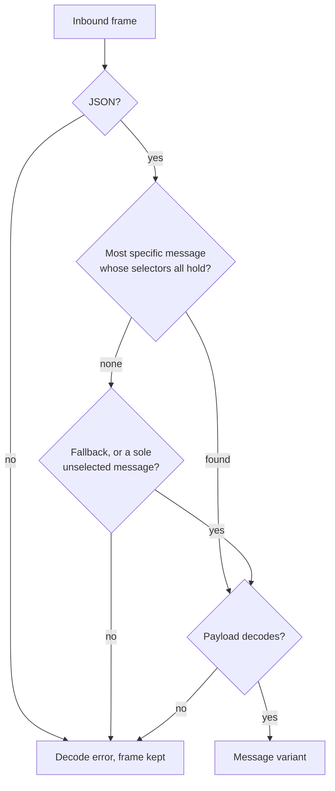
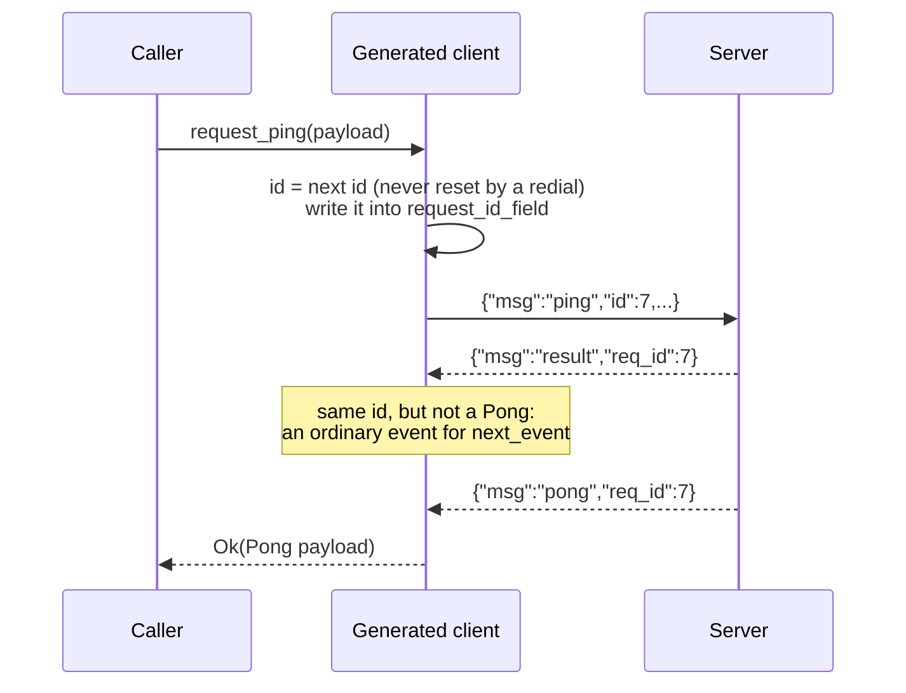
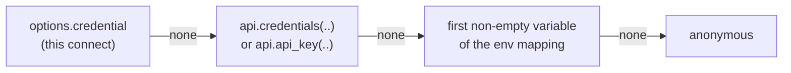
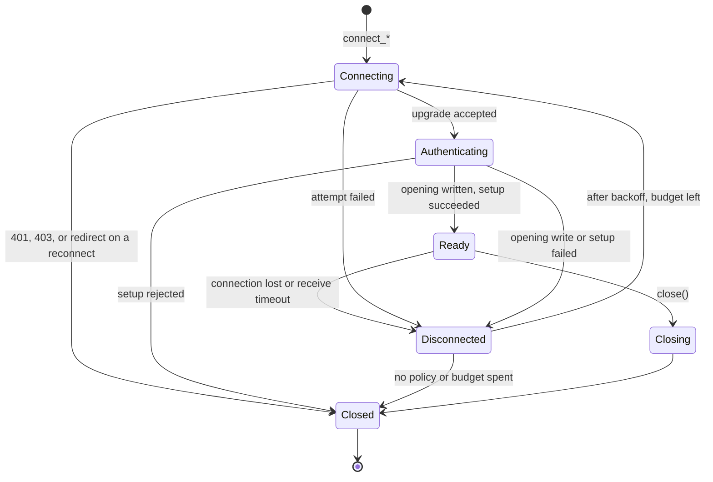

# WebSocket definitions

A `WebSocketApi` describes a WebSocket API the way a `RestApi` describes an
HTTP one: a base URL, authentication, and endpoints. `schematic-gen` turns it
into a module of `schematic-schema` with typed messages, a client per
endpoint and, where the endpoint asks for it, a host (server). This page
covers authoring the definition in `schematic-define` and what it generates.

Everything a handshake shares with an HTTP request uses the REST vocabulary:
`AuthStrategy`, `AuthPolicy`, `EnvMapping`, constant headers, and
`EndpointParams` of `ParamDef`s. There is no WebSocket-only parameter type.

## A complete definition

```rust
use schematic_define::websocket::*;
use schematic_define::{
    ApiKeyEnv, AuthStrategy, EndpointParams, EnvList, EnvMapping, ParamDef, QueryParamType, Schema,
};

let api = WebSocketApi {
    name: "ExampleWs".to_string(),
    description: "Example streaming API".to_string(),
    base_url: "wss://stream.example.com".to_string(),
    docs_url: None,
    auth: AuthStrategy::ApiKey { header: "X-Api-Key".to_string(), value_prefix: None },
    auth_policy: None,
    env_auth: vec!["EXAMPLE_API_KEY".to_string()],
    env_mapping: Some(EnvMapping {
        api_key: Some(ApiKeyEnv {
            names: EnvList::single("EXAMPLE_API_KEY"),
            header: "X-Api-Key".to_string(),
        }),
        ..EnvMapping::default()
    }),
    headers: vec![("X-Client".to_string(), "schematic".to_string())],
    version: None,
    endpoints: vec![WebSocketEndpoint {
        id: "Rooms".to_string(),
        path: "/rooms/{room}".to_string(),
        description: "Room events".to_string(),
        params: EndpointParams {
            path: vec![ParamDef::path("room", QueryParamType::String)],
            query: vec![ParamDef::new("since", QueryParamType::Integer)],
            ..EndpointParams::default()
        },
        role: EndpointRole::Client,
        messages: vec![
            MessageSchema::new("Ping", MessageDirection::Client, Schema::new("PingMessage"))
                .matches("type", "ping")
                .responds_with("Pong"),
            MessageSchema::new("Pong", MessageDirection::Server, Schema::new("PongMessage"))
                .matches("type", "pong"),
            MessageSchema::new("Event", MessageDirection::Server, Schema::new("EventMessage"))
                .fallback(),
        ],
        ..WebSocketEndpoint::default()
    }],
    runtime: None,
};
```

The five shipped definitions in `schematic-definitions` (ElevenLabs, Samsung
remote, and the Unfolded Circle Core, Dock, and Integration APIs) follow this
shape and are checked by its `ws_conformance` tests.

## Roles and directions

An endpoint's `role` says which side `schematic-gen` emits:

| `role` | Serialized | Generated |
|---|---|---|
| `EndpointRole::Client` (the default) | `"client"` | a client that dials the endpoint |
| `EndpointRole::Host` | `"host"` | a host that accepts connections |
| `EndpointRole::Both` | `"both"` | both |

The role is always declared, never inferred from the messages. A message's
`direction` is **client-relative** whatever the role: `Client` messages are
sent by the client and received by a host, `Server` messages the reverse, and
`Bidirectional` messages flow both ways. Use `Bidirectional` only for a
message that really travels both ways, such as the Integration API's event
envelope.

```rust
use schematic_define::websocket::EndpointRole;

// The Integration driver hosts the channel; the remote connects to it.
let role = EndpointRole::Both;
```

## Selecting an inbound message

An inbound frame is matched to one declared message by its **selectors**:
equality checks on existing top-level wire fields, written with `.matches`.
All of a message's selectors must hold. One message per direction may be the
`.fallback()`, which receives frames that match no selector; a fallback
declares no selectors.

```rust
use schematic_define::websocket::{MessageDirection, MessageSchema};
use schematic_define::Schema;

let pong = MessageSchema::new("Pong", MessageDirection::Server, Schema::new("PongMessage"))
    .matches("kind", "resp")
    .matches("msg", "pong");
let response = MessageSchema::new("Response", MessageDirection::Server, Schema::new("Envelope"))
    .fallback();
```

A direction with a single inbound message needs no selector. Selector values
are JSON strings; no nested field path is supported.

The frame selects the message whose selectors all hold. Two messages may
both match one frame only when one's selectors are a strict subset of the
other's; the frame then selects the more specific message. Above, a frame
`{"kind":"resp","msg":"pong"}` is `Pong`, and `{"kind":"resp","msg":"other"}`
reaches the `Response` fallback. Declaration order never decides.



Generation checks every direction an endpoint receives (`Server` messages for
a client, `Client` messages for a host, `Bidirectional` messages in both) and
reports an error for:

- more than one fallback
- a fallback that also declares selectors
- a message without selectors when the direction has more than one message
- two messages with the same selectors, or with selectors that can match
  one frame without one being a strict subset of the other
  (`{kind=resp, a=1}` and `{kind=resp, b=2}`)
- a selector field declared twice on one message

Selectors of a direction the endpoint never receives are not checked: a
client-only endpoint may send two client messages that share a wire value.

`schematic-gen import-asyncapi` writes selectors for you. A message that
carries `x-schematic-selectors` (as every exported document does) keeps
exactly those; any other message gets one selector per top-level payload
property whose schema is a string `const` (for example `kind: {const: resp}`),
following `$ref` and merging `allOf` parts. See
[AsyncAPI export and import](io/asyncapi.md).

## Linking a request to its response

`responds_with` on a request message names the message, in the same
endpoint, that answers it. Nothing is inferred from message names: an
endpoint correlates only when it declares `CorrelationHints` **and** at least
one message links its response.

```rust
use schematic_define::websocket::{CorrelationHints, MessageDirection, MessageSchema, WebSocketEndpointHints};
use schematic_define::Schema;

let ping = MessageSchema::new("Ping", MessageDirection::Client, Schema::new("PingMessage"))
    .responds_with("Pong");
let hints = WebSocketEndpointHints {
    correlation: Some(CorrelationHints {
        request_id_field: "id".to_string(),   // written into each request
        response_id_field: "req_id".to_string(), // read from each answer
        default_timeout_secs: 30,
    }),
    ..WebSocketEndpointHints::default()
};
```

Each link becomes one typed client method, `request_{request}` in snake
case, from the request payload to the response payload; `request_value`
takes and returns JSON for anything else:

```rust,ignore
let pong: PongMessage = live.request_ping(PingMessage::default()).await?;
let answer: serde_json::Value = live.request_value(serde_json::json!({"op": "stats"})).await?;
```

How one request is answered:



- The client allocates every id and writes it over any id the payload
  carries. The API's `WebSocketRuntimeHints.request_id_type` decides its JSON
  type: `u64` (the default) sends numbers, `string` sends strings (`"7"`),
  and an answer matches only when its `response_id_field` has the same type
  and value.
- A typed request completes only on a frame that selects its declared
  response message (see [selection](#selecting-an-inbound-message));
  `request_value` completes on the first frame carrying its id.
- A request that fails to send, times out (`RequestTimeout`), is cancelled
  (its future dropped), or loses its connection (`Disconnected`) gives up its
  slot among `max_pending_requests`. A request is never re-sent on a
  replacement connection, and commands still queued when a connection is lost
  are dropped rather than written to the next one.

Declare a link only where the protocol carries the id both ways. The Dock's
`auth` request and its `authentication` result carry none, so its `Auth`
message has no `responds_with`; its exchange runs in the
[setup callback](#setup-callbacks-for-challenge-flows) instead of as a
request that could only time out.

Generation rejects a link set on a server message, one naming no message of
the endpoint or a client message, a link on an endpoint without hints, and a
linked request named `Value`; hints or a `string` id type that nothing
consumes warn (see [validation](generation/validation.md#websocket-definitions)).

## Handshake parameters

`params` is the REST `EndpointParams` container:

- **path:** each `{placeholder}` in `path` is a required connect argument.
  With an empty `params.path` every placeholder is a string; otherwise
  `params.path` must name exactly the placeholders, each required, `simple`
  style, and a string, integer, number, or boolean. A substituted value is
  percent-encoded as one segment, so `a/b c?d` becomes `a%2Fb%20c%3Fd`.
- **query:** required values are fields of the endpoint's
  `{Endpoint}ConnectionParams` struct, optional ones are `Option` fields and
  are left out of the URL when unset. Scalars and arrays follow the REST
  query styles: `form` with `explode: true` repeats the name
  (`tag=a&tag=b`), `form` with `explode: false` joins with `,`, and
  `spaceDelimited`/`pipeDelimited` join with `%20`/`%7C`.
- **header** and **cookie** parameters are not generated for a handshake and
  are an error; put constant handshake headers on the API's `headers`.
- value **constraints** (`ParamDef::constraints`) on a handshake parameter are
  an error: a handshake does not enforce them.

The handshake URL is `base_url` followed by the substituted path, so a base
path such as `wss://host/proxy` stays a prefix. The endpoint path must start
with `/` and may not carry a query, a fragment, or an origin of its own:

```text
[ERROR] severity=error api=Example endpoint=Live feature=websocket-definition output=rust: endpoints/Live/path: path `/live?debug=1` embeds a query or fragment; declare query parameters in `params.query`
```

## Authentication and environment

`auth`, `auth_policy`, `env_auth`, `env_mapping`, and `headers` mean what
they mean on a `RestApi`. `effective_auth_policy()` and
`default_env_mapping()` return the explicit value when one is set and the
REST derivation otherwise. Shipped definitions set `env_mapping` explicitly.

### The handshake credential

A generated client translates the effective policy exactly as a REST client
does (its `auth_config()`), and each `connect_*` call selects **one**
credential before dialing:



```rust,ignore
use schematic_runtime::Credential;

// Core declares a challenge flow, so its connect takes a setup callback
// (see "Setup callbacks for challenge flows"); `authenticate` answers it.
let api = UnfoldedCircleCoreWs::new().api_key("client-key");
let core = api.connect_core_ws_with_setup(WsClientOptions::default(), authenticate).await?; // client-key
let other = api
    .connect_core_ws_with_setup(
        WsClientOptions::builder().credential(Credential::api_key("once")).build(),
        authenticate,
    )
    .await?; // once
assert_eq!(core.auth_method(), &schematic_runtime::AuthMethod::ClientLevel);
```

- **Placement** follows the strategy: a bearer token or API key in its
  header, an `ApiKeyParam` key as its query parameter or as a cookie merged
  into the request's `Cookie` header, Basic as `Authorization: Basic`. A
  policy of `AuthStrategy::None` sends no credential, even when an
  environment variable is set.
- **Anonymous** when nothing resolves: the upgrade carries no credential and
  `auth_method()` reports `AuthMethod::Anonymous`; a server that needs one
  answers with a rejection.
- **Once per connect.** Reconnects reuse the selected credential; a changed
  environment takes effect on the next explicit connect. `auth_method()`
  names the source, not proof the server accepted it.
- **No second source.** A credential of a kind the API does not accept, or a
  header, query value, or cookie the request already sets where the
  credential goes, is `WsError::InvalidCredential`; a caller header named
  like the credential header, or one the upgrade manages (`Host`,
  `Connection`, `Upgrade`, `Sec-WebSocket-Key`, `Sec-WebSocket-Version`,
  `Sec-WebSocket-Accept`, `Sec-WebSocket-Extensions`), is
  `WsError::InvalidHeader`. Nothing is sent.
- **Rejections are final.** Any non-101 answer is
  `WsError::HandshakeRejected { status, headers }`, with secret header
  values (including `Set-Cookie` and secrets inside `Location`) redacted. A
  redirect is never followed, so no request reaches another origin. A 401,
  403, or redirect on a reconnect closes the client without another attempt;
  other failures use the reconnect policy.
- **Nothing leaks.** Error text, `WsClientOptions`' `Debug`, and the stored
  handshake's `Debug` show `[redacted]` for credential values, including a
  query credential in a refused or stalled dial. The URL and headers needed
  for reconnecting are kept privately.
- **TLS:** `wss://` uses the platform's trusted roots. There is no option to
  accept an invalid certificate; the REST runtime's
  `danger_accept_invalid_certificates` configures its HTTP client only. A
  device that presents a self-signed certificate (for example a Samsung TV
  on `wss://…:8002`) therefore fails the dial with `WsError::Handshake`.
- **Cleartext:** a `ws://` base URL, as the Unfolded Circle Core and Dock
  definitions use for devices on the local network, connects without TLS.
  Any credential in the handshake or the setup exchange crosses the network
  unencrypted; the client sends it as declared and emits no warning.

`header(name, value)` adds a header to every handshake, replacing a constant
header of the same name.

A challenge exchange after the upgrade (an `auth_required` message the
client must answer) is declared as `AuthFlowHints` on the endpoint, never
only in prose:

```rust
use schematic_define::websocket::AuthFlowHints;

let flow = AuthFlowHints {
    challenge_message: "auth_required".to_string(),
    auth_request_schema: "AuthMessage".to_string(),
    success_indicator: Some("authentication".to_string()),
    failure_indicator: None,
};
```

## Runtime hints and heartbeats

`WebSocketEndpointHints` carries `correlation`, `auth_flow`, and
`heartbeat`; `WebSocketRuntimeHints` on the API carries the frame format,
reconnect support, and request id type. Every declared duration is at least
one second: a `0` for `default_timeout_secs`, `interval_secs`, or
`timeout_secs` is a generation error.

Heartbeats are caller-managed. The generated client does not send them; its
rustdoc states each declared heartbeat so the caller knows to:

```text
/// ## Heartbeat
///
/// The server expects the `Heartbeat` keepalive message (`send_heartbeat`) every 20 s, and expects the reply within 5 s. This client does not send it: schedule it from the caller.
```

A declared heartbeat produces no generation warning.

## The generated messages, client, and host

Each endpoint `Live` gets two enums, `LiveServerMessage` (what the server
sends) and `LiveClientMessage` (what the client sends). A variant is named
after its message and holds the payload type its `Schema` names; a
`Bidirectional` message is a variant of both. Lifecycle messages are not
variants: the close and keepalive messages keep their own `send_*` helpers,
and the open message is a `connect_*` argument (see
[Connecting, setup, and recovery](#connecting-setup-and-recovery)). A
direction with no messages is an empty enum and still compiles.

An enum serializes as its payload alone, with no variant tag, and only
derives `Debug`. It implements `Serialize` where the endpoint sends that
direction and has `decode` where it receives it, so a server payload of a
client-only endpoint needs only `Deserialize`, and no payload needs `Clone`
or `PartialEq`.

A typed variant holds only what its payload type models, so model each
payload on the protocol's recorded frames, including the fields it does not
name. An envelope that carries its data as top-level fields rather than in a
nested object keeps the rest in a flattened map; the Unfolded Circle Dock
reply and event types do this:

```rust,ignore
#[derive(Serialize, Deserialize)]
pub struct DockWsEventEnvelope {
    #[serde(rename = "type")]
    pub type_name: DockWsEnvelopeType,
    pub msg: DockWsMessageName,
    #[serde(flatten)]
    pub data: serde_json::Map<String, serde_json::Value>, // `ir_code`, `format`, ...
}
```

`{"type":"event","msg":"ir_receive","ir_code":"4;0x10;12;0"}` then decodes
with `data["ir_code"]` intact. (`serde_json`'s `RawValue` cannot be
flattened; use a map.)

The `frame_format` decides the frame kind: `json_text` (the default) or
`json_binary`. `raw_binary` and `mixed` are generation errors: the message
enums encode and decode JSON.

**Client** (`Client` and `Both` roles):

```rust,ignore
let mut live = api.connect_live(WsClientOptions::default()).await?;

live.send(LiveClientMessage::Subscribe(Subscribe { room: "lobby".into() })).await?;
live.send_value(serde_json::json!({"op": "debug"})).await?; // any JSON

match live.next_event().await {
    Some(Ok(LiveServerMessage::Update(update))) => println!("{update:?}"),
    Some(Ok(other)) => println!("{other:?}"),
    // Not JSON, matched nothing, or did not decode: the frame is kept and
    // the connection stays open.
    Some(Err(WsError::Decode { frame, reason })) => eprintln!("{} frame: {reason}", frame.kind()),
    Some(Err(error)) => eprintln!("{error}"),
    None => {} // closed
}
```

`next_value_event` returns the next message as a `serde_json::Value`
instead. Both read **one** bounded queue: each inbound message is delivered
once, to whichever call takes it. `events()` and `value_events()` turn the
client into a stream of the same items; the stream keeps the connection open
until it is dropped.

**Host** (`Host` and `Both` roles): the module has `{Api}WsHost`, a
`{Api}EventHub` connection registry, and a `WsHandler` trait. Host input is
the client enum and output the server enum:

```rust,ignore
struct Chat;

impl WsHandler for Chat {
    async fn handle_message(&self, message: LiveClientMessage, context: WsConnectionContext) -> Option<LiveServerMessage> {
        match message {
            LiveClientMessage::Subscribe(_) => { context.mark_subscribed().await; None }
            _ => None,
        }
    }

    // Optional: written once per connection, after the upgrade (and its
    // credential, if the host checks one) is accepted and before any message
    // is read. The default sends nothing.
    async fn on_authenticated(&self, _context: WsConnectionContext) -> Option<LiveServerMessage> {
        Some(LiveServerMessage::Welcome(Welcome::default()))
    }
}
```

- A host with several host endpoints routes a connection by its request path
  (`{name}` matches one segment; any other path gets `404`) and names the
  methods per endpoint: `handle_live_message`, `on_live_authenticated`.
- `on_error` (default: ignore) receives a frame that did not decode, after
  which the connection stays open, and a failed `on_authenticated` write,
  after which the connection is closed.
- `WsConnectionContext::credential_verified()` tells whether the upgrade
  presented a credential the host checked; it is `false` when the host has
  no credential configured.
- The hub's typed `send_to_connection`, `broadcast`, and
  `broadcast_to_subscribers` reach only connections of the message's
  endpoint; the `_value` variants send JSON to any connection.

## Connecting, setup, and recovery

A generated client is **ready** only when the WebSocket upgrade, the
endpoint's opening message, and its setup callback have all finished. The
same steps run again, in the same order, on every reconnect.



`state()` reports these states (`Authenticating` covers the opening message
and setup). `close()` and dropping the client end every state without a
reconnect.

### The opening message

An endpoint that declares `lifecycle.open` takes its payload as a `connect_*`
argument. It is serialized once and written first on every connection; there
is no separate helper that could send it twice.

```rust,ignore
let tts = api
    .connect_text_to_speech("voice-id", params, TtsInitMessage::default(), WsClientOptions::default())
    .await?;
```

When the opening payload also carries the API key, declare that wire field
as `lifecycle.open_credential_field` (ElevenLabs: `xi-api-key`). The client
fills it from the credential selected for the handshake when the payload
leaves it absent, null, or empty, keeps an equal value, and refuses a
different value with `WsError::InvalidCredential` before dialing, so the
payload never becomes a second credential source. With no credential
selected, a value the caller wrote is sent as given. A binding without an
`open` message, or an empty field name, is a generation error.

### Setup callbacks for challenge flows

An endpoint that declares `AuthFlowHints` gets only
`connect_{endpoint}_with_setup`, never a plain `connect_{endpoint}`: `Ready`
promises that the challenge was answered, so no connect can reach it without
a callback. The callback receives a typed `{Endpoint}Setup` session after the
opening message:

```rust,ignore
let core = api
    .connect_core_ws_with_setup(WsClientOptions::default(), |mut session: CoreWsSetup| async move {
        let CoreWsServerMessage::AuthRequired(_) = session.next_message().await? else {
            return Err(WsSetupError::Transient("expected auth_required".into()));
        };
        let token = session.credential().expose_secret().unwrap_or_default().to_string();
        session.send(CoreWsClientMessage::Auth(auth_message(token))).await?;
        match session.next_value().await? {
            reply if reply["code"] == 200 => Ok(()),
            _ => Err(WsSetupError::Rejected("authentication refused".into())),
        }
    })
    .await?;
```

- A caller that has already authenticated by other means passes an explicit
  `|_| async { Ok(()) }`. The generator does not infer the exchange from the
  hints; the callback performs it.
- The callback runs on the initial connection and on every reconnect,
  before `Ready`. Frames it does not read are delivered as events afterwards.
- `session.credential()` is the credential the handshake carried; its
  `Debug` is redacted, and `expose_secret()` returns the key or token.
- `WsSetupError::Rejected` is terminal: the connect fails with
  `WsError::SetupRejected`, or a running client closes, with no other
  credential or anonymous fallback. Every other setup error is
  `WsError::Setup` and counts as a failed attempt.
- A session is valid only during its attempt. Kept beyond it (for example
  moved into a spawned task), every operation returns
  `WsSetupError::SessionInvalid`, and the connection is already dropped.

### Timeouts

| Option | Bounds | On expiry |
| --- | --- | --- |
| `handshake_timeout` | One attempt: upgrade, opening write, and setup together. The explicit connect makes one attempt; each reconnect gets the full bound again, with no deadline carried over. | `WsError::HandshakeTimeout` |
| `receive_timeout` | Inbound silence once ready: no frame of any kind, pings and pongs included. Outbound traffic does not reset it. `None` never times out. | `WsError::ReceiveTimeout` event, then the reconnect policy |
| `request_timeout` | One correlated request. | `WsError::RequestTimeout` |

The client answers server pings and flushes the pong at once, so a server
that pings keeps an idle connection alive.

### Reconnecting

`WsClientOptions.reconnect` is `None` by default: a lost connection closes
the client. With a `ReconnectPolicy`, the client redials after
`reconnect_delay` backoff and reuses the handshake, credential, opening
payload, and setup callback of the explicit connect.

- `max_attempts` counts **consecutive** failed redials. A redial that
  completes setup resets the count, so a connection that drops five times
  and reconnects each time stays alive with `Some(2)`, while two refused
  redials in a row close it. `Some(0)` never redials; `None` has no limit.
- A 401, 403, or redirect on a redial, and a setup rejection, close the
  client at once. Other failures (a refused or stalled dial, another HTTP
  status, an opening write or setup failure) are delivered as `Err` events
  and use the budget.
- On a loss, `Ready` clears at once, pending requests fail with
  `WsError::Disconnected`, and queued messages are dropped: only the
  opening message and setup are repeated, never an application message.
  `send` while not ready returns `WsError::Disconnected` immediately.
- When the client closes, its last error event is delivered before
  `next_event` returns `None`.

### Backpressure

The outbound and inbound queues are bounded (`outbound_capacity`,
`inbound_capacity`). A `send` waits while the outbound queue is full. When
the inbound queue is full the client stops reading until the consumer takes
an event; meanwhile `close()`, state changes, pending-request wakeups, writes,
and the receive timeout keep working. Time spent not reading counts as
silence for `receive_timeout`, and a transient error raised while an event is
already waiting for queue space is dropped (`state()` still shows it).

## The JSON form

`WebSocketApi` serializes with serde. Absent and explicit `null` differ:

| Field | Absent | `null` |
|---|---|---|
| `endpoint.role` | `client` | error |
| `message.responds_with`, `message.selectors` | no declaration | error |
| `message.fallback` | `false` | error |
| `endpoint.runtime`, `api.runtime`, `auth_policy`, `env_mapping`, and each hint object | no declaration | error |
| `correlation.default_timeout_secs` | `30` | error |
| `endpoint.params`, `api.headers`, selector `field`/`value` | error | error |

An explicit empty value is kept as declared (`"selectors": []`,
`"runtime": {}`). A struct-valued field must be a JSON object: an array in
its place is an error, as are duplicate keys and trailing content. Empty
strings and zero durations load, and generation reports them as errors at
their definition path (for example
`endpoints/Live/runtime/heartbeat/interval_secs`).
