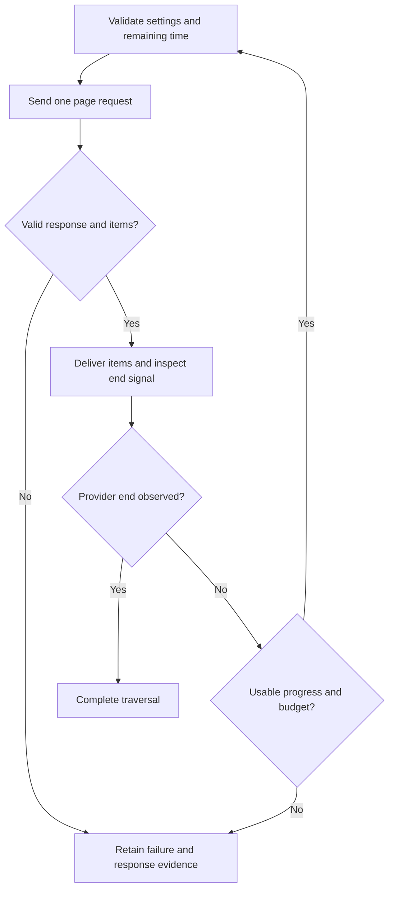

---
$schema:
    status: |-
        enum(
            draft-spec,
            finalized-spec,
            planned,
            implemented,
            review-findings,
            human-in-the-loop,
            completed,
            on-hold,
            abandoned
        ) -> an indicator of progress for this specification
    reviewed: boolean -> indicates whether the specification file has been reviewed by another agent from the one which created the spec
    reviewed_by: string -> the agent and model used in the spec review
    reviewed_on: date -> the date the spec was reviewed
    review_iterations: number -> the number of implementation reviews have taken place in the review/fix cycle
    clarified: boolean -> indicates whether the specification was built -- _in part_ -- with the 'clarify.md' prompt
    implemented: boolean -> indicates whether this spec's plan has been implemented
    implemented_by: string -> the agent who implemented the plan
status: draft-spec
reviewed: true
reviewed_by: codex/gpt-6.1-sol
reviewed_on: 2026-10-11
review_iterations: 0
clarified: false
implemented: true
human_review: false
parent: ../../reviews/2026-07-31-macro-review/spec.md
depends_on:
    - 2026-10-12-schematic-runtime-envelope
    - 2026-10-12-schematic-endpoint-methods
refresh_required: false
related: []
next_spec: 2026-10-14-schematic-definition-api
---

# Schematic pagination

> **Refresh (2026-10-13): endpoint methods are implemented.** The author’s runtime-envelope ruling makes generated endpoint calls the primary entry: `gh.list_releases(owner, repo).pages()`. Pagination adds its authored controls and entry points to these existing local call types; a generic request-object pager may remain as an escape hatch. The historical generic examples in the decided single-page clauses retain that secondary meaning. The primary form is `client.list_items().after(c).page_size(n).fetch_page()`, returning the same decided `Page<T>`. Compile cost was measured and the author accepted chained setters without per-API feature flags. Default 10 and the plan now reflect this delivered surface.

> **Inline review note (2026-10-12): link checks take the request type.** The author's ruling on `2026-10-12-schematic-runtime-envelope` review 1, Item 4 settles the runtime's link check as `Client::check_link::<R>(&Url)`, not a type-free `check_link(&Url)`: `R` is the listing request type, so a refused link reports that endpoint's id and method, and the check stays correct once later definition work adds per-endpoint origin policies. A request whose path is an absolute `http(s)://` URL is sent to that URL after the same origin check. The pager therefore (a) checks every next-page link with its own request type, `check_link::<R>`, and (b) follows an absolute link by sending it through that checked absolute-URL request path, not through a private transport call. Under Item 1 the pager built on the endpoint call types is the primary caller; ordinary callers are not expected to call `check_link` directly. R18 below is read with this note.

> **Reading guide for a developer new to this repository.** `schematic-define` holds the primitives an author uses to describe an API. `schematic-definitions` holds the 18 REST API descriptions written with them. `schematic-gen` turns a description into Rust client code, which is committed as the crate `schematic-schema` (generated; never hand-edited; the justfile recipes `test-schema` and `lint-schema` build and lint it). `schematic-runtime` is the hand-written shared runtime package that the previous spec in this series creates; the generated clients depend on it. A **pager** fetches a list endpoint one page at a time. A **knob** is a pager configuration method such as `.page_size(..)`. The `parent` frontmatter identifies the shared review behind this sibling specification. Its relative reference resolves from this document to `schematic/reviews/2026-07-31-macro-review/spec.md`. The **parent** holds the numbered decisions and the evidence; this spec restates what an implementer needs, so the parent need not be opened to do the work. Provenance is cited as "parent D14" and so on. Status labels used below: **Decided** (the author confirmed it in the parent), **Proposed** (this spec's suggestion, from a spike or from drafting), **Default** (a planning-time detail the parent left open; the implementer adopts it and logs it), **unverified** (not checked against a source).

## Problem

Pagination is described in `schematic-define` today but nothing consumes it, and most real pagination is not described at all. Verified facts (parent, `spikes/pagination/inventory.md`, and the code on 2026-10-11):

1. **The generator ignores all pagination data.** `PaginationStyle` has 12 fields of structure and the generator reduces them to `impl Paginated for X {}`, where `Paginated` is an empty marker trait (`schematic/gen/src/codegen/traits.rs`; it is imported by `schematic/gen/src/output/assemble/api.rs`). Its doc describes a `fetch_all_pages` helper that does not exist. `EndpointParams.response_pagination` has no reader and no definition sets it. Declared pagination only adds `page` and `per_page` style query parameters to the request struct through `EndpointParams::with_pagination` (`schematic/define/src/params/mod.rs`).
2. **35 endpoints declare pagination, all page-number**: Gitea 8, GitHub 9, GitLab 9, Bitbucket 9. (The parent's section 7.1 figure of 27 is a stale July number; 35 is the current, correct count.) The declared defaults disagree with the providers' real ones (GitHub 100 vs 30, GitLab 100 vs 20, Bitbucket 50 vs 10, Gitea 50 vs 30), and `PaginationStyle::gitlab()` is literally `github()`.
3. **About 157 list endpoints exist across the 18 REST APIs; about 122 of them declare nothing.** (The generated REST surface now has 547 endpoint request types and 547 corresponding call types, including 265 OpenAI endpoints; the parent's 253 is a stale figure.) OpenAI alone has 61 (60 GET plus one POST search) and expresses pagination only as ordinary query parameters (`after`, `limit`, `page`, `order`); its replies carry `has_more` and cursors the client never uses. Anthropic, ElevenLabs (3 paginated lists with 3 different strategies), EMQX (8 paginated lists per API), and Hugging Face (11) also declare none.
4. **No client can page.** A caller of a generated forge client must hand-loop on response headers, and reads response headers through `.full().await` on the generated endpoint call. sniff keeps its own hand-written GitHub and GitLab client partly for this reason (parent D20; sniff's own spec tracks the retirement and starts after this spec).
5. **Two definition gaps and one provider gap** block full coverage: EMQX `ListAuthUsers` declares a root-array response where the server (per unverified recall) returns `{data, meta}`; two OpenAI vector-store endpoints (`RetrieveVectorStoreFileContent`, `SearchVectorStore`) reply with `has_more` and `next_page` but the provider documents no request input to continue.

The author has decided the model (parent D14), its landing-1 shape (D42, D43), the complete-list helper (D41), and scoped sessions (D27). A throwaway prototype of the data model (56 tests) and a throwaway prototype of the pager API surface (31 runtime tests, 21 trybuild cases) exist as evidence under `schematic/reviews/2026-07-31-macro-review/spikes/pagination/` and `.../pager-surface/`. Neither is shippable code and neither is part of the workspace.

## Goal and non-goals

**Goal.** After this spec, an API author describes how a provider really paginates, once, in `schematic-definitions`; the generated client then exposes a pager with exactly the knobs the author described (an undescribed knob does not compile); and `collect_all` returns a complete list or an explicit `Incomplete` error, never a partial list presented as complete. The 18 REST APIs are authored for every strategy supported by the evidence rules below; unverified rows stay unpaginated and are recorded as a verification task. A complete result means the provider signaled the end of this traversal, starting from the caller's configured position and filters. It does not promise a snapshot of a collection that changes while paging, or items preceding a caller-supplied cursor, page, or offset.

**Non-goals (out of scope).**

- Endpoint builders and typed registration (spec 4a, `2026-10-14-schematic-definition-api`; the series has eight specs: 1 generation integrity, 2 runtime envelope, 3 this spec, 4a definition API, 4b definition vocabulary, 5 response model and GraphQL, 6 WebSocket, 7 fidelity polish). Landing 1 adds **no field to the endpoint literals** (D42).
- The response vocabulary v2 (success and error sets, streaming, selector) and GraphQL, including the pagination vocabulary for GraphQL connections (spec 5; parent P9).
- Removing the vendor constructors on `PaginationStyle` (the definition-API work owns removal of that legacy type). Each API owns its own small strategy function in `schematic-definitions` (D55-4); the later fidelity work only verifies that no vendor-named pagination constructor remains in `schematic-define`.
- Generating labeled alternates for the caller (modeled here; generation is a later step, see the defaults).
- Long-running job creation followed by polling (Salesforce Bulk, BigQuery): a different feature (parent D14).
- Silently restarting an expired cursor (Drive, Slack `invalid_cursor`): the client surfaces the API error and the caller decides.
- Non-JSON page bodies (S3's XML `NextContinuationToken`): the model's path type is JSON-only; a format-aware sibling is a later addition.
- Retiring sniff's hand-written provider client (sniff's own spec; D20).
- The cross-origin runtime, shared-deadline mechanics, envelope, and typed send themselves (spec 2). This spec **uses** them.

## Background: decisions this spec implements

Each item is restated in full so the implementer need not open the parent. The parent path is `schematic/reviews/2026-07-31-macro-review/spec.md`.

- **D14.1 Primitives, authored by the definition (Decided).** Pagination is definable entirely with primitives in `schematic-define` and authored in `schematic-definitions`. It describes what the provider actually offers; the author chooses among the mechanisms the provider offers. Schematic does not choose for the provider. Example: GitHub offers both a page parameter and a `Link` header, so the author picks.
- **D14.2 Lists are unpaginated by default (Decided).** An endpoint returning an array is a list. A response typed `Vec<T>` is recognized as a root-array list automatically (the author chose inference over explicit marking, against the spike's recommendation). A list inside a wrapper such as `{"data": [...]}` is marked with a `Collection::at(path)`-style marker. An API may declare a default strategy that applies to all its list endpoints, and any endpoint can override it or opt out.
- **D14.3 Only authored knobs (Decided).** In `schematic-schema` there is no page size, offset, cursor, or `next()` unless the definition provides that strategy. A missing knob is a compile error, not a runtime error.
- **D14.4 The model (Decided).** Four strategy kinds (page number, offset, cursor, next-link) plus general dimensions: where inputs go; how to detect the end; item location with nesting; page-size rules; direction; sessions with open, keep-alive, renew, and close; composite cursors with tiebreakers; the follow-up request shape; mid-iteration page-size changes; terminal values; 0-based and 1-based offsets; partitioned parallel iteration. The design is `spikes/pagination/design.md`.
- **D14.5 General mechanisms, not fitted examples (Decided).** Every pattern the research found is handled by a general mechanism. The prototype covers every inventoried strategy and 10 outside patterns. **Six of those 10 were checked from memory and are unverified**: X API v2, WordPress REST, OData `$skiptoken` in its non-Graph form, Azure Cosmos DB, Salesforce REST query, Reddit listings.
- **D14.6 Page sizes above the author-declared max return an error (Decided; the author did not veto it).** The client never clamps silently.
- **D14.7 Link following goes through the host policy (Decided, as amended by D28).** One cross-origin policy, authored in the API definition, governs followed next-page links and redirects.
- **D14.8 Labeled alternate strategies are supported in the model (Decided).** Whether the generated client exposes them is not decided (parent P8; default below).
- **D13 Shared deadline (Decided).** Opt-in. A caller sets one overall deadline for an operation (all pages and follow-up requests) on a monotonic clock. Per-request time under an opted-in deadline is min(remaining budget, the client's per-request timeout, default 30 s) (D56-3). Once time is spent no further request is sent and a `DeadlineExceeded` error reports the completed pages and the elapsed time. Dropping the call cancels in-flight work and spawns no detached tasks. The existing 30 s per-request default is unchanged for callers who do not opt in.
- **D19 as amended by D42 (Decided).** Pagination (primitives and generated pagers) lands in landing 1 so sniff gets real pagers. Landing 1 adds **no new field to the endpoint literals**. The API definition declares a default pagination strategy and one table of exceptions keyed by endpoint id (a list inside a wrapper, opt-outs, overrides), in 18 places. Validation rejects an exception id that matches no endpoint. In landing 2 (spec 4a) the builders move each exception onto its endpoint and the table is removed.
- **D43 Automatic list recognition (Decided).** Only **GET** endpoints are recognized as lists automatically. Other methods (a POST search, a write that returns an array) are lists only if the exceptions table says so.
- **D41 `collect_all` (Decided).** A `collect_all` helper exists. It succeeds only after the provider's last page is observed. Otherwise it returns an explicit `Incomplete` error carrying the reason (`PageLimitReached`, `RepeatedContinuation`, `HttpError`, `DeadlineExceeded`, `CrossOriginRejected`) and the items gathered so far. The page limit is caller-visible. Single-page methods remain. The parent notes that an invalid or missing continuation has no reason in this list; the mapping is a planning detail (default below).
- **D27 Scoped sessions only (Decided; refined by D57 item 5).** The generator emits **only** a scoped helper, `with_session(|pager| async { ... })`, which awaits a bounded close attempt when the closure returns, errors, or panics under unwinding. Server-side success is not guaranteed; the cleanup requirement below explains transport failures and cancellation. A failed close is reported as `Err(SessionError { outcome, close })`: the closure's outcome is kept intact (including a fully fetched `Ok`) and the close failure is attached (D57 item 5). There is no manual `open()`/`close()` and no drop-warning path. Consequences the author accepted: a session cannot be held across several functions; if the caller's whole task is cancelled externally nothing can send the close call (Rust has no async drop and D13 forbids detached work), so the server's own timeout is the backstop (Elasticsearch's default limit is 500 open scroll contexts).
- **D28 Cross-origin policy (Decided; implemented by spec 2).** The API definition authors one policy with five values: `same_origin` (default), `allow_origins([...])`, `allow_without_credentials`, `allow_any`, `deny`. It governs redirects and followed next-page links. Callers may tighten, never loosen. A next-page link refused before any request for it starts is the outer `TransportError` with kind `CrossOriginRejected` (D32).
- **D24 Failures before anything is sent (Decided; amended by D56-1).** Page size above the maximum, origin rejected, and invalid argument are kinds of the outer `TransportError`, which still carries request metadata. The full kind list is spec 2's. There is no missing-credential failure: when no credential resolves, the request goes out anonymously and the envelope reports `Anonymous` (D56-1).
- **D7 / D21 / D25 / D26 / D48 envelope (Decided; implemented by spec 2).** Every send returns `Result<Response<T, E>, TransportError>`. An envelope exists whenever an HTTP response head was received; the outer error means no head arrived. A 2xx that cannot be decoded is a failure inside the envelope with kind `MalformedSuccess` and the real status; a body cut off after the headers is `BodyInterrupted`. Request metadata includes the page number **only when the call is part of a paginated operation**.
- **D39 Runtime home (Decided).** The pager is hand-written in the runtime package (working name `schematic-runtime`), not emitted as template text; generated clients stay thin. The spike's one-generic-pager encoding is a recommendation, not a ratified decision (see the **Proposed** labels on R9, R10, R14, R24 and the Design section).
- **D3 / D45 typed send and `send_raw` (Decided; spec 2).** There is no free generic `request<T>`; each request type declares its response. `send_raw` exists as the checked escape hatch. The pager sits on top of typed send.
- **D49 isolated compile check (Decided; spec 1).** Freshly generated output is compiled in an isolated crate on a normal test run. This spec's generated code is covered by it.
- **D57 rulings on the second child-spec review (Decided).** Item 2: partitions sharing a session whose handle rotates per page use the latest observed handle across all partitions; the out-of-order risk is logged, not validated against. Item 3: adopted fields stay removed from the request (R7) and one page is fetched through the pager, `client.pager(req).after(c).page_size(n).fetch_page()`, returning a `Page<T>`. Item 4: the importer emits a call to a hand-written overlay module (`openai_pagination::apply(api)`) that it never writes, through a generic overlay hook rather than an OpenAI-specific branch. Item 5: a failed session close returns `Err(SessionError { outcome, close })`. Item 7: spec 2 adds `ErrorKind::RedirectFailed { target, category }` (a redirect hop that failed before a response, keeping the earlier 3xx as evidence); `collect_all` maps it as it maps `TransportError`. Item 13: a generated request struct with a required non-pager query field or a typed path field does not derive `Default`; an all-optional struct keeps it.

**Spike evidence this spec builds on (reported, not re-run by the parent; macOS only, HTTP/1.1 only).** One generic `Pager<E>`/`Pages<E>` with per-knob trait bounds gave readable compile errors (19 compile-fail and 2 pass cases); deadline cut-off, drop-cancel, host-policy rejection, over-max page size, and stall detection all behaved. At 157 endpoints the pager added about 1.77 MB to a release binary, 74% of it a second copy of each item's deserializer because pages decode through `serde_json::from_value`; decoding through the same `from_slice` path as unpaginated calls would remove most of it (proposed, **not measured**). Rejected by the spike: impl-level bounds (E0599 ignores the custom message) and type-level flag parameters (flags can drift from per-endpoint config).

> **Reader's note from the inline review.** The revisions preserve the parent's four-strategy model and scoped-session choice. They make completion depend on consistent provider signals, preserve failures with their received response evidence, and distinguish a bounded cleanup attempt from guaranteed server-side release. The single-page migration, persistent imported definitions, cleanup-error result, and rotating-handle partition sharing were ruled in D57 items 3, 4, 5, and 2. Legacy constructor removal is reconciled with later preset verification rather than assigning the same removal to two specifications.

For followed URLs, use the response that supplied the link as the resolution context, following [the Web Linking standard's link-target rule](https://www.rfc-editor.org/rfc/rfc8288.html#section-3.1) and [the URI standard's relative-reference rules](https://www.rfc-editor.org/rfc/rfc3986.html#section-5). This corrects the draft's API-base-URL rule: resolving `?page=2` against an API root loses the current endpoint path. Reuse the runtime's resolver; if its landed behavior differs, record the required integration correction during refresh. Link parsing follows [the Web Linking standard's parsing guidance](https://www.rfc-editor.org/rfc/rfc8288.html#appendix-B), with pagination-specific failure rather than normal completion when the authored next link is unusable. Multiple distinct links for the requested next relation are ambiguous and fail instead of selecting an arbitrary one; identical resolved links can be treated as one.

## Requirements

Each requirement is testable. "L1" means `just test` (no OS GUI, no window focus); "L2" means `just test-l2`, which must never take window focus. No requirement here needs L2: pagination has no terminal behavior. A new L2 test is not expected; if the implementer adds one, it must not take focus.

**Model (schematic-define)**

- **R1. The pagination model exists.** `schematic-define` provides the four strategy kinds (`PageNumber`, `Offset`, `Cursor`, `NextLink`) and the shared dimensions listed in D14.4, with builders, `serde` support, `#[non_exhaustive]` on open enums, and no public `Default` on any type that would present an empty strategy as usable. Every authoring example in `spikes/pagination/design.md` sections 5 and 9 is adapted to the API-level exceptions table and shared origin policy, then compiles against the real API; log those intentional departures and any renamed types.
  Validated by: L1 unit tests in `schematic-define`; port the prototype's 56 tests (`prototype/tests/{inventory,patterns,generalizations}.rs`), adapting obsolete endpoint fields and strategy-local trust tests to the contracts in this spec, and keep the applicable assertions passing.
- **R2. Validation rejects malformed strategies.** The rules in design.md section 8 are implemented, each with a test that triggers it and a test that its valid sibling passes: `CursorWithoutEndSignal`, `FullPageOnCursor`, `FullPageWithoutPageSize`, `PageCountOnNonPageNumber`, `InvalidPageSize`, `DuplicateInput`, `BodyInputOnGet`, `CollidesWithEndpointParam` (with the adoption exception in R7), `AlternatesWithoutPrimary`, `AlternatesOnUnpaginated`, `DuplicateLabel`, `InvalidLabel`, `InvalidTrustedOrigin` (see the defaults: link trust is replaced by the D28 policy, so this rule is removed or repurposed and the choice logged), `EmptyCursorLeg`, `InclusiveBoundaryNeedsItemKey`, `AdjustablePageSizeOnPageNumber`, `AdjustableLinkSizeNotQuery`, `NextLinkWithFollowUpPath`, `NextLinkMethodUnspecified`, `UnknownCarryParam`, `UnknownPathParam`, `SessionHandleUnreachable`, `SessionHandleNotSent`, `SessionStepNeedsHandle`, `KeepAliveWithoutInput`, `InvalidPartitionMax`, `PagerManagedRequiredWithoutDefault` (R2a).
  Validated by: L1 unit tests in `schematic-define` (and the existing `validate_api` integration in `schematic-gen`).
- **R2a. Pager-managed parameters are exempt from required fidelity (Decided, D55-5).** A parameter managed by a pagination strategy (a page, offset, cursor part, page size, or partition input, including any parameter adopted under R7) is exempt from spec 4b's query-parameter `required` handling: it never appears in a request's `new()`. If the provider requires such a parameter, the strategy must carry a default value for it and validation rejects a definition that does not (`PagerManagedRequiredWithoutDefault`). The pager always sends the parameter (the default when the caller sets nothing); the caller can still override it through the matching knob. This does not make `server_default` sendable (R13): the default here is an authored value the provider requires on every request. Because a pager-managed parameter is not a request field, it does not count as a "required non-pager query field" under spec 4b's `Default` rule (D57 item 13): a request whose only required query parameters are pager-managed keeps `Default` if its remaining fields are all optional.
  Validated by: L1 unit tests in `schematic-define` (a strategy marking a provider-required size parameter without a default is rejected; the same strategy with a default validates) and a generator test that the request's `new()` has no argument for a pager-managed parameter; L1 mock-server test in `schematic-runtime` that, with a default authored, the pager sends the parameter on every request (first and follow-up) and that a knob value overrides it.
- **R3. API-level default and exceptions table; endpoint literals untouched.** `RestApi` gains a default strategy (`Option<Strategy>`) and one table of exceptions keyed by endpoint id. `Endpoint` and `EndpointParams` gain **no** field. The 18 `RestApi` literals each gain the new fields (empty where nothing is authored).
  Validated by: a positive compile test of the current public surface: it builds an `Endpoint` literal and an `EndpointParams` literal exactly as the tree spells them today and asserts they still compile and behave the same. This test is frozen to today's surface and is retired or updated by spec 4a (`2026-10-14-schematic-definition-api`), which changes those literals; it is not a permanent guarantee. Also a diff check recorded in the log showing zero changed endpoint-literal lines in `schematic/definitions/src` other than the explicit exceptions the Human review agenda lists (the EMQX `ListAuthUsers` type fix, if taken).
- **R4. Resolution is a pure function with a stated order.** For each endpoint: (1) a table entry for the endpoint id decides first (wrapper list, opt-out, or override); (2) otherwise a GET endpoint whose response is `Vec<T>` is a root-array list and inherits the API default if there is one, else it is an unpaginated list; (3) otherwise (any non-GET method, any non-array response) the endpoint is not a list. The result records the origin (`Endpoint table entry`, `ApiDefault`, `None`) and, when paginated, the resolved strategy and the caller knob list (design.md `caller_knobs`).
  Validated by: L1 table-driven tests in `schematic-define`: GET `Vec<T>` with and without a default; POST returning an array (not a list without an entry, a list with one); wrapper list through an entry; opt-out; override.
- **R5. Table validation.** An exceptions-table id that matches no endpoint of that API is rejected, naming the API and the id and, when one exists, the nearest endpoint id. A duplicate id is rejected. An entry that names a demonstrably non-array location, or a strategy input colliding with a non-adopted plain parameter, is rejected. If the schema registry cannot describe the path, validate the path syntax and item type at generation, then enforce the array/projection contract at runtime; do not claim an opaque schema was structurally checked.
  Validated by: L1 unit tests in `schematic-define` / `schematic-gen`.
- **R6. Labeled alternates are modeled and validated.** A definition may carry named alternates (for example GitLab's `keyset`). Validation applies (R2). The generator ignores them (default below) and emits no `using_<label>` method.
  Validated by: L1 test that a definition with an alternate validates and generates byte-identical pager constants to the same definition without it; compile-level check that no `using_*` method exists.
- **R7. Plain parameters adopted by a strategy.** When a strategy input (page, offset, cursor part, page size, partition input) has the same location and name as a plain parameter the endpoint already declares (every OpenAI `after`/`limit`/`page`, every `with_pagination` query parameter on the 35 declared endpoints), the strategy **adopts** it: it is not a `CollidesWithEndpointParam` error; an adopted parameter is pager-managed and therefore exempt from `required` fidelity (R2a, D55-5), so it never appears in `new()` and a provider-required one needs a strategy default; the generated request struct omits that field (D57 item 3: adopted fields stay removed, and a caller who customized one page with them now uses `fetch_page()`, R11a); and the pager exposes the matching knob only if authored. A near-miss (same name, different location) is still a collision. **Adoption is allowed only when the strategy authors the matching knob** (for example an adopted `limit` requires a `PageSize` input on the strategy; an adopted `page` requires a `PageNumber` input). Otherwise the parameter is not adopted and the request-struct field is kept, so no caller-reachable control is hidden without a replacement (the "adopt and hide" hazard). Validation rejects a strategy that would adopt a parameter without authoring its knob, or the author keeps the field by leaving the parameter out of the strategy.
  Validated by: L1 unit tests (adoption with its knob accepted, adoption without its knob refused and the field kept, near-miss rejected) and a generator test that a request struct for an adopted input has no field for it. **Default**; see the defaults section.
- **R8. Old pagination types stay but are inert.** `PaginationStyle`, `PaginationResponse`, `EndpointParams::with_pagination`, and the `EndpointParams.pagination`/`response_pagination` fields remain, are documented as superseded, are not read by the generator for pager emission, and carry no `#[deprecated]` attribute (a deprecation warning inside about 140 OpenAI literals would fail `-D warnings`). Spec 4a (`2026-10-14-schematic-definition-api`) **owns** removing `PaginationStyle`, `PaginationResponse`, `with_pagination`, and `EndpointParams.pagination`/`response_pagination`, and converting the 35 declared endpoints; this spec only keeps the legacy metadata inert for pager generation. Query parameters already materialized by `with_pagination` remain ordinary parameter definitions and can be adopted by the new strategy. Because spec 4a removes the types, spec 7 moves nothing; it only verifies that no vendor-named pagination constructor remains in `schematic-define` (D55-4).
  Validated by: L1 test that the generator output for an endpoint is independent of those fields (set and unset give identical pager constants); `just lint` passes.

**Runtime pager (schematic-runtime)**

- **R9. One generic pager (Proposed: the spike's recommendation, not ratified by the author).** The runtime has one generic `Pager<E>` (configuration) and `Pages<E>` (iteration) serving all four kinds; the engine is not generic over the endpoint. Per paginated endpoint the generator emits constants, marker impls, and thin inherent forwards on the existing endpoint call type. Traversal logic stays in the shared runtime. The former prohibition on per-endpoint methods is superseded by the author’s primary endpoint-call ruling and the measured endpoint-method implementation.
  Validated by: L1 runtime test with hand-written endpoint impls shaped like the generator's output; generator snapshot and isolated compile/run tests asserting authored controls and thin forwards on existing call types, without generated traversal logic.
- **R10. Unauthored knobs do not compile (the outcome is Decided, D14.3; the trait-bound encoding and diagnostic attributes are Proposed, spike recommendations the author has not ratified).** For an endpoint that does not author a knob, calling it is a compile error with a readable message: `.page_size(..)`, `.page(..)`, `.offset(..)`, `.after(..)`, `.before(..)`, `.prev()`, `.keep_alive(..)`, `.partitioned(..)`, `.set_page_size(..)`, `total()`; a pager for an unpaginated list endpoint does not exist; a knob called after `.pages()` does not compile; a session endpoint has no `pages()` (R22). Each knob carries its own capability trait with `#[diagnostic::on_unimplemented]`; kind-only knobs use blanket capability traits with `#[diagnostic::do_not_recommend]`.
  Validated by: **compile-fail (trybuild)** suite in `schematic-runtime` covering every knob above plus the 2 positive cases, with `.stderr` snapshots; plus the same suite run against a real generated endpoint set in `schematic-schema` (the generated crate is excluded from the workspace and tested by `just test-schema`).
- **R11. Iteration surface.** `next()` returns `Result<Option<Page<Item>>, PagerError>`: a page on success, `None` after normal completion, or an error; `prev()` exists only where a backward direction is authored; `items()` flattens pages into an item stream without a second pass over the body; `total()` exists only where a total is authored or derivable; the caller can read the page number and the item count so far. A page carries the envelope metadata of its request.
  Validated by: L1 mock-server tests in `schematic-runtime` (see R30).
- **R11a. Single-page fetch through the pager (Decided, D57 item 3; closes parent agenda item 10).** A configured non-session pager has `fetch_page()`, which sends exactly one request carrying the knob values set on the pager (for example `client.pager(req).after(c).page_size(n).fetch_page()`) and returns a `Page<T>` (the page type described under Design), not the endpoint's original wrapper response. It applies the same validation as iteration (R13 bounds, R2a defaults) and does not follow any continuation. This is the replacement for customizing one page through an adopted request field (R7). Ordinary typed sends still return the original wrapper and send authored provider-required defaults; optional pager-managed inputs are omitted. Document the result-type change for migrating callers.
  Validated by: L1 mock-server test that `fetch_page()` with a cursor and page size set sends exactly one request carrying both values and returns that page's items; a generated-crate smoke test (R31) doing the same through generated code; a test that an ordinary typed send of the same request sends the authored required default.
- **R12. End detection.** Apply the authored end signal, not the truthiness of arbitrary JSON values. An explicit "more" signal takes precedence over continuation absence: false ends traversal even if a stale continuation is present; true requires a usable continuation for `Cursor` and `NextLink`, otherwise `MissingContinuation` is an error. Without that explicit signal, a continuation that is missing, JSON null, the empty string, or an authored terminal value (for example Salesforce Bulk's literal `"null"`) ends traversal. Numeric zero and boolean false are not automatically terminal cursor values. A present signal of the wrong type is `InvalidContinuation`, never normal completion. `PageNumber` and `Offset` end on an empty page unless an explicit signal still says more; that contradiction is a no-progress error, not a complete result. `Cursor` and `NextLink` can return empty pages with usable continuations (Slack and Microsoft Graph do so). A missing authored total falls back to `NonEmptyPage` only for page-number and offset strategies; it must not override a cursor or link signal. A malformed or negative total is an error. `PageNumber` increments by one from its `ZeroBased` or `OneBased` base; `Offset` starts at its base and advances by the number of source records received, before projection or boundary filtering. Increment arithmetic is checked; overflow is an invalid-argument error before the next send. A short page ends traversal only with an authored `FullPage` rule and a known effective size; `server_default` alone does not establish that size.
  Validated by: L1 mock-server tests per rule, including the 1-based SCIM-style offset, terminal values, zero-valued cursors, contradictory signals, missing/malformed totals, and checked arithmetic.
- **R13. Page-size rules.** An optional page size is sent only when the caller sets it. A provider-required size uses the authored sendable default required by the managed-parameter rule above; this is the sole exception to omission. A size above the author-declared max, or below the declared min, returns an error **before any request is sent**, as the outer `TransportError` carrying request metadata (D24), and the error names the declared bound. An adjustable size (`pages.set_page_size(n)`) applies from the next request and is validated the same way. `server_default` is documentation only and is never sent.
  Validated by: L1 mock-server test asserting zero requests reach the server; unit test of the bounds.
- **R14. Stall and loop detection (Proposed: the widened rule is a spike recommendation the author has not ratified; the minimum, a consecutive repeat is an error, is expected regardless).** For exclusive cursors and next links, the same continuation seen twice **anywhere in a forward traversal** (not only consecutively; Proposed in the spike, adopted by default) is a `RepeatedContinuation` error; a cycle a to b to a is caught; a repeated link is caught; an invalid continuation (present but unusable: wrong type, fails to parse as a URL for a next-link) and a missing continuation where one is required are distinct errors; a pager that has failed stays failed (every later `next()` returns the same failure without a request). Tracking is local to each partition and direction; a deliberate backward step is not itself a forward cycle. Inclusive cursors use the boundary-progress rule below: a repeated sort key with newly delivered identities is progress, while repeated keys with no new identities fail. Remember the caller's starting continuation so an immediate return to it is caught. Cursor keys use all tuple parts; links use resolved URLs. The engine retains exact keys rather than treating a hash collision as proof of a loop. Tracking grows with pages visited and is released with the iterator; the collection helper's page limit bounds its own tracking.
  Validated by: L1 mock-server tests for repeated cursor, cycle, repeated link, missing, invalid, and failed-stays-failed.
- **R15. Inclusive boundary and composite cursors.** A cursor may be a tuple (sort key plus tiebreakers) copied together into separate inputs; all parts present or all absent (a mix is `MissingContinuation`). With an inclusive boundary the client drops items already delivered at the last key; a page made only of re-delivered ties is a `BoundaryNoProgress` error. A resumable cursor takes a tuple argument when it has more than one part.
  Validated by: L1 tests with the prototype's `BoundaryTracker` cases ported to the runtime.
- **R16. Follow-up request shape.** A follow-up request may differ from the first in method, path, and which ordinary inputs are re-sent (`Carry::{All, Only, AllExcept, Nothing}`); continuation inputs, the session handle, session keep-alive, and an adjusted page size are always sent. For a next-link, explicitly carried ordinary names are set onto the link's query string replacing any value already there. With no authored follow-up carry rule, follow the next link verbatim using GET; do not merge the original query into a provider-issued cursor URL. A caller-selected size is preserved according to the authored rule, and a provider-issued size is not changed implicitly. Managed continuation inputs cannot be overwritten by ordinary inputs. Repeated query values remain repeated, header names compare without case, and body locations use exact path segments. Session handle, continuation, size, and constant inputs must also be checked for conflicting destinations at definition validation. Non-replayable request bodies are rejected for strategies that need to reuse them rather than silently being dropped.
  Validated by: L1 mock-server tests for Shopify-style `Only`, AIP-158 `AllExcept([skip])`, and an Elasticsearch-scroll-style replacement request.
- **R17. Item location with nesting.** Items are found through any number of array fan-outs and a projection (`data`, `edges[*].node`, `responses[*].hits.hits[*]._source`, root array), flattened in document order; cursors that read items use the record, and the caller receives the projection. A missing or non-array authored collection location, a failed projection, or an item decode failure is a malformed page, not an empty collection. Retain the HTTP envelope and classify it as `MalformedSuccess`; no items from that page are delivered. Validate schema paths at generation when structure is available; a runtime check remains required when the response schema is opaque.
  Validated by: L1 unit tests for the selector over fixtures, including a two-level case.
- **R18. Link following goes through the cross-origin policy.** Every followed next-page link is checked against the API's cross-origin policy (spec 2's runtime) before any request for it starts, through `Client::check_link::<R>` with the listing request type `R`, and an absolute link is sent through the runtime's checked absolute-URL request path (`2026-10-12-schematic-runtime-envelope` review 1, Item 4); relative links resolve against the final response URL that supplied the link, including its path and query, using spec 2's URL resolution and origin checks; parse all response `Link` header field values with a shared parser that handles quoted parameters and multiple relation tokens, not a comma split; malformed authored next-link data is `InvalidContinuation`, distinct from a valid link with no next relation; a refused link is the outer `TransportError` with kind `CrossOriginRejected`, zero requests reach the refused origin, and no credential is sent to it. Build and validate the final followed request after carry rules apply; spec 2's credential stripping and redirect checks govern every hop, including when a followed URL itself redirects. Under the default `same_origin`, a link to a different scheme, host, or port is refused, and userinfo and scheme-relative cross-origin links are refused. The strategy has **no trust setting of its own** (the prototype's `NextLink.trust` is replaced by the policy).
  Validated by: **mock-server** matrix over two local origins A and B for a next-link and the cross-origin values spec 2 supports (`same_origin`, `allow_origins`, `allow_without_credentials`, `allow_any`, `deny`): B receives zero requests when refused, receives the credential only where the policy says. Include relative `?page=2` and `../next` links, repeated Link headers, quoted commas, multiple relation tokens, ambiguous next links, and a followed-link redirect.
- **R19. Shared deadline across pages.** With a deadline set, every page request is limited to min(remaining budget, the client's per-request timeout, default 30 s) on a monotonic clock (D56-3); after expiry no request is sent and `DeadlineExceeded` reports the completed pages and the elapsed time; dropping the pager cancels the in-flight request and spawns no detached task. Without a deadline nothing changes (the client's per-request timeout, default 30 s).
  Validated by: L1 mock-server test (slow pages against a short budget; assert the third request is cut off, two completed pages reported, nothing sent afterwards, and that dropping closes the server-side connection). Timing margins must tolerate Windows timer granularity (about 15 ms): use page delays of at least 100 ms or a paused-time test.
- **R20. Envelope per page.** Every page is an ordinary typed send: it goes through the same credential resolution, redaction, cross-origin policy, and deadline as an unpaginated call, and returns the same envelope data (status, headers, request metadata with the page number set, elapsed). A page that fails inside the envelope (a 4xx or 5xx, `MalformedSuccess`, `BodyInterrupted`, `RedirectRefused`, `RedirectFailed` with its earlier 3xx evidence, D57 item 7) is returned to the caller with its envelope intact; the pager does not retry and does not retry a rejected credential (D11).
  Validated by: L1 mock-server tests: page 2 returns 500, 200 with bad JSON, and a cut-off body; each surfaces the failure with status and raw body kept; the page number appears only on paged calls.
- **R21. `collect_all` (D41).** `collect_all` returns `Ok` only after the last page was observed by the end-detection rules. Otherwise it returns `Incomplete` with a reason and the items so far. Reasons: `PageLimitReached`, `RepeatedContinuation`, `HttpError`, `DeadlineExceeded`, `CrossOriginRejected`, plus `InvalidContinuation` (default for an invalid or missing continuation). Every failure has a mapping: malformed/interrupted/redirect-refused envelopes map to `HttpError`; boundary no-progress maps to `RepeatedContinuation`; invalid page size, arithmetic overflow, or other pre-send argument errors map to an added `InvalidArgument`; other outer transport failures map to an added `TransportError`; a `RedirectFailed` envelope (a redirect hop that failed before a response) maps to `TransportError` as well, not `HttpError`, and keeps its 3xx evidence (D57 item 7). Preserve the underlying error and any received envelope, so callers can distinguish these causes without parsing text. Items from a successfully decoded page are retained even when its continuation is invalid; no items from a failed or malformed page are included. The page limit is caller-visible, readable and settable, defaults to 100, and must be greater than zero. It counts page fetch attempts, including empty pages, within this helper call. Inspect the last permitted page before applying the limit: if it proves completion, return `Ok`; otherwise return `PageLimitReached` before another request. Single-page methods remain; a customized single page is fetched with `fetch_page()` (R11a, D57 item 3).
  Validated by: L1 mock-server tests, one per reason, each asserting the reason, retained cause/envelope, exact items gathered, and that the result is never `Ok`; a mock 302 to a refused port on page 2 yields reason `TransportError` with the `RedirectFailed` cause and the 302's status and `Location` retained; also completion exactly at the limit, an empty intermediate page, a resumed starting position, and zero-limit validation.
- **R22. Sessions only through `with_session` (D27).** For an endpoint whose strategy has a session, the generated surface is `with_session(|pager| async { .. })`; once a usable session handle is known, one close attempt is made when the closure returns, returns an error, or panics under panic unwinding; there is no manual `open()` or `close()` and no drop warning; the session endpoint has no `pages()` outside the scope. Cancelling the caller's whole future is documented as leaving the session to the server's lease, not asserted closed; no task keeps running afterwards. Keep-alive (in-band `on_open`/`on_page`), a changing handle per page (latest wins), the `Session.pages` request target, an out-of-band renew step, and a separate open step are all honored.
  Validated by: **mock-server** (an Elasticsearch scroll-style server and a PIT-style server) recording open, keep-alive, page, renew, and close requests: exactly one close per exit path; **compile-fail** cases for `open()`, `close()`, and `pages()` on a session endpoint.
- **R23. Partitions.** `partitioned(n)` (only where authored, up to the authored max) yields `n` independent page iterators; iterator `i` sends `index = i` and `count = n` on every request; on a session, one session is opened for all and one close attempt is awaited when the scope ends. When partitions share one session whose handle changes per page (the PIT pattern in design.md G1), the latest observed handle wins across all partitions, as designed (D57 item 2): every partition's next request and the close use the most recently observed handle. Validation does not reject the combination and the pager does not serialize partition requests; the risk that completion order is not a valid handle order is logged (Human review agenda), not validated against. The pager spawns nothing; the caller drives the iterators.
  Validated by: L1 mock-server test with a PIT-style server and 4 partitions; unit tests rejecting zero partitions and counts above the max; independent continuation/loop histories are checked; with a rotating handle, a test that a definition combining partitions and page-driven handle replacement validates, and that each partition's next request and the close carry the most recently observed handle.
- **R22a. Session close after an expired shared deadline (Proposed; assigned here from spec 2).** When the caller opted into a shared deadline (R19) and it has expired, `with_session` still sends the session close call, using its own bounded grace budget that is separate from the expired deadline. Default grace: 5 seconds, configurable on the builder; the close request's time is min(grace, the client's per-request timeout, default 30 s), the same rule as a page fetch with the grace standing in for the remaining budget (D56-3). The grace applies only to the close call; it never extends normal page fetching, and no page request is sent after the deadline expires. A close that exceeds the grace is abandoned and the server lease is the backstop (D27). The grace bounds every close attempt, including early closure return while the page deadline still has time; it is not restricted to already-expired deadlines. Cleanup uses the latest valid handle observed, even if extracting that page's items or continuation later fails. If open fails before any handle can be recovered, no close can be addressed. Panic abort, process termination, and cancellation while opening or closing rely on the lease. The phrase "always closes" describes making and awaiting this bounded attempt during ordinary return, error, or unwind; it cannot promise server-side success. A failed or abandoned close is reported, not swallowed (D57 item 5): `with_session` returns `Err(SessionError { outcome, close })`, where `outcome` is the closure's result kept intact (a fully fetched `Ok` stays `Ok` with every item; a closure error stays the primary error) and `close` is the close failure. A successful close returns the closure's result unchanged. On panic the close is attempted under the grace and the original panic resumes; the panic path cannot return close evidence, and that limitation is documented.
  Validated by: L1 mock-server test with an expired deadline and a session server: exactly one close request arrives within the grace, zero page requests arrive after expiry, and a close against a deliberately slow server is cut off at the configured grace (page delays and margins at least 100 ms, per R19). L1 mock-server tests for the close-failure report: a mock that fails the close after a complete fetch yields `SessionError` whose `outcome` holds every item; a closure error with a failed close keeps the closure error as `outcome`; closure success or error with a successful close returns the closure's result unchanged; cleanup after a malformed page uses the latest handle; a panic during closure construction and during polling attempts the close and resumes the panic; early return under an unexpired deadline closes within the grace.
- **R24. Decoding path (Proposed, S11; the pager decode path is an unratified spike recommendation).** Prefer reusing the unpaginated `from_slice` deserialization path to avoid a second item-deserializer implementation. A quick comparison on the implementation host checks the known binary-size cost; retain `from_value` if reuse cannot preserve correctness or adds disproportionate complexity, and log the trade-off. There is no percentage threshold for adoption. The adoption test is in the defaults.
  Validated by: one quick before/after release-binary size sample on one host at the current endpoint count, recorded in the implementation log; the same L1 tests pass under either path.

**Generator (schematic-gen) and definitions**

- **R25. Generated pager surface.** For each endpoint that resolves paginated, `schematic-gen` emits the constants and marker impls for exactly the authored dimensions and nothing else; an unpaginated list and a non-list endpoint emit nothing pagination-related. Output is deterministic (byte-identical regeneration). The empty `Paginated` marker trait and its generator are removed; the generated crate imports the runtime's capability traits instead. A page's item type is the endpoint's declared item type (R26).
  Validated by: L1 generator snapshot tests in `schematic-gen`; the D49 isolated compile check compiles the emitted code; `just test-schema` and `just lint-schema` in the regenerated crate.
- **R26. Item type for wrapper lists.** A table entry that marks a wrapper list names its item type using the same Rust type-path rules as response types. Resolve registered named types through their registry; allow supported primitive and qualified types, including `serde_json::Value`, through the existing type resolver. Reject an unknown named type or invalid Rust type path. For a root-array list the item type is the `T` of the explicitly declared `Vec<T>` response. Type aliases and opaque response descriptors are not inferred to be lists.
  Validated by: L1 tests in `schematic-gen` (unknown named type rejected; registered, primitive, qualified, and explicit opaque item types compile); runtime malformed-collection fixtures verify the item location.
- **R27. All 18 REST APIs are authored for every verified strategy.** The API defaults and exceptions tables in `schematic-definitions` express the strategies in the authoring table below. A coverage test authors the list endpoints of all 18 REST APIs with the model and asserts, per list endpoint, the resolved origin, strategy kind, and caller knob list. Count checks: about 157 list endpoints across the 18 APIs and 35 declared today (both from a 2026-10-09 snapshot; the implementer re-counts against the current tree and logs the actual numbers).
  Validated by: L1 coverage test in `schematic-definitions` (this is the port of the prototype's `inventory.rs`, 16 tests, against the real definitions).
- **R28. Unverified rows stay unpaginated and are recorded.** A row tagged **U** in the inventory (recalled from provider docs, not fetched) is not authored unless the implementer verifies it against the provider's own documentation during the run and logs the source; otherwise its list endpoint resolves to unpaginated and is listed in the verification task (R33). The two OpenAI vector-store endpoints and the EMQX `ListAuthUsers` gap are handled as stated in the authoring table.
  Validated by: coverage test (R27) asserts each such endpoint resolves to `Unpaginated`; the log lists them.
- **R29. Exports and existing generated surface are otherwise unchanged.** Regenerating the OpenAPI and Postman exports yields byte-identical output except for an explicitly approved response-schema correction such as the EMQX wrapper fix. Record and assert that exact expected change rather than disabling export comparison. Plain parameters remain in definitions; preserve whatever each exporter currently emits. This does not claim that the existing OpenAPI exporter already exports every query parameter, and adding missing export fidelity belongs to the later vocabulary work. The generated request structs change only by removing fields for adopted inputs (R7); every such removal is listed in the log and every dependent crate that referenced one is migrated in the same phase.
  Validated by: golden/regeneration test for the exports; a recorded `git diff --stat` of `schematic/schema` reviewed in the log.

**Evidence, acceptance, and process**

- **R30. Mock-server coverage of every inventoried strategy and the 10 outside patterns.** Mock-server tests in `schematic-runtime` (and the generated-crate smoke tests in R31) cover: GitHub (`PageNumber` plus `Link` rel), GitLab (page number with `X-Next-Page`; keyset `NextLink` alternate), Gitea (page/limit, `Link`, total header), Bitbucket (`NextLink` from a body field with `previous` and `size`), OpenAI S6 (`after` from `last_id`, `has_more`; and the item-id variant), S7 (`after` from `next`), S8 (`page` from `next_page`), Anthropic (bidirectional id cursor), ElevenLabs history, voices token, and shared-voices 0-based `page`, EMQX (`page`/`limit`, nested `meta.hasnext`), Hugging Face (`Link` cursor and 0-based `p`); and the 10 outside patterns (AIP-158, Mastodon, SCIM, Salesforce Bulk 2.0 [verified]; X API v2, WordPress REST, OData `$skiptoken`, Cosmos DB, Salesforce REST query, Reddit [**unverified**: their tests prove the mechanism, not the provider's real behavior, and are named `unverified_*`]).
  Validated by: L1 mock-server tests in `schematic-runtime`.
- **R31. Generated-pager smoke tests.** In `schematic-schema` (run by `just test-schema`) one forge endpoint (page number), one OpenAI endpoint (cursor), and one Bitbucket endpoint (next-link) are paged end to end against a local mock server through the generated code, including `collect_all`, a single-page `fetch_page()` with knob values set (R11a), and a compile-fail case on the generated surface.
  Validated by: mock-server tests in `schematic/schema/tests` (or the generated tests directory the generator already emits), plus trybuild.
- **R32. Dependents.** Every crate that depends on `schematic-schema` (sniff, biscuit-speaks, model-citizen, and the homelab crates) builds and passes its tests; any use of a removed adopted-input field is migrated.
  Validated by: `just test {pkg}` from the repo root for each dependent crate (and `just lint` where the package area has it), recorded in the log. sniff's own migration to the pagers is out of scope.
- **R33. Verification task recorded.** The implementation log and the new docs page list every list endpoint left unpaginated because its row is unverified, with the provider, the endpoint id, the recalled strategy, and the source needed, so the author can authorize the verification (the parent lists this as a preparation task needing author permission). Live provider calls or unrelated definition corrections require separate scope.
  Validated by: review of the log; the coverage test names the same endpoints.
- **R34. Docs and skills.** A `schematic/docs` pagination topic page (new), the `schematic-define` README, the `schematic-gen` README, the `schematic-runtime` README, and the `.claude/skills/schematic-define` skill describe the model, the authoring examples, the generated surface, the `collect_all` guarantee, the `with_session` rule, and the compile-time knob rule. The page's audience is a developer with no experience of this repository: lead with what the reader can do, give a compact example per rule, and use a Mermaid diagram for the resolution flow and for the pager lifecycle. Per repo rules a `docs/` page never links to or names a feature or fix directory.
  Validated by: review; a grep that no new doc names `2026-10-` spec directories.

- **R35. Imported definitions retain authored pagination (Decided, D57 item 4).** OpenAI definition source is produced by the importer, not maintained by hand. OpenAI's strategy builders and exception entries live in a hand-written overlay module in `schematic-definitions` (`openai_pagination::apply(api)`), which the importer never writes. The importer gains a generic overlay hook, not an OpenAI-specific branch: configured by the import recipe, it emits a call to the named overlay function after constructing the imported API, so the same public API factory used by clients and exporters returns the augmented definition. Update the definition emitter for the new `RestApi` fields so importing any API still produces compiling literals. Re-importing OpenAI must preserve its resolved pagination and caller controls, without a manual edit of generated files; unknown exception ids are validated after each import (R5) so provider changes cannot silently erase coverage. D57 item 4 also binds spec 4a (`2026-10-14-schematic-definition-api`).
  Validated by: a focused importer/emitter fixture in a temporary directory, compilation of its output, and a resolution comparison before and after import; the fixture checks the emitted overlay call and that the overlay file is left untouched by the import, and that an import with no overlay configured emits no call. Use the vendored OpenAPI input; this test needs no network or additional performance measurement.
- **R36. Pager errors preserve the runtime privacy contract.** Pager-created error text and debug summaries describe the endpoint, page, and failure without embedding cursor values, session handles, authorization values, or raw next-link URLs. Request URLs and headers use spec 2's redaction. Preserve raw response evidence with the same documented limitations as the runtime envelope; this does not introduce arbitrary response-body redaction.
  Validated by: L1 sentinel tests for a repeated cursor, invalid continuation, rejected link with a secret query parameter, and failed close. Values may remain in retained raw response evidence but must not appear in pager-generated diagnostic text.

## Design

Package names are the real ones where they exist today. The delivered runtime package is `schematic-runtime` version `0.1.0`; its generator compatibility marker is ABI `3`. The runtime endpoint trait is called `EndpointSpec` (Decided, D56-5); every earlier mention of an "`Endpoint` trait" means it. Phase 1 reconciles the name with spec 2's actual outcome. Everything is **Proposed** unless marked **Decided**; the Decided items are exactly the parent decisions restated above.

**schematic-define** (`schematic/define/src/pagination.rs`, replaced in part; new submodules as the implementer sees fit)

- `Strategy` and `PageStrategy` (**Proposed shape; the four kinds and the dimensions are Decided, D14.4**). `PageStrategy` is `#[non_exhaustive]` with variants `PageNumber`, `Offset`, `Cursor`, `NextLink`; per the S12 default (**Proposed**, an unratified spike recommendation) each variant holds a named struct (`PageNumberStrategy`, and so on) so the generator can project each to a constant. `Strategy` wraps `PageStrategy` with the shared dimensions: constants, total, terminal values, follow-up shape, session, partition. Sessions, follow-ups, and partitions are **fields of `Strategy`, not variants** (design.md section 4: making them variants multiplies the enumeration).
- Supporting types, all **Proposed** and taken from the prototype `spikes/pagination/prototype/src/lib.rs`: `JsonPath`, `Step`, `ItemSelector`, `InputParam {Query, Header, Body}`, `ValueSource {Body, Header}`, `IndexBase`, `Polarity`, `CountUnit`, `PageSize`, `MoreSignal`, `CursorSource`, `CursorPart`, `Boundary`, `CursorLeg`, `LinkSource`, `Carry`, `FollowUp`, `SessionStep`, `SessionOpen`, `KeepAlive`, `Session`, `Partition`, `Pagination {Inherit, Unpaginated, Explicit}`, `Alternate`, `Collection`. `LinkTrust` is **not** carried over (R18).
- `Collection` (**Proposed**): item selector, item type path (the wrapper-list item-type requirement), pagination policy, alternates. `Collection::at(path)` and `Collection::root()` constructors follow design.md.
- `RestApi` new fields (**Decided by D42 that they exist; names Proposed**): `default_pagination: Option<Strategy>` and `pagination_exceptions` (a list of entries each holding an endpoint id and a `Collection`). Two new fields on each of the 18 literals.
- `resolve(api, endpoint) -> Resolved` and `caller_knobs(&Resolved) -> Vec<Knob>` (**Proposed**; prototype names): the pure resolution of R4 and the generator contract that maps each authored dimension to a knob (design.md section 7).
- `validate_pagination(api) -> Vec<Diagnostic>` (**Proposed**) wired into the existing `validate_api` path in `schematic-gen/src/validation.rs`.
- Untouched in this spec (R8): `PaginationStyle`, `PaginationResponse`, `EndpointParams::{pagination, response_pagination, with_pagination}`. Spec 4a owns their removal.

**schematic-runtime** (new module `pager`)

The runtime validates each page before deciding whether another request is allowed. A successful final page at the caller's limit completes normally; a page needing another fetch at that limit is incomplete.

- `Pager<E>` / `Pages<E>` (**Proposed**; the spike's encoding, not ratified; `E` is an `EndpointSpec`): configuration and iteration for every kind. Knob methods carry capability bounds, for example `fn page_size(self, n: u32) -> Self where E: PageSizeKnob`.
- Capability traits (**Proposed**): `PageSizeKnob`, `PageNumbered`, `Offsetted`, `Resumable`, `HasPrev`, `HasTotal`, `AdjustableSize`, `KeepAliveKnob`, `Partitioned`, `HasSession`, each with `#[diagnostic::on_unimplemented]`; kind-derived ones blanket-implemented with `#[diagnostic::do_not_recommend]`. The toolchain pin is Rust 1.98.1, which supports both attributes.
- `Paginated` (**Proposed**): the per-endpoint trait the generator implements; associated consts only (`STRATEGY` as a `&'static` projection of the model, item location, page-size bounds, keep-alive default, partition max). The `&'static` projection types mirror the define-side model with slices instead of `Vec`.
- Engine (**Proposed**): continuation extraction, end detection, stall tracking over the set of continuations seen, `BoundaryTracker`, follow-up building, session lifecycle (handle tracking, keep-alive, renew, close), partition fan-out. Page requests are typed sends through spec 2's client.
- `Page<T>` (**Proposed**): items, optional total, the envelope metadata of its request, and the page number.
- `PagerError` (**Proposed**): variants for the outer transport error, a failed envelope retained whole, `PageSizeOutOfRange` expressed as spec 2's pre-send kind, `RepeatedContinuation`, `MissingContinuation`, `InvalidContinuation`, `BoundaryNoProgress`, and `DeadlineExceeded` (with completed pages and elapsed time, D13). Whether `PageSizeOutOfRange` is a spec-2 `TransportError` kind or a pager-local variant converting into one follows spec 2's kind list (refresh item).
- `collect_all` and `Incomplete { reason, items }` (**Decided shape, D41; names Proposed**), `IncompleteReason` `#[non_exhaustive]`.
- `fetch_page()` (**Decided, D57 item 3**): on a configured non-session pager, one request with the pager's knob values, returning `Page<T>` (R11a).
- `with_session` (**Decided that only this exists, D27; closure shape Proposed**): takes a closure receiving the pager and returning a future that may borrow it; the implementation attempts cleanup without an asynchronous drop hook (catch closure construction and future-poll panics under unwind, attempt bounded close, then resume the original panic) because Rust has no async drop. Every close attempt has its own bounded grace budget, including when the page deadline has expired; this does not extend page fetching. A failed close returns `Err(SessionError { outcome, close })` with the closure's outcome intact (**Decided, D57 item 5**; field types Proposed). The exact signature (parent P6/R7) is a default below.

**schematic-gen** (`schematic/gen/src/codegen/`, `schematic/gen/src/output/assemble/`)

- New pagination emitter (**Proposed**; replaces `generate_paginated_trait` and `generate_paginated_impl` in `traits.rs`): for each endpoint whose resolved strategy is paginated, emits the `Paginated` impl with the `&'static` strategy constant, one marker impl per authored knob, and the item type association. Emits nothing for other endpoints. Assembly (`api.rs`, `shared.rs`) imports the runtime traits instead of the removed marker.
- Request-struct emitter (**Proposed**): omits fields for adopted inputs (R7).
- Validation (**Proposed**): the R2/R5/R26 diagnostics in the same format spec 1 chose for validation errors (API, endpoint, feature or rule, output target).

**schematic-definitions** (`schematic/definitions/src/<api>/`)

- Per-API default strategy builders and exceptions tables (**Proposed**), authored per the table below. The helper `bitbucket_pagination()` pattern is the model for a shared constructor per API.

**schematic-schema** (generated)

- Regenerated by the generator only; never hand-edited.

### Authoring table (what to author; from `spikes/pagination/design.md` section 10 and `inventory.md`)

Evidence labels are not interchangeable. **V-def** means the fact is present in current definitions, including OpenAI's vendored provider OpenAPI document; it does not independently prove server behavior. **V-notes** means the inventory cites prior research notes; log that source and its date. **U** means unverified recall. The table retains the source categories already accepted by the parent, without promoting code-derived facts into new provider verification. If current definitions or the vendored document contradict a row, record the discrepancy and leave that endpoint unpaginated until resolved. Required/optional request parameters, collection shape, continuation inputs and end signals must all agree; matching only the parameter name is insufficient.

| API | Authoring | Status |
| --- | --- | --- |
| GitHub (9) | API default `PageNumber{page, 1-based}`, size `per_page` (max 100; server default 30 recorded as documentation), end signal `Link` rel `next`. `ListWorkflowRuns`: table entry, wrapper at `workflow_runs`, total from the body `total_count`. | Verified (V-notes) |
| GitLab (9) | API default `PageNumber{page}`, size `per_page` (max 100; server default 20), end signal header `X-Next-Page` present, total header `X-Total`. `ListRepositoryTree` and `ListGroupProjects`: labeled alternate `keyset` = `NextLink{Link rel next}` plus constants `pagination=keyset`, `order_by=id`, `sort=asc` (modeled, not generated). `ListIssueParticipants`: believed paginated, unverified. | Verified for 9; participants and keyset constants per V-notes, otherwise unverified |
| Gitea (8 + tree) | API default `PageNumber{page}`, size `limit` (server cap 50; default 30 recorded), end signal `Link` rel `next`, total header `X-Total-Count`. `GetTagReference` (GET `Vec<GitRef>`, believed unpaginated prefix match): opt-out entry. `GetGitTree`/`GetGitTreeRecursive`: `per_page`, body `truncated`/`total_count`: unverified, leave unpaginated. | Verified for 8; tree and tag-reference unverified |
| Bitbucket (9) | API default `NextLink` from the body field `next` (absolute URL), backward `previous`, size `pagelen` (default 10, max 100), total `size`; each of the 9 wrapper lists is a table entry at `values` with its item type. | Verified (V-notes for the next URL; V-def for the declared params) |
| OpenAI (58 of 61) | API default `Cursor{after <- last_id, has_more}` (S6, 38 endpoints), size `limit`; table entries mark every wrapper list at `data` with its item type; `before` legs where the endpoint declares `before`; S7 overrides (9 endpoints: `after <- next`, `has_more`); S8 overrides (11 usage endpoints: `page <- next_page`, `has_more`); `ListFineTuningEvents` and `ListPaginatedFineTuningJobs` use the last item's `id` as the cursor (they reply `has_more` only). `ListModels`: opt-out. `RetrieveVectorStoreFileContent`, `SearchVectorStore`: opt-out (provider documents no continuation input; not a model gap). | Verified by the provider's own OpenAPI-derived params (V-def) |
| ElevenLabs (3 of 7) | `GetHistory`: `Cursor{start_after_history_item_id <- last_history_item_id, has_more}`, size `page_size`; `ListVoices` (v2): `Cursor{next_page_token <- next_page_token, has_more}`, total `total_count` (the definition already declares optional `page_size` and `page_token` query parameters, kept under `2026-10-12-schematic-runtime-envelope` review 1, item 5, and a strategy may adopt them under R7; the provider research names the input `next_page_token`, so confirm the sent name before adopting); `ListSharedVoices`: `PageNumber{page, 0-based, has_more}`. The four others unpaginated. | Verified (V-notes: `schematic/docs/research/elevenlabs-api.md`) |
| Anthropic (1) | `ListModels`: `Cursor{after_id <- last_id; before_id <- first_id; has_more}`, `limit` 20, 1..1000, resumable. | Request params **unverified** (U): leave unpaginated unless verified |
| EMQX basic and bearer (8 each) | `PageNumber{page, limit, Flag(meta.hasnext)}`, total `meta.count`; config and state lists opt out; `ListAuthUsers` needs its response type fixed from a root array to the `{data, meta}` wrapper before it can inherit the default. | **Unverified** (U): leave unpaginated; fix `ListAuthUsers` only if the rest is verified |
| Hugging Face (11) | `NextLink{Link rel next, limit}` for models, datasets, spaces, and file trees; `PageNumber{p, 0-based}` for commits and discussions. | **Unverified** (U): leave unpaginated |
| artificial_analysis, LM Studio, Ollama (x2), eversolo, samsung, unfolded_circle, critpt | No pagination. Unpaginated lists need no entry; non-lists (`collection: None` in the prototype) resolve to "not a list". Unfolded Circle `UploadResource`/`RestoreBackup` return root arrays but are writes, so D43 leaves them non-lists. | n/a |

## Suggested phases

An outline the plan may refine. Each phase ends with `just test` and `just lint` green for the touched packages, the regenerated crate compiling, and a log entry.

1. **Preflight and baseline.** Confirm spec 2's outcomes (names of the runtime package, the client's send, the envelope, `TransportError` kinds, the cross-origin and deadline entry points) and reconcile this spec's names. Re-count endpoints and the 35 declared. Grep every dependent crate for use of the 35 declared endpoints' `page`/`per_page` setters and OpenAI `after`/`limit`/`page` setters. Record regeneration, OpenAPI, and Postman baselines. No code change except the log. Grep dependents for single-page calls that set an adopted field; each migrates to `fetch_page()` (R11a, D57 item 3).
2. **Model in `schematic-define`.** Types, builders, serde, validation, `resolve`, `caller_knobs`; port the 56 prototype tests. Old types untouched. Green.
3. **API fields and exceptions table.** Add the two fields to `RestApi` and the 18 literals (empty), the table validation (R5), the adoption rule (R7). Endpoint literals untouched (R3 test). Green.
4. **Runtime pager core.** `Pager`/`Pages`, capability traits, the `&'static` projection, engine for page number, offset, cursor, next-link; end detection, page-size rules, stall detection, boundary tracker, item selector. Hand-written endpoint impls in tests. Trybuild suite. Green.
5. **Runtime pager integration.** Typed sends with the envelope and page number, cross-origin policy for links, shared deadline, `PagerError`, `collect_all` with `Incomplete`, follow-up shape. Mock-server matrix (R18, R19, R20, R21). Green.
6. **Sessions and partitions.** `with_session` with `SessionError` (D57 item 5), keep-alive, renew, handle tracking, partitions with the latest-handle-wins rule (D57 item 2); scroll and PIT mock servers; compile-fail cases. Green.
7. **Generator.** Pagination emitter, adopted-input omission in request structs, removal of the `Paginated` marker, validation wiring, snapshot tests; the D49 compile check covers the output. Green.
8. **Author the 18 APIs.** API defaults and exceptions tables per the authoring table, including the generic importer overlay hook, the hand-written `openai_pagination` overlay (D57 item 4), and the re-import regression fixture; the coverage test; the `ListAuthUsers` conditional fix; regenerate `schematic-schema`; smoke tests; export equality check; migrate dependents. Green.
9. **Decode-path measurement (S11).** Measure, adopt or keep, log. Green.
10. **Docs, skills, drift pass, and the full verification matrix.** Final `just test`, `just lint`, `just test-schema`, `just lint-schema`, dependents, OS evidence per the repo rules. Write the log's last section: the Human review agenda in full.

## Acceptance criteria and definition of done

The spec is "implementation complete, ready for review" when all of the following hold. The agent never moves the spec to `_completed`.

- **Platforms.** The new and changed packages build and their tests pass on macOS, Linux, native Windows, and WSL2 (repo rule). The implementer runs what the current host can run, reuses qualifying passing evidence for the others, and does not claim an OS cannot be tested before loading the `os` skill (`.claude/skills/os/`). Timing-sensitive tests tolerate Windows timer granularity and do not depend on path spelling or directory order. Which environments were exercised locally, and which are left to CI, is listed in the log.
- **Recipes.** `just test` and `just lint` (schematic area) pass; `just test-schema` and `just lint-schema` pass on the regenerated crate; the D49 isolated compile check passes; `just test-l2` is unaffected and takes no window focus.
- **Generated code.** `schematic-schema` is regenerated by the generator and never hand-edited; regeneration is byte-identical on a second run; OpenAPI and Postman exports match the baseline apart from any explicitly approved response-schema correction described in the export requirement.
- **Compile-fail acceptance.** The trybuild suite shows that an unauthored knob does not compile (R10, R22), including against a real generated endpoint set. Snapshots are portable (see risks).
- **Coverage acceptance.** The coverage test authors the list endpoints of all 18 APIs and asserts the resolved strategy and knob list for each (R27); the mock-server tests cover every inventoried real strategy and the 10 outside patterns, with the six unverified ones named as such (R30).
- **Behavior.** `collect_all` never returns `Ok` for a partial list; an over-max page size sends nothing; a refused link sends nothing and no credential; a shared deadline stops further page requests; `with_session` awaits one bounded close attempt on return, error, and panic unwinding when it has a usable handle; a mock that fails the session close after a complete fetch yields `SessionError` whose outcome holds every item (D57 item 5); `fetch_page()` sends exactly one request carrying the given cursor and page size (D57 item 3); a failed redirect hop during `collect_all` yields reason `TransportError` with its `RedirectFailed` evidence (D57 item 7).
- **Dependents.** Every dependent of `schematic-schema` builds and its tests pass (R32).
- **Docs and drift.** README, the `schematic/docs` pagination page, the area's other topic pages, `docs/dependencies.md` (new dev-dependencies), and the affected skills under `.claude/skills` (at least `schematic-define`) are updated for changed behavior. The comment pass is done: every changed symbol's `///`/`//!` and inline comments are corrected or deleted; any drift found is resolved by assuming the code is right, and the log states what drifted and how it was resolved. The comment rules in the repo CLAUDE.md apply (no HOW-narration, no tautological examples).
- **Commits.** The agent makes no commits unless the user explicitly requests them; a generated implementation plan is not commit authorization. When requested, repo rules apply: the author's identity, signed commits (never `--no-gpg-sign`), no agent attribution or co-author trailers, `git verify-commit HEAD` after each.
- **Log.** `implementation-log.md` exists, follows the shape of the example in the worktree area's log, and contains the whole Human review agenda below.

## Pre-authorizations the author must confirm before the unattended run (D50 item 8)

These are the steps that would otherwise pause an unattended run, from the parent's D50 item 8 list and from this spec's needs. None is granted until the author confirms the list; until then these are the steps the plan must assume. Two items are explicitly **pending** the author's approval under the parent's "Preparation tasks needing author permission": network verification of unverified provider rows, and the EMQX `ListAuthUsers` fix. If either is not confirmed when the plan reaches it, the plan stops that step, logs it, and leaves those rows unpaginated (R28).

- Regenerate `schematic-schema` with the generator (never by hand), and commit-free review of the resulting large diff.
- Edit dependent crates that use the generated clients (sniff, biscuit-speaks, model-citizen, the five homelab crates) only to the extent needed to migrate a removed adopted-input field (R7, R32).
- Edit the 18 API definitions in `schematic-definitions` (the two new `RestApi` fields, the authored defaults and tables). Edit endpoint literals **only** for the EMQX `ListAuthUsers` response type fix: **PENDING the author's approval**, and only if the EMQX rows were verified.
- Create the new pager module in the runtime package spec 2 created, and add dev-dependencies: `trybuild`, and a local mock-server dev-dependency already used in the monorepo (the `schematic-define` tests use `wiremock`). Update `docs/dependencies.md`.
- Read-only network access to provider documentation pages, to verify **U** rows: **PENDING the author's approval** (parent: "Preparation tasks needing author permission"). If it is not confirmed, the implementer has no network tool, or a source is unavailable or inconclusive, the plan stops that step, logs it, and the rows stay unverified and unpaginated. No live provider request with real credentials is ever made.
- Delete or replace the empty `Paginated` marker trait and its generator in `schematic-gen` and the generated `shared.rs`.
- Create the new `schematic/docs` pagination page and update the skills and READMEs named above.
- Run the release-binary size measurement (builds a release binary in the scratchpad or a temporary target directory, not in the repo).
- Not authorized here: deleting the stale `schematic/gen/schematic/` tree (spec 1's alone), rewriting the endpoint literals or removing the old pagination types (spec 4a's), committing, editing the parent spec, editing sibling child specs, and moving this spec to `_completed`.

## Dependencies and ordering

- **Needs first: `2026-10-12-schematic-runtime-envelope`** (spec 2). This spec uses: the runtime package; the typed send and the `EndpointSpec` trait; the `Response<T, E>` envelope and `RequestMeta` (including its page field); `TransportError` and its kinds (including `CrossOriginRejected` and a pre-send kind for invalid arguments); the envelope's `ErrorKind::RedirectFailed` (D57 item 7); the managed client and its credential resolution; the cross-origin runtime with the API-level policy; the shared deadline; `send_raw`. If any is absent when this plan starts, stop at phase 1 and log it; do not build a private substitute.
- **Verified prerequisite: spec 1** (generation integrity) landed: partial generation, the isolated compile check, the query-parameter split, and the diagnostics format for validation errors (parent P7, P10).
- **Needs first: `2026-10-12-schematic-endpoint-methods`.** Delivered: one local `{Endpoint}Call` per REST endpoint, inherent endpoint methods, request-object `send(request)`, shared call settings, early argument validation, and `.full()` for response evidence. Extend the existing call generator rather than generating a second set of endpoint wrappers.
- **Enables:** spec 4a (`2026-10-14-schematic-definition-api`: moves each table entry onto its endpoint via builders, removes the table, and owns removing the superseded types and converting the 35 declared endpoints; retires or updates R3's frozen literal test; must keep the generated output unchanged except for logged intended changes), spec 5 (GraphQL pagination vocabulary builds on the item selector and cursor dimensions; parent P9), spec 7 (`2026-10-18-schematic-fidelity-polish`: verifies that no vendor-named pagination constructor remains in `schematic-define` after spec 4a removes the legacy types, D55-4), and sniff's own spec (retires the hand-written GitHub/GitLab client onto these pagers; starts after this spec).
- **Same-file contention.** Specs 2 and 3 both add fields to the 18 `RestApi` literals (spec 2 adds the cross-origin field). They run in order, so no merge conflict, but the refresh must read spec 2's final literal shape.

## Planning-time details assigned to this spec

Parent item P8 (pagination) in full, plus the P6 part `with_session` shape and details this spec's drafting found. Each default is adopted by the implementer and **logged**; none is a decision the author has made.

**P8 items**

1. **Reason for an invalid or missing continuation under `collect_all`.** *Default if not ruled before planning:* retain the parent's five reasons and add `InvalidContinuation`, `InvalidArgument`, and `TransportError` to `IncompleteReason` (`#[non_exhaustive]`). A missing continuation where the end signal said "more" and an unusable continuation both map to `InvalidContinuation`; the collection requirement above gives the remaining complete mapping and requires the original cause/envelope to be retained.
2. **Default page limit.** *Default if not ruled before planning:* 100 pages, settable and readable by the caller; a runaway guard, not a recommendation.
3. **Exceptions table form and validation messages.** *Default if not ruled before planning:* a list of entries (endpoint id plus `Collection`) on `RestApi`, order preserved, rejected on a duplicate id or an unknown id; message shape `<api>.<endpoint_id>: <rule>: <detail>` with a nearest-id hint, aligned with spec 1's diagnostics format if one landed.
4. **Decode pages through `from_slice` (S11, unratified).** *Default if not ruled before planning:* implement the `from_slice` path (parse the declared page type once, read continuation values from the same bytes, extract items through a generated accessor or a shared non-generic parse) behind the same API; take one quick before/after release-binary sample on the implementation host at the current endpoint count, using the spike's `bloat/` scripts where applicable. Prefer the shared decode path if it avoids duplicated deserializers and preserves correctness; otherwise keep `from_value` and explain the complexity or correctness issue. The sample informs the choice and has no statistical or percentage gate. No additional host, workload, or repeated measurement campaign is required.
5. **`PageStrategy` variants as named structs with a constant projection (S12, unratified).** *Default if not ruled before planning:* adopt. Define-side types own `Vec`/`String`; the runtime has `&'static` mirror types; the generator emits the projection as an associated const.
6. **Widen the stall rule (Proposed, R14).** *Default if not ruled before planning:* adopt for exclusive forward traversal; for inclusive boundaries, require no new identities as well before declaring a stall. Keep direction and partition histories separate, as the runtime stall rule describes.
7. **Labeled alternates exposed by the generated client.** *Default if not ruled before planning:* model now, generate later (design Q3, option c). Alternates are modeled, validated, and ignored by the generator.
8. **The six unverified outside patterns.** *Default if not ruled before planning:* keep their tests under names prefixed `unverified_`, try to verify them from the provider documentation if a network tool is available (log the source for each that is verified), and never cite them as provider evidence.

**Other defaults found while drafting**

9. **Page-size error timing and type.** The design sketch has `.page_size(n)` return a `Result` at builder time; D24 puts "page size above the maximum" among pre-send `TransportError` kinds. *Default:* the knob is infallible and chainable; the bound check runs before the first request and returns the outer `TransportError` carrying request metadata; the declared bounds are readable constants so a caller can check early.
10. **Entry points.** *Refreshed default, applying the author’s endpoint-method ruling:* extend the existing generated endpoint call type with thin inherent forwards to the shared runtime pager and its authored controls, so `gh.list_releases(owner, repo).page_size(n).pages()` is the primary form. Non-session calls expose `pages()`, `collect_all()`, and configured `fetch_page()` returning the decided `Page<T>`; session calls expose `with_session` instead of outside-scope iteration. Generic request-object paging may remain an escape hatch. Keep runtime traversal hand-written; the old prohibition on per-endpoint method bodies cannot implement the delivered primary surface. Endpoint-specific controls must precede `.full()`, which returns generic `FullCall` and loses the local call type.
11. **Session endpoint surface.** *Default:* `with_session` is the only way to iterate a session endpoint; `collect_all` for a session endpoint is a method on the pager passed to the closure; `renew()` exists only inside the closure and only where a renew step is authored; the closure receives the pager by `&mut` reference and returns a boxed future whose lifetime is tied to the borrow (the exact signature is the implementer's, logged); the result type is the closure's result, or `SessionError { outcome, close }` on a failed close (Decided, D57 item 5).
12. **Adoption of plain parameters (R7).** *Default:* adopt-and-hide as in R7, **only when the strategy authors the matching knob** (an adopted `limit` requires a `PageSize` input, an adopted `page` a page input, and so on); otherwise the request-struct field is kept. The alternative (keep the request field and let the pager overwrite it) is rejected because a silent overwrite is a trap.
13. **Item type naming for wrapper lists (R26).** *Default:* the table entry names the item type as a Rust type-path string resolved by the response-type rules described in the wrapper-list requirement; spec 4a replaces it with typed registration.
14. **GET `Vec<T>` endpoints that inherit an API default but are not lists** (for example Gitea `GetTagReference`). *Default:* the coverage test enumerates every GET `Vec<T>` endpoint of every API with a default and asserts its resolution; each non-list gets an opt-out entry with a one-line reason.
15. **Old types and fields.** *Default:* keep, document as superseded, no `#[deprecated]` (R8).
16. **`InvalidTrustedOrigin` and link trust.** *Default:* remove the strategy-level trust setting and its validation rule; link trust is the D28 policy.
17. **`deny` and same-origin next links** (parent P1, spec 2's decision). *Default:* follow spec 2's ruling; absent one, same-origin next-page links are followed under `deny` (otherwise same-origin paging would stop working).
18. **Partition API.** *Default:* `partitioned(n)` returns `n` page iterators (no spawning); inside a session scope the closure receives the iterators.
19. **Test time source.** *Default:* real time with generous margins (at least 100 ms page delays) in deadline tests, not wall-clock manipulation.
20. **Doc/page name.** *Default:* `schematic/docs/pagination.md`, linked from the area's docs index if one exists.
21. **Session close grace (R22a, Proposed).** *Default:* with an opted-in shared deadline that has expired, `with_session` still sends the close call with its own grace budget of 5 seconds, configurable on the builder, and the close request's time is min(grace, the client's per-request timeout, default 30 s) (D56-3); the grace bounds every close attempt, including early return before deadline expiry, and never extends normal page fetching. Spec 2's ruling on whether closing gets time after expiry (parent P6, S10) overrides this if it differs.
22. **Wrapper-list item type (R26).** *Default:* same as the item-type naming default above; no second, different naming contract is introduced. Root-array recognition is limited to the explicit `Vec<T>` response descriptor; aliases or opaque `serde_json::Value` require an explicit table entry. Resolve item paths with the existing response-type resolver, including primitives and qualified Rust paths, and use registered schema information when available. Do not require an already-supported primitive or qualified type to acquire a new named schema merely to page it.

## Open Questions

The four questions the last review added were ruled by the author in the parent's D57; none remains open here.

- Customizing a single-page request after adopted fields are removed: ruled in D57 item 3 (R7, R11a).
- Where imported OpenAI pagination definitions live: ruled in D57 item 4 (R35).
- How session-close failures are reported: ruled in D57 item 5 (R22a).
- Whether partitions can share a session whose handle changes on every page: ruled in D57 item 2 (R23).

The remaining unconfirmed representation choices (generic pager, capability traits, named strategy structs, alternate exposure, and decode reuse) keep their labels and defaults above. A retry-from-failed-page API is outside this landing: failure remains terminal. Runtime origin-policy semantics come from the preceding runtime-envelope specification rather than a second pagination-specific policy.

## Risks and failure modes

- **Wrong pagination authored for an unverified provider.** A validator cannot catch a wrongly named signal; a wrong strategy loops or silently truncates. Mitigation: only verified rows are authored (R28); `collect_all` and the stall rule turn most mistakes into explicit errors.
- **Inference paginates something that is not a list.** D43 limits inference to GET `Vec<T>`, but an API default then applies to every such endpoint. Mitigation: the coverage test enumerates them (default 14).
- **Hidden request fields break dependents.** R7 removes request-struct fields. Mitigation: phase 1 greps dependents; each removal is logged; dependents migrate in the same phase.
- **Binary size.** The spike measured about 1.77 MB at 157 endpoints with `from_value`. Mitigation: R24 and default 4. If the `from_slice` path cannot remove it, the cost is logged for the author.
- **Compile time and diagnostics at scale.** The spike showed the implementor list is cut to 8 at 157 endpoints and measured only 550 trait impls, not incremental builds or rust-analyzer latency. Mitigation: record the `just lint-schema` (or `just test-schema` build) time for `schematic-schema` before and after; no per-endpoint method bodies.
- **trybuild snapshots are fragile.** The spike's `.stderr` files contain `kache`-remapped paths, and that portability risk stays open until snapshots are shown portable across hosts and CI. Mitigation: regenerate snapshots with `TRYBUILD=overwrite` on the implementer's host and check they contain no host-specific paths; confirm on Windows that path separators normalize; if a snapshot cannot be made portable, assert on the `on_unimplemented` message text in the test instead and log it.
- **Spec 2 not as drafted.** This spec's runtime integration depends on unratified spec-2 shapes (codecs, `ErrorKind`, `into_result` versus `into_parts`). Mitigation: phase 1 reconciles names; the refresh updates this spec.
- **Sessions leak on cancellation** (accepted by the author, D27): documented, bounded by the server lease.
- **Rotating handle shared by partitions** (accepted by the author, D57 item 2). Concurrent partition responses can arrive out of order and a provider may invalidate a handle when rotating it, so the latest observed handle may not be the provider's latest. Mitigation: none in code (the combination is not validated against); the implementer logs the risk and any observed provider behavior.
- **Untested environments.** HTTP/2, real providers, Linux/Windows/WSL2 for the pager, rust-analyzer latency, and incremental compile time were not tested by the spikes. The log records what this run covered.
- **Imported pagination is overwritten.** The import-persistence requirement (R35: the hand-written overlay the importer never writes, D57 item 4) and its re-import fixture prevent a client-regeneration-only check from masking this loss.
- **Large unattended edit.** About 100 table entries across 8 definitions plus regeneration. Mitigation: the coverage test plus export byte-equality plus the dependents' tests.
- **Count drift.** The parent's counts (157, 35, 253) are snapshots; the parent itself disagrees with the code (about 519 `Endpoint` literals in total, 265 of them in OpenAI alone, against the 253 the parent cites for all APIs; the parent's 27 declared endpoints is stale, 35 is correct). The implementer re-counts and logs; no requirement depends on the exact numbers.

## Process

Each spec has a 1:1 plan. The plan is implemented end to end, phase by phase, **without a human in the loop**. Then comes **review 1**, with time deliberately set aside for the author to review the decisions made during implementation and any open design questions. Then the **next** spec and plan are refreshed from the outcomes of review 1 (this spec's outcomes refresh `2026-10-14-schematic-definition-api`, spec 4a; the outcomes of spec 2's review 1 refresh this spec before its plan runs). Then fix and review cycles repeat until the reviewer deems the spec production ready. An agent's terminal state is **implementation complete, ready for review**; only the author moves a spec to `_completed`.

Because no human is available while the plan runs: this spec restates every decision and requirement the implementer needs (cite D-numbers and the parent path as provenance); every planning-time detail assigned here has a default that the implementer adopts and logs; and the implementer logs, **as they occur** (not at the end), every item in the Human review agenda below to `implementation-log.md` in this directory. If a choice is not covered, the implementer picks the smallest option consistent with the Decided items, states the assumption, and logs it as a design choice. The implementer does not stop to ask.

## Human review agenda

The implementer records each of the following in `implementation-log.md`, with the phase, the alternatives considered, and what to change if the author disagrees.

1. Every default adopted from "Planning-time details" (P8 items 1 to 8, and defaults 9 to 22), with the value actually used.
2. The reconciliation of spec 2's actual names and kinds with this spec's names (runtime package name, `EndpointSpec` trait, `TransportError` kinds, the page field of `RequestMeta`, cross-origin and deadline entry points).
3. Every design choice not dictated by this spec: names of the define-side and runtime-side types, the shape of `PagerError`, the `with_session` signature, the entry-point method names, the generated constant layout, which rules from design.md section 8 were kept, renamed, or dropped.
4. Every request-struct field removed under the adoption rule, and every dependent-crate edit it forced.
5. The authored versus left-unpaginated list: per API, the endpoint ids authored, the ids left unpaginated, the reason (unverified, provider gap, definition gap, not a list), and the source for any row the implementer verified. This is the verification task of R33.
6. The re-counted numbers (list endpoints, declared endpoints, endpoint literals) and how they differ from the parent's.
7. The quick decode-path sample: the one host used, release-binary size before and after at the current endpoint count, the decision, and the numbers; no adoption percentage gate.
8. Compile-time and diagnostic observations: build time (`just lint-schema` / `just test-schema`) for `schematic-schema` before and after; the implementor-list truncation; any rust-analyzer observation.
9. Which operating systems and environments the tests were actually run on, and which are left to CI; any test made tolerant for Windows timers or paths; any trybuild snapshot made portable and how.
10. Every deviation from this spec, with the reason; every requirement not met or met differently.
11. Every open design question found, with the implementer's recommended answer. Candidates already known: whether to expose labeled alternates; whether `deny` should follow same-origin next links; whether to keep the table's nearest-id hint; whether partition support should ship now or wait for a first real user.
12. Drift found between comments and code, and how it was resolved.
13. Anything done under a pre-authorization that the author may want to reverse (regeneration diff size, edited dependents, the `ListAuthUsers` fix if taken).
14. The **Proposed** items that carry no ratification, each with the value used and the alternative: R14's widened stall rule (any repeat anywhere versus consecutive only); R9/R10's one generic pager, trait-bound encoding, and diagnostic attributes; the pager decode path (S11); named-struct strategy variants (S12).
15. The adoption rule (R7, default 12): which plain parameters were adopted, that each adopted one has its matching knob and is reachable for a single page through `fetch_page()` (R11a, D57 item 3), and every parameter whose field was kept because the strategy authors no matching knob.
16. The session-close grace (R22a, default 21): the grace value used and whether spec 2 ruled otherwise.
17. The `InvalidContinuation` incomplete reason (R21, P8 item 1) and the additional argument/transport mappings in `IncompleteReason`, and the wrapper-list item type default (default 22 / R26).
18. The stale-rule widening (R14): any test that depended on consecutive-only detection, and any provider whose legitimate pagination repeats a continuation.
19. Provenance only, no open question: D55-5 (pager-managed parameters exempt from required fidelity, R2a, R7), D56-1 (anonymous send when no credential resolves), D56-3 (per-request time under a deadline), D56-5 (`EndpointSpec` name), and D57 items 2, 3, 4, 5, 7, and 13 (latest handle across partitions, `fetch_page()`, the importer overlay, `SessionError`, the `RedirectFailed` mapping, and `Default` on request structs) are Decided; the log records only where the implementation applied them and any difference found when reconciling with spec 2 and spec 4b.
20. The rotating-handle partition risk (R23, D57 item 2): that it was logged, and any out-of-order handle or provider handle invalidation observed in tests or documentation.

## Refresh notes

Verified after endpoint-methods review 3 on 2026-10-13:

- `schematic-runtime` version `0.1.0` exists at `schematic/runtime`. Its modules include `call`, `client`, `endpoint`, `codec`, `response`, `error`, `meta`, `origin`, and `deadline`; there is no pager module yet. Runtime `ABI` and generator `RUNTIME_ABI` are both `3`. Keep the ABI check and generated shared-file comparison while generated shared helpers remain.
- The generator's `codegen/endpoint_methods` emits 547 local call types beside the requests and inherent API methods. Each wraps `schematic_runtime::Call<'a, ApiTag, Request>`. The wrapper field and the runtime call's client/request/options fields are private; pagination must add a narrow integration seam rather than assume external field access. `Call::map_request` already provides request updates while retaining call settings. Names `pages`, `fetch_page`, and `collect_all` are reserved by the setter resolver; include every newly introduced inherent name in that same collision policy.
- Ordinary `client.endpoint(..).await` and `client.send(request).await` return data or `CallError<E>`. The accepted error shape is `Transport(TransportError)` or `Api { error, meta: Box<ResponseMeta> }`, not the original tuple proposal. Both preserve request evidence. `.full().await` returns `Result<Response<T, E>, TransportError>`; endpoint setters come before `.full()`. This ordering was accepted in endpoint-methods review 1, item 2. Internal page sends need the envelope path so status, headers, body failures, and redirect evidence survive.
- `EndpointSpec` fixes `Api`, `Success`, `Failure`, `Decoder`, `ENDPOINT_ID`, and `METHOD`, and encodes through `into_parts`. Its built-in codecs are `Json`, `Text`, `Binary`, and `Empty`, using the live-body `Decode` contract. `Response::into_parts()` returns metadata and `Outcome`; `into_result()` discards metadata. `ErrorKind::RedirectFailed { target, category }` exists. `TransportErrorKind::InvalidArgument(InvalidArgument)` is the existing pre-send argument kind; there is no dedicated page-size variant. `RequestMeta.page: Option<u32>` exists and ordinary sends leave it unset.
- Call `.build()` runs the send's first-hop argument checks: encoding, header/body content type, credential kind, and credential placement, with effective per-call settings. These run again at await. Client-setting errors, invalid URLs, origin refusal, and deadline expiry remain send-time errors. Page-size constraints and pager lifecycle validation are still this spec's work.
- `Client::check_link::<R>(&Url)` checks the listing request's target without sending. Same-origin links are allowed under `deny`, while redirects are refused. The runtime redirect limit is `MAX_REDIRECTS = 10`. Origins compare scheme, host, and effective port, with user information and non-HTTP schemes refused. The permissive constructor is named `danger_allow_any`; caller overrides can only tighten the authored policy.
- Per-call settings chain through `.credential(..)`, `.anonymous()`, and `.deadline(&Deadline)`; typed `send(request)` takes no separate `CallOptions`. `send_raw(request, &CallOptions)` retains that argument. Credential choice is per call, client, environment, then anonymous. A `Deadline` counts completed logical requests after outcome classification, including HTTP error replies, rather than successful pages; pager page counts need their own semantics. Close grace and session cleanup remain pagination work, with no existing session-cleanup implementation to override the planned default.
- `RestApi` already has `cross_origin`, `request_id_header`, and `secret_names`; preserve them in literals and importer output. Partial generation, typed diagnostics, query separation, and isolated fresh-output compilation are delivered. `schematic-schema` remains excluded from the workspace: use the area's `test-schema` and `lint-schema` recipes or its explicit manifest path. Its local suite now has 40 tests; CI's fresh-output tests compile and exercise fixture clients, but do not run this separate suite.
- Chained endpoint setters remain without per-API features under the author's accepted build-cost branch. Shared request helpers were untouched and remain generated; moving them was a candidate, not unfinished required work. Pagination, scoped sessions, and page-value validation remain assigned here; WebSocket and general value constraints stay with their later specs.

Provider verification, response corrections, alternates, session ownership, and pipeline ordering retain their existing decisions and authorization rules. This refresh supplies implementation facts and applies the already recorded endpoint-entry ruling; it makes no new author decision.

## Refresh log

### 2026-10-13 — Endpoint-methods review 3

Source: `2026-10-12-schematic-endpoint-methods` review 3, implementation-log.md, and its two repair cycles; checked against the parent pagination decisions and existing Refresh notes.

- Replaced the superseded generic-first entry default with thin forwards on the delivered endpoint calls, applying the author's existing primary-entry ruling while retaining the request-object escape hatch and decided single-page result.
- Corrected the REST surface count to 547 and the claim that generated clients cannot expose headers; `.full().await` now supplies them.
- Added the endpoint-method prerequisite and verified runtime, ABI, error, validation, call-setting, collision, and response-evidence handoffs so the implementer starts from the delivered API.
- Recorded accepted full-response ordering, the private-field integration boundary, and deadline request-count semantics to avoid relying on unavailable methods or fields.
- Set `refresh_required: false` and the implementer note. Provider scope, decided requirements, author rulings, and pipeline ordering are unchanged.
